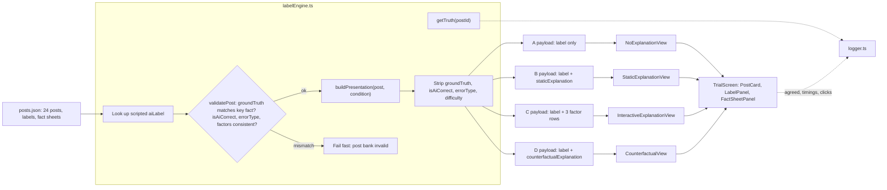
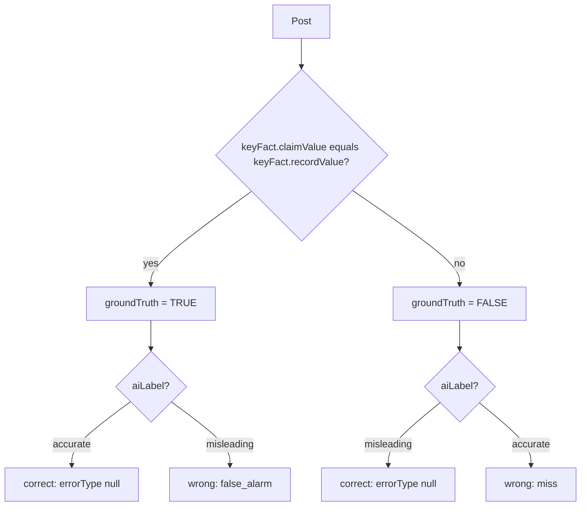
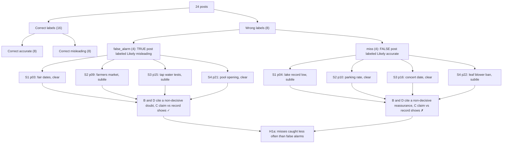

# AI Design: The Wizard-of-Oz Labeller

This doc (v3) covers the "AI" in the study app: where the accuracy labels come from, how each label is turned into the four explanation conditions (A, B, C, D), how the wrong labels are planted, and how the illusion stays the same across conditions. Participants read made-up social media posts from the fictional town of Riverton. Each post carries an AI label, **"Likely accurate"** (✓) or **"Likely misleading"** (⚠), and the participant clicks **Agree with label** or **Disagree with label**. **There is no language model and no machine-learning model.** Every label and every explanation is written by hand in the post bank (`src/data/posts.json`). The labeller (`src/engine/labelEngine.ts`) looks up the scripted label and presents it as if an AI had produced it. Code compares the post's claim with the fact sheet's key fact only to check the ground truth. That comparison never decides what the AI says. This doc is for post authors (who write labels and explanations), the condition owners (A, B, C and D views), and whoever writes the debrief. `_shared-decisions.md` is binding where this doc and it differ, and `stimuli.md` holds all the final participant-facing strings.

The previous design (v2.1, approving an AI agent's actions) is archived at [archive/v2.1-agent-permission/ai-design.md](archive/v2.1-agent-permission/ai-design.md).

---

## 1. Why Wizard-of-Oz

The study asks whether explanations help people catch wrong labels, whether that differs for false alarms and misses, and how the labels make people feel (H1–H6). To answer that, the team has to control exactly **which** labels are wrong, **how** they're wrong, and **how** they're justified. A real classifier or LLM can't give that control: its errors, wording and confidence change from run to run.

- **Control over errors.** With scripted labels, every wrong label contradicts the post's own fact sheet, so the participant can check it. That is what makes "agreed with a wrong label" a clean commission error in the sense of Skitka et al. [26]. Bussone et al. [4] used the same approach: a Wizard-of-Oz clinical decision support prototype with planted errors. They found that fuller explanations raised trust and also raised agreement with wrong diagnoses.
- **Matched stimuli.** The same post can be shown in A, B, C or D with an identical post card, label and fact sheet. Only the explanation layer changes, which is what the within-subjects comparison needs (literature §8).
- **Matched explanation text.** A live LLM would write a different rationale for each participant, with different length and confidence. Scripted text lets the team match length and tone across right and wrong labels (§4), which H2 and H3a depend on.
- **Implementation effort.** The proposal puts the effort into interface polish and study infrastructure, not model building. The app stays a static site with no API keys.

**Trade-off: ecological validity.** Real labelling errors are rarely this checkable. A real post's accuracy may hinge on context nobody has, or on a record that doesn't exist. Here every post has one fact sheet with one key fact, so the results should be read as a **best case for error detection** (literature §8). If people miss these errors with the facts one click away, they will very likely miss harder ones. Section 9 lists other limits.

---

## 2. "AI" pipeline

The labeller has three internal steps: a **label lookup** (the scripted `aiLabel`), a **validator** (`validatePost`, which checks `groundTruth` against the fact sheet's key fact at load time), and a **payload builder** (`buildPresentation(post, condition)`, which builds an allow-listed payload for each condition). Correctness fields (`groundTruth`, `isAiCorrect`, `errorType`, `difficulty`) never reach the view; they're stripped when the payload is built. Only `logger` calls `getTruth(postId)`, so trial records can carry correctness without the view ever seeing it (see `data-model.md`).



Notes:
- `validatePost` runs once when the post bank loads (and in a Vitest unit test). It is **not** part of producing a label. If any check fails, the app refuses to start, so a typo can't turn a correct label into a wrong one.
- Every payload carries the same post fields (author, text, `postedAgo`, likes, reposts) and the same label. Only the explanation fields differ. `FactSheetPanel` shows the same fact sheet in every condition, opened from "Fact sheet ▸", and never mentions the label.
- **Fixed latency.** After the post appears, `LabelPanel` shows **"AI is checking…" for a fixed ~800 ms** in every condition and on every post, then the label. `decisionTimeMs` starts when the label appears.
- **No confidence.** No AI confidence score, percentage or "high confidence" badge is ever shown (see §7).

---

## 3. Ground truth and validation

A post is TRUE when its key claim matches the fact sheet's key fact, and FALSE otherwise. Authors write `keyFact.recordValue` as the exact string `keyFact.claimValue` when the record supports the claim, and as the record's actual value when it doesn't. The label is then compared with the truth to classify it.



### TypeScript sketch (`src/engine/labelEngine.ts`)

`data-model.md` is the authority on field names and types; this sketch follows it.

```ts
export type Condition = "A" | "B" | "C" | "D";
export type Truth = "TRUE" | "FALSE";
export type AiLabel = "accurate" | "misleading";
export type ErrorType = null | "false_alarm" | "miss";
export type FactorKey = "source" | "claimVsRecord" | "wording";

export interface Factor {
  key: FactorKey;
  label: string;          // "Source" | "Claim vs record" | "Wording"
  displayValue: string;   // TRUE value, e.g. "Post: record low · Record: lowest since 2019; record low was 2012"
  passes: boolean;        // TRUE comparison, shown as ✓ / ✗
  detail: string;         // one sentence, argues for the AI's label
}

/** Ground truth only. Never used to choose the label. */
export function truthFromKeyFact(p: Post): Truth {
  return p.keyFact.claimValue === p.keyFact.recordValue ? "TRUE" : "FALSE";
}

/** Runs once at load. Throws so a broken post bank can't reach a participant. */
export function validatePost(p: Post): void {
  const truth = truthFromKeyFact(p);
  if (truth !== p.groundTruth) throw new Error(`${p.id}: groundTruth mismatch`);
  if (!p.factSheet.body.includes(p.keyFact.recordValue))
    throw new Error(`${p.id}: key fact missing from fact sheet body`);
  const correct = (p.aiLabel === "accurate") === (truth === "TRUE");
  if (correct !== p.isAiCorrect) throw new Error(`${p.id}: isAiCorrect mismatch`);
  const expectedErr: ErrorType = correct ? null
    : p.aiLabel === "misleading" ? "false_alarm" : "miss";
  if (p.errorType !== expectedErr) throw new Error(`${p.id}: errorType mismatch`);
  if ((p.difficulty === null) !== correct) throw new Error(`${p.id}: difficulty must be set only on wrong labels`);
  const keys = p.factors.map(f => f.key).join(",");
  if (keys !== "source,claimVsRecord,wording") throw new Error(`${p.id}: expected 3 factors in fixed order`);
  const cvr = p.factors[1];
  if (cvr.passes !== (truth === "TRUE")) throw new Error(`${p.id}: Claim vs record row must show the true comparison`);
}

/** What a view receives. Built from an allow-list, no correctness fields. */
export function buildPresentation(p: Post, condition: Condition): PresentationPayload {
  const base = {
    postId: p.id, condition,
    author: p.author, text: p.text, postedAgo: p.postedAgo,
    likes: p.likes, reposts: p.reposts,
    factSheet: p.factSheet, aiLabel: p.aiLabel,
  };
  switch (condition) {
    case "A": return base;
    case "B": return { ...base, staticExplanation: p.staticExplanation };
    case "C": return { ...base, factors: p.factors.map(({ key, label, displayValue, passes, detail }) =>
                         ({ key, label, displayValue, passes, detail })) };
    case "D": return { ...base, counterfactualExplanation: p.counterfactualExplanation };
  }
}

/** Called only by logger.ts. */
export function getTruth(postId: string): Pick<Post, "groundTruth" | "isAiCorrect" | "errorType" | "difficulty">;
```

`buildPresentation` names every field it copies. It never spreads the whole `Post`, so a new correctness field can't leak into the view by accident.

---

## 4. Explanation design

### 4.1 Rules for every condition

| Rule | Specification |
|---|---|
| Direction | B, C-detail and D text **always argue for the AI's label**, right or wrong. |
| Tone | The **same confident register** on correct and wrong labels. No hedges ("may", "might", "probably") anywhere, so a hedge can't give a wrong label away. |
| Wrong labels | B and D cite a **plausible but non-decisive factor** (the account type, the topic's reputation, a missing citation). They never mention the key fact that decides the post. |
| Confidence | None shown, in any condition. |
| Vocabulary | Plain words a participant can map onto the post card and fact sheet: account, verified, record, report, official page. |
| Strings | **`stimuli.md` holds all final strings** and is the authority. This doc quotes it; if they ever differ, `stimuli.md` wins and this doc is corrected. |

### 4.2 Condition A: No explanation

The label only: ✓ "Likely accurate" or ⚠ "Likely misleading", in identical styling. It is the baseline for agreement, trust, tension and detection.

### 4.3 Condition B: Static reason

One `staticExplanation` sentence under the label.

| Rule | Specification |
|---|---|
| Length | One sentence, **8–14 words**, every post within ±3 words of the median. |
| Frame | Opens "Flagged:" for "Likely misleading" and "Checked:" for "Likely accurate". |
| Selectivity | Names a reason, not the key value or the record, following Miller's "selective" property [22]. |

### 4.4 Condition C: Interactive "Why?"

A "Why?" button opens exactly three rows in a fixed order. Each row has a ✓/✗ icon plus a text label (not colour alone) and expands on its own to one `detail` sentence. Every open, expand and collapse is logged (`explanationOpened`, `factorsExpanded[]`, `timeToFirstExpandMs` from the first "Why?" open).

| Row | Value shown | ✓ when | Decides the truth? |
|---|---|---|---|
| Source | the account and whether it has the verified badge | verified local source | No |
| Claim vs record | the post's key value next to the fact-sheet value | the two match | **Yes** |
| Wording | neutral or sensational | neutral | No |

Only "Claim vs record" decides the ground truth. Source and Wording are real, honestly reported cues that can point the wrong way, so a ✗ on Source doesn't by itself mean the post is false. That keeps C from being a give-away: the participant still has to know which row matters. Like B, every `detail` sentence argues for the AI's label, but the row header's values and ✓/✗ always come from the true comparison.

### 4.5 Condition D: Counterfactual

One `counterfactualExplanation` sentence: "This would be labeled accurate if …" under a "Likely misleading" label, and "This would be labeled misleading if …" under a "Likely accurate" label.

| Rule | Specification |
|---|---|
| Length | **10–16 words**, every post within ±3 words of the D median. |
| Content | Points at the same factor as the post's B sentence, so B vs D differs in form (reason vs counterfactual), not content. |
| Correct labels | Names the change that would actually flip the truth (the decisive record). |
| Wrong labels | Names a change to a non-decisive factor, so the sentence sounds like a precise statement about the decision boundary while pointing at the wrong boundary. |

### 4.6 Canonical examples

The B, D and C `displayValue` strings for these three posts are quoted exactly from `stimuli.md`. The other 21 posts follow the same pattern and live there.

| Post | Truth / label | Type | B (static) | D (counterfactual) | C "Claim vs record" row | Why B and D mislead |
|---|---|---|---|---|---|---|
| p03 | TRUE / misleading | false_alarm, clear | "Flagged: event dates shared by personal accounts are often outdated." | "This would be labeled accurate if an official events page had posted it." | "Post: June 6–8, Mill Park · Record: June 6–8, Mill Park" · ✓ | Cites the account type; the dates match the record |
| p04 | FALSE / accurate | miss, subtle | "Checked: water level reports from this account are usually reliable." | "This would be labeled misleading if the account weren't a verified local source." | "Post: record low · Record: lowest since 2019; record low was 2012" · ✗ | Cites the account's track record; the "record low" is not a record |
| p15 | TRUE / misleading | false_alarm, subtle | "Flagged: claims about water safety are often exaggerated." | "This would be labeled accurate if it cited the March test report." | "Post: all 12 limits met in March · Record: all 12 tests within limits" · ✓ | Cites the topic's reputation and a missing citation; the record agrees |

### 4.7 Design decision for the team to confirm: C shows true values

> **Decision:** In Condition C, does the "Claim vs record" row show the **true** comparison, or one scripted to agree with a wrong label?
>
> **Recommendation: true values.** Reasons:
> 1. H2 predicts the best detection in C *because* C offers a verifiable claim-vs-record row. Vasconcelos et al. [28] found that explanations reduce overreliance when they make checking the AI much cheaper than doing the task alone. A row that puts the claim next to the record next to ✓/✗ is about as cheap as verification gets. If the row agreed with the wrong label, C would just be a longer, more convincing B [16][25], and H2 would test a different question.
> 2. The fact sheet already shows the true record in every condition. A row that contradicted it would read as a bug, not as AI behaviour.
> 3. `validatePost` (§3) enforces that the row's `passes` equals the true comparison, so this can't drift silently.
> 4. Attribution displays such as SHAP [21] report a system's actual inputs; they don't misstate them.
>
> The cost is that C may look "obviously" best at catching errors. That's a known best-case limitation (§1), to be stated in the report. A participant who never opens "Why?" gets no benefit, which is why `explanationOpened` is logged and H6 tests whether opening predicts detection. The Source and Wording rows (§4.4) also keep C from being a pure answer key.

---

## 5. Explanation-depth model

How each condition maps onto the competing predictions in the literature and onto the hypotheses:

```mermaid
flowchart LR
    A["A: No explanation, label only"]
    B["B: Static reason, one sentence"]
    C["C: Interactive Why?, 3 checkable rows"]
    D["D: Counterfactual, would be ... if ..."]

    P1["Placebic persuasion: a reason raises agreement whatever its content [1][11]"]
    P2["Information overload, illusion of understanding [25]"]
    P3["Cheap verification, cognitive forcing [3][28]"]
    P4["Counterfactuals: contrastive and actionable (Wachter et al. 2017), may sound precise when wrong"]

    P1 -. "raises agreement, incl. wrong labels" .-> B
    P1 -. "raises agreement" .-> D
    P2 -. "predicts worse detection" .-> C
    P3 -. "predicts better detection" .-> C
    P4 -. "could help or mislead" .-> D

    A --> H1["H1: detection differs by condition"]
    B --> H1
    C --> H1
    D --> H1
    A --> H1a["H1a: misses caught less than false alarms"]
    C --> H1b["H1b: miss vs false-alarm gap smallest in C"]
    C --> H2["H2: detection highest in C, lowest in B, D exploratory"]
    B --> H2
    D --> H2
    A --> H3["H3: tension and frustration rise with wrong labels noticed"]
    B --> H3a["H3a: B and D lower tension even on wrong labels"]
    D --> H3a
    C --> H3b["H3b: C raises tension when a ✗ row is visible"]
    B --> H4["H4: agreement and trust higher in B, C, D than A"]
    C --> H4
    D --> H4
    C --> H5["H5: fairness highest in C and D, lowest in A"]
    D --> H5
    C --> H6["H6: longest decisions in C and D, clicks predict detection"]
    D --> H6
```



| Condition | What changes | Main prediction | Hypotheses |
|---|---|---|---|
| A | Baseline, no justification | Lowest agreement and trust. Wrong labels are caught only by opening the fact sheet unaided. Fairness lowest. | H1, H1a, H3, H4 (lowest), H5 (lowest) |
| B | A selective, confident reason | A placebic "because" [1][11]: more agreement whether the label is right or wrong, the lowest detection, and less tension even on wrong labels. | H1, H2 (lowest), H3a, H4 |
| C | On-demand rows with the true claim vs record | Two competing outcomes: cheap verification and mild forcing [3][28] raise detection, or overload [25] lowers it. A visible ✗ may raise tension. Seeing each check should raise fairness. | H1, H1b, H2 (highest), H3b, H4, H5, H6 |
| D | A "would be … if …" sentence | Exploratory. Counterfactuals are contrastive and seem actionable (Wachter et al. 2017; Miller [22]), which could prompt a check, or lend more authority to a wrong label because they sound like a precise boundary. | H1, H2 (exploratory), H3a, H4, H5, H6 |

**LLM-era framing.** Langer's placebic "because" [18] and Eiband et al.'s placebic explanations [11] predate language models, but generative AI makes the effect sharper: an LLM writes a fluent rationale for every label at no cost, whether or not the label is sound. Si et al., NAACL 2024, found that LLM explanations help people verify claims when the model is right but lead them to accept convincingly wrong answers. Kim et al., CHI 2025, found that how an LLM phrases its answers (for example, expressing uncertainty) shifts how much people rely on it. Conditions B and D are controlled stand-ins for this fluent self-justification. (Si et al. 2024, Kim et al. 2025, Wachter et al. 2017 and Hart and Staveland 1988 are not yet in `literature.txt`; add them to the report's reference list.)

---

## 6. Error injection

### 6.1 Allocation

- **8 wrong of 24** (33%). That gives each condition two wrong-label trials, while the AI still looks mostly reliable (16/24 correct).
- **Per set (S1–S4):** 6 posts = 2 correct "accurate" + 2 correct "misleading" + **1 false alarm + 1 miss**. Through the set rotation, each condition gets one of each error type, which is what H1a and H1b need.
- **Clear vs subtle:** each set has one `clear` and one `subtle` wrong label, and each error type has 2 of each (fully crossed, §6.2). `difficulty` is stored per post as a covariate.
- **Base rates give nothing away:** 12 "accurate" and 12 "misleading" labels, 12 TRUE and 12 FALSE posts.
- **Correct "misleading" labels also exist** (2 per set), so a "Likely misleading" label doesn't by itself suggest the AI is wrong.
- Where the wrong labels fall within a block is handled by `counterbalance.ts`: the 2 wrong labels are never both in positions 1–2 (see `system-design.md`).

### 6.2 Error taxonomy

The two error types are the signal-detection pair:

- **`false_alarm`**: a TRUE post labelled "Likely misleading". If the participant agrees, accurate information is discredited.
- **`miss`**: a FALSE post labelled "Likely accurate". If the participant agrees, misinformation gets an endorsement.



Each set pairs one clear and one subtle wrong label (S1: p03 clear, p04 subtle; S2: p10 clear, p09 subtle; S3: p16 clear, p15 subtle; S4: p21 clear, p22 subtle). Error type and difficulty are fully crossed: false alarms p03, p21 clear and p09, p15 subtle; misses p10, p16 clear and p04, p22 subtle. So H1a isn't confounded with difficulty, and `difficulty` stays in the model as a covariate. Every analysis of detection (H1, H2, H6) is reported **separately by `errorType`** as well as pooled, because pooling could hide opposite effects; for example, B might lower detection of misses while leaving false alarms unchanged.

### 6.3 Why misses are expected to be caught less (H1a)

The two labels create different amounts of friction.

- **"Likely accurate" invites no scrutiny.** It confirms what the post already says, so the easy path is to click "Agree with label" and move on. Nothing prompts the participant to open the fact sheet. This is the classic commission error: people follow an automated cue that agrees with the surface of the information instead of checking it [26], and automation bias grows when checking takes effort [23][24].
- **"Likely misleading" interrupts.** A warning on a post that reads as ordinary local news is a surprise, and a surprise invites a look at the fact sheet. On a false alarm, the participant finds the record agrees with the post.
- **B and D widen the gap.** A reassuring reason ("Checked: water level reports from this account are usually reliable.") gives a second reason not to look, which is why H3a predicts lower tension in B and D even on wrong labels: less stressful, but more believable.
- **C should narrow it (H1b).** The "Claim vs record" row puts the ✗ on screen for a miss without a separate trip to the fact sheet, so the participant's check costs one click.

---

## 7. Wizard consistency

The illusion has to look the same in every condition, so the only thing that varies is the explanation.

| Element | Specification | Reason |
|---|---|---|
| Labeller identity | "AI label", with the same icon, panel and styling in A, B, C and D | One AI across conditions. Participants compare explanations, not systems. |
| AI confidence | **Not shown** in any condition | Zhang et al. [29] found confidence scores affect trust calibration, and Bansal et al. [1] found explanations added little beyond confidence. Showing it would add a cue that competes with the explanation. |
| Latency | Fixed **~800 ms "AI is checking…"** before every label | Stops C or wrong labels from seeming to "think harder". `decisionTimeMs` starts when the label appears. |
| Label wording | Always exactly ✓ "Likely accurate" or ⚠ "Likely misleading" | No tone differences between correct and wrong labels. |
| Fact sheet | Identical across conditions, opened from "Fact sheet ▸", never mentions the label | The same evidence is equally available everywhere, so detection differences come from the explanation. |
| Instructions | The AI is introduced as a tool that labels posts as likely accurate or misleading. Participants are told it is usually but not always right and that the fact sheet is the standard. | Gives a reason to verify without saying how often the AI is wrong. |

Don't confuse the participant's own `confidence` rating (1–7, asked after every post) with AI confidence. The rating is collected after the decision and is never shown as an AI output.

---

## 8. Affect: why tension and frustration (H3)

v3 adds two per-block affect measures because a wrong label is not only a reliability event; it's an unpleasant one. Noticing that the AI contradicts the record forces the participant to overrule it and to doubt the labels they already agreed with.

- **`tension` (1–7):** "How tense did you feel while judging the posts in this part?" A single item, cheap enough to ask every block.
- **`frustrationTlx` (0–100, steps of 5):** the frustration subscale of the NASA Task Load Index (Hart and Staveland 1988, "Development of NASA-TLX: Results of empirical and theoretical research", Advances in Psychology 52). The slider starts at 50 and must be moved (`frustrationTlxTouched`), so an untouched default isn't read as a rating.

Predictions:
- **H3:** both rise with `nWrongDetected` in the block. A label error that goes unnoticed causes no tension, which is why the count of *noticed* errors is the predictor.
- **H3a:** B and D lower tension even on wrong labels. A confident reason settles doubt whether or not the doubt was justified. That is the risk for real platforms: an explanation that makes labelling feel less stressful can also make wrong labels more believable.
- **H3b (exploratory):** C raises tension when a ✗ row is visible, because the participant sees the AI's own breakdown contradict its label.

An optional anxiety scale and a consequence banner ("Posts you agree are accurate stay visible to other users") are listed in `_shared-decisions.md` as off by default.

---

## 9. Ethics and debrief

- **Fictional misinformation only.** Every person, account, place, agency and record is fictional (Riverton, Alder County). No real brands. The false posts are deliberately mundane (event dates, fees, closures, rankings), and **no post makes a health-risk claim** that could be harmful if believed. No post touches health care. The water-safety post (p15) is TRUE and reassuring, and the one fee post that is a miss (p10) is about downtown parking rates.
- **Deception is limited and disclosed.** The consent form says the study evaluates "an AI labelling interface". It doesn't say the labels are scripted, because that would defeat the purpose. Ethics approval is needed for the deception and the stress measures (`_shared-decisions.md`).
- **Debrief (on `DebriefScreen` and verbally by the moderator):** participants are told that (1) there was no real AI and every label and explanation was written by the research team, (2) 8 of the 24 labels were **deliberately wrong**, (3) **for every wrong label they saw, the screen shows the post, the wrong label and the real fact** from the fact sheet, so no false belief leaves the session, (4) agreeing with a wrong AI label is common and well documented [24][26] and doesn't reflect on them, and (5) all posts, people and places were made up.
- Participants may withdraw their data after the debrief. The moderator can delete the session from `/admin` (see `system-design.md`).
- **Limitation to report:** every error is checkable against one fact sheet, so the detection rates are a best case (§1, literature §8).

---

## Related docs

- [architecture.md](architecture.md)
- [system-design.md](system-design.md)
- [sequence-diagrams.md](sequence-diagrams.md)
- [data-model.md](data-model.md)
- [ai-design.md](ai-design.md)
- [research-positioning.md](research-positioning.md)
- [implementation-plan.md](implementation-plan.md)
- [study-protocol.md](study-protocol.md)
- [stimuli.md](stimuli.md)
- [wireframes.md](wireframes.md)
