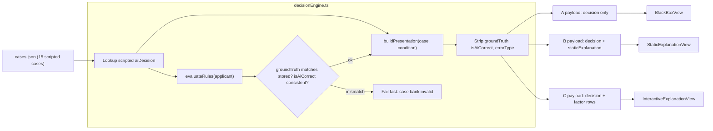
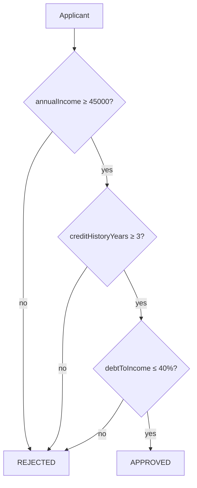
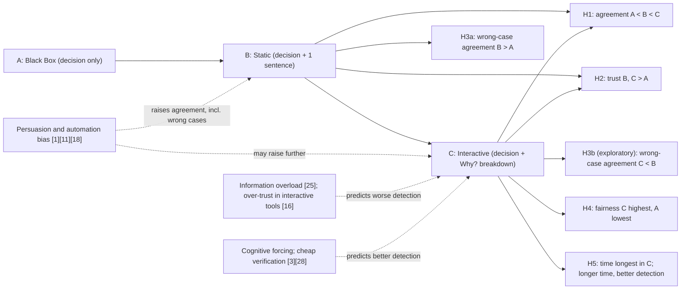
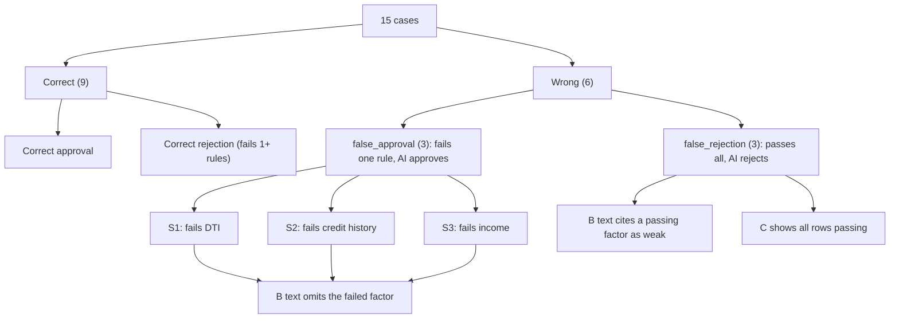

# AI Design: The Wizard-of-Oz Decision Engine

This doc covers the "AI" in the study app: where its decisions come from, how they're turned into the three explanation conditions, how the wrong decisions are planted, and how the illusion stays consistent across conditions. **There is no machine-learning model.** Every AI decision is written by hand in the case bank (`src/data/cases.json`). The engine (`src/engine/decisionEngine.ts`) looks up the scripted decision and presents it as if a model had produced it. The lending rules are evaluated in code only to compute and check the ground truth. They never decide what the "AI" says. This doc is the reference for case authors (who write decisions and explanations), the condition owners (A, B, C views), and whoever writes the debrief.

---

## 1. Why Wizard-of-Oz

The study asks whether explanation depth helps people catch AI mistakes or just makes them agree more (H3a/H3b). To answer that, the team has to control exactly **which** decisions are wrong, **how** they're wrong, and **how** they're justified. A real model can't give that control:

- **Control over errors.** With scripted decisions, every wrong case contradicts the applicant's own on-screen numbers, so it can be checked against the stated rules. That's what makes "agreed with a wrong decision" a clean commission error in the sense of Skitka et al. [26]. Bussone et al. [4] used the same approach: a Wizard-of-Oz clinical decision support prototype with planted errors. They found that fuller explanations raised trust and also raised agreement with incorrect diagnoses.
- **Matched stimuli.** The same case can be shown in A, B, or C with identical numbers and an identical decision. Only the explanation layer changes, which is what the within-subjects comparison needs (literature §8).
- **Implementation effort.** The proposal puts the effort into interface polish and study infrastructure, not model training.

**Trade-off: ecological validity.** Real AI errors are rarely this clear-cut. A real lending model's mistakes are often near a boundary, or depend on features the user can't see. Our errors are single, visible rule violations, so the results should be read as a **best case for error detection** (literature §8). If people miss these errors, they'll very likely miss subtler ones too. Section 8 lists other limits.

---

## 2. "AI" pipeline

The engine has three internal steps: a **decision lookup** (the scripted `aiDecision`), a **rule evaluator** (computes `groundTruth` for validation only), and an **explanation builder** (assembles the payload for each condition). Correctness metadata (`groundTruth`, `isAiCorrect`, `errorType`) never reaches the view. It's stripped when the payload is built. Analysis gets correctness by joining trial records to the case bank on `caseId` at export time (see `data-model.md`).



Notes:
- The rule evaluator runs at case-bank load time (and in a unit test). It is **not** part of producing the decision. If it disagrees with a stored `groundTruth`, or a stored `isAiCorrect` doesn't equal `aiDecision === groundTruth`, the app refuses to start. That protects the study from a typo turning a "correct" case into a wrong one.
- All three payloads carry the same `applicant` object and `decision`. Only the explanation fields differ.
- The C payload's factor rows are taken from the case bank's `factors[]`, and their `passes` values are checked against the rule evaluator (see §4.3).

---

## 3. Rule evaluator

The rules are the "stated criteria" from `_shared-decisions.md`. They're shown on the instructions screen and are available on every trial.



### TypeScript sketch (`src/engine/decisionEngine.ts`)

Field names follow `_shared-decisions.md`. `debtToIncome` is shown here as a percentage number (38 means 38%). `data-model.md` is authoritative on units.

```ts
export type Decision = "APPROVED" | "REJECTED";
export type Condition = "A" | "B" | "C";

export const RULES = {
  minIncome: 45_000,
  minHistoryYears: 3,
  maxDti: 40,
} as const;

export interface RuleResult {
  decision: Decision;
  checks: { income: boolean; history: boolean; dti: boolean };
}

/** Ground truth only. Never used to choose what the "AI" says. */
export function evaluateRules(a: Applicant): RuleResult {
  const checks = {
    income: a.annualIncome >= RULES.minIncome,
    history: a.creditHistoryYears >= RULES.minHistoryYears,
    dti: a.debtToIncome <= RULES.maxDti,
  };
  const ok = checks.income && checks.history && checks.dti;
  return { decision: ok ? "APPROVED" : "REJECTED", checks };
}

/** Runs once at load. Throws so a broken case bank can't reach a participant. */
export function validateCase(c: Case): void {
  const truth = evaluateRules(c.applicant);
  if (truth.decision !== c.groundTruth) throw new Error(`${c.id}: groundTruth mismatch`);
  if ((c.aiDecision === c.groundTruth) !== c.isAiCorrect) throw new Error(`${c.id}: isAiCorrect mismatch`);
  const expectedErr = c.isAiCorrect ? null
    : c.aiDecision === "APPROVED" ? "false_approval" : "false_rejection";
  if (c.errorType !== expectedErr) throw new Error(`${c.id}: errorType mismatch`);
  for (const f of c.factors) {
    const key = f.key as keyof RuleResult["checks"];
    if (f.passes !== truth.checks[key]) throw new Error(`${c.id}: factor ${f.key} passes ≠ true value`);
  }
}

export interface FactorRow {
  key: string; label: string;
  applicantValue: string; threshold: string;
  passes: boolean; weight?: number; detail?: string;
}

/** What a view receives. No correctness fields. */
export interface PresentationPayload {
  caseId: string;
  condition: Condition;
  persona: "LendAssist AI";
  applicant: Applicant;
  decision: Decision;
  staticExplanation?: string;   // B only
  factors?: FactorRow[];        // C only
}

export function buildPresentation(c: Case, condition: Condition): PresentationPayload {
  const base = {
    caseId: c.id, condition, persona: "LendAssist AI" as const,
    applicant: c.applicant, decision: c.aiDecision,
  };
  switch (condition) {
    case "A": return base;
    case "B": return { ...base, staticExplanation: c.staticExplanation };
    case "C": return { ...base, factors: c.factors.map(toFactorRow) };
  }
}

function toFactorRow(f: Factor): FactorRow {
  const { key, label, applicantValue, threshold, passes, weight, detail } = f;
  return { key, label, applicantValue: String(applicantValue), threshold: String(threshold), passes, weight, detail };
}
```

`buildPresentation` builds the payload from an explicit list of fields. It never spreads the whole `Case` object, so new correctness fields can't leak into the view by accident.

---

## 4. Explanation design

### 4.1 Static explanations (Condition B)

One `staticExplanation` string per case, written to these guidelines:

| Guideline | Rule |
|---|---|
| Length | One sentence. Matched in length across all 15 cases (target 8–12 words, every case within ±3 words of the median). |
| Content | Starts with the decision, then names 1–2 factors: `"<Decision>: <factor phrase>[ and <factor phrase>]."` |
| Selectivity | Names factors but no thresholds or exact numbers, like the proposal's example and Miller's "selective" property [22]. |
| Tone | Same confident, neutral register in correct and wrong cases. No hedges ("may", "likely") anywhere, so a hedge can't give away a wrong case. |
| Vocabulary | Uses the factor labels from the rules (income, credit history, debt-to-income ratio) so participants can map the text onto the card. |

Examples (correct cases):
- Correct approval: "Approved: income and debt-to-income ratio are within lending criteria."
- Correct rejection: "Rejected: credit history is too short for this loan."

### 4.2 Factor breakdown (Condition C)

The "Why?" button opens a panel with one row per rule, in a fixed order (income, credit history, DTI):

| Column | Content | Example |
|---|---|---|
| Label | Factor name | Debt-to-income ratio |
| Applicant value | The applicant's true value, same as on the applicant card | 46% |
| Threshold | Rule threshold with comparator | ≤ 40% |
| Pass/fail icon | ✓ or ✗ from the **true** comparison, plus a text label for accessibility | ✗ Fails |
| Weight bar (optional) | Relative importance bar | (see note) |

Each row can be expanded on its own (the `detail` text). Every expand and collapse is logged (`factorsExpanded[]`, `timeToFirstExpandMs`).

**Weight bar recommendation:** leave it out of v1, or show equal weights. The rules are conjunctive (all three must pass), so different weights would make up a model property that doesn't exist. Scripted weights that favour the AI's decision would also add a second persuasion channel that only C has, which confounds the A/B/C comparison. The `weight` field stays in the schema so the team can add the bar later.

### 4.3 How wrong-case explanations are written

Wrong cases have to stand in for a real system defending a wrong output. The explanation **supports the wrong decision and sounds plausible**, but every claim can be checked against the numbers on screen.

| Error type | B: static sentence | C: factor breakdown |
|---|---|---|
| `false_approval` (fails one rule, AI approves) | Names the 1–2 factors that **do** pass and leaves out the one that fails. Example: income $72,000, history 6 yrs, DTI 46% gives "Approved: strong income and established credit history." | Shows true values. The DTI row shows 46% vs ≤ 40% with ✗, right under an "Approved" decision. |
| `false_rejection` (passes all rules, AI rejects) | Cites a factor that actually passes, framed as a weakness. Example: DTI 31% gives "Rejected: debt-to-income ratio is too high for this loan." | Shows true values. All three rows are ✓ under a "Rejected" decision. |

The B sentence still contains no numbers, so its only "lie" is in what it selects or how it frames a factor. That mirrors the placebic-explanation effect [11][18]: the sentence sounds justified whether or not it's true. That's the mechanism H3a predicts will raise agreement with wrong decisions in B compared with A.

**Why C shows true values.** In C the breakdown is computed from the applicant's real numbers, so the failed row (or the "all pass but rejected" contradiction) is visible as soon as the participant opens it. This is deliberate. Vasconcelos et al. [28] found that explanations reduce overreliance when they make checking the AI much cheaper than solving the task alone. A breakdown that puts value next to threshold next to pass/fail is about as cheap as verification gets. H3b tests exactly this: does lowering the cost of verification beat the persuasive pull of a more thorough-looking explanation [16][25]? If C's rows were scripted to agree with the wrong decision, C would just be a longer, more convincing B, and H3b would be testing a different question.

### 4.4 Design decision for the team to confirm

> **Decision:** In Condition C, do the pass/fail icons (and values) reflect the **true** applicant data, or the AI's (wrong) decision?
>
> **Recommendation: true values.** Reasons:
> 1. H3b is about verification cost [28]. Only a truthful breakdown makes verification cheap.
> 2. The applicant card already shows the true numbers in every condition. A breakdown that contradicted the card would be an internal inconsistency, and participants would read it as a bug, not as AI behaviour.
> 3. The `validateCase` check (§3) enforces `factor.passes === evaluateRules(...)`, so this can't drift silently.
> 4. Ecologically, feature-attribution displays such as SHAP [21] report the model's actual inputs. They don't misstate them.
>
> The cost is that C may look "obviously" better at catching errors. That's a known best-case limitation (§1), not a flaw, and it should be stated in the report. A participant who never opens "Why?" gets no benefit, which is why `explanationOpened` is logged.

---

## 5. Explanation-depth model

How each level of depth maps onto the competing predictions in the literature and onto the hypotheses:



| Level | What changes | Main prediction | Hypotheses |
|---|---|---|---|
| A | Baseline, no justification | Lowest agreement and trust. Wrong cases can be caught only by checking the card against the rules unaided. | H1, H2, H3a (baseline), H4 (lowest) |
| B | Adds a selective, confident reason | Persuasive cue: more agreement whether the AI is right or wrong [1][11][18] | H1, H2, H3a |
| C | On-demand breakdown, value vs. threshold | Two competing outcomes: cheaper verification and mild forcing [3][28] lower wrong-case agreement, or overload and an illusion of understanding [16][25] raise it | H1, H2, H3b, H4 (informational justice [6]), H5 |

---

## 6. Error injection

### 6.1 Allocation

- **6 wrong of 15** (40%). That's high enough to give each condition enough wrong-case trials, and low enough that the AI still looks mostly reliable (9/15 correct).
- **Per set (S1, S2, S3):** 5 cases = 3 correct + 2 wrong. The 2 wrong cases are **1 `false_approval` + 1 `false_rejection`**, so each set (and so each condition, through the Latin square) gets one of each type.
- **Overall:** 3 false approvals + 3 false rejections.
- **Which rule is violated in a false approval rotates across sets:** S1 fails DTI, S2 fails credit history, S3 fails income. This keeps any single rule from being "the one that's always wrong". Across the counterbalancing cycle, each rule pairs with each condition.
- **Correct cases include correct rejections** that fail a rule. That way a failed rule doesn't, on its own, mean "the AI is wrong", and participants have to compare the decision with the numbers.
- Where the wrong cases fall within a block is handled by `counterbalance.ts` (the 2 wrong cases are never both in the first two positions). See `system-design.md`.

### 6.2 Choosing the violation

| Approach | Description | Use |
|---|---|---|
| **Single clear violation** | A false approval fails exactly **one** rule, by a clear margin (e.g., DTI 52%). A false rejection passes all three rules comfortably. | One wrong case per set (3 of 6) |
| Near-threshold | The deciding value is close to the threshold but not on it (e.g., income $43,500, history 2 yrs). | One wrong case per set (3 of 6), plus near-threshold correct cases, so "close to the line" doesn't signal "wrong". This keeps wrong-case agreement off the ceiling. Difficulty is stored per case (`difficulty`) and used as a covariate, so a near-threshold miss (possibly an arithmetic slip) can be separated from a clear one. |
| Exactly at threshold | Value equals the threshold (e.g., DTI = 40%). | **Correct cases only**, with the rules worded "at least" / "at most". Never in a wrong case, so no wrong case hinges on reading a boundary. |

Sets are matched on difficulty: similar margins, and a similar mix of approved and rejected AI outputs (each set shows the AI saying APPROVED 2–3 times).

### 6.3 Error taxonomy



---

## 7. Wizard consistency

The illusion has to look the same in every condition, so that the only thing that varies is explanation depth.

| Element | Specification | Reason |
|---|---|---|
| Persona | "LendAssist AI", with the same name, neutral icon, and header in A, B and C | One system across conditions. Participants compare explanation styles, not systems. |
| AI confidence | **Not shown** in any condition (no percentage, no "high confidence" label) | Zhang et al. [29] found that confidence scores affect trust calibration, and Bansal et al. [1] found that explanations added little beyond confidence. Showing it would add a second cue that competes with explanation depth. If the team ever wants it, it must be constant across all cases and conditions. |
| Latency | A fixed **~800 ms "LendAssist AI is analyzing..." spinner** before every decision, in every condition and on every case | Stops C (or wrong cases) from seeming to "think harder". `decisionTimeMs` starts when the decision appears, **after** the spinner. |
| Wording | Decision label is always exactly "Approved" or "Rejected", in the same styling | Avoids tone differences between correct and wrong cases |
| Instructions | The AI is introduced as "an AI system that recommends a decision". Participants are told it's usually but not always right, and that the lending rules are the standard. | Gives participants a reason to verify without saying how often the AI is wrong |

Don't confuse the participant's own `confidence` rating (1–7, an optional per-trial measure) with AI confidence. The participant's rating is collected after their decision and isn't shown to them as an AI output.

---

## 8. Ethics and debrief

- **Deception is limited and disclosed.** The consent form says the study evaluates "an AI decision-support interface". It doesn't say the AI is scripted, because saying so would defeat the purpose.
- **Debrief (on `DoneScreen` and verbally by the moderator):** participants are told that (1) there was no real AI and every decision was pre-scripted by the research team, (2) 6 of the 15 decisions were **deliberately wrong** to see whether people would notice, (3) agreeing with a wrong decision is common and well documented [24][26], and doesn't reflect on them, and (4) all applicants were fictional.
- Participants may withdraw their data after the debrief. The moderator can delete the session from `/admin` (see `system-design.md`).
- No real personal or financial data is used. Applicant names and details are invented.
- Limitation to report: the planted errors are clear-cut single-rule violations, so the detection rates are a best case (§1, literature §8).

---

## Related docs

- [architecture.md](architecture.md)
- [system-design.md](system-design.md)
- [sequence-diagrams.md](sequence-diagrams.md)
- [data-model.md](data-model.md)
- [ai-design.md](ai-design.md)
