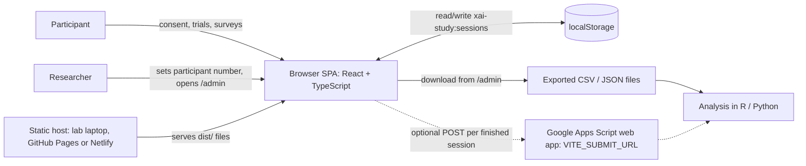
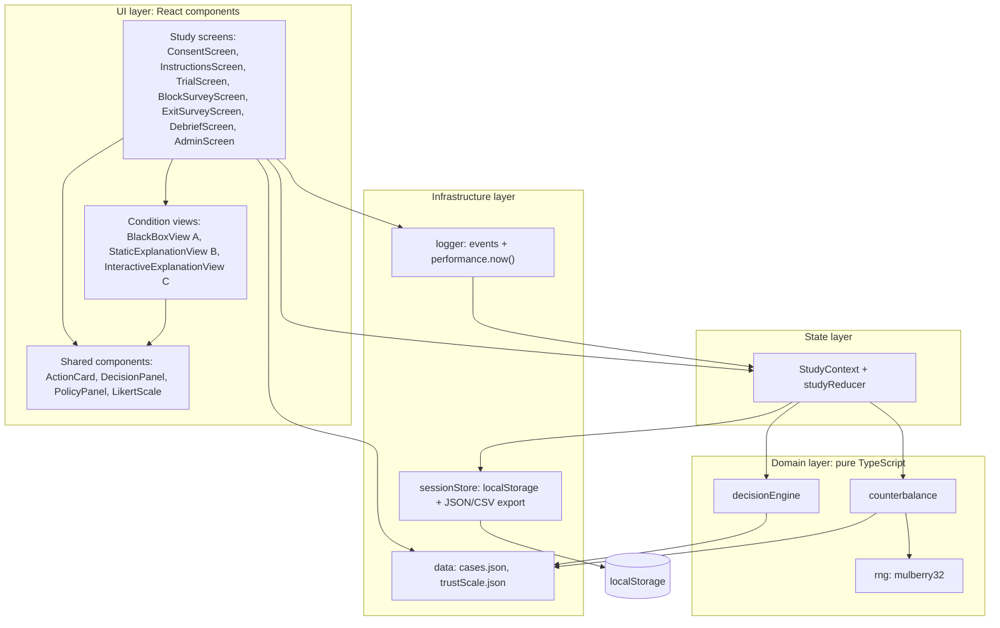
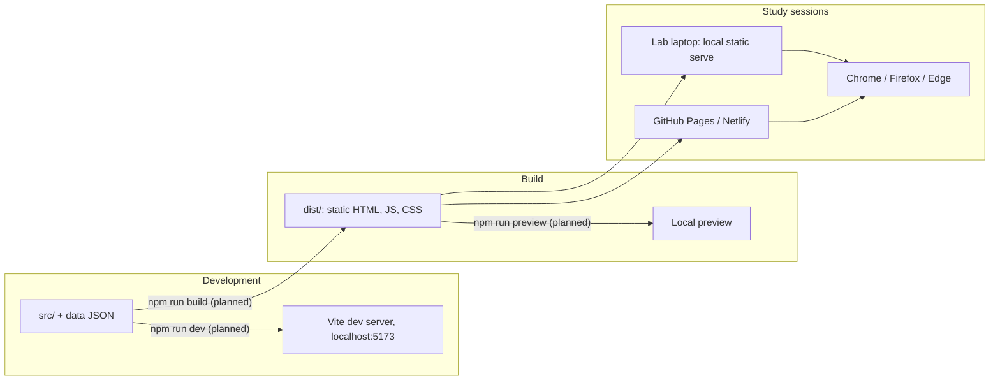

# Architecture

This document describes the planned architecture of the Group 4 (CEN5728) Wizard-of-Oz study app, "Do People Trust AI More When It Explains Itself?". In v2 the study domain is approving actions proposed by a scripted personal AI agent, **TaskPilot**: before each action TaskPilot checks it against the participant's delegation policy and calls ALLOW or BLOCK, and the participant clicks Agree or Override. The architecture is domain-independent, so v2 mainly renames components and data. This doc covers the system context, the layers and modules inside the app, the planned source tree, how the app is run and deployed, and the decisions behind the design. The architecture serves one goal: collect clean, reconstructable data for hypotheses H1–H5 while explanation depth (conditions A, B, C) is the only thing that changes between conditions. No code exists yet; everything here is the plan, and it follows `_shared-decisions.md`.

## 1. System context

The app is a static single-page application (SPA). Once it is loaded, it never talks to a server. Participants use it in a moderated lab session on a desktop or laptop browser. The researcher exports the data afterwards and analyzes it outside the app.



- **Participant**: reviews 15 actions proposed by TaskPilot (3 blocks × 5 trials), clicks Agree or Override on each scripted ALLOW/BLOCK call, and fills in a block survey after each block plus an exit survey at the end.
- **Researcher**: enters the participant number before the session starts, supervises the session, and exports the data from `/admin`.
- **Optional Google Apps Script**: an add-on, not part of the core. Dashed lines mark it as optional. The core flow works without it.

## 2. Layered component architecture

There are four layers, and dependencies only point downward. The domain layer is plain TypeScript with no React, so it can be unit-tested and gives the same output for the same participant number. The condition views get everything they need through props and never read state or storage themselves.



| Module | Responsibility | Depends on |
|---|---|---|
| `study/*Screen.tsx` | Moving between screens (React Router), collecting survey answers, putting together each trial | StudyContext, logger, condition views |
| `conditions/*View.tsx` | Showing one case at one explanation depth; C also reports when factors are expanded or collapsed | Shared components only (props in, callbacks out) |
| `components/` | `ActionCard`, `DecisionPanel`, `PolicyPanel` (delegation policy and trusted contacts) and the Likert input, used everywhere | Nothing app-specific |
| `state/StudyContext.tsx` | One store per session: participant number, assignment (including `styleArm`, the Study 2 flag that defaults to `"fluent"`), current block and trial, responses. The reducer adds trial and survey records | engine, sessionStore |
| `engine/decisionEngine.ts` | Looks up the scripted `aiDecision`, computes `groundTruth` with `evaluatePolicy(request)` from the three delegation-policy rules (cost, trusted recipient, requested by you), and builds the payloads for A, B and C | `data/cases.json` |
| `engine/counterbalance.ts` | Maps a participant number to a condition order (one of the 6 permutations), the set-to-condition rotation (3×3 Latin square), and the shuffled trial order with the wrong-case position constraint | rng, `data/cases.json` |
| `engine/rng.ts` | The mulberry32 PRNG, seeded from the participant number | Nothing |
| `logging/logger.ts` | Timestamps events with `performance.now()`, computes `decisionTimeMs` and `timeToFirstExpandMs`, and records `factorsExpanded[]` | Dispatches into StudyContext |
| `storage/sessionStore.ts` | Reads and writes `xai-study:sessions` after every trial and survey; builds the JSON and CSV exports; optional POST | `localStorage`, `VITE_SUBMIT_URL` |

## 3. Proposed source tree

The module names come from `_shared-decisions.md`. Files marked *(proposed)* are supporting files that this doc suggests.

```text
xai-trust-study/
├── index.html
├── package.json
├── vite.config.ts
├── tsconfig.json
├── .env.example                  # VITE_SUBMIT_URL= (optional)
└── src/
    ├── main.tsx                  # mounts <App/> inside <StudyProvider/>
    ├── App.tsx                   # React Router route table
    ├── types.ts                  # Case, Factor, TrialRecord, Session (proposed)
    ├── data/
    │   ├── cases.json            # 15 cases, sets S1–S3, plus policy and trustedContacts
    │   └── trustScale.json       # Jian et al. 12 items + 2 perceived-control items
    ├── engine/
    │   ├── decisionEngine.ts
    │   ├── counterbalance.ts
    │   ├── rng.ts
    │   └── __tests__/            # unit tests for engine (proposed)
    ├── state/
    │   ├── StudyContext.tsx
    │   └── studyReducer.ts       # (proposed split)
    ├── conditions/
    │   ├── BlackBoxView.tsx              # A
    │   ├── StaticExplanationView.tsx     # B
    │   └── InteractiveExplanationView.tsx # C
    ├── components/
    │   ├── ActionCard.tsx
    │   ├── DecisionPanel.tsx
    │   ├── PolicyPanel.tsx       # (proposed) delegation policy + trusted contacts, on every trial
    │   └── LikertScale.tsx       # (proposed) 7-point item
    ├── study/
    │   ├── ConsentScreen.tsx
    │   ├── InstructionsScreen.tsx
    │   ├── TrialScreen.tsx
    │   ├── BlockSurveyScreen.tsx
    │   ├── ExitSurveyScreen.tsx
    │   ├── DebriefScreen.tsx
    │   └── AdminScreen.tsx
    ├── logging/
    │   └── logger.ts
    └── storage/
        └── sessionStore.ts
```

## 4. Deployment view

All commands below are **planned**. They will be confirmed and copied into `CLAUDE.md` once the code exists.



| Step | Command (planned) | Output |
|---|---|---|
| Install | `npm install` | `node_modules/` |
| Develop | `npm run dev` | Vite dev server with hot reload |
| Build | `npm run build` | Static `dist/` folder |
| Preview / lab run | `npm run preview` | Serves `dist/` locally |
| Test (domain) | `npm test` (Vitest, proposed) | Engine unit tests |

- Every participant session in a run uses the same build of `dist/`, which keeps the stimulus fixed.
- `localStorage` belongs to one browser profile and one origin. The researcher therefore runs every session on the same machine, browser and URL, and exports from `/admin` before clearing any data.

## 5. Key architectural decisions

**ADR-1: Static SPA, no backend.**
*Context:* The proposal asks for a web prototype, and a JSON file is enough as the data source. *Decision:* React 18 + TypeScript + Vite, served as static files. *Consequences:* No server to host, secure, or keep running during sessions, and it works offline on a lab laptop. Data lives in the browser until it is exported (see ADR-4).

**ADR-2: JSON case bank as the single source of stimuli.**
*Context:* The three conditions are built by different team members, but they must show identical cases. *Decision:* One `src/data/cases.json` file. It holds the delegation `policy`, the `trustedContacts` list, and for each case the `request`, the scripted `aiDecision`, the stored `groundTruth`/`isAiCorrect`/`errorType`, and every explanation field (`staticExplanation`, `factors[]`). *Consequences:* The same record drives all conditions. It can be reviewed and version-controlled, and `decisionEngine` recomputes `groundTruth` with `evaluatePolicy(request)` and compares it with the stored value, so a mislabeled wrong case gets caught.

**ADR-3: Seeded PRNG for assignment and ordering.**
*Context:* Condition order, set mapping, and the positions of the wrong cases all have to be counterbalanced and reconstructable afterwards. *Decision:* A mulberry32 PRNG seeded from the participant number. Permutation and Latin-square indices are computed deterministically from `pid`. *Consequences:* Any session can be regenerated exactly from its participant number. The assignment table can be printed ahead of time and checked for balance across each cycle of 18 participants.

**ADR-4: localStorage persistence plus manual export.**
*Context:* There's no database, and a refresh or crash in the middle of a session must not lose any trials. *Decision:* Write the session to `xai-study:sessions` after every trial and every survey. The researcher downloads JSON (complete) and CSV (one row per trial, ready for analysis) from `/admin`. A POST to Apps Script is available as an optional extra. *Consequences:* Persistence is simple and survives crashes. The risk is that clearing browser data before export would lose sessions. To guard against that, the researcher exports after each session.

**ADR-5: Shared components across conditions (internal validity).**
*Context:* Any difference between conditions other than explanation depth (layout, fonts, button placement, how the request is shown) is a confound for H1–H5. *Decision:* All three views use the same `ActionCard`, `DecisionPanel` and `PolicyPanel`, in the same positions. Each view only adds its explanation region: nothing in A, a text block in B, the "Why?" button with its expandable factor list in C. *Consequences:* A difference in agreement, trust, perceived control or decision time can be put down to explanation depth alone. Team members own their view's explanation region, but not the shared frame around it.

**ADR-6: Pure domain layer below React.**
*Decision:* `decisionEngine`, `counterbalance` and `rng` have no React or browser imports. *Consequences:* They can be unit-tested in isolation, and the study's most important logic (assignment, ground truth) can be checked without a UI.

**ADR-7: No live LLM at runtime.**
*Context:* TaskPilot looks like an AI agent, but the study measures how explanation depth changes reliance, so every participant must see the same calls and the same explanation text. *Decision:* TaskPilot is a Wizard-of-Oz script. Its calls, its B text and its factor `detail` text all come from `cases.json`, and no language model is called while the app runs. *Consequences:* Stimuli are identical across participants and conditions, and the planted errors happen exactly where the design puts them. A live LLM would add uncontrolled variance (different wording, different calls, unplanned mistakes), an API cost per session and a network dependency, all of which would confound H1–H5.

## 6. Quality attributes

| Attribute | How the architecture achieves it |
|---|---|
| **Internal validity** | The layout is identical across conditions (ADR-5). All three views read the same case records (ADR-2). Counterbalancing covers condition order, set-to-condition mapping, and wrong-case position. The delegation policy and trusted contacts can be opened on every trial, so participants can check any call. A scripted agent keeps stimuli identical (ADR-7). |
| **Reproducibility** | The assignment comes deterministically from the participant number (ADR-3). Each session record stores `pid`, the condition order, the rotation, and the per-block trial order. The case bank is version-controlled, and every session uses one fixed build. |
| **Data integrity** | The session is persisted after every trial and survey (ADR-4). On reload, the session resumes from where it left off rather than restarting. `groundTruth` is checked with `evaluatePolicy`. The exports come from the same stored records, so the JSON and CSV agree. |
| **Timing accuracy** | `performance.now()` is used rather than `Date.now()`. `decisionTimeMs` runs from the moment the decision panel is first rendered to the Agree/Override click, minus time the tab was hidden (`decisionTimeMs = decisionTimeRawMs - hiddenMs`). `timeToFirstExpandMs` and each factor expand or collapse in C are timestamped by `logger`. |
| **Privacy** | Participants are identified only by an anonymous participant number. Names and contact details are never collected, and the demographics are coarse categories. Every person, email address and vendor in the cases is fictional, using `.example` or `northwind.edu` domains. Data stays on the lab machine unless the optional submit URL is configured. |

## Related docs

- [architecture.md](architecture.md) (this document)
- [system-design.md](system-design.md)
- [sequence-diagrams.md](sequence-diagrams.md)
- [data-model.md](data-model.md)
- [ai-design.md](ai-design.md)
- [research-positioning.md](research-positioning.md)
- [_shared-decisions.md](_shared-decisions.md)
