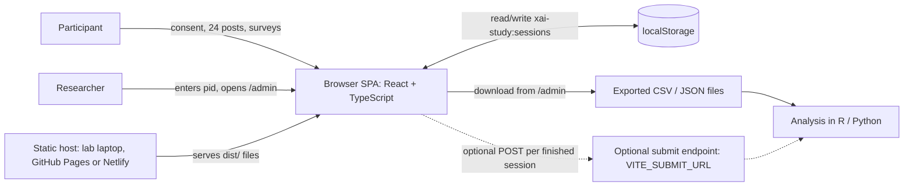
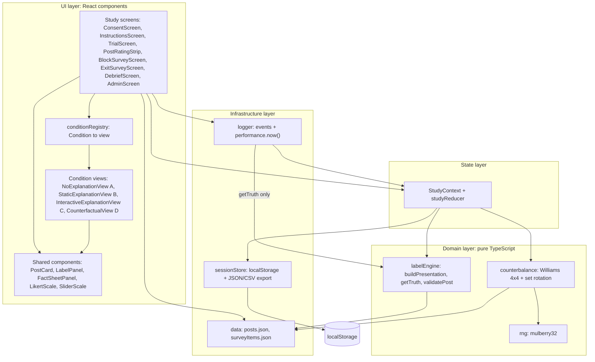
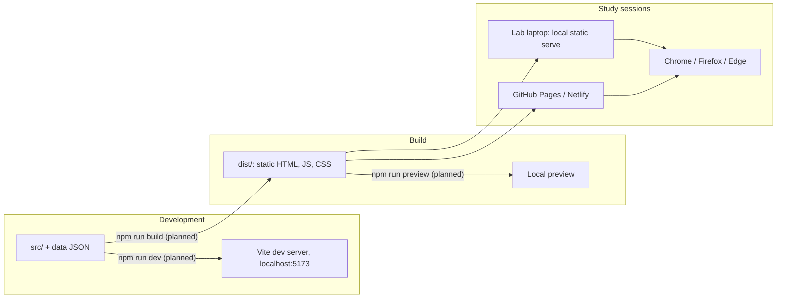

# Architecture

This document describes the planned architecture of the Group 4 (CEN5728) Wizard-of-Oz study app. In v3 the study asks: "When the AI label is wrong, do explanations help people catch it, and how do they make people feel?" Participants read made-up social media posts from the fictional town of Riverton. Each post carries a scripted AI accuracy label ("Likely accurate" ✓ or "Likely misleading" ⚠), and the participant clicks **Agree with label** or **Disagree with label**. A fictional fact sheet that settles each post's truth can be opened on every trial. This doc covers the system context, the layers and modules inside the app, the planned source tree, how the app is run and deployed, the decisions behind the design, and the quality attributes it has to deliver. The architecture has one goal: collect clean, reconstructable data for RQ1–RQ3 and H1–H6 while the explanation (conditions A, B, C, D) is the only thing that changes between conditions. No code exists yet. Everything here is the plan, and it follows [_shared-decisions.md](_shared-decisions.md).

The previous design (v2.1, approving an AI agent's actions) is archived in [archive/v2.1-agent-permission/architecture.md](archive/v2.1-agent-permission/architecture.md).

## 1. System context

The app is a static single-page application (SPA). Once it is loaded, it never talks to a server. Participants use it in a moderated lab session on a desktop or laptop browser. The researcher exports the data afterwards and analyzes it outside the app.



- **Participant**: judges 24 posts (4 blocks × 6 posts, one block per condition) plus 1 practice post. For each post they read the AI label, can open the fact sheet, click Agree or Disagree, and rate their confidence (1–7). After each block they fill in the block survey (Jian trust, fairness, tension, NASA-TLX frustration), and at the end the exit survey. The debrief shows the facts for every wrong label.
- **Researcher**: enters the participant number (pid) before the session starts, supervises the session, and exports the data from `/admin`.
- **Optional submit endpoint**: an add-on, not part of the core. Dashed lines mark it as optional. The core flow works without it, and `localStorage` stays the primary copy.

## 2. Layered component architecture

There are four layers, and dependencies only point downward. The domain layer is plain TypeScript with no React, so it can be unit-tested and gives the same output for the same pid. The condition views get everything they need through props and never read state, storage or ground truth themselves.



The arrow from `logger` to `labelEngine` is the only path to `getTruth`. Views and screens receive the allow-listed payload from `buildPresentation`, which carries no `groundTruth`, `isAiCorrect`, `errorType` or `difficulty`.

| Module | Responsibility | Depends on |
|---|---|---|
| `study/*Screen.tsx` | Moving between screens (React Router), collecting survey answers, putting each trial together. `TrialScreen` holds the fixed ~800 ms "AI is checking…" delay, the shared frame and the Agree/Disagree buttons. `PostRatingStrip` asks the per-post confidence (1–7) | StudyContext, logger, conditionRegistry |
| `conditions/*View.tsx` | The explanation region for one condition: nothing in A, one fixed sentence in B, the "Why?" button with Source, Claim vs record and Wording rows in C (reports opens and row expands), one counterfactual sentence in D | Shared components only (props in, callbacks out) |
| `conditions/conditionRegistry.ts` | Maps each `Condition` (`"A"`–`"D"`) to its view, so `TrialScreen` renders `conditionRegistry[condition]` and never branches on the condition (ADR-8) | Condition views |
| `components/` | `PostCard` (author, verified badge, text, `postedAgo`, likes, reposts), `LabelPanel` (the AI label), `FactSheetPanel` (on-demand side panel, reports open/close), `LikertScale` (7-point), `SliderScale` (TLX frustration 0–100, steps of 5, starts at 50, must be moved) | Nothing app-specific |
| `state/StudyContext.tsx` | One store per session: pid, `sessionId`, assignment (condition order, rotation, per-block post order), current block and trial, responses. The reducer adds trial and survey records | engine, sessionStore |
| `engine/labelEngine.ts` | The Wizard-of-Oz labeller. `buildPresentation(post, condition)` returns an allow-listed payload with the scripted `aiLabel` and only the explanation field for that condition. `getTruth(postId)` returns `groundTruth`, `isAiCorrect`, `errorType`, `difficulty` and is called only by `logger`. `validatePost(post)` checks `groundTruth` against `keyFact` and the fact sheet, and checks `isAiCorrect` against `aiLabel` | `data/posts.json` |
| `engine/counterbalance.ts` | Maps a pid to a condition order (`williams[(pid-1) % 4]` over ABDC, BCAD, CDBA, DACB), the set rotation (`floor((pid-1)/4) % 4`), and the seeded shuffle of each block's 6 posts with the rule that the 2 wrong labels are never both in positions 1–2. Written for k conditions, used with k = 4 | rng, `data/posts.json` |
| `engine/rng.ts` | The mulberry32 PRNG, seeded from the pid | Nothing |
| `logging/logger.ts` | Timestamps events with `performance.now()`, computes `decisionTimeMs = decisionTimeRawMs - hiddenMs`, `hiddenCount`, `timingFlag`, `factSheetOpened`, `factSheetOpenMs`, `explanationOpened`, `factorsExpanded[]`, `timeToFirstExpandMs`; adds the truth fields and `detectedError` to the trial record | StudyContext, `labelEngine.getTruth` |
| `storage/sessionStore.ts` | Reads and writes `xai-study:sessions` after every trial and survey; resumes interrupted sessions (`resumed = true`); builds the JSON and CSV exports; optional POST | `localStorage`, `VITE_SUBMIT_URL` |

## 3. Proposed source tree

The module names come from `_shared-decisions.md`. Files marked *(proposed)* are supporting files that this doc suggests.

```text
xai-trust-study/
├── index.html
├── package.json
├── vite.config.ts
├── tsconfig.json
├── .env.example                  # VITE_SUBMIT_URL= (optional)
└── src/
    ├── main.tsx                  # mounts <App/> inside <StudyProvider/>
    ├── App.tsx                   # React Router route table
    ├── types.ts                  # Post, Factor, Presentation, TrialRecord, Session (proposed)
    ├── data/
    │   ├── posts.json            # 24 posts in sets S1–S4 + 1 practice post, each with keyFact and factSheet; strings checked against docs/stimuli.md
    │   └── surveyItems.json      # Jian et al. 12 items, 2 fairness items, tension, TLX frustration, confidence, exit survey
    ├── engine/
    │   ├── labelEngine.ts
    │   ├── counterbalance.ts
    │   ├── rng.ts
    │   └── __tests__/            # unit tests for engine (proposed)
    ├── state/
    │   ├── StudyContext.tsx
    │   └── studyReducer.ts       # (proposed split)
    ├── conditions/
    │   ├── conditionRegistry.ts          # Condition → view map (ADR-8)
    │   ├── NoExplanationView.tsx         # A
    │   ├── StaticExplanationView.tsx     # B
    │   ├── InteractiveExplanationView.tsx # C
    │   └── CounterfactualView.tsx        # D
    ├── components/
    │   ├── PostCard.tsx
    │   ├── LabelPanel.tsx
    │   ├── FactSheetPanel.tsx    # "Fact sheet ▸", identical in every condition (ADR-9)
    │   ├── LikertScale.tsx       # 7-point item
    │   └── SliderScale.tsx       # NASA-TLX frustration, 0–100 in steps of 5
    ├── study/
    │   ├── ConsentScreen.tsx
    │   ├── InstructionsScreen.tsx # includes 1 practice post
    │   ├── TrialScreen.tsx
    │   ├── PostRatingStrip.tsx    # per-post confidence 1–7
    │   ├── BlockSurveyScreen.tsx
    │   ├── ExitSurveyScreen.tsx
    │   ├── DebriefScreen.tsx      # shows the facts for every wrong label
    │   └── AdminScreen.tsx
    ├── logging/
    │   └── logger.ts
    └── storage/
        └── sessionStore.ts
```

## 4. Deployment view

All commands below are **planned**. They will be confirmed and copied into `CLAUDE.md` once the code exists.



| Step | Command (planned) | Output |
|---|---|---|
| Install | `npm install` | `node_modules/` |
| Develop | `npm run dev` | Vite dev server with hot reload |
| Build | `npm run build` | Static `dist/` folder |
| Preview / lab run | `npm run preview` | Serves `dist/` locally |
| Test (domain) | `npm test` (Vitest) | Engine unit tests, including `validatePost` over all 24 posts |

- Every participant session in a run uses the same build of `dist/`, which keeps the stimuli fixed.
- `localStorage` belongs to one browser profile and one origin. The researcher therefore runs every session on the same machine, browser and URL, and exports from `/admin` before clearing any data.

## 5. Key architectural decisions

**ADR-1: Static SPA, no backend.**
*Context:* The proposal asks for a web prototype and says a JSON file is enough as the data source. *Decision:* React 18 + TypeScript + Vite, served as static files. *Consequences:* There is no server to host, secure or keep running during sessions, and the app works offline on a lab laptop. Data lives in the browser until it is exported (see ADR-4).

**ADR-2: JSON post bank, including fact sheets, as the single source of stimuli.**
*Context:* The four conditions are built by different team members, but they must show identical posts, labels and fact sheets. *Decision:* One `src/data/posts.json` file. For each post it holds the author and post text, `keyFact {claimValue, recordValue}`, `factSheet {title, body, source}`, the scripted `aiLabel`, the stored `groundTruth`/`isAiCorrect`/`errorType`/`difficulty`, and every explanation field (`staticExplanation` for B, `factors[]` for C, `counterfactualExplanation` for D). Survey wording lives in `src/data/surveyItems.json`. *Consequences:* The same record drives all conditions, and it can be reviewed and version-controlled. Participant-facing strings are checked against [stimuli.md](stimuli.md), which is the authority on final wording. `validatePost` checks that `groundTruth` follows from the claim vs the fact sheet's key fact and that `isAiCorrect` matches `aiLabel`, so a mislabeled post fails the tests before any session runs.

**ADR-3: Seeded PRNG for assignment and ordering.**
*Context:* Condition order, set rotation and the positions of the wrong labels all have to be counterbalanced and reconstructable afterwards. *Decision:* Condition order and rotation are computed from the pid (4×4 Williams square, 4-set rotation). Within-block order uses a mulberry32 PRNG seeded from the pid, with the rule that the 2 wrong labels are never both in positions 1–2. *Consequences:* Any session can be regenerated exactly from its pid. The assignment table can be printed ahead of time and checked for balance across each 16-participant cycle (target N = 32).

**ADR-4: localStorage persistence plus manual export.**
*Context:* There's no database, and a refresh or crash in the middle of a session must not lose any trials. *Decision:* Write the session to `xai-study:sessions` after every trial and every survey. The researcher downloads JSON (complete) and CSV (one row per trial, ready for analysis) from `/admin`. A POST to `VITE_SUBMIT_URL` is an optional extra. *Consequences:* Persistence is simple and survives crashes, and interrupted trials are marked `resumed = true`. The risk is that clearing browser data before export would lose sessions, so the researcher exports after each session.

**ADR-5: Shared components across conditions (internal validity).**
*Context:* Any difference between conditions other than the explanation (layout, fonts, button placement, how the post or label is shown, label timing) is a confound. *Decision:* All four views sit inside the same `TrialScreen` frame, with the same `PostCard`, `LabelPanel`, `FactSheetPanel`, buttons and ~800 ms "AI is checking…" delay, in the same positions. Each view only fills its explanation region: nothing in A, one sentence in B, the "Why?" rows in C, one counterfactual sentence in D. No view ever shows an AI confidence score. *Consequences:* A difference in detection, agreement, trust, fairness, tension, frustration or decision time can be put down to the explanation alone. Team members own their view's explanation region, but not the shared frame around it.

**ADR-6: Pure domain layer below React.**
*Decision:* `labelEngine`, `counterbalance` and `rng` have no React or browser imports. *Consequences:* They can be unit-tested in isolation, and the study's most important logic (assignment, wrong-label placement, ground truth, the payload allow-list) can be checked without a UI.

**ADR-7: No live LLM at runtime.**
*Context:* The labels look like the output of an AI, but the study measures how explanation type changes error detection and feelings, so every participant must see the same labels and the same explanation text. *Decision:* The labeller is a Wizard-of-Oz script. Its labels, B sentences, C factor rows and D sentences all come from `posts.json`, and no model is called while the app runs. *Consequences:* Stimuli are identical across participants and conditions, and the 8 planted errors (4 false alarms, 4 misses) happen exactly where the design puts them. A live LLM would add uncontrolled variance (different wording, different labels, unplanned mistakes), a per-session API cost and a network dependency.

**ADR-8: Conditions are pluggable.**
*Context:* The study has four core conditions, built by different team members, and the course schedule may need a condition dropped or swapped without touching the others. *Decision:* `conditionRegistry` maps each `Condition` (`"A"`, `"B"`, `"C"`, `"D"`) to its view component. `TrialScreen` looks the view up and never switches on the condition. `counterbalance` is written for k conditions and used with k = 4 (Williams square, 4-set rotation). *Consequences:* Each view can be built and tested in isolation against the same props contract. Changing the condition set means editing the registry, the `Condition` type and the post bank, while `TrialScreen` and the shared frame stay untouched.

**ADR-9: The fact sheet is identical across conditions.**
*Context:* Detecting a wrong label depends on two things: whether the explanation helps, and whether the participant can check the claim. If the chance to check varied by condition, a detection difference could come from access to evidence rather than from the explanation. *Decision:* Every post has one fact sheet, opened from the same "Fact sheet ▸" button in `FactSheetPanel` in every condition. Its content comes only from `post.factSheet`, never mentions the label, and does not change with the condition. Opening, closing and time open are logged (`factSheetOpened`, `factSheetOpenMs`). *Consequences:* The verification opportunity is held constant, so differences in detection (H1, H2) and time or clicks (H6) come from the explanations. C's "Claim vs record" row shows the true comparison, and logging fact-sheet use lets the analysis tell whether a C participant caught an error from the row or from the fact sheet.

## 6. Quality attributes

| Attribute | How the architecture achieves it |
|---|---|
| **Internal validity** | The frame, timing and label are identical across conditions (ADR-5). All four views read the same post records (ADR-2). The fact sheet is the same in every condition (ADR-9). Counterbalancing covers condition order, set-to-condition mapping and wrong-label position (ADR-3). Scripted labels keep stimuli identical (ADR-7). |
| **Reproducibility** | The assignment follows deterministically from the pid (ADR-3). Each session record stores pid, `sessionId`, condition order, rotation and the per-block post order. The post bank is version-controlled, and every session uses one fixed build. |
| **Data integrity** | The session is saved after every trial and survey (ADR-4). On reload the session resumes where it left off and the trial is marked `resumed`. `validatePost` checks every post's ground truth against its fact sheet. Views never see truth fields, because only `logger` calls `getTruth`. JSON and CSV exports come from the same stored records, so they agree. |
| **Timing accuracy** | `performance.now()` is used rather than `Date.now()`. `decisionTimeMs` runs from when the label is shown (after the fixed delay) to the Agree/Disagree click, minus time the tab was hidden. Fact-sheet open time, the "Why?" open and each row expand in C are timestamped by `logger`. |
| **Privacy** | Participants are identified only by an anonymous pid. Names and contact details are never collected, and demographics are coarse categories. Data stays on the lab machine unless the optional submit URL is configured, which sends only the anonymous session object. |
| **Content safety** | Every post, person, account, place and agency is fictional (Riverton, Alder County, sources marked "(fictional)"). There are no real brands and no health-risk claims that could cause harm if believed. Fact sheets are clearly fictional records, and the debrief explains the deception and shows the facts for every wrong label, so no participant leaves holding a false belief. |
| **Maintainability** | Pure domain layer (ADR-6), pluggable conditions (ADR-8), and one data file for stimuli (ADR-2) let each team member work on their own module with unit tests. |

## Related docs

- [architecture.md](architecture.md) (this document)
- [system-design.md](system-design.md)
- [sequence-diagrams.md](sequence-diagrams.md)
- [data-model.md](data-model.md)
- [ai-design.md](ai-design.md)
- [research-positioning.md](research-positioning.md)
- [implementation-plan.md](implementation-plan.md)
- [study-protocol.md](study-protocol.md)
- [stimuli.md](stimuli.md)
- [wireframes.md](wireframes.md)
- [_shared-decisions.md](_shared-decisions.md)
