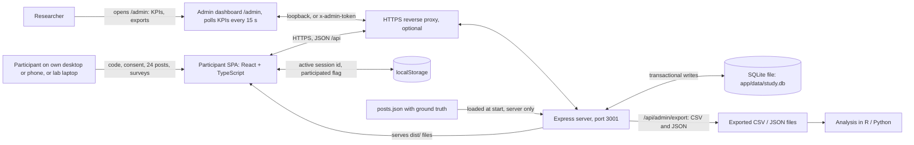
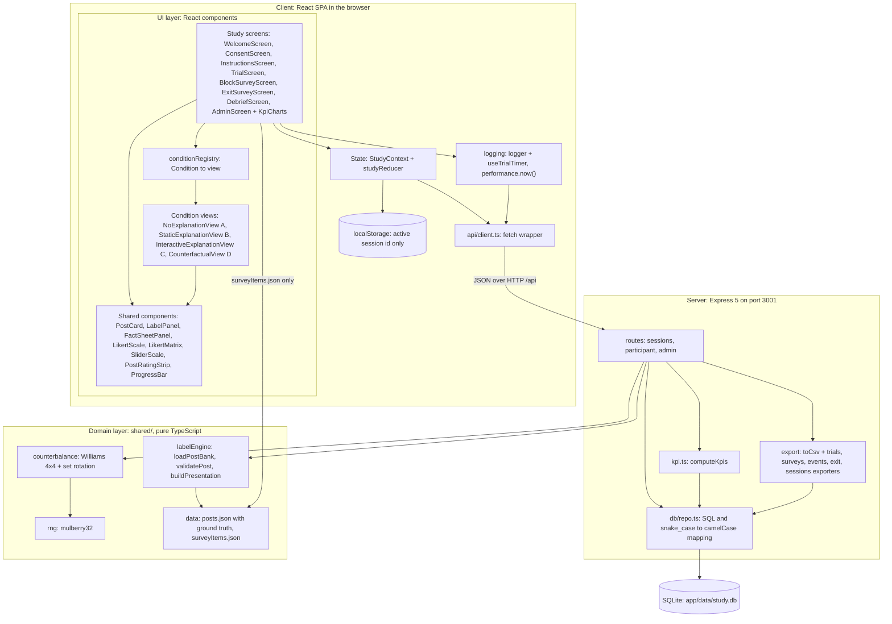
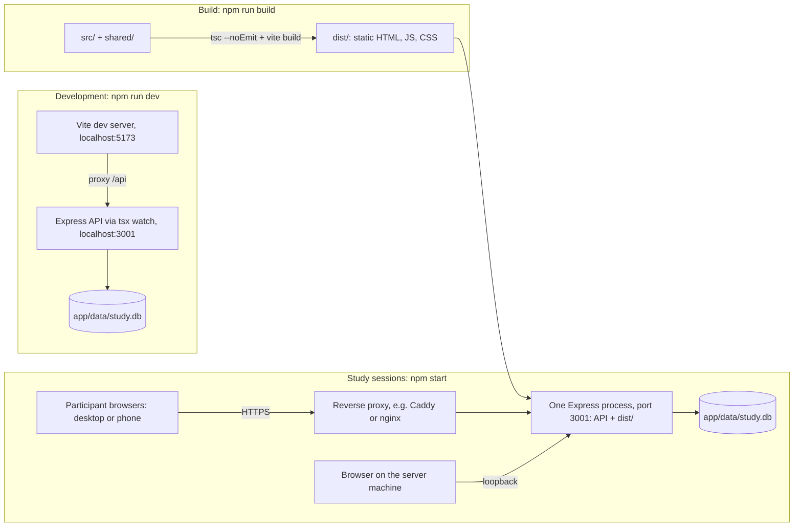

# Architecture

This document describes the architecture of the Group 4 (CEN5728) Wizard-of-Oz study app. In v3 the study asks: "When the AI label is wrong, do explanations help people catch it, and how do they make people feel?" Participants read made-up social media posts from the fictional town of Riverton. Each post carries a scripted AI accuracy label ("Likely accurate" ✓ or "Likely misleading" ⚠), and the participant clicks **Agree with label** or **Disagree with label**. A fictional fact sheet that settles each post's truth can be opened on every trial. This doc covers the system context, the layers and modules inside the app, the source tree, how the app is run and deployed, the decisions behind the design, and the quality attributes it has to deliver. The architecture has one goal: collect clean, reconstructable data for RQ1–RQ3 and H1–H6 while the explanation (conditions A, B, C, D) is the only thing that changes between conditions. It follows [_shared-decisions.md](_shared-decisions.md). The code is in `app/`; its build contract (ownership, module signatures, HTTP API) is [app/CONTRACT.md](../app/CONTRACT.md) and the run guide is [app/README.md](../app/README.md).

**Change from the first version of this plan:** persistence moved from browser `localStorage` to a small local Node server (Express 5) with a SQLite database (`better-sqlite3`). The client is still a React SPA, and everything else (conditions, counterbalancing, logging, the shared frame) is unchanged. See ADR-1 and ADR-4.

**v2 change (self-guided study):** participants now start the study themselves on the lab laptop or their own desktop or phone, with a participation code that is hashed on the server so each person takes part once (ADR-10). The server assigns the pid and reuses the pids of abandoned sessions (ADR-12). `/admin` is read-only data and KPIs and no longer starts sessions (ADR-11). The trial and survey screens were made faster (inline confidence chips, keyboard shortcuts, progress bar, survey matrix, phone layout); the 24-post bank, the four conditions, counterbalancing and every measure are unchanged.

The previous design (v2.1, approving an AI agent's actions) is archived in [archive/v2.1-agent-permission/architecture.md](archive/v2.1-agent-permission/architecture.md).

## 1. System context

The app is a React single-page application (SPA) served by one Node server. `npm start` runs one Express process that serves the built client and a JSON API on port 3001, and writes every response to one SQLite file (`app/data/study.db`). For a lab-only run the server binds to `127.0.0.1` and nothing leaves the laptop. For participants on their own devices it binds to a reachable interface (`HOST=0.0.0.0`) behind an HTTPS reverse proxy. Participants are **self-guided**: they open the site, type a participation code and go, with no researcher present. The researcher watches progress on the `/admin` dashboard and exports the data, then analyzes it outside the app.



- **Participant**: opens the site and types a short participation code on the Welcome screen (`/`). The server hashes the code, refuses it if that person already took part, and assigns a pid. The participant then judges 24 posts (4 blocks × 6 posts, one block per condition) plus 1 practice post. For each post they read the AI label, can open the fact sheet, click Agree or Disagree, and tap a confidence chip (1–7) on the same screen. After each block they fill in the one-screen block survey (Jian trust matrix, fairness, tension, NASA-TLX frustration), and at the end the exit survey. The debrief shows the facts for every wrong label. Target length: 15–20 minutes.
- **Researcher**: does not start or supervise sessions. Opens `/admin` (from the server machine, or with `ADMIN_TOKEN` from anywhere) to watch KPIs, check counterbalancing balance, mark stalled sessions abandoned, delete a withdrawn session, and download the exports.
- **Server**: holds the post bank with its correctness fields, hashes participation codes, allocates pids, computes the assignment from the pid, derives the truth fields of each trial when it is saved, computes KPIs, and writes everything to SQLite. The browser only ever receives allow-listed presentations, so the client bundle and network traffic never contain ground truth.

## 2. Layered component architecture

The app has a client (the React SPA in `app/src/`) and a server (`app/server/`), and both use the pure TypeScript domain code in `app/shared/`. Dependencies only point downward. The domain layer has no React, Express or browser imports, so it can be unit-tested and gives the same output for the same pid. The condition views get everything they need through props and never read state, storage or ground truth themselves. Ground truth exists only on the server: `posts.json` and the truth parts of `labelEngine` are imported by server code, never by the client.



The client may import `rng`, `counterbalance`, the types and `surveyItems.json`. It never imports `posts.json` or the truth functions. Views and screens receive the allow-listed payload from `buildPresentation` through `GET /api/sessions/:id/presentation/:block/:pos`, which carries no `groundTruth`, `isAiCorrect`, `errorType` or `difficulty`. When a trial is submitted, the client sends only what it measured (decision, confidence, timings, expands), and the server adds the condition, set, topic, label, truth fields, `detectedError`, `decisionTimeMs` and `timingFlag` from the stored assignment and the post bank.

| Module | Responsibility | Depends on |
|---|---|---|
| `src/study/*Screen.tsx` | Moving between screens (React Router), collecting survey answers, putting each trial together. `WelcomeScreen` takes the participation code and starts or continues a session. `TrialScreen` holds the fixed ~800 ms "AI is checking…" delay, the shared frame and the Agree/Disagree buttons, then slides in `PostRatingStrip` confidence chips (1–7) on the same screen; a chip tap submits after a 1 s Undo window. It handles the keyboard shortcuts (`A`, `D`, `1`–`7`, `F`, `W`, `Esc`) and prefetches the next presentation | StudyContext, logger, conditionRegistry, api |
| `src/conditions/*View.tsx` | The explanation region for one condition: nothing in A, one fixed sentence in B, the "Why?" button with Source, Claim vs record and Wording rows in C (reports opens and row expands), one counterfactual sentence in D | Shared components only (props in, callbacks out) |
| `src/conditions/conditionRegistry.ts` | Maps each `Condition` (`"A"`–`"D"`) to its view, so `TrialScreen` renders `conditionRegistry[condition]` and never branches on the condition (ADR-8) | Condition views |
| `src/components/` | `PostCard` (author, verified badge, text, `postedAgo`, likes, reposts), `LabelPanel` (the AI label), `FactSheetPanel` (on-demand side panel, reports open/close), `LikertScale` (7-point), `SliderScale` (TLX frustration 0–100, steps of 5, starts at 50, must be moved), `PostRatingStrip` (required confidence chips 1–7), `ProgressBar` ("Post n of 24" + "Part x of 4"), `LikertMatrix` (the 12 trust items as one matrix; chip rows on phones). `FactSheetPanel` is a side panel on wide screens and a bottom sheet on narrow ones | Nothing app-specific |
| `src/state/StudyContext.tsx` | Holds the current `SessionView` (pid, `sessionId`, assignment, cursor) from the server, starts a session from a participation code (`"started"`, `"resumed"`, or `AlreadyParticipatedError` on 409), resumes, and moves the cursor. Keeps only `xai-study:activeSessionId` and, after the exit survey, `xai-study:participated` in `localStorage` | api |
| `src/logging/logger.ts`, `useTrialTimer.ts` | Timestamps events with `performance.now()`, tracks `decisionTimeRawMs`, `hiddenMs`, `hiddenCount`, `blurCount`, `factSheetOpened`, `factSheetOpenMs`, `explanationOpened`, `factorsExpanded[]`, `timeToFirstExpandMs`. Buffers events and flushes them to the server on trial submit, on block survey, every 5 s, and on `pagehide` (via `sendBeacon`) | api |
| `src/api/client.ts` | Thin `fetch` wrapper for the HTTP API in `CONTRACT.md` | Server API |
| `shared/labelEngine.ts` | The Wizard-of-Oz labeller. `buildPresentation(post, condition)` returns an allow-listed payload with the scripted `aiLabel` and only the explanation field for that condition. `validatePost(post)` checks `groundTruth` against `keyFact` and `isAiCorrect` against `aiLabel`. `loadPostBank` validates the whole bank at server start | `shared/data/posts.json` (server side) |
| `shared/counterbalance.ts` | Maps a pid to a condition order (`WILLIAMS[(pid-1) % 4]` over ABDC, BCAD, CDBA, DACB), the set rotation (`floor((pid-1)/4) % 4`), and the seeded shuffle of each block's 6 posts with the rule that the 2 wrong labels are never both in positions 1–2. Written for k conditions, used with k = 4 | rng |
| `shared/rng.ts` | The mulberry32 PRNG, seeded from the pid | Nothing |
| `server/routes/*` | The HTTP API: self-start with a participation code (hash, once-only check, pid allocation), resume, consent, practice post, presentations, trials, events, cursor, block and exit surveys, admin list/KPIs/assignment preview/abandon/delete/export behind the admin access rule (token, or loopback when no token is set). Validates every submission, derives the truth fields, and stamps `last_activity_at` on every participant write |
| `server/kpi.ts` | `computeKpis(db)`: session counts, completion rate, duration, progress toward N = 32, per-condition and per-error-type detection, balance by condition order, completions per day. Completed sessions only; pilot pids ≥ 900 excluded | repo | labelEngine, counterbalance, repo, export |
| `server/db/` | `schema.sql` (tables `sessions` with `participant_hash` and `last_activity_at`, `blocks`, `trials`, `events`, `block_surveys`, `exit_surveys`, `meta`), `openDb` (WAL mode, foreign keys on, adds the v2 columns to older databases), and `repo.ts` with one function per read or write | `better-sqlite3` |
| `server/export/` | Builds `trials.csv`, `surveys.csv`, `events.csv`, `exit.csv` and `sessions.json` from the database | repo |

## 3. Source tree

The module names come from `_shared-decisions.md` and `app/CONTRACT.md`, which assigns one owner to each file.

```text
app/
├── CONTRACT.md                  # binding build contract (v2 folded in)
├── CONTRACT-v2.md               # v2 addendum, kept for history
├── README.md                    # run guide
├── index.html
├── package.json                 # dev, test, typecheck, build, start
├── vite.config.ts               # Vite (5173, /api proxy) + Vitest
├── tsconfig.json
├── data/                        # study.db (git-ignored)
├── shared/
│   ├── types.ts                 # Post, Factor, Presentation, Trial, BlockSurvey, ExitSurvey …
│   ├── api.ts                   # Assignment, SessionView, Cursor, request/response types
│   ├── data/
│   │   ├── posts.json           # 24 posts in sets S1–S4 + 1 practice post, with keyFact, factSheet and ground truth (server only)
│   │   └── surveyItems.json     # Jian et al. 12 items, 2 fairness items, tension, TLX frustration, confidence, exit survey
│   ├── labelEngine.ts
│   ├── counterbalance.ts
│   └── rng.ts                   # each with a *.test.ts next to it
├── server/
│   ├── index.ts                 # reads PORT, HOST, DB_PATH, ADMIN_TOKEN, PARTICIPANT_SALT, STALE_MINUTES; serves dist/ in production
│   ├── app.ts                   # createApp({ db, bank, appVersion, adminToken, staticDir })
│   ├── kpi.ts                   # computeKpis for /api/admin/kpis
│   ├── routes/
│   │   ├── sessions.ts
│   │   ├── participant.ts
│   │   └── admin.ts
│   ├── db/
│   │   ├── schema.sql
│   │   ├── db.ts                # openDb
│   │   └── repo.ts
│   └── export/
│       ├── csv.ts
│       └── exporters.ts
└── src/
    ├── main.tsx                 # mounts <App/>, imports styles/global.css
    ├── App.tsx                  # React Router route table, StudyProvider
    ├── api/client.ts
    ├── state/
    │   ├── StudyContext.tsx
    │   └── studyReducer.ts
    ├── logging/
    │   ├── logger.ts
    │   └── useTrialTimer.ts
    ├── conditions/
    │   ├── conditionRegistry.ts          # Condition → view map (ADR-8)
    │   ├── NoExplanationView.tsx         # A
    │   ├── StaticExplanationView.tsx     # B
    │   ├── InteractiveExplanationView.tsx # C
    │   └── CounterfactualView.tsx        # D
    ├── components/
    │   ├── PostCard.tsx
    │   ├── LabelPanel.tsx
    │   ├── FactSheetPanel.tsx    # "Fact sheet ▸", identical in every condition (ADR-9)
    │   ├── LikertScale.tsx       # 7-point item
    │   ├── SliderScale.tsx       # NASA-TLX frustration, 0–100 in steps of 5
    │   ├── LikertMatrix.tsx      # 12 trust items as one matrix
    │   ├── ProgressBar.tsx       # Post n of 24, Part x of 4
    │   └── PostRatingStrip.tsx   # inline confidence chips 1–7
    ├── study/
    │   ├── WelcomeScreen.tsx      # participation code, Start / Continue
    │   ├── ConsentScreen.tsx
    │   ├── InstructionsScreen.tsx # includes 1 practice post
    │   ├── TrialScreen.tsx
    │   ├── BlockSurveyScreen.tsx
    │   ├── ExitSurveyScreen.tsx
    │   └── DebriefScreen.tsx      # shows the facts for every wrong label
    ├── admin/
    │   ├── AdminScreen.tsx        # KPIs, sessions, exports (no start form)
    │   └── KpiCharts.tsx          # inline SVG bars
    └── styles/
        └── global.css
```

## 4. Deployment view

The commands below are the real `package.json` scripts, run from `app/`. `app/README.md` has the full run guide.



| Step | Command | Output |
|---|---|---|
| Install | `npm install` | `node_modules/` (includes the `better-sqlite3` native module) |
| Develop | `npm run dev` | API server on 3001 and Vite on 5173 with hot reload; open `http://localhost:5173/` (participant) or `/admin` |
| Test | `npm test` (Vitest) | Client, shared and server suites, including `validatePost` over all 24 posts and API tests on an in-memory database |
| Type-check | `npm run typecheck` | `tsc --noEmit` |
| Build | `npm run build` | Static `dist/` folder |
| Study run | `npm start` | Serves the API and `dist/` on 3001; participants open `/`, the researcher `/admin` |

- Every participant session in a run uses the same build of `dist/` and the same `posts.json`. Each session row stores the post bank hash and app version, so a changed bank is detectable.
- The SQLite file lives on the server host (`DB_PATH`, default `app/data/study.db`). A participant can resume from another browser or device by typing the same code. The researcher exports from `/admin` (or copies the `.db` file while the server is stopped) after each session day.
- Environment variables: `PORT` (default 3001), `HOST` (default `127.0.0.1`; `0.0.0.0` to accept other devices), `DB_PATH` (default `data/study.db`, relative to `app/`), `ADMIN_TOKEN` (optional; when set, admin routes require it, and when unset they answer only from loopback), `PARTICIPANT_SALT` (HMAC secret for participation codes; generated once into `meta.participant_salt` if unset), `STALE_MINUTES` (default 120).
- For participants on their own devices, put an HTTPS reverse proxy in front of port 3001. Requests through the proxy are not loopback, so `ADMIN_TOKEN` must be set to use `/admin` remotely.

## 5. Key architectural decisions

**ADR-1: React SPA served by a local server on the lab laptop.**
*Context:* The proposal asks for a web prototype and says a JSON file is enough as the data source. The first plan was a static SPA with no backend. *Decision:* React 18 + TypeScript + Vite for the client, served by one local Express 5 process (`npm start`) that also hosts the JSON API. The post bank stays a JSON file (ADR-2); the server only stores responses (ADR-4). *Consequences:* The app still runs offline on one laptop with one command, and there is nothing to host on the internet. The server must be running during sessions, and the run guide (`app/README.md`) documents how to start it. Superseded the "static SPA, no backend" plan.

**ADR-2: JSON post bank, including fact sheets, as the single source of stimuli.**
*Context:* The four conditions are built by different team members, but they must show identical posts, labels and fact sheets. *Decision:* One `shared/data/posts.json` file, read by the server at start-up and validated with `loadPostBank`. For each post it holds the author and post text, `keyFact {claimValue, recordValue}`, `factSheet {title, body, source}`, the scripted `aiLabel`, the stored `groundTruth`/`isAiCorrect`/`errorType`/`difficulty`, and every explanation field (`staticExplanation` for B, `factors[]` for C, `counterfactualExplanation` for D). Survey wording lives in `shared/data/surveyItems.json`, which the client may import. *Consequences:* The same record drives all conditions, and it can be reviewed and version-controlled. Participant-facing strings are checked against [stimuli.md](stimuli.md), which is the authority on final wording. `validatePost` checks that `groundTruth` follows from the claim vs the fact sheet's key fact and that `isAiCorrect` matches `aiLabel`, so a mislabeled post fails the tests before any session runs.

**ADR-3: Seeded PRNG for assignment and ordering.**
*Context:* Condition order, set rotation and the positions of the wrong labels all have to be counterbalanced and reconstructable afterwards. *Decision:* Condition order and rotation are computed from the pid (4×4 Williams square, 4-set rotation). Within-block order uses a mulberry32 PRNG seeded from the pid, with the rule that the 2 wrong labels are never both in positions 1–2. *Consequences:* Any session can be regenerated exactly from its pid. The assignment table can be printed ahead of time and checked for balance across each 16-participant cycle (target N = 32).

**ADR-4: Local Node server with SQLite.**
*Context:* A refresh or crash in the middle of a session must not lose any trials. The first plan kept every session in browser `localStorage` (`xai-study:sessions`), which ties the data to one browser profile, is lost if site data is cleared before export, and would have put the post bank, with its ground truth, inside the client bundle. *Decision:* The Express server writes to one SQLite file (`app/data/study.db`, set by `DB_PATH`) through `better-sqlite3`. Each trial, event batch and survey is one transactional write, checked by the schema (`CHECK` constraints, primary keys that reject duplicates, foreign keys with cascade delete for withdrawals). Correctness data stays on the server: the server computes the assignment, serves allow-listed presentations, and derives the truth fields and `detectedError` when a trial is saved. The browser keeps only the active session id (`xai-study:activeSessionId`). The researcher downloads `trials.csv`, `surveys.csv`, `events.csv`, `exit.csv` and `sessions.json` from `/admin`. *Consequences:* The whole dataset is a single file that is easy to back up (copy it while the server is stopped) and survives a browser reset. A session can resume from any browser on the laptop, and interrupted trials are marked `resumed = true`. Writes are atomic, so a half-saved trial cannot exist. The client bundle and network traffic never contain ground truth, so a curious participant cannot find the wrong labels in DevTools. The cost is one native dependency (`better-sqlite3`) and a server process that has to be running during sessions.

**ADR-5: Shared components across conditions (internal validity).**
*Context:* Any difference between conditions other than the explanation (layout, fonts, button placement, how the post or label is shown, label timing) is a confound. *Decision:* All four views sit inside the same `TrialScreen` frame, with the same `PostCard`, `LabelPanel`, `FactSheetPanel`, buttons and ~800 ms "AI is checking…" delay, in the same positions. Each view only fills its explanation region: nothing in A, one sentence in B, the "Why?" rows in C, one counterfactual sentence in D. No view ever shows an AI confidence score. *Consequences:* A difference in detection, agreement, trust, fairness, tension, frustration or decision time can be put down to the explanation alone. Team members own their view's explanation region, but not the shared frame around it.

**ADR-6: Pure domain layer below React.**
*Decision:* `labelEngine`, `counterbalance` and `rng` live in `shared/` and have no React, Express or browser imports. *Consequences:* They can be unit-tested in isolation, and the study's most important logic (assignment, wrong-label placement, ground truth, the payload allow-list) can be checked without a UI.

**ADR-7: No live LLM at runtime.**
*Context:* The labels look like the output of an AI, but the study measures how explanation type changes error detection and feelings, so every participant must see the same labels and the same explanation text. *Decision:* The labeller is a Wizard-of-Oz script. Its labels, B sentences, C factor rows and D sentences all come from `posts.json`, and no model is called while the app runs. *Consequences:* Stimuli are identical across participants and conditions, and the 8 planted errors (4 false alarms, 4 misses) happen exactly where the design puts them. A live LLM would add uncontrolled variance (different wording, different labels, unplanned mistakes), a per-session API cost and a network dependency.

**ADR-8: Conditions are pluggable.**
*Context:* The study has four core conditions, built by different team members, and the course schedule may need a condition dropped or swapped without touching the others. *Decision:* `conditionRegistry` maps each `Condition` (`"A"`, `"B"`, `"C"`, `"D"`) to its view component. `TrialScreen` looks the view up and never switches on the condition. `counterbalance` is written for k conditions and used with k = 4 (Williams square, 4-set rotation). *Consequences:* Each view can be built and tested in isolation against the same props contract. Changing the condition set means editing the registry, the `Condition` type and the post bank, while `TrialScreen` and the shared frame stay untouched.

**ADR-9: The fact sheet is identical across conditions.**
*Context:* Detecting a wrong label depends on two things: whether the explanation helps, and whether the participant can check the claim. If the chance to check varied by condition, a detection difference could come from access to evidence rather than from the explanation. *Decision:* Every post has one fact sheet, opened from the same "Fact sheet ▸" button in `FactSheetPanel` in every condition. Its content comes only from `post.factSheet`, never mentions the label, and does not change with the condition. Opening, closing and time open are logged (`factSheetOpened`, `factSheetOpenMs`). *Consequences:* The verification opportunity is held constant, so differences in detection (H1, H2) and time or clicks (H6) come from the explanations. C's "Claim vs record" row shows the true comparison, and logging fact-sheet use lets the analysis tell whether a C participant caught an error from the row or from the fact sheet.

**ADR-10: Self-start with a hashed participation code.**
*Context:* v1 needed a researcher to type the pid on `/admin` and hand over the laptop, which limits data collection to moderated lab slots. The PI wants anyone to start the study themselves on any device, and each person to take part only once, without the app storing who they are. *Decision:* The Welcome screen asks for a short personal code (for example a university email or student ID). `POST /api/sessions { participantCode }` normalises it (`trim().toLowerCase()`, 3–120 characters) and stores only `participant_hash = HMAC-SHA256(salt, code)` (hex) in a unique column. The salt is `PARTICIPANT_SALT`, or 32 random bytes generated once into `meta.participant_salt`. A new code gets 201; a code with an `in_progress` session resumes it (200); a code with a `completed` or `abandoned` session gets 409 `already_participated`. After the exit survey the browser also sets `xai-study:participated` as a convenience. *Consequences:* No researcher is needed to start, and a person cannot take part twice under the same code. The raw code is never stored or logged, and without the salt the hash cannot be matched against a list of emails. Someone who types a different code can still take part again, so duplicate participation is reduced, not prevented. The salt must not change during a study.

**ADR-11: Admin is read-only data and KPIs.**
*Context:* With self-start, the researcher no longer needs to create sessions, and a dashboard that can start sessions is an extra attack surface once the server is reachable from other devices. *Decision:* `/admin` shows KPI cards, a per-condition table with inline SVG bars (no chart library), a balance grid, the sessions table and the export buttons, refreshed every 15 s from `GET /api/admin/kpis` and `GET /api/admin/sessions`. It keeps only Abandon and Delete (withdrawal), plus a pid assignment preview (`GET /api/admin/assignments/:pid`, moved from the public API). Access: if `ADMIN_TOKEN` is set every admin route requires it; if not, admin routes answer only from loopback and return 403 otherwise. KPIs use completed sessions only and exclude pilot pids ≥ 900. *Consequences:* The researcher can monitor progress and balance during unmoderated collection. Admin data cannot leak to the network by default, because a server reachable from other devices without a token refuses admin requests from them.

**ADR-12: Server-allocated pids that reuse abandoned slots.**
*Context:* Counterbalancing depends on the pid (Williams order, set rotation, seed). With self-start, people who start and never finish would leave holes in the 16-participant cycle, and two people starting at once must not get the same pid. *Decision:* In one `BEGIN IMMEDIATE` transaction, the server first marks abandoned any `in_progress` session whose `last_activity_at` is older than `STALE_MINUTES` (default 120), then assigns the lowest pid ≥ 1 that has no `in_progress` or `completed` session. Every participant write updates `last_activity_at`. Pilot pids 901+ are never auto-assigned. *Consequences:* Completed sessions fill pids 1, 2, 3 … without gaps, so each cycle of 16 stays balanced. Concurrent starts are serialised by SQLite. An abandoned session keeps its rows (with its old pid) for the record, but its pid is given to the next person, so analysis must filter on `status = completed`. A participant idle for longer than `STALE_MINUTES` loses their slot and cannot resume (their code then returns 409).

## 6. Quality attributes

| Attribute | How the architecture achieves it |
|---|---|
| **Internal validity** | The frame, timing and label are identical across conditions (ADR-5). All four views read the same post records (ADR-2). The fact sheet is the same in every condition (ADR-9). Counterbalancing covers condition order, set-to-condition mapping and wrong-label position (ADR-3). Scripted labels keep stimuli identical (ADR-7). |
| **Reproducibility** | The assignment follows deterministically from the pid (ADR-3). Each session row stores pid, `sessionId`, condition order, rotation, seed, the per-block post order, the post bank hash and the app version. The post bank is version-controlled, and every session uses one fixed build. |
| **Data integrity** | Every trial and survey is a transactional SQLite write, checked by the schema and the API validation (ADR-4). Duplicate submissions are rejected (409), and events are de-duplicated on `(session_id, seq)`. On reload the session resumes from the server cursor and the trial is marked `resumed`. `validatePost` checks every post's ground truth against its fact sheet at server start. The client never sees truth fields; the server adds them when it saves a trial. JSON and CSV exports come from the same tables, so they agree. |
| **Timing accuracy** | `performance.now()` is used rather than `Date.now()`. `decisionTimeMs` runs from when the label is shown (after the fixed delay) to the Agree/Disagree click, minus time the tab was hidden. Fact-sheet open time, the "Why?" open and each row expand in C are timestamped by `logger`. |
| **Privacy** | Participants are identified only by an anonymous pid. The participation code is stored only as a salted HMAC hash (ADR-10), never raw and never logged. Names and contact details are never collected, and demographics are coarse categories. Data stays in one SQLite file on the server host and is never sent anywhere else. Admin routes answer only from loopback unless `ADMIN_TOKEN` is set (ADR-11); remote participants should reach the server over HTTPS. A withdrawal deletes every row of the session (cascade). |
| **Content safety** | Every post, person, account, place and agency is fictional (Riverton, Alder County, sources marked "(fictional)"). There are no real brands and no health-risk claims that could cause harm if believed. Fact sheets are clearly fictional records, and the debrief explains the deception and shows the facts for every wrong label, so no participant leaves holding a false belief. |
| **Speed and usability** | One screen and two taps per post (Agree/Disagree, then a confidence chip), keyboard shortcuts, a prefetched next presentation, a one-screen survey matrix, and a layout that works from 360 px phones to 1280 px laptops, so a session takes 15–20 minutes. The 800 ms checking delay stays, because it is part of the design. |
| **Unmoderated data quality** | With no researcher present, attention is inferred from the logs: `hiddenMs`, `hiddenCount`, `blurCount`, `timingFlag` (tab hidden or decision > 120 s), fact-sheet use and session duration are kept for every trial. |
| **Maintainability** | Pure domain layer (ADR-6), pluggable conditions (ADR-8), and one data file for stimuli (ADR-2) let each team member work on their own module with unit tests. |

## Related docs

- [architecture.md](architecture.md) (this document)
- [system-design.md](system-design.md)
- [sequence-diagrams.md](sequence-diagrams.md)
- [data-model.md](data-model.md)
- [ai-design.md](ai-design.md)
- [research-positioning.md](research-positioning.md)
- [implementation-plan.md](implementation-plan.md)
- [study-protocol.md](study-protocol.md)
- [stimuli.md](stimuli.md)
- [wireframes.md](wireframes.md)
- [_shared-decisions.md](_shared-decisions.md)
