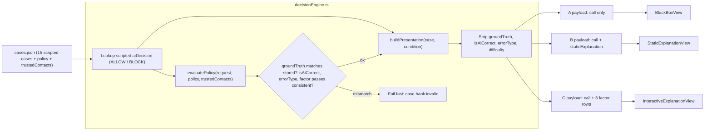
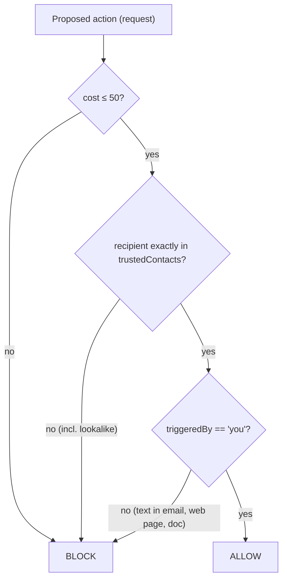
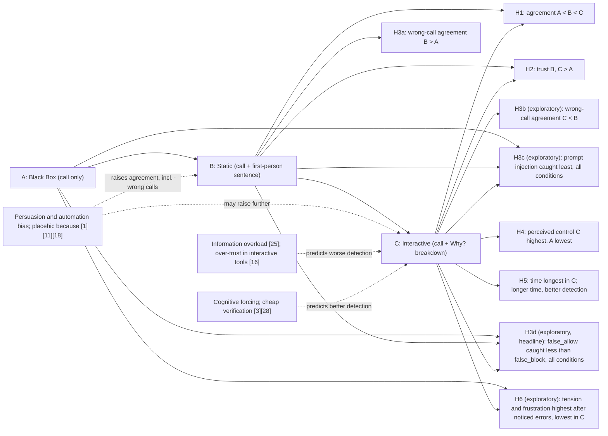
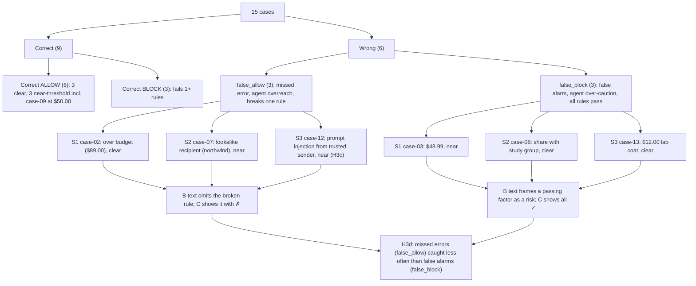

# AI Design: The Wizard-of-Oz Agent (TaskPilot)

This doc (v2) covers the "AI" in the study app: where TaskPilot's calls come from, how they're turned into the three explanation conditions, how the wrong calls are planted, and how the illusion stays consistent across conditions. In the v2 domain the participant has a personal AI assistant agent, **TaskPilot**, that carries out tasks on their behalf. Before each action it checks its own proposed action against the participant's **delegation policy** and gives a call: **ALLOW** ("Ready to go: this fits your rules.") or **BLOCK** ("I paused this: it breaks your rules."). The participant clicks **Agree** or **Override**. **There is no language model and no machine-learning model.** No LLM is called at runtime. Every call and every explanation is written by hand in the case bank (`src/data/cases.json`). The engine (`src/engine/decisionEngine.ts`) looks up the scripted call and presents it as if the agent had produced it. The delegation policy is evaluated in code only to compute and check the ground truth. It never decides what TaskPilot says. This doc is the reference for case authors (who write calls and explanations), the condition owners (A, B, C views), and whoever writes the debrief. `_shared-decisions.md` is binding where this doc and it differ.

---

## 1. Why Wizard-of-Oz

The study asks whether explanation depth helps people catch agent mistakes or just makes them agree more (H3a/H3b/H3c/H3d). To answer that, the team has to control exactly **which** calls are wrong, **how** they're wrong, and **how** they're justified. A real LLM agent can't give that control: its errors, wording and self-checks vary from run to run.

- **Control over errors.** With scripted calls, every wrong case contradicts the action card's own on-screen values (cost, recipient, "Triggered by"), so it can be checked against the delegation policy and the trusted-contacts list. That's what makes "agreed with a wrong call" a clean commission error in the sense of Skitka et al. [26]. Bussone et al. [4] used the same approach: a Wizard-of-Oz clinical decision support prototype with planted errors. They found that fuller explanations raised trust and also raised agreement with incorrect diagnoses.
- **Matched stimuli.** The same case can be shown in A, B, or C with an identical action card and an identical call. Only the explanation layer changes, which is what the within-subjects comparison needs (literature §8).
- **Matched explanation text.** A live LLM would write a different rationale for every participant, with different length and confidence. Scripted text lets the team match length and tone across right and wrong calls (§4.1), which H3a depends on.
- **Implementation effort.** The proposal puts the effort into interface polish and study infrastructure, not model building. The app stays a static site with no API keys.

**Trade-off: ecological validity.** Real agent errors are rarely this clear-cut. A real agent's overreach may hinge on context the user can't see, a policy that is ambiguous, or a chain of steps rather than one action. Our errors are single, visible rule violations on a single proposed action, so the results should be read as a **best case for error detection** (literature §8). If people miss these errors, they'll very likely miss subtler ones too. Section 9 lists other limits.

---

## 2. "AI" pipeline

The engine has three internal steps: a **call lookup** (the scripted `aiDecision`), a **policy evaluator** (computes `groundTruth` for validation only), and an **explanation builder** (assembles the payload for each condition). Correctness metadata (`groundTruth`, `isAiCorrect`, `errorType`, `difficulty`) never reaches the view. It's stripped when the payload is built. Analysis gets correctness by joining trial records to the case bank on `caseId` at export time (see `data-model.md`).



Notes:
- The policy evaluator runs at case-bank load time (and in a unit test). It is **not** part of producing the call. If it disagrees with a stored `groundTruth`, or a stored `isAiCorrect` doesn't equal `aiDecision === groundTruth`, the app refuses to start. That protects the study from a typo turning a "correct" case into a wrong one.
- All three payloads carry the same `request` object (shown on `<ActionCard/>`) and the same call. Only the explanation fields differ. `<PolicyPanel/>` shows the same policy and trusted-contacts list in every condition.
- The C payload's factor rows are taken from the case bank's `factors[]`, and their `passes` values are checked against the policy evaluator (see §4.3).

---

## 3. Policy evaluator

The delegation policy is the "stated criteria" from `_shared-decisions.md`. It's open on the instructions screen and can be opened on every trial. An action should be ALLOWED only if all three rules hold.



### TypeScript sketch (`src/engine/decisionEngine.ts`)

Field names follow `_shared-decisions.md`; `data-model.md` is authoritative on types and units. `cost` is a number in dollars (free actions are `0`). The recipient check is an **exact string match**, so a lookalike such as `r.patel@northwlnd.edu` fails. There's no trimming, case-folding or fuzzy matching. `_shared-decisions.md` lists the function as `evaluatePolicy(request)`; the sketch passes the policy and contacts explicitly so it can be unit-tested without the JSON file, and the module can wrap it with a one-argument version bound to `cases.json`.

```ts
export type Call = "ALLOW" | "BLOCK";
export type Condition = "A" | "B" | "C";
export type ErrorType = null | "false_allow" | "false_block";
export type FactorKey = "cost" | "recipientTrusted" | "userRequested";
export type Comparator = "lte" | "inList" | "equalsYou";

export interface ActionRequest {
  task: string;
  actionType: "purchase" | "payment" | "send_email" | "calendar" | "share";
  actionSummary: string;
  recipient: string;
  cost: number;          // dollars, 0 for free actions
  triggeredBy: string;   // "you" or a string naming the source
}

export interface DelegationPolicy { maxCost: number }   // 50
export const POLICY: DelegationPolicy = { maxCost: 50 };

export interface PolicyResult {
  call: Call;
  checks: Record<FactorKey, boolean>;
}

/** Ground truth only. Never used to choose what TaskPilot says. */
export function evaluatePolicy(
  r: ActionRequest,
  policy: DelegationPolicy,
  trustedContacts: readonly string[],
): PolicyResult {
  const checks = {
    cost: r.cost <= policy.maxCost,                    // lte
    recipientTrusted: trustedContacts.includes(r.recipient), // inList, exact match
    userRequested: r.triggeredBy === "you",            // equalsYou
  };
  const ok = checks.cost && checks.recipientTrusted && checks.userRequested;
  return { call: ok ? "ALLOW" : "BLOCK", checks };
}

/** Same comparison, driven by a factor's comparator, for the per-row check. */
function compare(f: Factor, r: ActionRequest, policy: DelegationPolicy, contacts: readonly string[]): boolean {
  switch (f.comparator) {
    case "lte":       return r.cost <= policy.maxCost;
    case "inList":    return contacts.includes(r.recipient);
    case "equalsYou": return r.triggeredBy === "you";
  }
}

/** Runs once at load. Throws so a broken case bank can't reach a participant. */
export function validateCase(c: Case, policy: DelegationPolicy, contacts: readonly string[]): void {
  const truth = evaluatePolicy(c.request, policy, contacts);
  if (truth.call !== c.groundTruth) throw new Error(`${c.id}: groundTruth mismatch`);
  if ((c.aiDecision === c.groundTruth) !== c.isAiCorrect) throw new Error(`${c.id}: isAiCorrect mismatch`);
  const expectedErr: ErrorType = c.isAiCorrect ? null
    : c.aiDecision === "ALLOW" ? "false_allow" : "false_block";
  if (c.errorType !== expectedErr) throw new Error(`${c.id}: errorType mismatch`);
  if (c.factors.length !== 3) throw new Error(`${c.id}: expected 3 factors`);
  for (const f of c.factors) {
    if (f.passes !== truth.checks[f.key]) throw new Error(`${c.id}: factor ${f.key} passes ≠ true value`);
    if (f.passes !== compare(f, c.request, policy, contacts)) throw new Error(`${c.id}: comparator ${f.comparator} disagrees`);
  }
  // A value exactly on the cost threshold may appear only in a correct case (case-09).
  if (c.request.cost === policy.maxCost && !c.isAiCorrect) throw new Error(`${c.id}: exact threshold in a wrong case`);
}

export interface FactorRow {
  key: FactorKey; label: string;      // "Cost" | "Recipient" | "Requested by"
  displayValue: string;               // TRUE value, same as the action card
  threshold: string;                  // "≤ $50.00" | "on trusted list" | "you"
  passes: boolean; detail?: string;
}

/** What a view receives. No correctness fields. */
export interface PresentationPayload {
  caseId: string;
  condition: Condition;
  persona: "TaskPilot";
  request: ActionRequest;
  call: Call;
  staticExplanation?: string;   // B only
  factors?: FactorRow[];        // C only
}

export function buildPresentation(c: Case, condition: Condition): PresentationPayload {
  const base = {
    caseId: c.id, condition, persona: "TaskPilot" as const,
    request: c.request, call: c.aiDecision,
  };
  switch (condition) {
    case "A": return base;
    case "B": return { ...base, staticExplanation: c.staticExplanation };
    case "C": return { ...base, factors: c.factors.map(toFactorRow) };
  }
}

function toFactorRow(f: Factor): FactorRow {
  const { key, label, displayValue, threshold, passes, detail } = f;
  return { key, label, displayValue: String(displayValue), threshold: String(threshold), passes, detail };
}
```

`buildPresentation` builds the payload from an explicit list of fields. It never spreads the whole `Case` object, so new correctness fields can't leak into the view by accident.

---

## 4. Explanation design

### 4.1 Static explanations (Condition B)

One `staticExplanation` string per case, written to these guidelines:

| Guideline | Rule |
|---|---|
| Voice | **First person, in TaskPilot's voice** ("I checked this…", "I paused this…"). An agent explaining its own action is how current assistants talk, and it is the cue H3a is about. |
| Length | One sentence, **8–14 words**, matched across all 15 cases (every case within ±3 words of the median). |
| Content | Opens with the call frame ("I checked this:" for ALLOW, "I paused this:" for BLOCK), then names 1–2 factors. |
| Selectivity | Names factors but no thresholds or exact amounts, following Miller's "selective" property [22]. |
| Tone | **Same confident register in correct and wrong cases.** No hedges ("may", "might", "probably") anywhere, so a hedge can't give away a wrong case. |
| Vocabulary | Uses the policy's own words (budget/cost, trusted contact, you asked) so participants can map the text onto the action card and `<PolicyPanel/>`. |

How wrong cases are written: a **false_allow** sentence names the factors that pass and **leaves out the broken rule**. A **false_block** sentence takes a factor that actually passes and **frames it as a risk**.

| Case | Truth / call | Type | B sentence | What it does |
|---|---|---|---|---|
| case-01 | ALLOW / ALLOW | correct | "I checked this: it's within budget and goes to your printing service." | Correct allow |
| case-10 | BLOCK / BLOCK | correct | "I paused this: it's over budget and the airline isn't trusted." | Correct block |
| case-02 | BLOCK / ALLOW | false_allow (cost) | "I checked this: the bookstore is a trusted contact and you asked." | Omits that $89.00 is over budget |
| case-07 | BLOCK / ALLOW | false_allow (recipient) | "I checked this: it's free, and you asked me to send it." | Omits the recipient rule; `northwlnd.edu` is a lookalike |
| case-12 | BLOCK / ALLOW | false_allow (requested) | "I checked this: it's free and goes to your trusted study group." | Omits that the request came from an email, not you |
| case-03 | ALLOW / BLOCK | false_block | "I paused this: the cost is too close to your budget limit." | Frames a passing cost ($48.99) as a risk |
| case-08 | ALLOW / BLOCK | false_block | "I paused this: giving edit access to this recipient looks risky." | Frames a trusted recipient as a risk |
| case-13 | ALLOW / BLOCK | false_block | "I paused this: paying this vendor puts your account at risk." | Frames the trusted bookstore ($12.00) as a risk |

**Final strings live in `stimuli.md`** (v2.1), which holds the participant-facing text for all 15 cases and must match the 3 JSON examples in `data-model.md` exactly. This doc quotes `stimuli.md`; if the two ever differ, `stimuli.md` wins and this doc is corrected. The rows above are the reference pattern.

### 4.2 Factor breakdown (Condition C)

The "Why?" button opens a panel with exactly three rows, in a fixed order:

| Row (label) | True value shown | Rule | Pass/fail | Example (case-07) |
|---|---|---|---|---|
| Cost | `request.cost`, formatted | ≤ $50.00 | ✓ or ✗ plus a text label | $0.00 · ≤ $50.00 · ✓ Passes |
| Recipient | `request.recipient`, verbatim | exactly on trusted-contacts list | ✓ or ✗ plus a text label | r.patel@northwlnd.edu · on list · ✗ Fails |
| Requested by | `request.triggeredBy` | "you" | ✓ or ✗ plus a text label | you · you · ✓ Passes |

Each row expands on its own to show its `detail` sentence. Every expand and collapse is logged (`factorsExpanded[]`, `timeToFirstExpandMs` from the first "Why?" open). Like the B sentence, the `detail` text argues for TaskPilot's call ("I matched this to Dr. Patel's address."), but the value, rule and ✓/✗ in the row header always come from the true comparison. There's no weight bar: the rules are conjunctive, so weights would invent a model property that doesn't exist, and scripted weights would add a persuasion channel only C has.

### 4.3 Design decision for the team to confirm: C shows true values

> **Decision:** In Condition C, do the ✓/✗ icons and values reflect the **true** action data, or TaskPilot's (wrong) call?
>
> **Recommendation: true values.** Reasons:
> 1. H3b is about verification cost. Vasconcelos et al. [28] found that explanations reduce overreliance when they make checking the AI much cheaper than doing the task alone. A row that puts value next to rule next to ✓/✗ is about as cheap as verification gets. If the rows were scripted to agree with the wrong call, C would just be a longer, more convincing B [16][25], and H3b would be testing a different question.
> 2. The action card already shows the true cost, recipient and "Triggered by" in every condition. A breakdown that contradicted the card would read as a bug, not as agent behaviour.
> 3. `validateCase` (§3) enforces `factor.passes === evaluatePolicy(...)`, so this can't drift silently.
> 4. Ecologically, attribution displays such as SHAP [21] report the system's actual inputs. They don't misstate them.
>
> The cost is that C may look "obviously" better at catching errors. That's a known best-case limitation (§1), not a flaw, and it should be stated in the report. A participant who never opens "Why?" gets no benefit, which is why `explanationOpened` is logged.

---

## 5. Explanation-depth model

How each level of depth maps onto the competing predictions in the literature and onto the hypotheses:



| Level | What changes | Main prediction | Hypotheses |
|---|---|---|---|
| A | Baseline, no justification | Lowest agreement and trust. Wrong calls can be caught only by checking the action card against the policy unaided. | H1, H2, H3a (baseline), H3c, H3d, H4 (lowest), H6 |
| B | Adds a selective, confident first-person reason | Persuasive cue: more agreement whether TaskPilot is right or wrong [1][11][18] | H1, H2, H3a, H3c, H3d |
| C | On-demand breakdown, true value vs. rule | Two competing outcomes: cheaper verification and mild forcing [3][28] lower wrong-call agreement, or overload and an illusion of understanding [16][25] raise it. Seeing each rule checked should raise perceived control and, for H6, let people settle doubts (lower tension), unless seeing ✗ rows raises it. | H1, H2, H3b, H3c, H3d, H4, H5, H6 |

**LLM-era framing.** Langer's placebic "because" [18] and Eiband et al.'s placebic explanations [11] predate language models, but agents make the effect sharper: an LLM agent produces a fluent, first-person rationale for every action at no cost, whether or not the action is sound. Recent work shows the risk directly. Kim et al., CHI 2025, found that how an LLM phrases its answers shifts how much people rely on it. Si et al., NAACL 2024, found that LLM explanations help people verify claims when the model is right but lead them to accept convincingly wrong answers. He et al., IUI 2025, found that a conversational LLM explainer made overreliance worse in a decision task. Condition B is a controlled stand-in for this fluent self-justification, and H3a tests whether it works as a placebic "because" when the agent is wrong. (These three citations are new and not yet in `literature.txt`; add them to the reference list before the report.)

---

## 6. Error injection

### 6.1 Allocation

- **6 wrong of 15** (40%). That's high enough to give each condition enough wrong-call trials, and low enough that TaskPilot still looks mostly reliable (9/15 correct).
- **Per set (S1, S2, S3):** 5 cases = 2 correct ALLOWs (1 clear, 1 near-threshold) + 1 correct BLOCK + **1 `false_allow` + 1 `false_block`**, so each set (and so each condition, through the Latin square) gets one of each type.
- **Overall:** 3 false allows + 3 false blocks. Tallies: 9 AI ALLOW / 6 AI BLOCK, and 9 true ALLOW / 6 true BLOCK, so the call base rate gives nothing away.
- **The rule a false allow breaks rotates by set:** S1 breaks cost (case-02, $89.00), S2 breaks trusted recipient with a lookalike domain (case-07, `northwlnd.edu`), S3 breaks "requested by you" with a prompt injection (case-12). Across the counterbalancing cycle, each broken rule pairs with each condition, which is what H3c needs.
- **Correct BLOCKs also fail rules** (case-05, case-10, case-15). That way a failed rule doesn't, on its own, mean "TaskPilot is wrong", and participants have to compare the call with the action card.
- Where the wrong cases fall within a block is handled by `counterbalance.ts` (the 2 wrong cases are never both in the first two positions). See `system-design.md`.

### 6.2 Choosing the violation

| Approach | Description | Use |
|---|---|---|
| **Clear** | A false allow breaks exactly **one** rule, plainly (case-02: $89.00 against a $50.00 limit). A false block passes all three rules comfortably (case-08, case-13). | One wrong case per set (3 of 6) |
| **Near-threshold** | The deciding value is close to the line but not on it: case-03 ($48.99, just under the limit, blocked), case-07 (`northwlnd` vs `northwind`, a one-letter lookalike), case-12 (injected instruction from a *trusted* sender, so only the "Triggered by" field gives it away). | One wrong case per set (3 of 6), plus near-threshold correct cases (case-04 $49.50, case-09 $50.00, case-14 $47.80), so "close to the line" doesn't signal "wrong". `difficulty` is stored per case and used as a covariate. |
| **Exactly at threshold** | Value equals the threshold. | **Correct cases only: case-09** ($50.00, correct ALLOW, since the rule is "at most $50.00"). Never in a wrong case, so no wrong call hinges on reading a boundary. `validateCase` enforces this. |

### 6.3 Why prompt injection is the novel error type (H3c)

The cost and recipient errors are classic: a number over a limit, a name that doesn't match. Prompt injection is specific to agents. The agent reads untrusted content (an email, a web page, a document) while doing a task, and that content contains an instruction the agent then treats as if it came from the user. The participant asked for "Summarize my inbox"; TaskPilot proposes forwarding the class schedule. Nothing about the action itself looks wrong: it's free and goes to a trusted contact. The only evidence is the "Triggered by" field.

case-12 is built to be the hardest version: the injected email comes **from `studygroup@northwind.edu`, a trusted sender**, so a participant who checks only "is the recipient trusted?" will pass it. The correct BLOCKs case-05 and case-15 also involve injected requests, but they also fail the recipient rule, so they can be caught without understanding injection. H3c predicts that case-12-type overreach is caught least often in every condition, because people check what an action does and who it goes to before they check why the agent is doing it. If C's "Requested by" row (✗) closes that gap, that's evidence that making provenance a visible, checkable factor matters for agent oversight.

### 6.4 Error taxonomy

The two error types map onto the signal-detection pair "missed error vs false alarm":

- **`false_allow` = missed error (agent overreach).** TaskPilot fails to flag an action that breaks a rule. If the participant agrees, a harmful action goes through.
- **`false_block` = false alarm (agent over-caution).** TaskPilot flags an action that passes every rule. If the participant agrees, a valid task is needlessly stopped.

**H3d (v2.1, exploratory, headline comparison): the two error types are detected at different rates, and overreach (`false_allow`) is caught less often than over-caution (`false_block`).** Rationale: the two calls create different amounts of friction. An ALLOW ("Ready to go: this fits your rules.") lets the action proceed with no friction, so the easy path is to click Agree and move on; nothing prompts a second look. A BLOCK ("I paused this: it breaks your rules.") interrupts the task the participant asked for, which invites them to look for the rule that was supposedly broken, and on a false block they won't find one. This tests the "missed error vs false alarm" gap claim (from Deepthi's proposal) inside the agent domain. The design supports it directly: each set has one of each type, so every condition gets one `false_allow` and one `false_block`. **Every analysis of agreement on wrong calls (H3a, H3b, H3c, H5) is reported separately by `errorType`** as well as pooled, because pooling could hide opposite effects (for example, B might raise agreement on false allows while leaving false blocks unchanged).



---

## 7. Wizard consistency

The illusion has to look the same in every condition, so that the only thing that varies is explanation depth.

| Element | Specification | Reason |
|---|---|---|
| Persona | "TaskPilot", with the same name, neutral icon, and header in A, B and C | One agent across conditions. Participants compare explanation styles, not systems. |
| AI confidence | **Not shown** in any condition (no percentage, no "high confidence" label) | Zhang et al. [29] found that confidence scores affect trust calibration, and Bansal et al. [1] found that explanations added little beyond confidence. Showing it would add a second cue that competes with explanation depth. |
| Latency | A fixed **~800 ms "TaskPilot is checking…"** indicator before every call, in every condition and on every case | Stops C (or wrong cases) from seeming to "think harder". `decisionTimeMs` starts when the call appears, **after** the delay. |
| Wording | The call is always exactly "ALLOW: Ready to go: this fits your rules." or "BLOCK: I paused this: it breaks your rules.", in the same styling | Avoids tone differences between correct and wrong calls |
| Instructions | TaskPilot is introduced as "an AI assistant that acts for you and checks each action against your rules first". Participants are told it's usually but not always right, and that their delegation policy is the standard. | Gives participants a reason to verify without saying how often TaskPilot is wrong |

Don't confuse the participant's own `confidence` rating (1–7, an optional per-trial measure) with AI confidence. The participant's rating is collected after their decision and isn't shown as an agent output.

### 7.1 Study 2 style arm (planned extension, not part of the course build)

Study 2 adds a between-subjects explanation-style factor to test whether the B effect comes from the first-person fluency itself rather than from the content:

- **Fluent arm:** the first-person TaskPilot sentences from §4.1 (Study 1 as-is).
- **Terse arm:** template text from the optional case field `staticExplanationTerse`.
- **Content-matched:** each terse string names exactly the same factors as its fluent string, with the same omission or framing. For case-12, fluent "I checked this: it's free and goes to your trusted study group." becomes terse **"ALLOW: cost ok, recipient trusted."** Both leave out "requested by". Factor rows (C) are identical in both arms.
- **Assignment:** by pid parity (session field `styleArm`, default `"fluent"`). This needs **N = 36**, two full 18-participant counterbalancing cycles, so each arm gets a full cycle.

---

## 8. Extension 2: counterfactual explanations (condition D)

Planned for Study 3 (from Deepthi's proposal). **Not part of the course build.** Condition D shows the call plus one "what would change this" sentence instead of B's "why" sentence. It asks whether a contrastive explanation is as persuasive as a reason-giving one when the agent is wrong.

**Literature angle.** Counterfactual explanations are a standard XAI form: rather than listing the reasons for an output, they state the smallest change to the input that would flip it (Wachter, Mittelstadt and Russell, 2017, "Counterfactual explanations without opening the black box", Harvard Journal of Law & Technology). They are often recommended because they are contrastive, which matches how people ask "why this and not that?" (Miller [22]), and because they seem actionable. That same property is the risk tested here: a counterfactual sounds like a precise, checkable statement about the decision boundary, so it may carry even more authority than B's sentence when it points at the wrong boundary. (Wachter et al. is cited as a well-known reference and is not yet in `literature.txt`; add it to the reference list if Study 3 goes ahead.)

### 8.1 Design rules

| Rule | Specification |
|---|---|
| Form | **One** first-person sentence in TaskPilot's voice: "I'd allow this if…" for a BLOCK, "I'd block this if…" for an ALLOW. |
| Length | **10–16 words**, length-matched to the case's B sentence (B is 8–14 words; the "if" clause adds about 2). Every D sentence within ±3 words of the D median. |
| Tone | Same confident register as B. No hedges. No thresholds the policy doesn't state. |
| Correct cases | Name the actual decisive rule (e.g. case-10: "I'd allow this if it cost $50.00 or less from a trusted vendor."). |
| Wrong cases | **Support TaskPilot's wrong call** by naming an irrelevant or non-decisive factor. A false allow's "I'd block this if…" names only rules that already pass, so it implies those are the only things that could block it and never mentions the broken rule. A false block's "I'd allow this if…" names a change to a factor that already passes, or to something the policy doesn't cover at all. |
| Same content as B | Each D sentence points at the same factor(s) as its B sentence, with the same omission or framing, so B vs D differs in form (reason vs counterfactual), not content. |
| Storage | Optional case field `counterfactualExplanation`. A future `CounterfactualView` reads it; `buildPresentation` adds it to the D payload only. |

### 8.2 Draft D sentences for the 6 wrong cases

Drafts only. The final strings go in `stimuli.md` (Study 3 counterfactual drafts), and this table will quote them.

| Case | Truth / call | Type | B sentence (`stimuli.md`) | Draft D sentence | Words | Why it misleads |
|---|---|---|---|---|---|---|
| case-02 | BLOCK / ALLOW | false_allow (cost) | "I checked this: the bookstore is a trusted contact and you asked." | "I'd block this if the bookstore weren't on your trusted-contacts list." | 11 | Names two rules that pass; the $89.00 cost never comes up |
| case-07 | BLOCK / ALLOW | false_allow (recipient) | "I checked this: it's free, and you asked me to send it." | "I'd block this if it cost money or you hadn't asked me to send it." | 15 | Names cost and requester; the lookalike `northwlnd.edu` never comes up |
| case-12 | BLOCK / ALLOW | false_allow (requested) | "I checked this: it's free and goes to your trusted study group." | "I'd block this if it cost money or went outside your trusted contacts." | 13 | Names cost and recipient; the email trigger never comes up |
| case-03 | ALLOW / BLOCK | false_block | "I paused this: the cost is too close to your budget limit." | "I'd allow this if the cost were well under your $50.00 limit." | 12 | Asks for a change to a cost ($48.99) that already passes |
| case-08 | ALLOW / BLOCK | false_block | "I paused this: giving edit access to this recipient looks risky." | "I'd allow this if you shared view-only access instead of edit access." | 12 | Access level isn't a policy rule; the trusted recipient already passes |
| case-13 | ALLOW / BLOCK | false_block | "I paused this: paying this vendor puts your account at risk." | "I'd allow this if you bought the lab coat from a different vendor." | 13 | Purchase history isn't a policy rule; the bookstore and $12.00 already pass |

What D needs beyond Study 1 is set in `_shared-decisions.md` (Extension 2): 24 cases in 4 matched sets of 6 (each with 1 `false_allow` + 1 `false_block`), a 4-row Williams design for condition order, and a 4-set rotation (cycle of 16). H3d applies to D unchanged: if counterfactuals that name passing rules make overreach even harder to spot, the false_allow vs false_block gap should be widest in D.

---

## 9. Ethics and debrief

- **Deception is limited and disclosed.** The consent form says the study evaluates "an AI assistant interface". It doesn't say TaskPilot is scripted, because saying so would defeat the purpose.
- **Nothing real is touched.** TaskPilot never sends an email, makes a payment, books anything or connects to any account. Every contact, address and vendor is fictional (`.example` domains or the fictional `northwind.edu`). No real personal, financial or account data is used or collected.
- **Debrief (on `DebriefScreen` and verbally by the moderator):** participants are told that (1) there was no real AI agent and every call and explanation was pre-scripted by the research team, (2) 6 of the 15 calls were **deliberately wrong** to see whether people would notice, (3) one kind of wrong call was a **prompt injection**: text inside an email or web page that tries to give the agent instructions, which is a real and growing risk with AI agents, and the "Triggered by" field is the way to spot it, (4) agreeing with a wrong call is common and well documented [24][26], and doesn't reflect on them, and (5) all people, contacts and vendors were fictional.
- Participants may withdraw their data after the debrief. The moderator can delete the session from `/admin` (see `system-design.md`).
- Limitation to report: the planted errors are clear-cut single-rule violations on single actions, so the detection rates are a best case (§1, literature §8).

---

## Related docs

- [architecture.md](architecture.md)
- [system-design.md](system-design.md)
- [sequence-diagrams.md](sequence-diagrams.md)
- [data-model.md](data-model.md)
- [ai-design.md](ai-design.md)
- [research-positioning.md](research-positioning.md)
- [implementation-plan.md](implementation-plan.md)
- [study-protocol.md](study-protocol.md)
- [stimuli.md](stimuli.md)
- [wireframes.md](wireframes.md)
