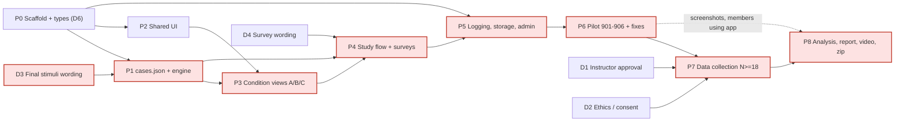

# Implementation Plan

This is the build-and-run plan for the course study (Study 1: conditions A, B and C, 15 cases, N ≥ 18). It orders the work from an empty repo to the final submission listed in `implementation.txt`: a source `.zip`, a demo video and a report. It sets out the decisions to close first, nine phases in relative weeks, who owns what, the critical path, a definition of done for each phase, the planned commands, a report checklist and the schedule risks. Weeks are relative (Week 0 to Week 8). The submission deadline is not in the repo, so **map each week to actual semester dates** once the deadline is known. Names follow `_shared-decisions.md`, and field names follow `data-model.md`.

## 1. Decisions to close before (or during) Week 0

| # | Decision | Owner | Blocks |
|---|---|---|---|
| D1 | **Instructor approval of the domain change** (loan approval to TaskPilot agent approvals), H4 changed to perceived control, and the new exploratory hypotheses H3c, H3d and H6 | Whole group; the request is sent by Bibek Gupta | Phase 7 (no real data before sign-off). Building can start before it, because the architecture does not depend on the domain. |
| D2 | **Ethics / consent.** Confirm with the instructor whether a class study needs IRB review or exemption, and get the consent text approved (draft in `study-protocol.md`) | Md Shamimul Islam | Phase 7 |
| D3 | **Final stimuli wording.** Freeze the participant-facing text for all 15 cases (task, action, B sentence, C row details) in `stimuli.md`, matching the JSON examples in `data-model.md` | Afzal Hossain Sohag + Siwani Sah | Phase 1 (`cases.json` is generated from it) |
| D4 | **Survey wording.** The perceived-control items, the Jian et al. anchor labels, and the tension and TLX frustration items | Md Shamimul Islam | Phase 4 |
| D5 | **Work split.** Confirm the ownership in `system-design.md` §7 | Whole group | Phase 0 |
| D6 | **Interface contracts.** The `Case` type, the condition-view props `{ case, onExplanationEvent }`, and the logger API (`logEvent`, `startTrial`, `recordDecision`) | Afzal (types), Mohamed (logger), Bibek (views) | Phases 2–5 running in parallel |

## 2. Phased plan

| Phase | Weeks | Scope | Main outputs |
|---|---|---|---|
| 0 Setup | 0 | Vite + React 18 + TypeScript scaffold, ESLint + Prettier, Vitest, React Router, the source tree from `architecture.md` §3 with empty files, `types.ts` with the D6 contracts, branch and PR rules | Repo that builds, lints and runs an empty test |
| 1 Data & engine | 1 | `cases.json` (policy, trustedContacts, 15 cases) from `stimuli.md`; `trustScale.json`; `rng.ts` (mulberry32); `evaluatePolicy(request)` and the pure `evaluatePolicy(request, policy, trustedContacts)`; `validateCase`; `buildPresentation(case, condition)`; `getTruth(caseId)`; `counterbalance.ts` `assign(pid)` | Engine with `rng`, `decisionEngine`, `caseBank` and `counterbalance` test suites passing |
| 2 Shared UI | 1–2 | `ActionCard` (monospace recipient, "Triggered by"), `DecisionPanel` (call badge, ~800 ms "TaskPilot is checking…" delay, Agree/Override with call-dependent hints), `PolicyPanel` (rules + trusted contacts), `LikertScale` (7-point), `SliderScale` (0–100, step 5, for TLX frustration); base styles | Components in a dev-only gallery route, layout identical across conditions |
| 3 Condition views | 2–3 | `BlackBoxView` (A), `StaticExplanationView` (B, reads `staticExplanation`, `styleArm` hook left in place), `InteractiveExplanationView` (C, "Why?" plus 3 factor rows, expand/collapse callbacks) with a fixed-height explanation area | Three views rendering any case through `buildPresentation` |
| 4 Study flow + surveys | 3–4 | `StudyContext` + `studyReducer`, routing, `ConsentScreen`, `InstructionsScreen` (practice action, 5 s gate), `TrialScreen` shell, `BlockSurveyScreen` (Jian 12 items, 2 control items, `tension` 1–7, `frustrationTlx` 0–100), `ExitSurveyScreen` (`aiAgentUse`, preferred condition), `DebriefScreen`, resume on reload | Full participant flow end to end |
| 5 Logging, storage, export, admin | 4–5 | `logger.ts` (`performance.now()`, hidden-time subtraction, `factorsExpanded[]`, `timeToFirstExpandMs`, carry-over click guard), `sessionStore.ts` (`xai-study:sessions`, save after every trial and survey), JSON + CSV export, `AdminScreen` (pid entry, assignment preview, export, confirm-to-clear), optional `VITE_SUBMIT_URL` POST | Exports that load in R/pandas with no cleanup; `logger` and `sessionStore` suites passing |
| 6 Pilot + fixes | 5–6 | Manual checks (`system-design.md` §9.2) in Chrome, Firefox and Edge; each member runs one session as pid 901–906; review against the pilot exit criteria (§9.3); fix bugs; version `cases.json` (`caseBankVersion`) if wording changes; tag the study build | Pilot log, fix list closed, frozen `dist/` build |
| 7 Data collection | 6–7 | Moderated sessions with the frozen build, following `study-protocol.md`; pids 1–18 (one full counterbalancing cycle), with withdrawn pids replaced in the same slot; export after every session | N ≥ 18 complete sessions, backed-up exports |
| 8 Analysis + submission | 7–8 | Analysis in R/Python (`system-design.md` §6); report; demo video; screenshots; `.zip` from a clean checkout | Report, video, `.zip` submitted |

```mermaid
gantt
    title Study 1 build-and-run plan (relative weeks; map to semester dates)
    dateFormat X
    axisFormat %s
    section Prerequisites
    D1-D6 decisions (approval, ethics, stimuli) :d0, 0, 2
    section Build
    P0 Setup                       :p0, 0, 1
    P1 Data and engine             :p1, 1, 2
    P2 Shared UI                   :p2, 1, 3
    P3 Condition views A B C       :p3, 2, 4
    P4 Study flow and surveys      :p4, 3, 5
    P5 Logging storage export admin :p5, 4, 6
    section Study
    P6 Pilot pids 901-906 and fixes :p6, 5, 7
    P7 Data collection N 18        :p7, 6, 8
    section Submission
    P8 Analysis report video zip   :p8, 7, 9
```

The axis shows week numbers, and each bar runs from the start of its first week to the end of its last. Phases overlap on purpose: Phase 5 work on the logger API starts as soon as the D6 contract is agreed, and the report draft starts during Phase 7.

## 3. Per-member tasks

Ownership is taken from `system-design.md` §7 and is still a proposal (D5).

| Member | Phases | Deliverables | Depends on |
|---|---|---|---|
| Afzal Hossain Sohag (case bank + engine) | 0, 1 | `types.ts` `Case`/`Factor`; `cases.json`; `rng.ts`, `decisionEngine.ts` (`evaluatePolicy`, `validateCase`, `buildPresentation`, `getTruth`), `counterbalance.ts`; `rng`, `decisionEngine`, `caseBank` and `counterbalance` tests | D3 final stimuli; Phase 0 scaffold |
| Deepthi Reddy Chelladi (A + shared components) | 2, 3 | `ActionCard`, `DecisionPanel`, `PolicyPanel`, `LikertScale`, `SliderScale`, base styles; `BlackBoxView`; visual-parity and accessibility pass | `Case` type (D6); `buildPresentation` payload shape |
| Siwani Sah (B) | 1, 3 | All 15 `staticExplanation` strings (with Afzal), peer-reviewed by a non-author; `StaticExplanationView`; Study 2 terse drafts (not built) | D3; shared components |
| Bibek Gupta (C) | 3 | `InteractiveExplanationView`, factor rows, expand/collapse events wired to `onExplanationEvent`; instructor approval request (D1) | Shared components; logger API (D6) |
| Md Shamimul Islam (flow + surveys) | 4, 8 | `StudyContext`, `studyReducer`, routes, the consent, instructions, trial-shell, block-survey, exit-survey and debrief screens; `trustScale.json`; resume on reload; ethics (D2) and survey wording (D4); demo video | Engine `assign(pid)`; condition views; D4 |
| Mohamed Sylla (logging, storage, admin) | 0, 5, 8 | `logger.ts`, `sessionStore.ts`, `AdminScreen`, CSV schema, optional POST; `logger` and `sessionStore` tests; final `.zip` from a clean checkout | Trial record type (D6); `TrialScreen` shell |
| Everyone | 6, 7, 8 | One pilot session each; moderating sessions; the "code screenshots + explanation" report section for their own files | Frozen build |

## 4. Dependencies and critical path

The critical path (shaded) is D3 → P1 → P3 → P4 → P5 → P6 → P7 → P8. Stimuli wording is the earliest item that can slip the whole plan. D1 and D2 are off the build path but gate Phase 7, so they should be requested in Week 0. Screenshots of members using the app can be taken during the pilot, which takes them off the Phase 8 path.

## 5. Definition of done per phase

Every phase also needs: the PR reviewed by one member who isn't the author, `npm run lint` and `npm test` clean, and a short demo at the weekly group meeting.

| Phase | Done when |
|---|---|
| 0 | `npm run dev` shows a placeholder app; `npm test` runs one passing test; `npm run build` produces `dist/`; every member has cloned and run it |
| 1 | The `rng`, `decisionEngine` and `caseBank` suites pass (15 cases, 9/6 split, truth = `evaluatePolicy`, `northwlnd` fails `inList`); the `counterbalance` suite passes (balance over pids 1–18, wrong-case position rule over pids 1–1000); `validateCase` rejects a deliberately mislabelled case |
| 2 | Every shared component renders in the gallery with A/B/C-ready props; recipient and trusted list use the same monospace font; keyboard focus order checked |
| 3 | The same case looks pixel-identical in A, B and C outside the explanation area; C emits expand/collapse events for all 3 factors; A and B emit none |
| 4 | A participant can go from consent to debrief for any pid; reload mid-trial and mid-survey resumes correctly; block surveys include tension and TLX frustration |
| 5 | The `logger` and `sessionStore` suites pass; `/admin` Preview for pids 1–18 matches `system-design.md` §4.3; the CSV loads in R and pandas with no manual cleanup |
| 6 | Pilot exit criteria in `system-design.md` §9.3 are met (no blocking bugs, wrong-case agreement 20–80%, no Agree/Override mapping errors); the build is tagged and `caseBankVersion` is set |
| 7 | ≥ 18 complete sessions covering pids 1–18; every session exported and backed up off the lab machine; incidents logged |
| 8 | Every checklist item in §7 is ticked; the `.zip` builds and runs from a clean checkout on a second machine |

## 6. Commands (planned)

None of these exist yet. Once they work, copy the real versions into `CLAUDE.md` and the report.

| Purpose | Command (planned) |
|---|---|
| Scaffold (Phase 0, once) | `npm create vite@latest xai-trust-study -- --template react-ts` |
| Add test and routing deps (once) | `npm install react-router-dom` and `npm install -D vitest @testing-library/react jsdom` |
| Install | `npm install` |
| Develop | `npm run dev` (Vite, `http://localhost:5173`) |
| Lint | `npm run lint` |
| Unit tests | `npm test` (Vitest) |
| Build | `npm run build` (static `dist/`) |
| Preview / lab run | `npm run preview` |

## 7. Report deliverables checklist (`implementation.txt`)

| `implementation.txt` item | What goes in | Source / owner |
|---|---|---|
| Source code as one `.zip` | Clean checkout without `node_modules/` or `dist/`, with a README that has the run steps | Mohamed |
| Video of the app running | 3–5 min: admin pid entry, consent, instructions, one trial in each of A, B and C (including "Why?" in C and one wrong call), a block survey, debrief, export | Md Shamimul |
| Brief project description | Research question, TaskPilot scenario, A/B/C, Wizard-of-Oz design | `research-positioning.md`, `_shared-decisions.md` |
| Technologies used | React 18, TypeScript, Vite, React Router, Vitest, localStorage, optional Google Apps Script; analysis in R/Python | `architecture.md` |
| Target devices | Desktop or laptop browser (Chrome, Firefox, Edge), moderated lab session; not designed for phones | `architecture.md` §4 |
| Step-by-step run from source | Install Node LTS, unzip, `npm install`, `npm run dev`, open the URL; `npm test`; `npm run build` + `npm run preview` for the lab build. Tested from a clean checkout | §6 above |
| How to interact with the app | Researcher: `/admin`, pid, export. Participant: consent → instructions → 3 parts × 5 actions (Agree/Override, policy panel, "Why?" in C) → surveys → debrief | `study-protocol.md`, `wireframes.md` |
| Screenshots of source code + explanation | Each member, for their own files: `cases.json`, `evaluatePolicy`, `assign(pid)`, the three views, `logger`, `sessionStore`, `StudyContext` | Each owner |
| Screenshots of the app running | Consent, instructions + policy, a trial in each of A/B/C, C expanded, block survey (Likert + slider), debrief, `/admin` | Deepthi |
| Screenshots of group members using it | Taken during the Phase 6 pilot, all 6 members, with no personal data on screen | Everyone |

## 8. Schedule risks

| Risk | Effect | Mitigation |
|---|---|---|
| Instructor approval of the domain change is late or refused | Phase 7 can't start | Ask in Week 0; the engine and UI don't depend on the domain, so a fallback to loan cases only means changing `cases.json` and the wording |
| Ethics or consent review takes longer than expected | Phase 7 slips | Ask in Week 0; pilot with group members only (pids 901–906) while waiting |
| Stimuli wording keeps changing | Phase 1 and every later phase slip | Freeze `stimuli.md` by the end of Week 0; later changes only through a `caseBankVersion` bump |
| Interface contracts (D6) drift between members | Integration breaks in Phases 4–5 | Agree on `types.ts` in Week 0; changes need a PR reviewed by the affected owners |
| The pilot shows ceiling or floor effects on wrong cases | Case rework plus a second pilot | Pilot keeps a 1-week buffer (Weeks 5–6); only wording changes, not the case structure |
| Fewer than 18 participants recruited | Incomplete counterbalancing cycle | Recruit from Week 4; book sessions in advance; replace withdrawn pids in the same slot |
| Data loss on the lab machine | Missing sessions unbalance the cycle | Export after every session; copy exports off the machine daily; optional POST backup |
| Report and video left to the final week | Rushed submission | Draft report sections and take screenshots during Phases 5–6; video recorded right after the build freeze |

## 9. Out of scope (paper extensions)

These are not built for the course. The data model already leaves room for them (`_shared-decisions.md`).

- **Extension 1, Study 2:** fluent vs terse explanation style, between subjects by pid parity, N = 36 (`styleArm`, `staticExplanationTerse`).
- **Extension 2, Study 3:** counterfactual condition D, 24 cases in 4 sets, a 4×4 Williams design, a cycle of 16 (`counterfactualExplanation`, `CounterfactualView`).

## Related docs

- [architecture.md](architecture.md)
- [system-design.md](system-design.md)
- [sequence-diagrams.md](sequence-diagrams.md)
- [data-model.md](data-model.md)
- [ai-design.md](ai-design.md)
- [research-positioning.md](research-positioning.md)
- [implementation-plan.md](implementation-plan.md) (this document)
- [study-protocol.md](study-protocol.md)
- [stimuli.md](stimuli.md)
- [wireframes.md](wireframes.md)
