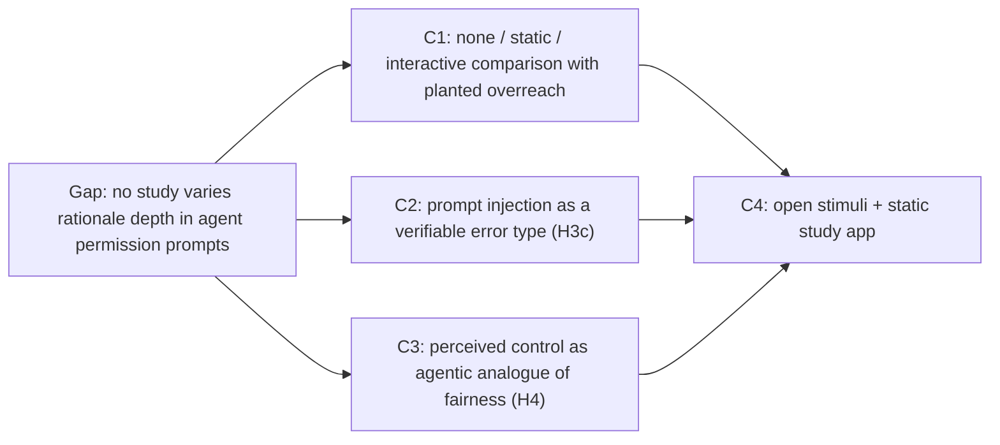

# Research positioning

This document explains why the v2 design moves the study's domain from loan approval to approving an AI agent's actions (TaskPilot permission prompts), and how the course study can become a publishable paper. It records the domain-selection analysis, the nearest prior work and the gap, LLM-era work to add to the literature review, candidate contributions, the v2 hypotheses, a two-study plan, target venues, threats to validity, and what the team must do before switching. It follows `_shared-decisions.md`. Items marked **(partially verified)** have not been fully checked against the primary source and must be confirmed before anything is submitted.

## 1. Why not loans

Loan approval is one of the most heavily used tasks in XAI and human-AI decision-making research. The literature review already leans on lending-adjacent work (Zhang et al. [29], income prediction), and the field has moved further since. The closest threat is **He, Aishwarya & Gadiraju, IUI 2025, "Is Conversational XAI All You Need? Human-AI Decision Making With a Conversational XAI Assistant"** (DOI 10.1145/3708359.3712133). It used a loan task with N = 306 and found that a conversational explainer increased understanding and trust compared with an XAI dashboard, but made overreliance worse. The authors attribute this to an *illusion of explanatory depth*. That is close to our H3a/H3b story: a richer, more engaging explanation increases agreement without improving how well people catch errors.

A reviewer who sees a three-level explanation study on loans would likely call it a replication with a smaller sample and a simpler explainer. The loan domain also has two practical weaknesses for us. Student participants have little feel for underwriting, and the fairness question (H4) depends on protected attributes that we deliberately leave out of the cases.

## 2. Domains considered

Each domain was scored 1–5 on six design-fit criteria and the scores were summed (maximum 30). The table shows the three criteria that decided the choice. Content moderation was considered but not scored.

| Domain | Saturation of prior work | On-screen verifiability of planted errors | Fit for student participants | Total (/30) | Verdict |
|---|---|---|---|---|---|
| Loan approval | Very high (IUI 2025 loan study) | High (numbers vs thresholds) | Weak | 23 | Dropped: reads as a replication |
| Phishing / scam email | High (security usability) | High | Strong | 23 | Absorbed into the agent design through the prompt-injection rule |
| AI-text detectors (academic integrity) | Medium | Low (no ground truth on screen) | Strong | 21 | Dropped: errors can't be checked on screen |
| **Agentic action approval** | **Low, very current** | **High (cost, contact list, "Triggered by")** | **Strong** | **26** | **Chosen** |
| Deepfake detection | Medium | Low (perceptual, not rule-based) | Medium | 15 | Dropped |
| Symptom triage | Medium–high | Medium | Weak (needs medical framing, ethics) | 19 | Dropped |
| Resume screening | High (bias studies) | High | Medium | 24 | Fallback if the team must keep the fairness hypothesis |
| Content moderation | High | Medium (policy judgment calls) | Medium | not scored | Dropped |

Agentic approval keeps everything the proposal needs: a stated rule set, objectively checkable calls, and wrong calls that contradict visible information. It also adds a new error type (prompt injection) that loans can't express.

## 3. Nearest prior work and the gap

- **He, Demartini & Gadiraju, CHI 2025, "Plan-Then-Execute: An Empirical Study of User Trust and Team Performance When Using LLM Agents As A Daily Assistant"** (DOI 10.1145/3706598.3713218). N = 248. Users trusted plausible-but-wrong agent plans, and involving users in planning or execution didn't consistently calibrate their trust. It varies *user involvement*, not explanation depth.
- **Microsoft Research, 2026 preprint on displays for approving computer-use agents** (arXiv 2602.16844). **Preprint, partially verified.** It varies what the agent's display shows during oversight.
- **arXiv 2608.27443** (2026 preprint). Non-programmers approved most "ask" permission prompts. It varies the permission policy and approval mode, not the rationale. **Partially verified.**
- **ConLeash** (arXiv 2605.11360). It addresses consent fatigue from repeated agent permission requests. **Partially verified.**

**Gap.** None of this work varies *how deeply the agent explains its own permission call* (none, static, interactive) while planting calls that contradict rules the participant can see. Our design does exactly that, and it separates over-permission (`false_allow`) from over-caution (`false_block`) and splits overreach by the rule it breaks.

## 4. LLM-era related work to add

These are not yet in `literature.txt` and should be added in the literature-review update (section 10).

- **Kim et al., CHI 2025, "Fostering Appropriate Reliance on Large Language Models: The Role of Explanations, Sources, and Inconsistencies"** (DOI 10.1145/3706598.3714020). Explanations increased reliance on both correct and incorrect LLM answers. Sources and inconsistencies within explanations reduced reliance on incorrect ones. This directly supports H3a and motivates the factor rows in Condition C.
- **Si et al., NAACL 2024, "Large Language Models Help Humans Verify Truthfulness – Except When They Are Convincingly Wrong."** Fluent LLM explanations led people to over-trust wrong answers. This motivates the Study 2 fluent-vs-terse arm.
- **Steyvers et al., 2025, "What Large Language Models Know and What People Think They Know," *Nature Machine Intelligence* 7:221–231.** It shows a *calibration gap*: people overestimate LLM accuracy from default explanations, and longer explanations raise confidence without improving accuracy.
- **Spatharioti, Rothschild, Goldstein & Hofman, CHI 2025, "Effects of LLM-based Search on Decision Making: Speed, Accuracy, and Overreliance."** LLM search users were as accurate as traditional-search users when the model was right, but overrelied on it when it was wrong. Confidence highlighting helped them catch errors.
- **Wilson et al., AIES 2025, "No Thoughts Just AI: Biased LLM Hiring Recommendations Alter Human Decision Making and Limit Human Autonomy."** People adopted a simulated LLM's racial preferences in resume screening. This is relevant to the resume-screening fallback and to the perceived-control framing. (Title and venue found by web search; full text **partially verified**.)
- **Wachter, Mittelstadt & Russell, 2017, "Counterfactual Explanations Without Opening the Black Box," *Harvard Journal of Law & Technology*.** The standard reference for counterfactual explanations, and the basis for condition D in Extension 2 (v2.1).
- **Hart & Staveland, 1988, development of the NASA-TLX.** The source of the frustration item used for H6 (v2.1).
- **Langer, Blank & Chanowitz, 1978** (already reference [18]). The "placebic because" is the theoretical anchor for H3a, now applied to a first-person agent rationale.

No other new citations should be added until someone has checked them against the primary source.

## 5. Candidate contributions

- **C1.** The first within-subjects comparison of no, static and interactive rationale in AI-agent permission prompts, with planted overreach (`false_allow`) and over-caution (`false_block`) that participants can check against an always-visible delegation policy.
- **C2.** Prompt injection as a verifiable error type for human oversight. H3c tests whether overreach triggered by text inside an email or web page is caught less often than overreach on cost or on a lookalike recipient, including when the injected text comes from a trusted sender (case-12).
- **C3.** Perceived control and accountability, measured as the agentic analogue of fairness, alongside trust, agreement, detection and decision time in the same participants.
- **C4.** Open materials: the 15-case bank with matched sets, the condition texts, and the static React app, so others can replicate the study or extend it online.

## 6. Research questions and hypotheses (v2, updated in v2.1)

The research questions stay the same as in `proposal.txt` (agreement, trust, error detection), except that the fourth asks about perceived control instead of fairness. v2.1 adds H3d (error-type comparison) and H6 (affect).

| ID | Hypothesis (v2) | Changed from v1? |
|---|---|---|
| H1 | Agreement goes up with depth, A < B < C. | No |
| H2 | Trust (Jian et al. [15]) is higher in B and C than in A. | No (items reworded to "the assistant") |
| H3a | On wrong calls, agreement is higher in B than in A, because a fluent first-person rationale works as a placebic "because". | Wording only (first-person agent voice) |
| H3b | (Exploratory) On wrong calls, agreement is lower in C than in B, because the breakdown makes checking cheap. | No |
| H3c | (New, exploratory) Detection of `false_allow` depends on the broken rule. Prompt-injection overreach is caught least often in every condition. | **New** |
| H4 | Perceived control is highest in C and lowest in A. | **Yes** (was fairness) |
| H5 | Decision time is longest in C, and longer times go with better detection. | No |

## 7. Study plan

**Study 1 (course study).** A moderated lab session with university students, with the three conditions A, B and C. N = 18 at minimum (N ≥ 18), which is one full counterbalancing cycle (6 condition orders × 3 set rotations). The design is 3 blocks × 5 trials, with a block survey after each block (trust, perceived control, tension and NASA-TLX frustration). Analysis is done in R or Python outside the app.

**Extension 1: explanation style (Study 2, paper).** This adds a between-subjects style factor: a **fluent** arm (the Study 1 first-person voice) and a **terse** arm (template text such as "ALLOW: cost ok, recipient trusted."). Content and factors are identical in both arms. The arm is assigned by pid parity, which needs N = 36 (two full cycles), and more if possible. Because the app is static, the same build can run online through Prolific, with attention checks and a timing-based exclusion rule set in advance. Study 2 separates the persuasive effect of *fluency* from that of *content* (Si et al.; Langer).

**Extension 2: counterfactual explanation, condition D (Study 3, paper).** This adds a fourth condition, D, which shows the call plus a "what would change this" line in the agent's voice (e.g. "I'd allow this if the cost were $50.00 or less"), following the counterfactual-explanation idea of Wachter, Mittelstadt & Russell (2017, *Harvard Journal of Law & Technology*). As in B, the line supports the AI's call on wrong cases. It needs 4 conditions × 6 cases = 24 cases in 4 matched sets (each set with 1 `false_allow` and 1 `false_block`), a 4×4 balanced Latin square for condition order (a 4-row Williams design) and a 4-set rotation, giving a counterbalancing cycle of 16 participants. Nothing about D is built for the course.

**Power caveat.** With N = 18 and only 2 wrong cases per condition per participant (1 of each error type), the error-detection hypotheses (H3a–H3d) are badly underpowered, and H6 rests on 3 block-level ratings per person. Study 1 should be reported as a pilot, with effect sizes and confidence intervals. Its estimates should drive power analyses for the extensions, and their hypotheses and analysis plans should be pre-registered. Mixed-effects logistic models (random intercepts for participant and case, with `errorType` as a fixed effect for H3d) are the planned analysis for the trial-level outcomes.

## 8. Target venues and timeline

- **Near term (Study 1 as a pilot):** CHI Late-Breaking Work, IUI posters/short papers, or CSCW posters.
- **Later (Study 1 + Study 2):** a CHI full paper, or IUI.
- **If the security and prompt-injection angle leads:** SOUPS.

Deadlines change every year, so check the current call for papers for each venue before planning around it. Work backwards from the chosen deadline: allow time for instructor sign-off, ethics review, data collection, analysis, and a full internal review of the draft.

## 9. Threats to validity

- **Wizard-of-Oz clarity of errors.** Each planted error breaks one rule that can be checked on screen. Real agent errors are messier, so detection rates are a best case (literature §8).
- **Students as a proxy.** Students are realistic users of personal assistants, but they aren't representative of all agent users, and course-adjacent recruiting may add demand effects. Study 2 on Prolific broadens the sample.
- **Single session.** Trust in agents develops over repeated use. A single 15-trial session measures first impressions, not long-term calibration.
- **Novelty of prompt injection.** Many participants won't know what prompt injection is. The instructions explain the "requested by you" rule, but low H3c detection may reflect unfamiliarity as well as explanation effects. Report participants' self-reported familiarity, and consider a comprehension check.
- **Within-subjects carry-over.** Seeing one condition can change how people judge the others [2], and an observed error lowers trust for the rest of the session [10]. Counterbalancing helps, but carry-over should be tested as an order effect.

## 10. What the team must do before switching

1. **Instructor approval.** The domain change and the swap of H4 from fairness to perceived control depart from the approved `proposal.txt`. Get written sign-off from Prof. Hamam before building.
2. **Update the literature review.** Reframe sections 1, 7 and 9 around agent oversight. Add He et al. (IUI 2025), He et al. (CHI 2025) and the section 4 papers. Confirm every item marked partially verified, and drop any that can't be confirmed.
3. **IRB and ethics check.** Ask whether the course study needs IRB review or an exemption, and whether Study 2 (publication, online recruiting, payment) needs full review. Keep all people and domains fictional, and keep the debrief that reveals the planted errors.
4. **Ethics approval for affect measures (v2.1).** The tension and NASA-TLX frustration items ask about participants' emotional state. Make sure the consent form and the ethics submission name them, that participants can skip them, and that the debrief addresses any stress from the planted errors.
5. **Run a real literature search.** Search Google Scholar and the ACM Digital Library for at least these queries, and record what was found before claiming the gap or any contribution:
   - "false positive vs false negative AI error explanation" (for H3d / C2)
   - "emotional response incorrect AI" (for H6 / C5)
   - "counterfactual explanation overreliance" (for Extension 2)
   - "agent permission prompt explanation" (for the gap in section 3)

   Add only papers someone has read in the primary source. Until then, the only new references beyond section 4 are Wachter et al. (2017) and Hart & Staveland (1988).

## Related docs

- [architecture.md](architecture.md)
- [system-design.md](system-design.md)
- [sequence-diagrams.md](sequence-diagrams.md)
- [data-model.md](data-model.md)
- [ai-design.md](ai-design.md)
- [implementation-plan.md](implementation-plan.md)
- [study-protocol.md](study-protocol.md)
- [stimuli.md](stimuli.md)
- [wireframes.md](wireframes.md)
