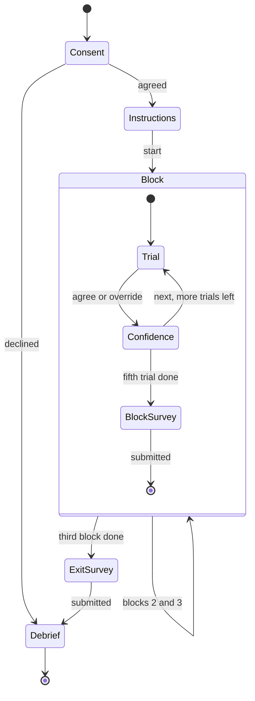
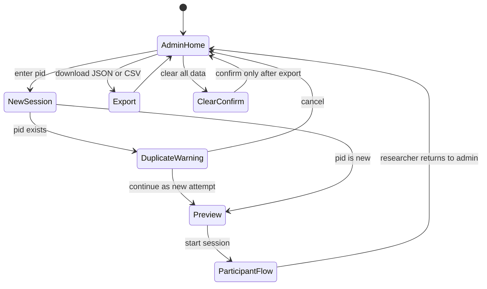

# System Design: Explanation Depth Study App (v2: TaskPilot agent approvals)

This document turns the approved proposal (`proposal.txt`) and the hypotheses in `literature.txt` §9 into a buildable specification for the study app, using the v2 scenario: the participant approves or overrides actions proposed by **TaskPilot**, a fictional AI assistant agent that checks each action against the participant's delegation policy. It covers the requirements and how each one traces back to the proposal or a hypothesis, the participant and admin flows, a screen-by-screen spec, the exact counterbalancing scheme for 18 participants, how timing and logging work, which logged fields feed which analysis, a proposed split of work across the six team members, risks, the test and pilot plan, and the two planned paper extensions (an explanation-style arm and a counterfactual condition D). v2.1 adds two per-block affect items (`tension` and the NASA-TLX `frustrationTlx`), hypothesis H3d (overreach vs over-caution detection, a headline comparison) and H6 (affect by condition). Where this doc and `_shared-decisions.md` disagree, `_shared-decisions.md` wins. Module and field names follow it exactly.

> **Deviation from the approved proposal.** The proposal used a different, heavily studied decision scenario. v2 keeps the research questions, the A/B/C manipulation, the planted errors, the within-subjects design and the counterbalancing, but changes the scenario to agent permission prompts and changes H4 from fairness to perceived control. The rationale is in `research-positioning.md`. **This change needs sign-off from the instructor before any real data is collected.**

---

## 1. Requirements

### 1.1 Functional requirements

| ID | Requirement |
|---|---|
| FR-1 | The researcher starts a session by entering a numeric participant ID (`pid`) on `/admin`. The app warns if that `pid` already has a stored session. |
| FR-2 | The participant must give informed consent before seeing any case. If they decline, the app goes straight to `DebriefScreen` and records no trial data. |
| FR-3 | The instructions screen explains the scenario (you delegate tasks to TaskPilot, and it checks each action against your policy), shows the delegation policy (cost ≤ $50.00, trusted recipient, requested by you) and the trusted-contacts list, and walks through one neutral practice action with no TaskPilot call on it. |
| FR-4 | Every case, the `policy` and the `trustedContacts` are loaded from `src/data/cases.json`. The three condition views read the same case objects through `decisionEngine.ts`. |
| FR-5 | Condition A (`BlackBoxView`) shows only TaskPilot's call (ALLOW or BLOCK). |
| FR-6 | Condition B (`StaticExplanationView`) shows the call plus `staticExplanation`, one first-person sentence in TaskPilot's voice. |
| FR-7 | Condition C (`InteractiveExplanationView`) shows the call plus a "Why?" button. The button opens a panel with three rows (Cost, Recipient, Requested by), each showing the true value, the rule and ✓/✗, and each row expands to show its `detail`. |
| FR-8 | All three views render the shared `<ActionCard/>`, `<DecisionPanel/>` and `<PolicyPanel/>`. Only the explanation area differs between them. |
| FR-9 | `<PolicyPanel/>` opens on every trial from a "Your policy" button that looks the same and sits in the same place in all conditions. It shows the three rules and the full trusted-contacts list. |
| FR-10 | On each trial the participant clicks **Agree** (go with TaskPilot's call) or **Override** (do the opposite). `agreed = true` means they went with TaskPilot. Each button has a one-line hint under it saying what will happen. The choice is final once clicked. |
| FR-11 | After the Agree/Override choice, the app asks an optional confidence rating (1–7) before the "Next" button. |
| FR-12 | `counterbalance.ts` assigns condition order, the set-to-condition mapping, and the within-block trial order, deterministically from `pid` (see §4). |
| FR-13 | After each block of 5 trials, the participant completes the block survey: Jian et al. 12 items (worded "the assistant") plus 2 perceived-control and accountability items, all on 7-point scales, then the two affect items (FR-23, FR-24). The full order and validation are in §3.2. |
| FR-14 | After block 3, the participant completes the exit survey: demographics, how often they use AI assistants or agents, preferred part, and an open comment. |
| FR-15 | The logger records per-trial measures and a timestamped event stream (see §5). |
| FR-16 | The session is written to `localStorage` (`xai-study:sessions`) after every trial and every survey submit. |
| FR-17 | `/admin` lists sessions and exports all of them as JSON and as CSV (one row per trial, plus a survey CSV). |
| FR-18 | Optional: when `VITE_SUBMIT_URL` is set, each finished session is POSTed to it. If the POST fails, nothing is lost, because localStorage is still the primary copy. |
| FR-19 | If the page is reloaded mid-session, the app resumes at the first trial or survey that has no saved response. |
| FR-20 | Recipients and vendors are shown character-for-character, in a monospace font, in both the `ActionCard` "To" field and the trusted-contacts list, with no highlighting of differences. A lookalike address (e.g. `northwlnd.edu`) must be detectable by comparison alone. |
| FR-21 | The `ActionCard` always shows a "Triggered by" field: `you` for the participant's own instruction, or the named source (an email, a web page, a document) for anything else. |
| FR-22 | `DebriefScreen` explains that TaskPilot was scripted, that 6 of the 15 calls were deliberately wrong, and what prompt injection is, with the injected cases pointed out. |
| FR-23 | (v2.1) Each block survey asks `tension`, "How tense did you feel while making decisions in this part?", on a 1–7 scale, once per block, after the control items. There is no per-trial affect rating. |
| FR-24 | (v2.1) Each block survey ends with `frustrationTlx`, the raw NASA-TLX frustration item, "How irritated, stressed or annoyed did you feel during this part?", on a 0–100 slider in steps of 5 (21 points). The slider counts as answered only after the participant has moved it at least once (§3.2). |
| FR-25 | (v2.1) Every trial record keeps `errorType` (`false_allow`/`false_block`/null) and `detectedError`, and the CSV export carries both on every row, so every wrong-call analysis can be split by error type (H3d) and the number of wrong calls detected in each block can be computed for H6. |

### 1.2 Non-functional requirements

| ID | Requirement |
|---|---|
| NFR-1 | Static SPA (React 18 + TS + Vite). It needs no server and no database, and runs with `npm install && npm run dev`, or from the `npm run build` output. |
| NFR-2 | It runs on current desktop Chrome, Firefox, and Edge at a viewport of 1280×720 or larger. Mobile is out of scope. |
| NFR-3 | Decision time is measured with `performance.now()` and resolves to the millisecond. UI work between the call appearing and the click doesn't add more than one frame (about 16 ms) of bias. |
| NFR-4 | Assignment is reproducible: the same `pid` always gives the same orders, sets, and trial sequence (seeded mulberry32). |
| NFR-5 | Losing data is limited to the trial in progress at most (FR-16). |
| NFR-6 | Visual parity: in all three conditions the action card, call badge, buttons, hints, and "Your policy" button have the same layout, size, and position. |
| NFR-7 | The UI shows no information that could leak a case's correctness: no `isAiCorrect`, no `errorType`, and no AI confidence score. Every call appears after the same fixed ~800 ms "TaskPilot is checking…" delay. |
| NFR-8 | Data is anonymous. The app stores only `pid` plus survey answers, with no names or emails of participants. Every person, address and vendor in the cases is fictional (`.example` domains or the fictional `northwind.edu`). |
| NFR-9 | A full session takes about 20–25 minutes (budget in §3.3). The affect items are asked per block, not per trial, to stay inside it. |
| NFR-10 | Accessibility: everything can be done with the keyboard, color is never the only cue (pass/fail rows also show ✓/✗ and text; ALLOW/BLOCK is spelled out), and contrast is WCAG AA. |

### 1.3 Traceability

| Requirement | Proposal element | Hypothesis served |
|---|---|---|
| FR-4, NFR-1 | "case-bank backend (a JSON file is sufficient)", "no database" | All |
| FR-5, FR-6, FR-7, FR-8, NFR-6 | "The Three Conditions" table | H1, H2, H3a, H3b, H4, H5 |
| FR-3, FR-9, FR-20, FR-21 | Wrong calls contradict criteria the participant can see (v2: the delegation policy and trusted list) | H3a, H3b, H3c |
| FR-10 | "agreement (yes/no)" | H1, H3a, H3b, H3c |
| FR-11 | Trust measured behaviourally and by self-report (Hoffman et al., lit. §8) | H2 (supporting) |
| FR-12, NFR-4 | "case order and condition-case pairing counterbalanced"; position of wrong cases (lit. §8) | All (controls order effects) |
| FR-13 | "trust score (Likert)", "Jian et al."; v2 replaces the fairness rating with perceived control (deviation, needs instructor sign-off) | H2, H4 |
| FR-23, FR-24 | Not in the proposal: adopted in v2.1 from Deepthi's alternative proposal (tension and NASA-TLX frustration) | H6 |
| FR-25 | Planted errors of two kinds (`false_allow` and `false_block` in every set); "missed error vs false alarm" comparison adopted from Deepthi's proposal | H3d, H6 |
| FR-14 | Research question on the most preferred condition (preference supplements it) | H4 (supporting) |
| FR-15, NFR-3 | "time-to-decision" | H5 |
| FR-10, FR-15 (`detectedError` by `errorType`) | "agreement (yes/no)" on the planted wrong cases | H3d |
| FR-7 + FR-15 (expand events) | CLAUDE.md: needed to tell whether C was actually used | H3b, H5 |
| FR-16, FR-17, FR-19, NFR-5 | "Survey/data collection layer" | All |
| FR-18 | Optional Google-Form-style collection | All |
| FR-1, FR-2, FR-22, NFR-8 | Study ethics, moderated lab session, debrief | — |
| NFR-7 | Planted errors must be detected from the data alone | H3a, H3b, H3c |
| NFR-2, NFR-10 | `implementation.txt`: target devices, run steps, demo | — |
| NFR-9 | Session length; per-block (not per-trial) affect items | H6 (keeps fatigue out of the affect ratings) |

---

## 2. Flows

### 2.1 Participant flow



`Confidence` is part of `TrialScreen`: the same screen gets a second step, and the route doesn't change. Block index and trial index are kept in `StudyContext`, and the URL is `/trial/:block/:trial`, so a reload lands in the right place (FR-19). Stored records use `blockIndex` 1–3 and `positionInBlock` 1–5.

### 2.2 Admin (researcher) flow



`/admin` isn't linked from any participant screen, and the researcher opens it by URL. "Preview" shows the assignment for that `pid` (order, sets, case IDs, wrong-case positions), so the researcher can check it against the table in §4.3 before handing over the laptop.

---

## 3. Screen-by-screen spec

All screens are in `src/study/`. "Logged" means an event goes to `logger.ts`, with `{type, ts: performance.now(), wallClock: ISO string, payload}`.

| Screen | Shows | Inputs | Logged / stored |
|---|---|---|---|
| `AdminScreen` | Session list (pid, start time, status, trial count), the new-session form, assignment preview, export buttons, clear button | pid (int ≥ 1), buttons | `session_created {pid, assignment, attempt}`; nothing is logged for exports |
| `ConsentScreen` | Study purpose ("how people supervise an AI assistant that acts on their behalf"), duration, voluntariness, data use, contact | "I agree" / "I do not agree" | `consent {given: bool}` |
| `InstructionsScreen` | The scenario: "You have a personal AI assistant, TaskPilot. You give it tasks and it carries them out for you. Before each action, it checks the action against your policy and tells you its call: ALLOW or BLOCK. You then Agree or Override." The `PolicyPanel` is shown open: the three rules and the trusted-contacts list. One labelled tour of an `ActionCard` explains each field (Your task, Proposed action, To, Cost, Triggered by) in neutral terms. One practice action with no TaskPilot call (see below), and a note that "TaskPilot may make mistakes" (the same wording for every pid). | "Start" (enabled after 5 s, so it can't be skipped by accident) | `instructions_viewed {durationMs}` |
| `TrialScreen` | Progress ("Task 3 of 5 · Part 2 of 3"), `ActionCard`, `DecisionPanel` with TaskPilot's call, the condition view's explanation area, the "Your policy" button, and the Agree / Override buttons, each with a one-line hint | Agree / Override; then confidence 1–7 (optional) and "Next"; in C: "Why?" and factor rows | `trial_shown`, `policy_toggled`, `explanation_opened`/`explanation_closed`, `factor_expanded`/`factor_collapsed {key}`, `decision {agreed}`, `confidence {value|null}`, `visibility {state}`, `trial_saved`; the per-trial record (§5.3) |
| `BlockSurveyScreen` | The heading "About the assistant you just used (Part N)" and 16 items in a fixed order: 12 Jian, 2 perceived control (7-point radio rows), `tension` (7-point radio row), `frustrationTlx` (0–100 slider). Full spec in §3.2 | All 16 are required; the slider must be moved at least once | `block_survey_submitted {block, condition, responses[], control1, control2, tension, frustrationTlx, durationMs}` |
| `ExitSurveyScreen` | Age range, gender (optional), field of study, how often they use AI assistants or agents (1–7), preferred part (1/2/3 with a one-line reminder of each), and an open comment | Required: preferred part and AI-assistant use | `exit_survey_submitted {…}` |
| `DebriefScreen` | A thank-you message, then the debrief: (1) TaskPilot was not a real AI and every call was scripted by the research team; (2) 6 of the 15 calls were deliberately wrong, to see whether people would notice; (3) what **prompt injection** is: text inside an email or web page that tries to give the agent instructions you never gave; the injected actions are shown again with their "Triggered by" field pointed out; (4) agreeing with a wrong call is common and says nothing bad about the participant; (5) every person, address and vendor was fictional. Ends with an instruction to call the researcher. No back button. | — | `session_completed`; triggers the optional POST (FR-18) |

The surveys never name the condition letter or "black box". Participants see "Part 1/2/3", and the export maps each part to its condition.

**Trial button wording.** The hint under each button depends on TaskPilot's call, so the participant never has to work out the double negative of "overriding a block":

| TaskPilot's call | Agree hint | Override hint |
|---|---|---|
| ALLOW | "The action goes ahead." | "The action is stopped." |
| BLOCK | "The action stays stopped." | "The action goes ahead anyway." |

**Practice action.** The instructions use one action that is not in the case bank and is not about injection: "Buy a notebook for class", purchase, `bookstore.northwind.edu`, $6.00, triggered by you. It passes every rule. The participant checks it against the policy with no TaskPilot call shown and sees a short worked check (✓ cost, ✓ trusted, ✓ requested by you). See §8 for why the practice example deliberately avoids injection.

### 3.1 Trial screen wireframes

`<ActionCard/>` (left), `<DecisionPanel/>` (right) and the "Your policy" button (top right) are pixel-identical across conditions. Only the box marked **EXPLANATION AREA** changes. It keeps a fixed minimum height, so the buttons and hints sit in the same place in all three conditions (NFR-6). The example is `case-07` (S2, `false_allow`, lookalike domain): TaskPilot says ALLOW, but `r.patel@northwlnd.edu` is not on the trusted list (`r.patel@northwind.edu` is), so the true answer is BLOCK.

**Condition A: Black Box (`BlackBoxView`)**

```
+--------------------------------------------------------------------------+
| Part 1 of 3 · Task 2 of 5                                [Your policy v]|
+-----------------------------------+--------------------------------------+
| ACTION                            |  TASKPILOT                           |
|  Your task:                       |  +--------------------------------+  |
|   Send my essay draft to          |  |  ALLOW                         |  |
|   Dr. Patel                       |  |  Ready to go: this fits your   |  |
|  Proposed action:                 |  |  rules.                        |  |
|   send email: attach essay draft  |  +--------------------------------+  |
|  To:                              |  +- EXPLANATION AREA -------------+  |
|   r.patel@northwlnd.edu  (mono)   |  |                                |  |
|  Cost:          $0.00             |  |   (empty: call only)           |  |
|  Triggered by:  you               |  |                                |  |
|                                   |  +--------------------------------+  |
|                                   |  [   Agree    ]     [  Override  ]   |
|                                   |  The action        The action is     |
|                                   |  goes ahead.       stopped.          |
+-----------------------------------+--------------------------------------+
```

**Condition B: Static (`StaticExplanationView`)**

```
+--------------------------------------------------------------------------+
| Part 2 of 3 · Task 2 of 5                                [Your policy v]|
+-----------------------------------+--------------------------------------+
| ACTION                            |  TASKPILOT                           |
|  (identical ActionCard)           |  +--------------------------------+  |
|                                   |  |  ALLOW                         |  |
|                                   |  |  Ready to go: this fits your   |  |
|                                   |  |  rules.                        |  |
|                                   |  +--------------------------------+  |
|                                   |  +- EXPLANATION AREA -------------+  |
|                                   |  | "I checked this: it goes to    |  |
|                                   |  | Dr. Patel, a trusted contact,  |  |
|                                   |  | at no cost."                   |  |
|                                   |  +--------------------------------+  |
|                                   |  [   Agree    ]     [  Override  ]   |
|                                   |  The action        The action is     |
|                                   |  goes ahead.       stopped.          |
+-----------------------------------+--------------------------------------+
```

**Condition C: Interactive (`InteractiveExplanationView`), after "Why?" and one row expanded**

```
+--------------------------------------------------------------------------+
| Part 3 of 3 · Task 2 of 5                                [Your policy v]|
+-----------------------------------+--------------------------------------+
| ACTION                            |  TASKPILOT                           |
|  (identical ActionCard)           |  +--------------------------------+  |
|                                   |  |  ALLOW                         |  |
|                                   |  |  Ready to go: this fits your   |  |
|                                   |  |  rules.                        |  |
|                                   |  +--------------------------------+  |
|                                   |  +- EXPLANATION AREA -------------+  |
|                                   |  | [ Why? ^ ]                     |  |
|                                   |  | > Cost   $0.00 vs <= $50.00  ✓ |  |
|                                   |  | v To     r.patel@northwlnd.edu |  |
|                                   |  |          vs trusted list     ✗ |  |
|                                   |  |   "Addressed to Dr. Patel, as  |  |
|                                   |  |    you asked."                 |  |
|                                   |  | > Requested by  you          ✓ |  |
|                                   |  +--------------------------------+  |
|                                   |  [   Agree    ]     [  Override  ]   |
|                                   |  The action        The action is     |
|                                   |  goes ahead.       stopped.          |
+-----------------------------------+--------------------------------------+
```

**Policy panel (same in all conditions, opened from "Your policy")**

```
+- YOUR POLICY ----------------------------------------+
| TaskPilot should ALLOW an action only if all hold:   |
|  1. Cost: at most $50.00                             |
|  2. Trusted recipient: exactly on the list below     |
|  3. Requested by you: from your own instruction      |
|                                                      |
| Trusted contacts                                     |
|  alex.chen@northwind.edu      (roommate)             |
|  r.patel@northwind.edu        (Dr. Patel, professor) |
|  studygroup@northwind.edu                            |
|  maria.r@mailbox.example      (Mom)                  |
|  bookstore.northwind.edu      (campus bookstore)     |
|  cloudprint.example           (printing service)     |
+------------------------------------------------------+
```

In C, the factor rows show each row's `passes` value, which `decisionEngine.ts` computes from the true request values and the policy, so the breakdown is truthful and verification gets easier (the H3b mechanism): the Recipient row shows ✗. In B, the scripted `staticExplanation` is fluent, confident, and leaves out the broken rule (the H3a mechanism). In C, the row `detail` text may carry the same plausible framing ("Addressed to Dr. Patel, as you asked."), but the ✓/✗ is always computed from the rules. `ai-design.md` owns the wording rules. The "To" field, the factor row and the trusted list all use the same monospace font, and none of them highlights the differing character (FR-20).

The panel in C starts collapsed on every trial. Opening it doesn't move the buttons, because the explanation area has a fixed height and scrolls inside itself if it overflows. The policy panel opens as an overlay anchored to the "Your policy" button, so opening it doesn't move anything either.

### 3.2 `BlockSurveyScreen` spec (v2.1)

Owned by the study flow and surveys owner (Md Shamimul Islam, §7). Items are loaded from `trustScale.json` and always shown in this order, on one scrolling page, with no randomisation (so the affect items never come before the trust items):

| # | Item(s) | Field | Response format | Hypothesis |
|---|---|---|---|---|
| 1–12 | Jian et al. (2000) Trust in Automation, "automation" worded as "the assistant"; items 1–5 reverse-scored at analysis | `responses[]` (`jian-01`…`jian-12`) | 7-point radio row, 1 = not at all, 7 = extremely | H2 |
| 13 | "I felt in control of what the assistant did on my behalf" | `control1` | 7-point radio row | H4 |
| 14 | "I would accept responsibility for the outcomes of these actions" | `control2` | 7-point radio row | H4 |
| 15 | "How tense did you feel while making decisions in this part?" | `tension` | 7-point radio row, 1 = not at all tense, 7 = extremely tense | H6 |
| 16 | NASA-TLX frustration: "How irritated, stressed or annoyed did you feel during this part?" | `frustrationTlx` | Horizontal slider 0–100, step 5 (21 points), end labels "Very low" / "Very high", value shown under the thumb | H6 |

**Validation.**
- Continue stays disabled until all 16 items have an answer. Unanswered items are outlined and named in a summary line above Continue ("2 questions still need an answer"), and focus moves to the first one.
- Radio items accept integers 1–7 only. `tension` uses the same radio component as the other 7-point items.
- The slider's thumb starts at 50 but **does not count as an answer until the participant moves it** (pointer drag or arrow keys). The screen tracks `frustrationTlxTouched`. If Continue is pressed while it is false, the slider is outlined with "Please set this slider, even if you leave it at 50." Moving away and back to 50 counts as answered.
- The stored `frustrationTlx` must be an integer in [0, 100] divisible by 5. Any other value is rejected before saving (a guard against bad keyboard or touch input).
- Raw values are stored as given. No reverse-scoring is applied to `tension` or `frustrationTlx`. Higher means more tension or frustration.
- Submit is locked once pressed (§5.4) and the survey is saved before navigation (§5.5). On reload mid-survey, the block survey is shown again empty, and `frustrationTlxTouched` resets to false.
- The heading never names the condition letter. The affect items ask about "this part", matching the "Part N" heading.

### 3.3 Session-length budget

Target total: about **20–25 minutes** (NFR-9). The pilot (§9.3) times each phase from the event stream.

| Phase | Contents | Estimated time |
|---|---|---|
| Consent | Purpose, data use, agree/decline | 1.5–2 min |
| Instructions + practice | Scenario, policy panel, ActionCard tour, Agree/Override hints, one practice action (5 s minimum) | 4–5 min |
| Trials | 3 blocks × 5 trials at about 32–40 s each (800 ms delay, checking, decision, optional confidence) | 8–10 min |
| Block surveys | 3 × 16 items (12 Jian + 2 control + tension + TLX frustration) at about 1.5–1.7 min each; the two affect items add about 15 s per block | 4.5–5 min |
| Exit survey | Demographics, AI-agent use, preferred part, comment | 1–1.5 min |
| Debrief | Scripted-AI disclosure, wrong calls, prompt injection, questions | 1–1.5 min |
| **Total** | | **≈ 20–25 min** |

If the pilot runs over 25 minutes, the first cut is the optional per-trial confidence rating, not the affect items or any hypothesis measure.

---

## 4. Counterbalancing

Implemented in `src/engine/counterbalance.ts`, using `src/engine/rng.ts`.

### 4.1 The 6 condition orders

`order = permutations[(pid - 1) % 6]`

| Index | Order (block 1 → 2 → 3) |
|---|---|
| 0 | A → B → C |
| 1 | A → C → B |
| 2 | B → A → C |
| 3 | B → C → A |
| 4 | C → A → B |
| 5 | C → B → A |

Over every 6 participants, each condition appears exactly twice in each block position, and each condition comes immediately before each other condition exactly once.

### 4.2 Latin-square set rotation

`rotation = floor((pid - 1) / 6) % 3`. The set for condition `c` (A=0, B=1, C=2) is `S[(c + rotation) % 3 + 1]`.

| Rotation | A uses | B uses | C uses | pids |
|---|---|---|---|---|
| 0 | S1 | S2 | S3 | 1–6 |
| 1 | S2 | S3 | S1 | 7–12 |
| 2 | S3 | S1 | S2 | 13–18 |

Each set is paired with each condition for exactly 6 of the 18 participants. Because the order varies independently, each set also shows up in each block position 6 times. Because the broken rule of each set's `false_allow` rotates (S1 cost, S2 trusted recipient, S3 requested by you), each rule type is also paired with each condition 6 times, which H3c relies on.

### 4.3 Full assignment for pid 1–18 (one complete cycle)

Each cell is condition / set for that block position. pid 19 starts the cycle again, so it's the same as pid 1, apart from its within-block shuffle.

| pid | Order idx | Order | Rotation | Block 1 | Block 2 | Block 3 |
|---|---|---|---|---|---|---|
| 1 | 0 | A-B-C | 0 | A / S1 | B / S2 | C / S3 |
| 2 | 1 | A-C-B | 0 | A / S1 | C / S3 | B / S2 |
| 3 | 2 | B-A-C | 0 | B / S2 | A / S1 | C / S3 |
| 4 | 3 | B-C-A | 0 | B / S2 | C / S3 | A / S1 |
| 5 | 4 | C-A-B | 0 | C / S3 | A / S1 | B / S2 |
| 6 | 5 | C-B-A | 0 | C / S3 | B / S2 | A / S1 |
| 7 | 0 | A-B-C | 1 | A / S2 | B / S3 | C / S1 |
| 8 | 1 | A-C-B | 1 | A / S2 | C / S1 | B / S3 |
| 9 | 2 | B-A-C | 1 | B / S3 | A / S2 | C / S1 |
| 10 | 3 | B-C-A | 1 | B / S3 | C / S1 | A / S2 |
| 11 | 4 | C-A-B | 1 | C / S1 | A / S2 | B / S3 |
| 12 | 5 | C-B-A | 1 | C / S1 | B / S3 | A / S2 |
| 13 | 0 | A-B-C | 2 | A / S3 | B / S1 | C / S2 |
| 14 | 1 | A-C-B | 2 | A / S3 | C / S2 | B / S1 |
| 15 | 2 | B-A-C | 2 | B / S1 | A / S3 | C / S2 |
| 16 | 3 | B-C-A | 2 | B / S1 | C / S2 | A / S3 |
| 17 | 4 | C-A-B | 2 | C / S2 | A / S3 | B / S1 |
| 18 | 5 | C-B-A | 2 | C / S2 | B / S1 | A / S3 |

Recruitment target: a multiple of 18 completers (18 is the minimum). If a participant withdraws, the next new participant takes that participant's `pid` slot in a new session (new `sessionId`; the withdrawn session is kept with status `abandoned`), so the cycle stays balanced. Pilot sessions use `pid` ≥ 900 and are left out of the analysis.

### 4.4 Within-block trial shuffle

Each set has 5 cases: 3 correct and 2 wrong (one `false_allow`, one `false_block`). Within a block, the 5 cases are put in a random order using the seeded PRNG, with one constraint: **the two wrong cases must not take positions 1 and 2 together.** A participant who sees two errors back to back right at the start of a block would have their trust in that condition anchored by those errors (Dzindolet et al., lit. §8).

Out of the C(5,2) = 10 possible wrong-case position pairs, 9 are allowed. Across participants, the two wrong cases land in different positions, which keeps position from being confounded with condition. The analysis can include the wrong case's trial position as a covariate, because it's logged.

The PRNG is a single mulberry32 stream seeded with `pid`. It's consumed in block order (block 1, then 2, then 3), so the sequence for each block is fixed by `pid` alone. Shuffling uses rejection sampling: shuffle with Fisher–Yates, and if the constraint is violated, shuffle again from the same stream. The expected number of attempts is 10/9, and the loop is capped at 100 attempts, which in practice is never reached. If the cap were hit, the fallback deterministically swaps the case at position 2 with the first correct case found in positions 3–5.

### 4.5 `assign(pid)` pseudocode

```ts
const PERMS = [["A","B","C"],["A","C","B"],["B","A","C"],
               ["B","C","A"],["C","A","B"],["C","B","A"]] as const;
const SETS = ["S1","S2","S3"] as const;
const COND_INDEX = { A: 0, B: 1, C: 2 };

function assign(pid: number, cases: Case[]): Assignment {
  if (!Number.isInteger(pid) || pid < 1) throw new Error("pid must be integer >= 1");
  const order    = PERMS[(pid - 1) % 6];
  const rotation = Math.floor((pid - 1) / 6) % 3;
  const rng      = mulberry32(pid);                       // rng.ts

  const blocks = order.map((condition, blockIdx) => {
    const set      = SETS[(COND_INDEX[condition] + rotation) % 3];
    const setCases = cases.filter(c => c.set === set);    // exactly 5: 3 correct, 2 wrong
    const caseIds  = constrainedShuffle(setCases, rng).map(c => c.id);
    return { blockIndex: blockIdx + 1, condition, set, caseIds };
  });

  return { pid, orderIndex: (pid - 1) % 6, rotation, order, blocks };
}

function constrainedShuffle(xs: Case[], rng: () => number): Case[] {
  for (let attempt = 0; attempt < 100; attempt++) {
    const a = fisherYates([...xs], rng);
    const bothWrongFirstTwo = !a[0].isAiCorrect && !a[1].isAiCorrect;
    if (!bothWrongFirstTwo) return a;
  }
  // deterministic fallback (practically unreachable)
  const a = [...xs];
  const j = a.findIndex((c, i) => i >= 2 && c.isAiCorrect);
  [a[1], a[j]] = [a[j], a[1]];
  return a;
}
```

The full `Assignment` object is saved into the session at creation time and exported. Analysis never recomputes it, but a unit test checks that recomputing gives the same result (§9). Study 2 adds one field to the session, `styleArm`, which `assign` does not touch (§10.1).

---

## 5. Timing and logging

### 5.1 Decision timer

| Event | Action |
|---|---|
| Start | `TrialScreen` mounts with the case and shows "TaskPilot is checking…" for a fixed ~800 ms in every condition. When the call is revealed, a `requestAnimationFrame` callback inside a `useLayoutEffect` sets `shownAt = performance.now()` and logs `trial_shown`. This happens after the call badge has been painted. |
| Stop | The first valid Agree/Override click: `decidedAt = performance.now()`. |
| Not counted | The fixed delay comes before `shownAt`. The confidence rating and "Next" come after `decidedAt`. Opening the policy panel or "Why?" happens before the decision, so it is included (that's the point of H5). |
| Derived | `decisionTimeRawMs = decidedAt - shownAt`; `decisionTimeMs = decisionTimeRawMs - hiddenMs`. |
| C-specific | `timeToFirstExpandMs = firstExplanationOpenAt - shownAt` (null if never opened, and always null in A and B). |

### 5.2 Tab blur / visibility change

- The logger listens to `document.visibilitychange` and `window.blur`/`focus` while a trial is active.
- When the tab goes hidden, it records `hiddenSince = performance.now()`. When it becomes visible again, it adds the gap to `hiddenMs` and increments `hiddenCount`. Every change also goes into the event stream.
- `window.blur` without a hidden tab (for example, clicking on another monitor) only increments `blurCount`. It isn't subtracted, because the participant may still be reading.
- If a trial has `hiddenCount > 0` or `decisionTimeMs > 120000`, it gets `timingFlag = true`. Analysis can exclude flagged trials or winsorize them. They are never deleted.
- The session is moderated, so the researcher discourages tab switching during the briefing. These fields are there to catch accidents.

### 5.3 Per-trial record

This is the core record the app writes. `data-model.md` holds the canonical schema.

`pid, sessionId, blockIndex, condition, set, positionInBlock, trialIndex, caseId, aiDecision, groundTruth, isAiCorrect, errorType, agreed, detectedError, decisionTimeMs, decisionTimeRawMs, hiddenMs, hiddenCount, blurCount, timingFlag, policyOpened, explanationOpened, factorsExpanded[] (keys in order), timeToFirstExpandMs, confidence, resumed`

`agreed = true` means the participant went with TaskPilot's call (Agree), whatever that call was. `detectedError = !agreed` on wrong cases and `null` on correct ones. In A and B, `explanationOpened = null`, `timeToFirstExpandMs = null` and `factorsExpanded = []`. The trial id is `${pid}-${blockIndex}-${positionInBlock}`.

### 5.4 Double-click and accidental-input guards

- **Synchronous lock:** Agree and Override share one `useRef` flag, `decidedRef`. The first click sets it before any state update, and later clicks return immediately. This guards against React batching letting two clicks through.
- **Carry-over clicks:** a decision only counts if its `pointerdown` *and* `click` both land on the button after `shownAt`. That stops a double-click on the previous screen's "Next" from registering on the new trial's button. The buttons are disabled during the "TaskPilot is checking…" delay. Keyboard activation (Enter/Space on a focused button) is accepted, but focus starts on the page heading, not on a button.
- **Next:** disabled after the first press. Navigation is idempotent: the reducer ignores `NEXT_TRIAL` if the trial record at that index is already saved.
- **Survey submit:** disabled once pressed, and validation runs before the lock.
- **Reload mid-trial:** a trial with no saved decision is shown again with a new timer, and gets `resumed = true`, and a `session_resume` event is logged.

### 5.5 Persistence

`sessionStore.save(session)` writes the whole storage root (`{schemaVersion, activeSessionId, sessions}` under the single key `xai-study:sessions`, with sessions keyed by `sessionId`; see `data-model.md` §7) after every `decision` and confidence/Next, and after every survey submit. A failed write (quota or private mode) shows a blocking banner telling the participant to call the researcher. The app never carries on silently without saving.

---

## 6. Measures to hypotheses

All analysis is done outside the app in R or Python, working from the trial CSV and the survey CSV. With N = 18 and 2 wrong cases per condition per participant, the tests on wrong cases (H3a/H3b/H3c/H3d) have low power. They should be reported with effect sizes and CIs, and H3b, H3c, H3d and H6 stay exploratory. Every analysis of agreement or detection on wrong calls is reported separately for `false_allow` and `false_block`.

| Hypothesis | Logged fields used | Derived measure | Primary analysis | Secondary / robustness |
|---|---|---|---|---|
| H1: agreement A < B < C | `agreed`, `condition`, `pid`, `caseId` | Agreement rate per pid × condition (all 15 trials) | Mixed-effects logistic regression `agreed ~ condition + (1|pid) + (1|caseId)`; planned contrasts A<B, B<C | Repeated-measures ANOVA on per-pid rates, or Friedman with Page's trend test for the ordering |
| H2: trust B, C > A | Block survey Jian items 1–12, `condition` | Mean trust per pid × condition (items 1–5 reverse-scored: 8 − x) | One-way repeated-measures ANOVA (Greenhouse–Geisser if needed); Holm-corrected contrasts B vs A, C vs A | Friedman + Wilcoxon signed-rank; Cronbach's α per condition |
| H3a: on wrong cases, agreement B > A | `agreed`, `isAiCorrect`, `condition`, `errorType` | Automation-bias rate = agreement on `isAiCorrect = false` | `agreed ~ condition * isAiCorrect + (1|pid) + (1|caseId)` (logit); contrast B vs A within `isAiCorrect = false`; reported separately for `false_allow` and `false_block` (v2.1 rule) | Wilcoxon on per-pid wrong-case agreement (0, 0.5, 1), also split by `errorType` |
| H3b (exploratory): on wrong cases, agreement C < B | As H3a, plus `explanationOpened`, `factorsExpanded` | As H3a | Same model; contrast C vs B within `isAiCorrect = false`; reported separately by `errorType` | Within C, `agreed ~ explanationOpened` on wrong cases (descriptive, since opening is self-selected) |
| H3c (exploratory): `false_allow` detection depends on the broken rule; injection is caught least | `detectedError`, `errorType`, `caseId`, `condition`, `policyOpened`; broken rule from the case bank (the factor with `passes = false`: `cost` in case-02, `recipientTrusted` in case-07, `userRequested` in case-12) | `ruleType` ∈ {cost, trusted, requested}; detection rate on `false_allow` trials per rule type × condition | Mixed logistic model on `false_allow` trials only: `detectedError ~ ruleType + condition + (1|pid)`; planned contrasts requested < cost and requested < trusted. Each rule type has exactly one case, so `ruleType` stands in for `caseId` (no separate `(1|caseId)`), and the result is reported as case-level, not a general claim about rule types | `ruleType × condition` interaction (descriptive); detection by rule type split by `policyOpened`; per-rule detection table for each condition |
| **H3d (exploratory, headline comparison): `false_allow` detected less than `false_block`** | `detectedError`, `errorType`, `condition`, `pid`, `caseId`, `policyOpened` | Detection rate on wrong trials per `errorType` × condition (each pid has 3 of each) | Mixed logistic model on wrong trials only: `detectedError ~ errorType * condition + (1|pid)`; main effect of `errorType` (`false_allow` < `false_block`) reported as a headline result with odds ratio and 95% CI, then the interaction | Per-pid paired comparison (Wilcoxon on detection rates for the two types); per-condition detection table by type; adding `(1|caseId)` if it converges; `policyOpened` as a covariate, since a BLOCK may prompt checking |
| H4: perceived control C highest, A lowest | Block survey control items 1–2 ("I felt in control of what the assistant did on my behalf"; "I would accept responsibility for the outcomes of these actions"), `condition` | Mean of the 2 items per pid × condition; each item also reported separately | Repeated-measures ANOVA + contrasts C>B, B>A (or Friedman + Page's test) | Cross-check against exit-survey `preferredCondition` (χ² goodness of fit); inter-item correlation of the 2 items |
| H5: time longest in C; longer time → better detection | `decisionTimeMs`, `timingFlag`, `condition`, `agreed`, `isAiCorrect` | log(decisionTimeMs); detection = `!agreed` on wrong cases | LMM `log(time) ~ condition + (1|pid) + (1|caseId)`, contrast C vs A, B; then `detected ~ timeWithinPid_z * condition + (1|pid) + (1|caseId)` on wrong cases (time centered within pid) | Excluding flagged trials; `timeToFirstExpandMs` in C; `policyOpened` as a covariate |
| H6 (exploratory): tension and frustration lowest in C; higher in blocks with noticed wrong calls (competing prediction: ✗ rows raise tension in C) | Block survey `tension`, `frustrationTlx`, `condition`, `blockIndex`; per-block count of `detectedError = true` | `nWrongDetected` ∈ {0, 1, 2} per pid × block; raw `tension` (1–7) and `frustrationTlx` (0–100) | Two LMMs (or repeated-measures models): `tension ~ condition + nWrongDetected + (1|pid)` and `frustrationTlx ~ condition + nWrongDetected + (1|pid)`; contrasts C vs A and C vs B, read against both directional predictions | `condition × nWrongDetected` interaction; `blockIndex` as a covariate (fatigue); within C, affect by `explanationOpened` (descriptive); Friedman as a non-parametric check; correlation of the two affect items |
| Order/position checks | `blockIndex`, `positionInBlock`, wrong-case positions | — | Add `blockIndex` as a fixed effect to the H1/H3 models; check the condition × block interaction | Trust drop after a wrong case is seen (Dzindolet effect) |

---

## 7. Team work breakdown (PROPOSAL, to be confirmed by the group)

This split gives each condition view its own owner, as the proposal asks, and spreads the infrastructure across the other three members.

| Member | Primary ownership | Files | Also responsible for |
|---|---|---|---|
| Deepthi Reddy Chelladi | Condition A + shared trial components | `BlackBoxView.tsx`, `ActionCard`, `DecisionPanel`, `PolicyPanel`, base styles | Visual parity across A/B/C (NFR-6), monospace recipient rendering (FR-20), accessibility pass (NFR-10) |
| Siwani Sah | Condition B | `StaticExplanationView.tsx` | Writing all 15 `staticExplanation` strings in TaskPilot's first-person voice with the case-bank owner, confident wording for the 6 wrong calls; the Study 2 `staticExplanationTerse` strings |
| Bibek Gupta | Condition C | `InteractiveExplanationView.tsx` | Factor-row interaction (Cost, Recipient, Requested by), expand/collapse logging hooks, `timeToFirstExpandMs` |
| Afzal Hossain Sohag | Case bank + engine | `cases.json` (15 action scenarios, `policy`, `trustedContacts`), `decisionEngine.ts`, `counterbalance.ts`, `rng.ts` | Writing the action scenarios, set matching (S1–S3) and broken-rule rotation, `evaluatePolicy`, Vitest suite for the engine and counterbalancing |
| Md Shamimul Islam | Study flow + surveys | `ConsentScreen`, `InstructionsScreen`, `TrialScreen` shell, `BlockSurveyScreen`, `ExitSurveyScreen`, `DebriefScreen`, `StudyContext`, `trustScale.json` | Routing, resume-on-reload (FR-19), scenario and practice-action wording, Agree/Override hints, survey wording, debrief text; **owns the v2.1 affect items** (`tension` and the `frustrationTlx` slider in `BlockSurveyScreen`, their wording in `trustScale.json`, and the slider validation in §3.2) |
| Mohamed Sylla | Logging, storage, export, admin | `logger.ts`, `sessionStore.ts`, `AdminScreen` | CSV schema, the optional `VITE_SUBMIT_URL` POST, analysis-ready export (including `errorType`, `tension`, `frustrationTlx` columns), `styleArm` in the export |

Shared work: everyone runs one pilot session (§9). The report sections in `implementation.txt` are split by ownership, so each member writes the "code screenshots + explanation" part for their own files. The demo video is recorded by Md Shamimul Islam (flow owner), and Mohamed Sylla puts the final `.zip` together from a clean checkout.

Interface contracts to agree on in week 1 so that work can run in parallel: the `Case` type (including `request {task, actionType, actionSummary, recipient, cost, triggeredBy}`), the props of the condition views (`{ case, onExplanationEvent }`), and the logger API (`logEvent(type, payload)`, `startTrial`, `recordDecision`).

---

## 8. Risks and mitigations

| Risk | Effect on validity | Mitigation |
|---|---|---|
| Order and carry-over effects (Binns et al.; seeing C makes A look worse) | Condition effects get confounded with block position | All 6 orders balanced; `blockIndex` included in the models; condition × block interaction checked; the parts are labelled neutrally ("Part 1/2/3") |
| Error exposure lowers trust for the rest of the session (Dzindolet et al.) | Later blocks show lower trust whatever their condition | Wrong cases are spread evenly (2 per block); they're never both in the first two positions; positions are logged and modelled |
| Ceiling effects: rules are simple, so everyone catches every error | No variance on wrong-case agreement, so H3 can't be tested | Each set has one clear and one near-threshold wrong case (`case-03` blocked at $48.99, `case-07` sent to the lookalike `northwlnd.edu`, `case-12` injected by a *trusted* sender, so only "Triggered by" gives it away; see `data-model.md` §5); the pilot checks detection rates; target wrong-case agreement in the pilot is 20–80% |
| Wrong cases too subtle: nobody catches them, or they read as ambiguous | Floor effect; the cases stop testing verification | Every wrong case breaks or meets each rule unambiguously when checked (a value exactly on a threshold appears only in a correct case, `case-09` at $50.00); the policy is available on every trial; the pilot asks "was any action unclear?" |
| Participants unfamiliar with prompt injection | Rule 3 ("requested by you") is ignored or misunderstood, so injection detection measures understanding rather than verification, and H3c is confounded | The policy states rule 3 in plain words, and the ActionCard tour explains the "Triggered by" field neutrally ("where the request came from"). The one practice action is deliberately **not** about injection (a plain bookstore purchase triggered by you), so participants aren't primed to hunt for injection. **Trade-off:** a practice injection example would raise detection of `case-12`-type actions and make the instructions "teach to the test", shrinking the very differences H3c and H3a look for; leaving it out risks some participants not grasping rule 3. We accept that risk, check it in the pilot ("what does 'Triggered by' mean?"), and explain injection fully in the debrief. If the pilot shows rule 3 is not understood at all, the rule wording is clarified, not the practice example |
| Lookalike domains too hard to see | `case-07` becomes undetectable for perceptual reasons (font), not because of explanation depth | Recipient field, factor row and trusted list all use the same monospace font, rendered character-for-character (FR-20); no highlighting or diff marks, because that would do the checking for the participant; the pilot checks that `northwlnd` can be spotted when someone looks for it |
| Agree/Override mapping confusion on BLOCK calls | On a BLOCK call, "Agree" means the action stays stopped; a participant who wants the action to go ahead may click Agree by mistake, so `agreed` no longer measures reliance | One-line hint under each button that changes with the call (§3); the instructions explain Agree/Override once with both call types; the pilot asks each member to say aloud what will happen before clicking on one BLOCK call, and a post-pilot question checks the mapping |
| Matched sets aren't equivalent | Set difficulty gets confounded with condition | Latin-square rotation pairs each set with each condition equally; `(1|caseId)` random effect; per-set agreement is checked in the pilot |
| Timing noise (tab switches, interruptions, slow first trial) | H5 is distorted | Visibility-adjusted time, `timingFlag`, log transform, `(1|pid)`; the instructions include a non-scored practice action; moderated lab setting |
| Data loss (refresh, crash, cleared storage, researcher clears the wrong thing) | Missing participants unbalance the cycle | Save after every trial; resume on reload; export after every session (procedure); clearing needs confirmation, and the export button comes first; optional POST backup; withdrawn pids are replaced in the same slot |
| Static text gives the answer away, or reads as obviously wrong | B and C are no longer comparable | One wording guide for all `staticExplanation` strings (8–14 words, first person, same confident tone for right and wrong calls); peer review by someone who isn't the case author |
| C panel is never opened | H3b turns into "C with nothing opened ≈ A" | `explanationOpened` is logged and reported; the instructions mention "Why?" in a neutral way, as they mention the "Your policy" button |
| Domain change from the approved proposal | The project no longer matches what was approved | Written rationale in `research-positioning.md`; instructor sign-off obtained before real data collection |
| Small N (18) | Low power, especially for H3 | Effect sizes + CIs; mixed models use trial-level data; H3b, H3c, H3d and H6 are pre-labelled as exploratory |
| Survey fatigue: 16 items × 3 blocks | Careless or straight-lined answers, especially in block 3, which would blur H2, H4 and H6 | Affect is asked once per block, not per trial (no per-trial affect rating); session budget kept to about 20–25 min (§3.3); `blockIndex` in the survey models; the pilot times each block survey and checks for straight-lining (identical answers across all 12 Jian items); if the session runs long, the optional confidence rating is cut first |
| Affect items' reactivity: asking about tension and frustration makes people attend to their own stress | Later blocks' trust, decisions or affect shift because of the question, not the condition | The affect items come last in each survey, after trust and control, so they can't colour those answers within the block; neutral wording that names no cause ("in this part"); the same items after every block, so any reactivity is spread evenly across conditions by the counterbalancing; condition × block interaction checked; H6 is reported as exploratory |
| Slider default biases `frustrationTlx` | An unmoved thumb at 50 would read as a real "medium" answer | The slider must be moved at least once before Continue (§3.2); `frustrationTlx` values are checked in the pilot for a pile-up at 50 |

---

## 9. Pilot and test plan

### 9.1 Unit tests (planned, Vitest, `npm run test`)

None of these exist yet. They are written alongside the engine.

| Suite | Checks |
|---|---|
| `decisionEngine.test.ts` | For every case in `cases.json`, `groundTruth` equals `evaluatePolicy(request)`; `isAiCorrect === (aiDecision === groundTruth)`; `errorType` matches (ALLOW but a rule fails → `false_allow`, BLOCK but every rule passes → `false_block`, else null); every `factors[].passes` agrees with the request value, `comparator` (`lte`, `inList`, `equalsYou`) and `threshold`; `inList` is an exact string match, so `r.patel@northwlnd.edu` fails |
| `caseBank.test.ts` | Exactly 15 unique IDs; 9 correct / 6 wrong; 9 AI ALLOW / 6 AI BLOCK; each set has 5 cases, 3 correct / 2 wrong (one `false_allow`, one `false_block`); the `false_allow` broken rule is cost in S1, trusted in S2, requested in S3; no wrong case sits exactly on a threshold |
| `counterbalance.test.ts` | `assign(pid)` is deterministic (two calls deep-equal); across pids 1–18, each condition appears 6× in each block position, and each set × condition pair occurs 6×; each block's `caseIds` is a permutation of its set; for pids 1–1000, wrong cases never take positions 1 and 2 together; all 9 allowed wrong-position pairs occur; invalid pid throws |
| `rng.test.ts` | mulberry32 with the same seed gives the same sequence; values are in [0, 1) |
| `sessionStore.test.ts` | Round trip save/load; the CSV has one row per trial with the §5.3 columns; Jian items 1–5 are reverse-scored only in the derived columns, while raw answers are kept |
| `logger.test.ts` | With a fake `performance.now`, `decisionTimeMs` subtracts hidden time; a second click is ignored; `timingFlag` is set on hidden time > 0; `agreed` is true for Agree and false for Override on both ALLOW and BLOCK calls |

### 9.2 Manual checks before the pilot

- Use `/admin` Preview for pids 1–18 and compare against §4.3.
- Run one full session in each of Chrome, Firefox, and Edge. Reload in the middle of a trial and in the middle of a survey, and check that it resumes correctly.
- Check that the Agree/Override hints change with the call, and that the "To" field and trusted list render in the same monospace font.
- Export JSON and CSV and load the CSV in R or pandas.

### 9.3 Pilot run

- **Who:** the 6 group members, as `pid` 901–906. That covers all 6 orders, rotation `floor(900/6) % 3 = 0`. The data is excluded from analysis.
- **Rule:** each member completes the full flow as a participant before reviewing results. Members who authored case content (case-bank owner, Condition B owner) are noted in the pilot log, and their agreement rates are not used to judge case difficulty.
- **What gets checked:** session length (target 20–25 min, per phase as in §3.3); wrong-case agreement rate (target 20–80%, see the ceiling risk), split by broken rule; whether any policy, scenario or explanation wording was unclear; whether "Triggered by" was understood without being primed; whether `northwlnd` could be spotted; whether Agree/Override was ever clicked against the participant's stated intent on a BLOCK call; whether the C panel was opened; whether the affect items and the slider were understood; detection by `errorType` (H3d needs both types off floor and ceiling); flagged trials; whether the export opens in R or Python with no manual cleanup.
- **Exit criteria:** no blocking bugs, every unit test passes, wrong cases sit in the target difficulty band, no Agree/Override mapping errors, and the CSV loads with no manual cleanup. If case difficulty changes, `cases.json` is versioned (`caseBankVersion` stored in each session) before real data collection starts.

---

## 10. Paper extensions (not part of the course build)

Two extensions are planned for a later paper. Neither is built for the course. The data model already has the fields both need, so the Study 1 app doesn't have to change shape to support them.

### 10.1 Extension 1: explanation style (Study 2, N = 36)

Study 2 adds a **between-subjects** explanation-style factor on top of the Study 1 design, to test whether the B effect comes from the fluent first-person voice rather than the content:

- **Fluent arm:** the first-person TaskPilot voice used in Study 1 (`staticExplanation`).
- **Terse arm:** template text with the same content, e.g. "ALLOW: cost ok, recipient trusted." (`staticExplanationTerse`).

Content and factors are identical in both arms, and only the B text (and, if the paper needs it, the C `detail` text) changes. The arm is set at session creation by pid parity: odd pids get `fluent`, even pids get `terse`. Because the 18-pid counterbalancing cycle already balances order and set rotation, two full cycles (**N = 36**) give 18 per arm with the same within-subjects balance in each.

It runs on the same app with a flag: the session field `styleArm` (default `"fluent"`, so Study 1 sessions are unaffected) is chosen by `AdminScreen` when Study 2 mode is on, stored in the session, and exported with every trial row. `StaticExplanationView` reads `styleArm` and picks `staticExplanationTerse` when it's present and the arm is `terse`. Nothing else changes: `assign(pid)`, timing, logging and persistence are the same. `caseBank.test.ts` gains a check that every case has a `staticExplanationTerse` when Study 2 mode is enabled.

### 10.2 Extension 2: counterfactual explanation, condition D (Study 3, adopted from Deepthi's proposal)

Study 3 adds a fourth within-subjects condition:

- **What D shows:** the call plus one "what would change this" line in TaskPilot's voice, e.g. "I'd allow this if the cost were $50.00 or less." Like B, it is written to support the AI's call on wrong cases. A false allow's counterfactual names something that wouldn't change the outcome (e.g. "I'd block this if it cost over $50" on an action whose real problem is the recipient), so it never points at the broken rule.

| Design element | Study 1 (course build) | Study 3 (Extension 2) |
|---|---|---|
| Conditions | A, B, C | A, B, C, D |
| Cases | 15 in 3 matched sets of 5 | 24 in 4 matched sets of 6 |
| Wrong cases per set | 2 (1 `false_allow` + 1 `false_block`) | 2 (1 `false_allow` + 1 `false_block`) |
| Condition order | All 6 permutations of 3 | 4×4 balanced Latin square (4-row Williams design: each condition once per position, each condition immediately before each other condition once) |
| Set rotation | 3-set Latin square | 4-set rotation |
| Counterbalancing cycle | 18 participants | **16 participants** (4 orders × 4 rotations) |
| Blocks × trials | 3 × 5 | 4 × 6, with a block survey (including both affect items) after each block |

**What it needs in the app.** An optional case field `counterfactualExplanation` (drafts in `stimuli.md`), `Condition` extended to `"D"`, a future `CounterfactualView` alongside `BlackBoxView`, `StaticExplanationView` and `InteractiveExplanationView` (same shared components, only the explanation area differs), a 4-condition branch in `counterbalance.ts`, and nine more cases in `cases.json`. Four blocks of six trials make the session longer than the Study 1 budget in §3.3, so Study 3 needs its own time budget and pilot. H3d and H6 extend directly: `errorType × condition` and the affect models gain a fourth level.

---

## Related docs

- [`architecture.md`](architecture.md): module structure, component tree, state and storage architecture
- [`system-design.md`](system-design.md): this document
- [`sequence-diagrams.md`](sequence-diagrams.md): runtime interactions (trial lifecycle, persistence, export)
- [`data-model.md`](data-model.md): canonical schemas for `cases.json`, the session record, and the CSV export
- [`ai-design.md`](ai-design.md): the Wizard-of-Oz decision engine, explanation wording, wrong-case design
- [`research-positioning.md`](research-positioning.md): why the domain changed to agent approvals, and how the study sits against prior work
- [`implementation-plan.md`](implementation-plan.md): build order, milestones and who does what when
- [`study-protocol.md`](study-protocol.md): the moderated session script, timings, consent and debrief procedure
- [`stimuli.md`](stimuli.md): final participant-facing wording for all 15 cases, plus the Study 2 terse and Study 3 counterfactual drafts
- [`wireframes.md`](wireframes.md): screen wireframes for every study screen, including the block survey
- [`_shared-decisions.md`](_shared-decisions.md): the binding source of truth for every doc
