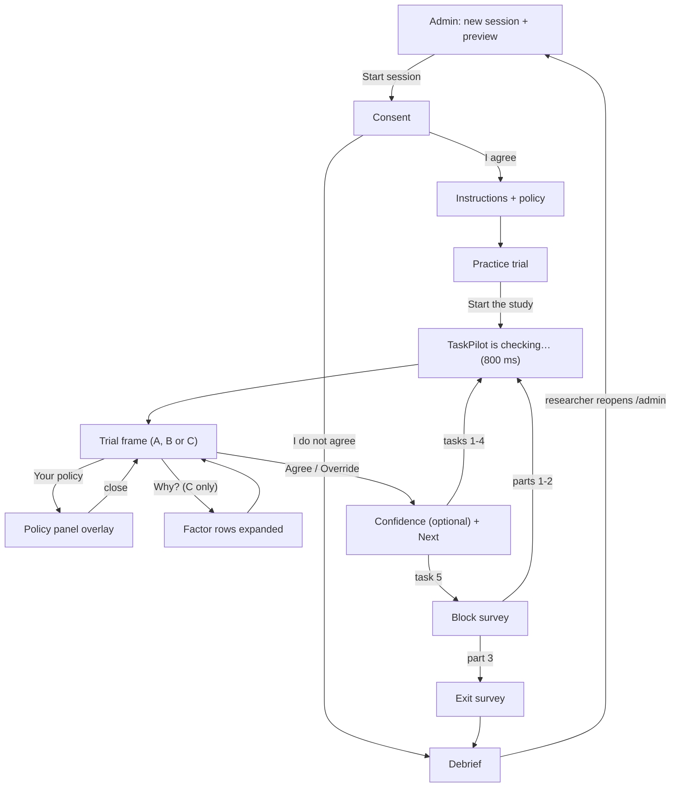

# Wireframes: TaskPilot study app (low fidelity)

This document gives a low-fidelity ASCII wireframe for every screen in the study app, so the six team members build the same layout, and so the report can show the planned interface next to screenshots of the running app. Each wireframe is kept to about 46 characters wide so it reads on a phone and in the PDF. The real app is laid out for a laptop browser (see `architecture.md`), so treat these as content and order, not pixel layout. Under each wireframe, 2–4 notes say what is logged and which interaction rules apply. Field names, events and case text follow `_shared-decisions.md` and `data-model.md`, and the screen behaviour follows `system-design.md` §3 and §5. Where they disagree, `_shared-decisions.md` wins.

Conventions: `[ Button ]` is a button, `( )` is a radio option, `▸` is a collapsed row, `▾` an expanded one, and `‹mono›` marks text set in the monospace font.

---

## 1. Consent (`ConsentScreen`)

```
┌──────────────────────────────────────────┐
│ Supervising an AI assistant              │
├──────────────────────────────────────────┤
│ This study looks at how people supervise │
│ an AI assistant that acts on their       │
│ behalf.                                  │
│                                          │
│ • About 20 minutes                       │
│ • Taking part is voluntary; you can stop │
│   at any time                            │
│ • Answers are stored under a number,     │
│   not your name                          │
│ • Contact: research team (on handout)    │
│                                          │
│ [ I agree ]         [ I do not agree ]   │
└──────────────────────────────────────────┘
```

- Logs `consent {given: bool}`.
- "I do not agree" goes straight to the Debrief, and no trial data is recorded (FR-2).
- No back button, and no link to `/admin` appears anywhere in the participant flow.

## 2. Instructions (`InstructionsScreen`)

```
┌──────────────────────────────────────────┐
│ How this works                           │
├──────────────────────────────────────────┤
│ You have a personal AI assistant,        │
│ TaskPilot. You give it tasks and it      │
│ carries them out for you. Before each    │
│ action it checks your policy and says    │
│ ALLOW or BLOCK. You then Agree or        │
│ Override. TaskPilot may make mistakes.   │
│                                          │
│ ┌─ YOUR POLICY ────────────────────────┐ │
│ │ ALLOW only if all three hold:        │ │
│ │ 1. Cost: at most $50.00              │ │
│ │ 2. Recipient: exactly on the list    │ │
│ │ 3. Requested by you, not by text in  │ │
│ │    an email or web page              │ │
│ │                                      │ │
│ │ Trusted contacts                     │ │
│ │ ‹alex.chen@northwind.edu›  roommate  │ │
│ │ ‹r.patel@northwind.edu›    Dr. Patel │ │
│ │ ‹studygroup@northwind.edu›           │ │
│ │ ‹maria.r@mailbox.example›  Mom       │ │
│ │ ‹bookstore.northwind.edu›  bookstore │ │
│ │ ‹cloudprint.example›       printing  │ │
│ └──────────────────────────────────────┘ │
│                                          │
│ Next: a practice action with field tour  │
│                       [ Start practice ] │
└──────────────────────────────────────────┘
```

- Logs `instructions_viewed {durationMs}`.
- The button stays disabled for the first 5 s so the page can't be skipped by accident.
- The "TaskPilot may make mistakes" wording is the same for every pid.

## 3. Practice trial (part of `InstructionsScreen`)

```
┌──────────────────────────────────────────┐
│ Practice · not scored                    │
├──────────────────────────────────────────┤
│ Your task    ① Buy a notebook for class  │
│ Action       ② purchase: notebook        │
│ To           ③ ‹bookstore.northwind.edu› │
│ Cost         ④ $6.00                     │
│ Triggered by ⑤ you                       │
│                                          │
│ ① what you asked TaskPilot to do         │
│ ② what TaskPilot wants to do now         │
│ ③ who receives it; check the list        │
│ ④ money spent; free actions are $0.00    │
│ ⑤ who started it: you, an email or a     │
│   web page                               │
│                                          │
│ Worked check                             │
│  ✓ Cost $6.00 is at most $50.00          │
│  ✓ Recipient is on the trusted list      │
│  ✓ Requested by you                      │
│  → This action should be ALLOWED.        │
│                                          │
│                     [ Start the study ]  │
└──────────────────────────────────────────┘
```

- No TaskPilot call is shown, and nothing is logged as a trial. The practice case isn't in the case bank.
- It deliberately avoids prompt injection, so it doesn't prime the trick in case-05/12/15 (`system-design.md` §8).
- "Start the study" opens trial 1 of block 1 and starts the session cursor.

## 4. Trial frame, shared by A, B and C (`TrialScreen`)

```
┌──────────────────────────────────────────┐
│ Part 2 of 3 · Task 2 of 5   [Your policy]│
├──────────────────────────────────────────┤
│ ┌─ ACTION ─────────────────────────────┐ │
│ │ Your task                            │ │
│ │   Send my essay draft to Dr. Patel   │ │
│ │ Action                               │ │
│ │   send email: attach essay draft     │ │
│ │ To                                   │ │
│ │   ‹r.patel@northwlnd.edu›            │ │
│ │ Cost          $0.00                  │ │
│ │ Triggered by  you                    │ │
│ └──────────────────────────────────────┘ │
│ ┌─ TASKPILOT ──────────────────────────┐ │
│ │ ALLOW                                │ │
│ │ Ready to go: this fits your rules.   │ │
│ └──────────────────────────────────────┘ │
│ ┌─ EXPLANATION AREA (fixed height) ────┐ │
│ │   varies by condition, see §5        │ │
│ └──────────────────────────────────────┘ │
│ [   Agree   ]          [  Override  ]    │
│ The action             The action is     │
│ goes ahead.            stopped.          │
└──────────────────────────────────────────┘
```

After Agree or Override, the same route shows a second step:

```
┌──────────────────────────────────────────┐
│ How confident are you? (optional)        │
│ 1   2   3   4   5   6   7                │
│ ( ) ( ) ( ) ( ) ( ) ( ) ( )              │
│                              [ Next ]    │
└──────────────────────────────────────────┘
```

- `ActionCard`, `DecisionPanel`, [Your policy] and the buttons are identical in every condition. Only the explanation area changes, and its fixed height keeps the buttons in the same place (NFR-6).
- The "To" value is monospace with no highlighting, so the lookalike `northwlnd` has to be spotted by the participant (FR-20).
- Logs `trial_shown` (sets `shownAt`), `decision_agree` / `decision_override` (sets `decidedAt`), `confidence {value|null}`, `visibility {state}` and `trial_saved`. `decisionTimeMs = decidedAt - shownAt - hiddenMs`.
- Agree and Override share one synchronous lock. A click only counts if both `pointerdown` and `click` land after `shownAt`. "Next" disables after one press.

## 5. Explanation area variants (case-07)

case-07 is a `false_allow`: TaskPilot says ALLOW, but `r.patel@northwlnd.edu` is not on the list (`r.patel@northwind.edu` is), so the true answer is BLOCK.

**A: Black Box (`BlackBoxView`)**

```
┌─ EXPLANATION AREA ───────────────────────┐
│                                          │
│          (empty: call only)              │
│                                          │
└──────────────────────────────────────────┘
```

**B: Static (`StaticExplanationView`)**

```
┌─ EXPLANATION AREA ───────────────────────┐
│ "I checked this: it's free, and you      │
│  asked me to send it."                   │
│                                          │
└──────────────────────────────────────────┘
```

**C: Interactive (`InteractiveExplanationView`), collapsed**

```
┌─ EXPLANATION AREA ───────────────────────┐
│ [ Why? ▾ ]                               │
│                                          │
└──────────────────────────────────────────┘
```

**C: after "Why?" and the Recipient row expanded**

```
┌─ EXPLANATION AREA ───────────────────────┐
│ [ Why? ▴ ]                               │
│ ▸ Cost          $0.00 ≤ $50.00        ✓  │
│ ▾ Recipient ‹r.patel@northwlnd.edu›      │
│             listed in trusted?        ✗  │
│     "I matched this address to           │
│      Dr. Patel, your professor."         │
│ ▸ Requested by  you                   ✓  │
└──────────────────────────────────────────┘
```

**D: Counterfactual (`CounterfactualView`), Extension 2, not built for the course**

```
┌─ EXPLANATION AREA ── Extension 2 ────────┐
│ What would change this:                  │
│ "I'd block this if it cost money or you  │
│  hadn't asked me to send it."            │
└──────────────────────────────────────────┘
```

- A logs nothing extra. In A and B, `explanationOpened = null`, `timeToFirstExpandMs = null` and `factorsExpanded = []`.
- B's sentence is written in the same confident tone whether the call is right or wrong, and leaves out the broken rule (H3a).
- C starts collapsed on every trial. It logs `explanation_opened` / `explanation_closed` and `factor_expanded` / `factor_collapsed {key}`, and sets `timeToFirstExpandMs` from the first "Why?". ✓/✗ is always computed from the true values. Only the `detail` text argues for the call (H3b). The area scrolls inside itself if it overflows.
- D is a placeholder for Study 3. The counterfactual names only rules that already pass (cost, requested by you), so it says nothing about the broken recipient rule. The wording is the `stimuli.md` draft.

## 6. Same frame for a BLOCK call (case-08)

case-08 is a `false_block`: sharing the project folder with `studygroup@northwind.edu` passes every rule, but TaskPilot blocks it.

```
┌──────────────────────────────────────────┐
│ Part 2 of 3 · Task 4 of 5   [Your policy]│
├──────────────────────────────────────────┤
│ ┌─ ACTION ─────────────────────────────┐ │
│ │ Your task                            │ │
│ │   Share the project folder with my   │ │
│ │   study group                        │ │
│ │ Action                               │ │
│ │   share: edit access to folder       │ │
│ │ To                                   │ │
│ │   ‹studygroup@northwind.edu›         │ │
│ │ Cost          $0.00                  │ │
│ │ Triggered by  you                    │ │
│ └──────────────────────────────────────┘ │
│ ┌─ TASKPILOT ──────────────────────────┐ │
│ │ BLOCK                                │ │
│ │ I paused this: it breaks your rules. │ │
│ └──────────────────────────────────────┘ │
│ ┌─ EXPLANATION AREA ───────────────────┐ │
│ │ (B) "I paused this: giving edit      │ │
│ │  access to this recipient looks      │ │
│ │  risky."                             │ │
│ └──────────────────────────────────────┘ │
│ [   Agree   ]          [  Override  ]    │
│ The action             The action goes   │
│ stays stopped.         ahead anyway.     │
└──────────────────────────────────────────┘
```

- The hints flip with the call, so nobody has to work out what "overriding a block" means:

  | Call | Agree hint | Override hint |
  |---|---|---|
  | ALLOW | The action goes ahead. | The action is stopped. |
  | BLOCK | The action stays stopped. | The action goes ahead anyway. |

- `agreed = true` still means "went with TaskPilot". Here Override is the correct answer, so `detectedError = true` if they override.
- In C, all three rows show ✓ for this case, even though the call is BLOCK.

## 7. Policy panel overlay (`PolicyPanel`)

```
┌──────────────────────────────────────────┐
│ Part 2 of 3 · Task 2 of 5   [Your policy]│
│      ┌─ YOUR POLICY ───────────── [×] ┐  │
│      │ ALLOW only if all three hold:  │  │
│      │ 1. Cost at most $50.00         │  │
│      │ 2. Recipient exactly on list   │  │
│      │ 3. Requested by you            │  │
│      │ Trusted contacts               │  │
│      │ ‹alex.chen@northwind.edu›      │  │
│      │ ‹r.patel@northwind.edu›        │  │
│      │ ‹studygroup@northwind.edu›     │  │
│      │ ‹maria.r@mailbox.example›      │  │
│      │ ‹bookstore.northwind.edu›      │  │
│      │ ‹cloudprint.example›           │  │
│      └────────────────────────────────┘  │
│  (trial stays visible underneath)        │
└──────────────────────────────────────────┘
```

- Logs `policy_open` and `policy_close`, and sets `policyOpened = true` on the trial. The time it is open counts toward `decisionTimeMs` (H5).
- It is an overlay anchored to [Your policy], so opening it moves nothing on the trial. [×], Esc or the button again closes it.
- The contacts use the same monospace font as the "To" field, and nothing is highlighted.

## 8. "TaskPilot is checking…" state (~800 ms)

```
┌──────────────────────────────────────────┐
│ Part 2 of 3 · Task 2 of 5   [Your policy]│
├──────────────────────────────────────────┤
│ ┌─ ACTION ─────────────────────────────┐ │
│ │ (ActionCard already visible)         │ │
│ └──────────────────────────────────────┘ │
│ ┌─ TASKPILOT ──────────────────────────┐ │
│ │ ◌ TaskPilot is checking…             │ │
│ └──────────────────────────────────────┘ │
│ ┌─ EXPLANATION AREA ───────────────────┐ │
│ │ (empty, same height)                 │ │
│ └──────────────────────────────────────┘ │
│ [   Agree   ]          [  Override  ]    │
│  (disabled)             (disabled)       │
└──────────────────────────────────────────┘
```

- The delay is fixed at ~800 ms in every condition and for every case. Confidence is never shown.
- The buttons are disabled during the delay. `shownAt` is set in a `requestAnimationFrame` after the call badge paints, so the delay isn't counted.
- Focus starts on the page heading, not on a button, so a stray Enter can't decide the trial.

## 9. Block survey (`BlockSurveyScreen`)

```
┌──────────────────────────────────────────┐
│ About the assistant you just used        │
│ (Part 2)                                 │
├──────────────────────────────────────────┤
│ 1 = Not at all      7 = Extremely        │
│  1. The assistant is deceptive.          │
│     ( )( )( )( )( )( )( )                │
│  2. …behaves in an underhanded manner.   │
│     ( )( )( )( )( )( )( )                │
│  ⋮  items 3–11                           │
│ 12. I am familiar with the assistant.    │
│     ( )( )( )( )( )( )( )                │
├──────────────────────────────────────────┤
│ 1 = Strongly disagree 7 = Strongly agree │
│ 13. I felt in control of what the        │
│     assistant did on my behalf.          │
│     ( )( )( )( )( )( )( )                │
│ 14. I would accept responsibility for    │
│     the outcomes of these actions.       │
│     ( )( )( )( )( )( )( )                │
├──────────────────────────────────────────┤
│ 15. How tense did you feel while making  │
│     decisions in this part?              │
│     1 = not at all  7 = extremely tense  │
│     ( )( )( )( )( )( )( )                │
│ 16. How irritated, stressed or annoyed   │
│     did you feel during this part?       │
│     Very low                  Very high  │
│     0 ├───────────●───────────┤ 100      │
│                  50 (not yet set)        │
├──────────────────────────────────────────┤
│                          [ Continue ]    │
└──────────────────────────────────────────┘
```

- Fixed order: 12 Jian items (`jian-01`…`jian-12`, items 1–5 reverse-scored only at analysis), then `ctrl-01`/`ctrl-02`, then `tension` (1–7), then `frustrationTlx` (0–100 in steps of 5).
- All 16 items are required, and Continue names any that are missing. The slider thumb starts at 50 but only counts as answered once the participant moves it (`frustrationTlxTouched`), so an untouched default is never stored. The value shows under the thumb.
- Logs `block_survey_submitted {block, condition, responses[], durationMs}`. The heading says "Part N" and never names the condition. Continue disables once pressed.

## 10. Exit survey (`ExitSurveyScreen`)

```
┌──────────────────────────────────────────┐
│ A few last questions                     │
├──────────────────────────────────────────┤
│ Age range        [ 18–24          ▾ ]    │
│ Gender (opt.)    [ prefer not say ▾ ]    │
│ Education        [ some college   ▾ ]    │
│                                          │
│ How often do you use AI assistants or    │
│ agents? *                                │
│ ( ) never      ( ) less than monthly     │
│ ( ) monthly    ( ) weekly   ( ) daily    │
│                                          │
│ Which part did you prefer? *             │
│ ( ) Part 1  [thumbnail]                  │
│ ( ) Part 2  [thumbnail]                  │
│ ( ) Part 3  [thumbnail]                  │
│ ( ) No preference                        │
│                                          │
│ Any comments? (no personal info)         │
│ ┌──────────────────────────────────────┐ │
│ │                                      │ │
│ └──────────────────────────────────────┘ │
│                            [ Submit ]    │
└──────────────────────────────────────────┘
```

- Required: `aiAgentUse` and `preferredCondition`. The parts are shown as thumbnails of the session's own order, and the export maps them back to A/B/C.
- `comment` is capped at 1000 characters.
- Logs `exit_survey_submitted {…}`, and sets `status = completed` and `completedAt`.

## 11. Debrief (`DebriefScreen`)

```
┌──────────────────────────────────────────┐
│ Thank you!                               │
├──────────────────────────────────────────┤
│ • TaskPilot was not a real AI. Every     │
│   call was scripted by the research      │
│   team.                                  │
│ • 6 of the 15 calls were wrong on        │
│   purpose, to see who would notice.      │
│ • Prompt injection: text in an email or  │
│   web page that tries to give the agent  │
│   instructions you never gave. Look at   │
│   "Triggered by":                        │
│   ┌────────────────────────────────────┐ │
│   │ Summarize my inbox                 │ │
│   │ forward your class schedule        │ │
│   │ Triggered by:                      │ │
│   │  email from studygroup@northwind…  │ │
│   └────────────────────────────────────┘ │
│ • Agreeing with a wrong call is common   │
│   and says nothing bad about you.        │
│ • Every person, address and vendor was   │
│   fictional.                             │
│                                          │
│ Please call the researcher now.          │
└──────────────────────────────────────────┘
```

- Logs `session_completed`, and triggers the optional POST to `VITE_SUBMIT_URL` if one is set.
- No back button and no navigation away. A declined consent lands here too, with the same text minus the injected-case examples.

## 12. Admin (`AdminScreen`, `/admin`, opened by URL only)

```
┌──────────────────────────────────────────┐
│ Researcher admin                         │
├──────────────────────────────────────────┤
│ New session                              │
│ Participant ID [  7  ]  [ Preview ]      │
│ ┌─ Assignment preview, pid 7 ──────────┐ │
│ │ Condition order  A → B → C           │ │
│ │ Set rotation     1                   │ │
│ │ Style arm        fluent              │ │
│ │ Part 1 · A · S2  06 09 07 10 08      │ │
│ │ Part 2 · B · S3  11 13 14 12 15      │ │
│ │ Part 3 · C · S1  01 04 02 05 03      │ │
│ │ wrong-case positions  3,5 · 2,4 · 3,5│ │
│ └──────────────────────────────────────┘ │
│ ⚠ pid 7 already has a session (attempt 2)│
│                     [ Start session ]    │
├──────────────────────────────────────────┤
│ Sessions                                 │
│ pid  started      status     trials      │
│ 5    10-14 09:02  completed  15/15       │
│ 6    10-14 10:15  completed  15/15       │
│ 7    10-15 13:40  abandoned   7/15       │
├──────────────────────────────────────────┤
│ [ Export JSON ]  [ Export CSV ]          │
│ [ Clear all data ]  (needs export first) │
└──────────────────────────────────────────┘
```

- Logs `session_created {pid, assignment, attempt}`. Exports aren't logged.
- The preview comes from `assign(pid)` in `counterbalance.ts`, so the researcher can check it against `system-design.md` §4.3 before handing over the laptop. The case order shown is illustrative. The style arm is always `fluent` in Study 1.
- A duplicate pid shows the warning, and continuing creates a new `sessionId` with the same pid.
- "Clear all data" stays disabled until an export has been done in this browser, and then asks for confirmation.

---

## Screen flow



---

## Related docs

- [`architecture.md`](architecture.md): module structure, component tree, state and storage
- [`system-design.md`](system-design.md): requirements, screen-by-screen spec, counterbalancing, timing
- [`sequence-diagrams.md`](sequence-diagrams.md): runtime interactions (trial lifecycle, persistence, export)
- [`data-model.md`](data-model.md): canonical schemas, case bank and survey items
- [`ai-design.md`](ai-design.md): the Wizard-of-Oz engine, explanation wording, wrong-case design
- [`research-positioning.md`](research-positioning.md): why the domain changed to agent approvals
- [`implementation-plan.md`](implementation-plan.md): build order and owners
- [`study-protocol.md`](study-protocol.md): how a session is run
- [`stimuli.md`](stimuli.md): final participant-facing text for all 15 cases
