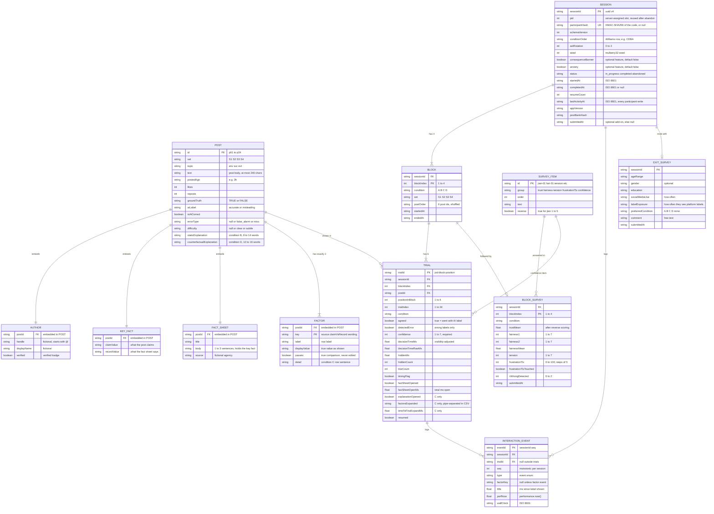

# Data Model

This document is the data model ("DB diagram") for the v3 XAI study app. Participants read made-up social media posts from the fictional town of Riverton (Alder County). Each post carries a scripted AI label, **"Likely accurate"** or **"Likely misleading"**, and the participant clicks **Agree with label** or **Disagree with label**. The data model has two parts. The first is **read-only static content**: `shared/data/posts.json` (the 24-post bank, each post with its embedded author, key fact, fact sheet and condition C factors) and `shared/data/surveyItems.json` (trust, fairness, tension, frustration and confidence items). The post bank is loaded only by the local server, which sends the browser allow-listed presentations without the correctness fields; the client imports only `surveyItems.json`. The second is a **session log**, written by the local Express server to a single SQLite file (`app/data/study.db`) as each trial, event batch and survey arrives, and exported from `/admin` as CSV and JSON for analysis in R or Python (§7–§8). The stimuli stay a JSON file, as the proposal suggests; SQLite holds only the responses. The diagram, field dictionaries, TypeScript interfaces and export formats below are the contract between `labelEngine.ts`, `counterbalance.ts`, `logger.ts`, the server's `repo.ts` and exporters, and the analysis scripts. Each field is tied to the hypothesis (RQ1–RQ3, H1–H6) it serves. This document is the authority on field names and types. [stimuli.md](stimuli.md) is the authority on all participant-facing wording (the practice post and all 24 posts). The three JSON examples in §4 (p03, p04, p15) are copied from `stimuli.md`; if they ever differ from it, `stimuli.md` wins and this document is corrected.

The previous agent-permission data model (v2.1) is archived at [archive/v2.1-agent-permission/data-model.md](archive/v2.1-agent-permission/data-model.md).

## 1. Entity-relationship diagram

The **static** entities (POST, AUTHOR, KEY_FACT, FACT_SHEET, FACTOR, SURVEY_ITEM) ship with the build and never change at runtime. The **session** entities (SESSION, BLOCK, TRIAL, INTERACTION_EVENT, BLOCK_SURVEY, EXIT_SURVEY) are created once per participant. AUTHOR, KEY_FACT, FACT_SHEET and FACTOR are embedded inside POST in the JSON, while SESSION, BLOCK, TRIAL, INTERACTION_EVENT, BLOCK_SURVEY and EXIT_SURVEY each have their own SQLite table (§7). The diagram shows the embedded ones as separate entities too, so their keys and cardinalities are explicit.



Cardinality notes:
- `BLOCK ||--o| BLOCK_SURVEY` and `SESSION ||--o| EXIT_SURVEY` are optional only because a session can be abandoned partway. A `completed` session has exactly 4 block surveys and 1 exit survey.
- `POST ||--o{ TRIAL`: each participant sees every post exactly once (24 trials, 24 posts), so across N participants each post appears in N trials. The practice post (§4.3) is never a TRIAL.
- `SURVEY_ITEM ||--o{ BLOCK_SURVEY`: one block survey answers the 12 trust items, the 2 fairness items, `tension` and `frustrationTlx`. The 12 trust answers are stored as an embedded `trustResponses` array; the other four groups are fixed fields on BLOCK_SURVEY.
- `SURVEY_ITEM ||--o{ TRIAL`: the single `confidence` item is asked after every post (in `PostRatingStrip`) and stored on the trial.
- `condition` is `A`/`B`/`C`/`D`. All four are built and run in every session.

## 2. Field dictionary

"Hyp." gives the hypothesis or purpose the field serves. "Integrity" means the field exists for validation or reconstruction, not for a hypothesis test.

### 2.1 POST (`posts.json` → `posts[]`)

| Field | Type | Constraints | Description | Hyp. |
|---|---|---|---|---|
| `id` | string | unique; `^p(0[1-9]\|1[0-9]\|2[0-4])$` | Stable post identifier | all (join key) |
| `set` | `"S1" \| "S2" \| "S3" \| "S4"` | exactly 6 posts per set | Matched set used in the set-to-condition rotation | counterbalancing |
| `topic` | `"env" \| "svc" \| "evt"` | required | Environment, public services, or local events | covariate |
| `author` | Author | required, embedded | Who posted it, shown in `PostCard` header | H1a (source cue), H5 |
| `text` | string | 1–3 short sentences, at most 240 characters; contains the claim in `keyFact.claimValue` | Post body shown in `PostCard` in every condition | all |
| `postedAgo` | string | e.g. `"3h"`, `"1d"` | Relative timestamp shown on the card (cosmetic) | none |
| `likes`, `reposts` | integer | ≥ 0 | Engagement counts shown on the card (cosmetic, kept moderate so they do not cue truth) | none |
| `keyFact` | KeyFact | required, embedded | The one checkable value: the post's claim vs the record | H1, H2 |
| `factSheet` | FactSheet | required, embedded | The fictional official record behind "Fact sheet ▸" | H1, H6 |
| `groundTruth` | `"TRUE" \| "FALSE"` | must equal `keyFact.claimValue === keyFact.recordValue ? "TRUE" : "FALSE"` | Whether the post is true according to its fact sheet | H1, H1a, H2 |
| `aiLabel` | `"accurate" \| "misleading"` | required | Scripted Wizard-of-Oz label, shown as "Likely accurate" (✓) or "Likely misleading" (⚠) | H1, H4 |
| `isAiCorrect` | boolean | must equal `(aiLabel === "accurate") === (groundTruth === "TRUE")` | Splits correct labels from planted errors | H1, H4 |
| `errorType` | `null \| "false_alarm" \| "miss"` | null iff `isAiCorrect`; `false_alarm` iff TRUE post labeled misleading; `miss` iff FALSE post labeled accurate | Kind of planted error. Every analysis of detection is reported separately by `errorType` | **H1a**, **H1b** |
| `difficulty` | `null \| "clear" \| "subtle"` | null iff `isAiCorrect`; each set has 1 `clear` and 1 `subtle` wrong label | `clear` = the record flatly contradicts (or flatly confirms) the claim; `subtle` = the error is harder to see, because the claim is close to the record (e.g. p04: "record low" vs "lowest since 2019") or the card gives no surface cue against the label (e.g. p15: verified account, neutral wording) | set matching; covariate |
| `staticExplanation` | string | 8–14 words; starts `"Flagged:"` when `aiLabel` is misleading, `"Checked:"` when accurate | Fixed sentence shown in condition B. Argues for the label with the same confident tone whether right or wrong. On wrong labels it cites a plausible but non-decisive factor | H2, H3a, H4 |
| `factors` | Factor[] | exactly 3, in order `source`, `claimVsRecord`, `wording` | Per-factor breakdown behind "Why?" in condition C | H1b, H2, H3b |
| `counterfactualExplanation` | string | 10–16 words; `"This would be labeled accurate if …"` when `aiLabel` is misleading, `"This would be labeled misleading if …"` when accurate | Sentence shown in condition D. Like B, it argues for the label and names a non-decisive change on wrong labels | H2 (exploratory), H3a, H5 |

### 2.2 AUTHOR (embedded in POST)

| Field | Type | Constraints | Description | Hyp. |
|---|---|---|---|---|
| `handle` | string | `^@[A-Za-z0-9_]{3,24}$`; fictional; unique across the bank (case kept as in `stimuli.md`, e.g. `@RivertonNeighbors`) | Account handle shown under the display name | H1a (source cue) |
| `displayName` | string | non-empty; fictional person or local page | Name shown in bold on the card | none |
| `verified` | boolean | | Shows a verified badge. Drives the C `source` row (`passes === verified`) | H1a, H3b |

### 2.3 KEY_FACT (embedded in POST)

| Field | Type | Constraints | Description | Hyp. |
|---|---|---|---|---|
| `claimValue` | string | non-empty; canonical short form | The checkable value the post claims, e.g. `"June 6–8, Mill Park"` | H1, H2 |
| `recordValue` | string | non-empty; same canonical form; must appear (in substance) in `factSheet.body` | The value in the fact sheet. Ground truth is TRUE iff the two strings are **identical** | H1, H2 |

Both values are written in the same canonical short form so that `groundTruth` is a plain string comparison and never a judgement call. `keyFact` is never shown to participants. The C `claimVsRecord` row shows the participant-facing wording of the same comparison from `stimuli.md` (its "Claim vs record" row), which may phrase the two sides of a TRUE post differently (e.g. p15: "all 12 limits met in March" vs "all 12 tests within limits") while `keyFact` holds one identical canonical string on both sides.

### 2.4 FACT_SHEET (embedded in POST)

| Field | Type | Constraints | Description | Hyp. |
|---|---|---|---|---|
| `title` | string | non-empty | Record title, e.g. "Riverside Fair Schedule" | none |
| `body` | string | 1–3 sentences; contains the key fact; never mentions the AI label | Record text in `FactSheetPanel`. Identical in every condition | H1, H6 |
| `source` | string | ends with `"(fictional)"` | Issuing body, e.g. "Riverton Public Works (fictional)" | none |

### 2.5 FACTOR (embedded in POST, `factors[]`)

| Field | Type | Constraints | Description | Hyp. |
|---|---|---|---|---|
| `key` | `"source" \| "claimVsRecord" \| "wording"` | unique within post, fixed order | Factor identifier, also logged in `factorsExpanded` and `factorKey` | H1b, H3b, H6 |
| `label` | string | `"Source"`, `"Claim vs record"`, `"Wording"` | Row label | none |
| `displayValue` | string | `source` → `` `${handle} · verified` `` or `` `${handle} · not verified` ``; `claimVsRecord` → `` `Post: … · Record: …` `` (wording from `stimuli.md`); `wording` → `"Neutral"` or `"Sensational (…)"` naming the cue, e.g. `Sensational (all caps, "!!!")` | True value shown in the row. Never edited to support the label | H1b, H2 |
| `passes` | boolean | `source` → `author.verified`; `claimVsRecord` → `keyFact.claimValue === keyFact.recordValue`; `wording` → `displayValue === "Neutral"` | ✓/✗ badge. `passes: true` means the factor points to "accurate". **Always truthful**: the `claimVsRecord` row shows the TRUE comparison even on wrong labels, so a participant who opens it can see the contradiction | H1b, H2, H3b |
| `detail` | string | one sentence, non-empty | Expanded row sentence. Like the B text it argues for the AI's label; only `displayValue` and `passes` are guaranteed truthful. Final wording lives in `stimuli.md` | H2, H3a |

### 2.6 SESSION / PARTICIPANT

| Field | Type | Constraints | Description | Hyp. |
|---|---|---|---|---|
| `sessionId` | string (uuid v4) | unique | Primary key of the stored session | integrity |
| `pid` | integer | ≥ 1; unique among `in_progress` and `completed` sessions | Anonymous participant number **assigned by the server** at self-start: the lowest integer ≥ 1 with no `in_progress` or `completed` session, so the pids of abandoned sessions are reused. Pilot pids 901+ are never auto-assigned. Drives all counterbalancing | all (subject ID) |
| `participantHash` | hex string / null | unique when not null | `HMAC-SHA256(salt, normalisedCode)` of the participation code, where `normalisedCode = code.trim().toLowerCase()` (3–120 characters) and the salt is `PARTICIPANT_SALT` or `meta.participant_salt`. Enforces once-only participation. The raw code is never stored. Never exported. | integrity (once-only) |
| `lastActivityAt` | ISO 8601 string / null | set on create and on every participant write | Last time the participant did anything (consent, trial, events, cursor, surveys, exit, resume). An `in_progress` session idle longer than `STALE_MINUTES` (default 120) is marked `abandoned` at the next session start | data cleaning, pid reuse |
| `schemaVersion` | integer | currently `1` | Session record format version | integrity |
| `conditionOrder` | `[Condition × 4]` | `williams[(pid-1) % 4]`, rows `ABDC`, `BCAD`, `CDBA`, `DACB` | Order in which conditions are run | order-effect control |
| `setRotation` | `0 \| 1 \| 2 \| 3` | `floor((pid-1)/4) % 4` | Rotation that maps sets to conditions: `set = S[(conditionIndex + setRotation) % 4]`, A=0, B=1, C=2, D=3 | counterbalancing |
| `seed` | integer | derived from `pid` | mulberry32 seed for within-block shuffling | reproducibility |
| `consequenceBanner` | boolean | default `false` (optional feature, off) | If true, every trial shows "Posts you agree are accurate stay visible to other users" | optional (H3) |
| `anxiety` | boolean | default `false` (optional feature, off) | If true, an anxiety scale is added to each block survey | optional (H3) |
| `status` | `"in_progress" \| "completed" \| "abandoned"` | | Lifecycle state | data cleaning |
| `consentAt` | ISO 8601 string | required before the practice post | Consent timestamp (no signature or name stored) | ethics |
| `startedAt` / `completedAt` | ISO 8601 string / null | `completedAt` set when the exit survey is submitted | Session wall-clock bounds | data cleaning |
| `cursor` | `{ blockIndex, positionInBlock, phase }` | | Resume point after a page reload | integrity |
| `resumeCount` | integer | ≥ 0 | Number of reloads recovered during the session | data cleaning |
| `appVersion` | string | from `package.json` | Build that produced the data | reproducibility |
| `postBankHash` | string | hash of `posts.json` | Detects post-bank changes partway through the study | integrity |
| `submittedAt` | ISO 8601 string / null | null unless the optional `VITE_SUBMIT_URL` add-on posted the session | When the session was submitted to the optional endpoint | integrity |
| `blocks`, `events`, `exitSurvey` | embedded | | Child records | — |

With 4 Williams rows × 4 set rotations, a full balance takes **16 participants** (pid 1–16). The target is N = 32 (two cycles); the minimum is 16.

### 2.7 BLOCK (condition assignment)

| Field | Type | Constraints | Description | Hyp. |
|---|---|---|---|---|
| `blockIndex` | `1 \| 2 \| 3 \| 4` | unique within session | Position of the block in the session | order effects |
| `condition` | `"A" \| "B" \| "C" \| "D"` | `conditionOrder[blockIndex-1]` | Explanation type for this block | H1–H6 (IV) |
| `set` | `"S1" \| "S2" \| "S3" \| "S4"` | from the set rotation | Post set used in this block | counterbalancing |
| `postOrder` | string[6] | the 6 post ids of `set`, seeded shuffle; the 2 wrong labels are never both in positions 1–2 | Presentation order | wrong-label position control |
| `startedAt` / `endedAt` | ISO 8601 | | Block bounds | data cleaning |
| `trials` | Trial[6] | | Child trials | — |
| `survey` | BlockSurvey \| null | | Post-block survey | H3, H4, H5 |

### 2.8 TRIAL

| Field | Type | Constraints | Description | Hyp. |
|---|---|---|---|---|
| `trialId` | string | `${pid}-${blockIndex}-${positionInBlock}` | Primary key | join key |
| `blockIndex` | 1–4 | | Parent block | order effects |
| `positionInBlock` | 1–6 | | Position within the block | wrong-label position control |
| `trialIndex` | 1–24 | `(blockIndex-1)*6 + positionInBlock` | Position within the session | trust-decay covariate |
| `postId` | string | FK to POST | Post shown | all |
| `condition` | A/B/C/D | copied from block | Denormalized for export | H1–H6 |
| `set`, `topic` | as POST | copied from post | Denormalized for export | covariates |
| `aiLabel`, `groundTruth`, `isAiCorrect`, `errorType`, `difficulty` | as POST | snapshot written by `logger` (via `getTruth`) at response time | Denormalized so `trials.csv` is self-contained. Never in the view payload | H1, H1a, H1b, H4 |
| `agreed` | boolean | required | true = **Agree with label** (went with the AI label); false = **Disagree with label** | **H4**, H1 |
| `detectedError` | boolean \| null | `!agreed` when `!isAiCorrect`; null when `isAiCorrect` | Caught a planted error | **H1**, **H1a**, **H1b**, **H2**, H3, H6 |
| `confidence` | integer 1–7 | **required** (never null on a saved trial); asked in `PostRatingStrip` after every decision, and Next stays disabled until it is given | "How confident are you in your decision?" | exploratory (calibration), H3a |
| `labelShownAt` / `respondedAt` | ISO 8601 | | Wall-clock bounds (display only; timing uses `performance.now()`) | data cleaning |
| `decisionTimeMs` | number (ms) | > 0; `decisionTimeRawMs - hiddenMs` | Time to decision, excluding time the tab was hidden | **H6** |
| `decisionTimeRawMs` | number (ms) | from first render of the label (after the fixed ~800 ms "AI is checking…" delay) to the Agree/Disagree click | Unadjusted time | data cleaning |
| `hiddenMs`, `hiddenCount`, `blurCount` | number | ≥ 0 | Time and count of tab-hidden periods, and window blurs | data cleaning |
| `timingFlag` | boolean | true if `hiddenCount > 0` or `decisionTimeMs > 120000` | Marks trials to exclude or winsorize in H6 (never deleted) | H6 |
| `factSheetOpened` | boolean | | The fact sheet was opened at least once before the decision. Available in every condition | **H6**, H1 |
| `factSheetOpenMs` | number (ms) | ≥ 0; 0 if never opened | Total time the fact sheet was open before the decision (sum of open intervals, visibility-adjusted) | **H6** |
| `explanationOpened` | boolean \| null | null in A, B and D; in C, true if "Why?" was opened at least once | Whether the interactive explanation was used | H1b, H3b, H6 |
| `factorsExpanded` | FactorKey[] | `[]` in A, B and D; in C, unique keys in order of first expansion. In CSV it is one pipe-separated cell, e.g. `claimVsRecord\|source` (empty for `[]`) | Which factor rows were inspected | H1b, H3b, H6 |
| `timeToFirstExpandMs` | number \| null | null unless C and opened; ms from label shown to the first "Why?" open | Latency of engagement | H6 |
| `resumed` | boolean | | true if this trial was re-presented after a reload (timer restarted). Analysts may exclude it from H6 | data cleaning |

### 2.9 INTERACTION_EVENT

| Field | Type | Constraints | Description | Hyp. |
|---|---|---|---|---|
| `eventId` | string | `${sessionId}-${seq}` | Primary key | integrity |
| `seq` | integer | strictly increasing within session | Total order of events | integrity |
| `trialId` | string \| null | null for non-trial events (including the practice post) | Parent trial | H6 |
| `type` | enum (below) | | What happened | H1b, H3b, H6 |
| `factorKey` | FactorKey \| null | required for `factor_expand` / `factor_collapse`; null otherwise | Factor involved | H1b, H3b |
| `tMs` | number \| null | ms since the trial's label was shown; null outside trials | Relative timing | H6 |
| `perfNow` | number | `performance.now()` | Raw high-resolution timestamp | integrity |
| `wallClock` | ISO 8601 | | Wall-clock time | data cleaning |

Event `type` values (this list is the authority; other docs use these names exactly, and events carry no payload beyond the fields above): `session_start`, `session_resume`, `consent_given`, `practice_start`, `practice_complete`, `block_start`, `trial_shown` (label rendered after the delay), `fact_sheet_open`, `fact_sheet_close`, `why_open`, `why_close`, `factor_expand`, `factor_collapse`, `decision_agree`, `decision_disagree`, `confidence_submit`, `visibility_hidden`, `visibility_visible`, `block_survey_submit`, `exit_survey_submit`, `session_complete`.

`decision_agree` / `decision_disagree` set `agreed` and `respondedAt`, and `confidence_submit` is logged each time a confidence value is chosen (the last value before Next is stored in `confidence`). `why_open`, `why_close`, `factor_expand` and `factor_collapse` occur only in condition C. `fact_sheet_open`/`fact_sheet_close` occur in every condition and are the source of `factSheetOpened` and `factSheetOpenMs`. If the participant decides while the fact sheet is open, `logger` writes a synthetic `fact_sheet_close` just before the decision event so every interval is closed.

### 2.10 BLOCK_SURVEY

| Field | Type | Constraints | Description | Hyp. |
|---|---|---|---|---|
| `blockIndex`, `condition` | | matches parent block | Condition being rated | H3–H5 |
| `trustResponses` | TrustResponse[12] | one per trust item, all required | Jian et al. (2000) answers, worded with "the AI labels" | **H4** |
| `trustResponses[].itemId` | string | FK to SURVEY_ITEM (`jian-01` … `jian-12`) | Item answered | H4 |
| `trustResponses[].raw` | integer 1–7 | | Answer as given (1 = not at all, 7 = extremely) | H4 |
| `trustResponses[].scored` | integer 1–7 | `reverse ? 8 - raw : raw` | Score after reverse coding | H4 |
| `trustMean` | number | mean of the 12 `scored` values | Trust score for this condition; higher = more trust | **H4** |
| `fairness1`, `fairness2` | integer 1–7 | required | "The AI labels were fair to the people who posted" and "The AI labels treated posts consistently" | **H5** |
| `fairnessMean` | number | mean of the 2 items | Fairness score for this condition | **H5** |
| `tension` | integer 1–7 | required | "How tense did you feel while judging the posts in this part?" (1 = "Not at all tense", 7 = "Extremely tense") | **H3**, **H3a**, **H3b** |
| `frustrationTlx` | integer 0–100 | required; multiple of 5 (21 points); raw, not weighted | NASA-TLX frustration item on a slider (0 = "Very low", 100 = "Very high") | **H3**, H3a |
| `frustrationTlxTouched` | boolean | must be true before submit | The slider (start position 50) was moved at least once, so 50 is a real answer, not a default | data cleaning |
| `nWrongDetected` | integer 0–2 | computed from the block's trials at submit: count of `detectedError === true` | Wrong labels noticed in this block; the H3 predictor | **H3** |
| `anxiety` | number[] \| null | null unless `session.anxiety` is true | Reserved for the optional anxiety scale (items not yet chosen) | optional |
| `submittedAt` | ISO 8601 | | | data cleaning |

### 2.11 SURVEY_ITEM (`surveyItems.json`)

| Field | Type | Constraints | Description | Hyp. |
|---|---|---|---|---|
| `id` | string | `jian-01` … `jian-12`, `fair-01`, `fair-02`, `tension`, `frustrationTlx`, `confidence` | Item key | H3–H5 |
| `group` | `"trust" \| "fairness" \| "tension" \| "frustrationTlx" \| "confidence"` | | Which scale the item belongs to | H3–H5 |
| `order` | integer | 1-based within group | Display order (Jian items in the published order) | H4 |
| `text` | string | Jian et al. (2000) with "the system" worded as "the AI labels" | Item wording | H4 |
| `reverse` | boolean | trust only; true for orders 1–5 | Distrust items, reverse-scored | H4 |
| `subscale` | `"distrust" \| "trust"` | trust only | For optional subscale analysis | H4 |

### 2.12 EXIT_SURVEY

| Field | Type | Constraints | Description | Hyp. |
|---|---|---|---|---|
| `ageRange` | enum | `18-24`, `25-34`, `35-44`, `45-54`, `55+`, `prefer_not` | Range, not an exact age, to limit identifiability | sample description |
| `gender` | enum \| null | optional, includes `prefer_not` | | sample description |
| `education` | enum | `high_school`, `some_college`, `bachelors`, `graduate`, `prefer_not` | | sample description |
| `socialMediaUse` | enum | `never`, `less_than_weekly`, `weekly`, `daily`, `several_daily` | How often they use social media | covariate (H1, H4) |
| `labelExposure` | enum | `never`, `rarely`, `sometimes`, `often` | How often they have seen platform accuracy or fact-check labels | covariate (H1a, H4) |
| `preferredCondition` | `"A" \| "B" \| "C" \| "D" \| "none"` | shown as screenshots, not letters | Preferred interface | H4, H5 (supporting) |
| `comment` | string | at most 1000 chars; the exit screen reminds participants not to enter personal info | Open comment | qualitative |
| `submittedAt` | ISO 8601 | | | |

## 3. TypeScript interfaces

These live in `src/types.ts` and are imported by the engine, logger, store and views.

```ts
// ---------- shared enums ----------
export type Condition = "A" | "B" | "C" | "D";
export type Label = "accurate" | "misleading";       // shown as "Likely accurate" / "Likely misleading"
export type Truth = "TRUE" | "FALSE";
export type ErrorType = null | "false_alarm" | "miss";
export type Difficulty = null | "clear" | "subtle";
export type SetId = "S1" | "S2" | "S3" | "S4";
export type Topic = "env" | "svc" | "evt";
export type FactorKey = "source" | "claimVsRecord" | "wording";
export type Likert7 = 1 | 2 | 3 | 4 | 5 | 6 | 7;
export type Tlx100 = number;   // 0-100, multiple of 5

// ---------- static: posts.json ----------
export interface Author {
  handle: string;             // "@..." fictional
  displayName: string;
  verified: boolean;
}

export interface KeyFact {
  claimValue: string;         // what the post claims, canonical short form
  recordValue: string;        // what the fact sheet says, same form
}

export interface FactSheet {
  title: string;
  body: string;               // 1-3 sentences, contains the key fact
  source: string;             // ends with "(fictional)"
}

export interface Factor {
  key: FactorKey;
  label: "Source" | "Claim vs record" | "Wording";
  displayValue: string;       // true value as shown
  passes: boolean;            // true comparison; true = points to "accurate"
  detail: string;             // argues for the AI label (stimuli.md)
}

export interface Post {
  id: string;                 // "p01".."p24"
  set: SetId;
  topic: Topic;
  author: Author;
  text: string;
  postedAgo: string;
  likes: number;
  reposts: number;
  keyFact: KeyFact;
  factSheet: FactSheet;
  groundTruth: Truth;
  aiLabel: Label;
  isAiCorrect: boolean;
  errorType: ErrorType;
  difficulty: Difficulty;
  staticExplanation: string;          // B, 8-14 words
  factors: [Factor, Factor, Factor];  // source, claimVsRecord, wording
  counterfactualExplanation: string;  // D, 10-16 words
}

export interface PracticePost extends Omit<Post, "id" | "set"> {
  id: "practice-01";
  set: null;
}

export interface PostBank {
  schemaVersion: 1;
  practice: PracticePost;     // shown once in InstructionsScreen, never a Trial
  posts: Post[];              // length 24
}

// What a condition view receives from buildPresentation(post, condition).
// Allow-listed: no groundTruth, isAiCorrect, errorType, difficulty or keyFact.
export interface Presentation {
  postId: string;
  condition: Condition;
  author: Author;
  text: string;
  postedAgo: string;
  likes: number;
  reposts: number;
  factSheet: FactSheet;
  aiLabel: Label;
  staticExplanation?: string;          // B only
  factors?: [Factor, Factor, Factor];  // C only
  counterfactualExplanation?: string;  // D only
}

// ---------- static: surveyItems.json ----------
export interface TrustItem {
  id: string;                 // "jian-01".."jian-12"
  order: number;
  text: string;
  reverse: boolean;           // true for orders 1-5
  subscale: "distrust" | "trust";
}

export interface SimpleItem {
  id: string;
  order: number;
  text: string;
}

export interface ScaleItem {
  id: "tension" | "frustrationTlx" | "confidence";
  text: string;
  min: number;
  max: number;
  step: number;
  minLabel: string;
  maxLabel: string;
  widget: "likert" | "slider";
  start?: number;             // slider only: 50
}

export interface SurveyItems {
  schemaVersion: 1;
  trustScale: { min: 1; max: 7; minLabel: string; maxLabel: string };
  trustItems: TrustItem[];    // length 12
  fairnessScale: { min: 1; max: 7; minLabel: string; maxLabel: string };
  fairnessItems: SimpleItem[]; // length 2
  tension: ScaleItem;
  frustrationTlx: ScaleItem;
  confidence: ScaleItem;
}

// ---------- session log (SQLite tables, see §7; nested like this in sessions.json) ----------
export type EventType =
  | "session_start" | "session_resume" | "consent_given"
  | "practice_start" | "practice_complete" | "block_start"
  | "trial_shown" | "fact_sheet_open" | "fact_sheet_close"
  | "why_open" | "why_close" | "factor_expand" | "factor_collapse"
  | "decision_agree" | "decision_disagree" | "confidence_submit"
  | "visibility_hidden" | "visibility_visible"
  | "block_survey_submit" | "exit_survey_submit" | "session_complete";

export interface InteractionEvent {
  eventId: string;            // `${sessionId}-${seq}`
  seq: number;
  trialId: string | null;
  type: EventType;
  factorKey: FactorKey | null;
  tMs: number | null;         // since trial_shown
  perfNow: number;            // performance.now()
  wallClock: string;          // ISO 8601
}

export interface Trial {
  trialId: string;            // `${pid}-${blockIndex}-${positionInBlock}`
  blockIndex: 1 | 2 | 3 | 4;
  positionInBlock: 1 | 2 | 3 | 4 | 5 | 6;
  trialIndex: number;         // 1-24
  postId: string;
  condition: Condition;
  set: SetId;
  topic: Topic;
  aiLabel: Label;
  groundTruth: Truth;
  isAiCorrect: boolean;
  errorType: ErrorType;
  difficulty: Difficulty;
  agreed: boolean;                   // true = "Agree with label"
  detectedError: boolean | null;     // wrong labels only
  confidence: Likert7;               // required, never null
  labelShownAt: string;
  respondedAt: string;
  decisionTimeMs: number;            // decisionTimeRawMs - hiddenMs
  decisionTimeRawMs: number;
  hiddenMs: number;
  hiddenCount: number;
  blurCount: number;
  timingFlag: boolean;               // hiddenCount > 0 or decisionTimeMs > 120000
  factSheetOpened: boolean;
  factSheetOpenMs: number;
  explanationOpened: boolean | null; // C only
  factorsExpanded: FactorKey[];      // C only; [] otherwise
  timeToFirstExpandMs: number | null;
  resumed: boolean;
}

export interface TrustResponse {
  itemId: string;
  raw: Likert7;
  scored: Likert7;
}

export interface BlockSurvey {
  blockIndex: 1 | 2 | 3 | 4;
  condition: Condition;
  trustResponses: TrustResponse[];  // length 12
  trustMean: number;                // H4
  fairness1: Likert7;
  fairness2: Likert7;
  fairnessMean: number;             // H5
  tension: Likert7;                 // H3
  frustrationTlx: Tlx100;           // H3; 0-100 in steps of 5
  frustrationTlxTouched: boolean;   // slider moved at least once
  nWrongDetected: 0 | 1 | 2;        // H3 predictor
  anxiety: number[] | null;         // optional, off by default
  submittedAt: string;
}

export interface Block {
  blockIndex: 1 | 2 | 3 | 4;
  condition: Condition;
  set: SetId;
  postOrder: string[];        // 6 post ids
  startedAt: string | null;
  endedAt: string | null;
  trials: Trial[];
  survey: BlockSurvey | null;
}

export interface ExitSurvey {
  ageRange: "18-24" | "25-34" | "35-44" | "45-54" | "55+" | "prefer_not";
  gender: "woman" | "man" | "nonbinary" | "self_describe" | "prefer_not" | null;
  education: "high_school" | "some_college" | "bachelors" | "graduate" | "prefer_not";
  socialMediaUse: "never" | "less_than_weekly" | "weekly" | "daily" | "several_daily";
  labelExposure: "never" | "rarely" | "sometimes" | "often";
  preferredCondition: Condition | "none";
  comment: string;
  submittedAt: string;
}

export type Phase =
  | "consent" | "instructions" | "trial" | "post_rating"
  | "block_survey" | "exit_survey" | "done";

export interface Session {
  schemaVersion: 1;
  sessionId: string;
  pid: number;
  conditionOrder: [Condition, Condition, Condition, Condition];
  setRotation: 0 | 1 | 2 | 3;
  seed: number;
  consequenceBanner: boolean; // optional feature, default false
  anxiety: boolean;           // optional feature, default false
  status: "in_progress" | "completed" | "abandoned";
  consentAt: string | null;
  startedAt: string;
  completedAt: string | null;
  cursor: { blockIndex: 1 | 2 | 3 | 4; positionInBlock: 1 | 2 | 3 | 4 | 5 | 6; phase: Phase };
  resumeCount: number;
  lastActivityAt: string | null; // v2: updated on every participant write
  // participantHash is stored in SQLite only; it is never sent to the browser or exported
  appVersion: string;
  postBankHash: string;
  submittedAt: string | null; // optional VITE_SUBMIT_URL add-on only; null otherwise
  blocks: [Block, Block, Block, Block];
  events: InteractionEvent[];
  exitSurvey: ExitSurvey | null;
}

// Legacy: the root object of the earlier localStorage plan. Not used with SQLite.
export interface SessionStoreRoot {
  schemaVersion: 1;
  activeSessionId: string | null;
  sessions: Record<string, Session>; // keyed by sessionId
}
```

## 4. `posts.json`: structure and three worked examples

Top-level shape: `{ "schemaVersion": 1, "practice": {...}, "posts": [ ...24 posts ] }`.

Ground-truth rule: **`groundTruth` is `"TRUE"` iff `keyFact.claimValue === keyFact.recordValue`**, otherwise `"FALSE"`. The label is correct iff `aiLabel` is `"accurate"` on a TRUE post or `"misleading"` on a FALSE post.

The three examples are `p03` (false alarm, clear: a true event post from a personal account, flagged), `p04` (miss, subtle: a false "record low" claim from a verified local account, passed), and `p15` (false alarm, subtle: a true water-test post from a verified community page, flagged). Every participant-facing string below (author, text, counts, fact sheet, B, C rows and D) is **copied from [stimuli.md](stimuli.md)**, which is the wording authority; `ai-design.md` quotes `stimuli.md` too. Only `keyFact` is written here: it is the canonical comparison form of each post's "Claim vs record" row.

```json
{
  "schemaVersion": 1,
  "practice": { "...": "see §4.3" },
  "posts": [
    {
      "id": "p03",
      "set": "S1",
      "topic": "evt",
      "author": { "handle": "@marcy_in_riverton", "displayName": "Marcy Teller", "verified": false },
      "text": "Riverside Fair is June 6–8 at Mill Park this year! Rides, food trucks and the pie contest. See you there.",
      "postedAgo": "1d",
      "likes": 143,
      "reposts": 29,
      "keyFact": { "claimValue": "June 6–8, Mill Park", "recordValue": "June 6–8, Mill Park" },
      "factSheet": {
        "title": "Riverside Fair Schedule",
        "body": "The Riverside Fair runs June 6–8 at Mill Park, opening at 10 am each day.",
        "source": "Riverton Parks & Recreation (fictional)"
      },
      "groundTruth": "TRUE",
      "aiLabel": "misleading",
      "isAiCorrect": false,
      "errorType": "false_alarm",
      "difficulty": "clear",
      "staticExplanation": "Flagged: event dates shared by personal accounts are often outdated.",
      "factors": [
        { "key": "source", "label": "Source", "displayValue": "@marcy_in_riverton · not verified", "passes": false, "detail": "Event details from personal accounts are often out of date." },
        { "key": "claimVsRecord", "label": "Claim vs record", "displayValue": "Post: June 6–8, Mill Park · Record: June 6–8, Mill Park", "passes": true, "detail": "Matching dates alone don't show the post is current." },
        { "key": "wording", "label": "Wording", "displayValue": "Neutral", "passes": true, "detail": "Cheerful event posts often repeat details from past years." }
      ],
      "counterfactualExplanation": "This would be labeled accurate if an official events page had posted it."
    },
    {
      "id": "p04",
      "set": "S1",
      "topic": "env",
      "author": { "handle": "@AlderLakeWatch", "displayName": "Alder Lake Watch", "verified": true },
      "text": "Lake Alder hit a record low this spring. The shoreline at North Dock is farther out than we have ever measured.",
      "postedAgo": "6h",
      "likes": 356,
      "reposts": 120,
      "keyFact": { "claimValue": "record low", "recordValue": "lowest since 2019; record low was 2012" },
      "factSheet": {
        "title": "Lake Alder Water Levels: Spring Report",
        "body": "This spring's level was the lowest since 2019. The record low, set in 2012, was 1.4 feet lower.",
        "source": "Alder County Water Authority (fictional)"
      },
      "groundTruth": "FALSE",
      "aiLabel": "accurate",
      "isAiCorrect": false,
      "errorType": "miss",
      "difficulty": "subtle",
      "staticExplanation": "Checked: water level reports from this account are usually reliable.",
      "factors": [
        { "key": "source", "label": "Source", "displayValue": "@AlderLakeWatch · verified", "passes": true, "detail": "This verified account has tracked lake levels for years." },
        { "key": "claimVsRecord", "label": "Claim vs record", "displayValue": "Post: record low · Record: lowest since 2019; record low was 2012", "passes": false, "detail": "This spring's level is still one of the lowest on record." },
        { "key": "wording", "label": "Wording", "displayValue": "Neutral", "passes": true, "detail": "The post reports the level calmly, without exaggeration." }
      ],
      "counterfactualExplanation": "This would be labeled misleading if the account weren't a verified local source."
    },
    {
      "id": "p15",
      "set": "S3",
      "topic": "env",
      "author": { "handle": "@RivertonNeighbors", "displayName": "Riverton Neighbors", "verified": true },
      "text": "Good news: Riverton tap water met all 12 safety limits in March.",
      "postedAgo": "6h",
      "likes": 187,
      "reposts": 52,
      "keyFact": { "claimValue": "all 12 within safety limits, March", "recordValue": "all 12 within safety limits, March" },
      "factSheet": {
        "title": "March Water Quality Report",
        "body": "In March, Riverton's tap water was tested for 12 regulated substances. All 12 results were within safety limits.",
        "source": "Riverton Water Department (fictional)"
      },
      "groundTruth": "TRUE",
      "aiLabel": "misleading",
      "isAiCorrect": false,
      "errorType": "false_alarm",
      "difficulty": "subtle",
      "staticExplanation": "Flagged: claims about water safety are often exaggerated.",
      "factors": [
        { "key": "source", "label": "Source", "displayValue": "@RivertonNeighbors · verified", "passes": true, "detail": "Community pages can be verified without being experts on water testing." },
        { "key": "claimVsRecord", "label": "Claim vs record", "displayValue": "Post: all 12 limits met in March · Record: all 12 tests within limits", "passes": true, "detail": "The post states the result without citing the March report." },
        { "key": "wording", "label": "Wording", "displayValue": "Neutral", "passes": true, "detail": "Reassuring safety posts often leave out caveats from the full report." }
      ],
      "counterfactualExplanation": "This would be labeled accurate if it cited the March test report."
    }
  ]
}
```

### 4.1 Notes on the examples
- **p03 (false alarm, clear).** The post is true: the claim and the record are identical. The B and D text both point at the unverified source, which is true but not decisive. In C the `source` row shows a truthful ✗, which supports the flag, while the `claimVsRecord` row shows a truthful ✓ with identical values; that row is what lets a participant catch the error. The fact sheet shows the same dates in every condition.
- **p04 (miss, subtle).** The post is false, but only just: the record says "lowest since 2019", not a record low. The account is verified and the wording is neutral, so two of the three C rows show ✓, and the B and D text lean on the verified source. Only the `claimVsRecord` row (✗) or the fact sheet shows the problem. This is the case type H1a predicts will be caught least often: a "Likely accurate" label invites no scrutiny.
- **p15 (false alarm, subtle).** The claim matches the record (the canonical `keyFact` strings are identical; the on-screen row phrases the two sides as `stimuli.md` does). The account is verified and the wording is neutral, so all three C rows show a truthful ✓ and nothing on the card cues against the post, which is why it is `subtle`. B cites a generic "water safety claims are often exaggerated" heuristic, and D names a missing citation, neither of which bears on whether the claim is true.
- In every example the `detail` sentences argue for the AI's label in the same confident tone used on correct labels; only `displayValue` and `passes` are guaranteed truthful.

### 4.2 Factor semantics
`passes: true` always means "this factor points to accurate". For a correct "Likely misleading" label on a FALSE post, the `claimVsRecord` row is ✗; for a false alarm it is ✓. `source` and `wording` vary across posts so that neither one predicts the truth: some FALSE posts come from verified accounts with neutral wording (e.g. p04), and some TRUE posts come from unverified accounts (e.g. p03, p09), and some flagged TRUE posts come from verified ones (e.g. p15, p21).

### 4.3 Practice post
`practice` uses the `Post` shape with `id: "practice-01"` and `set: null` (topic `svc`, TRUE, correct "Likely accurate" label: the Birch Road dog park post in `stimuli.md` §3). It is shown once in `InstructionsScreen`, before part 1, in the condition of part 1 (so its B, C or D text is used only if part 1 is that condition). It logs `practice_start` and `practice_complete` events with `trialId: null`, is never written as a Trial, and is excluded from the tallies in §9.1. Its wording lives in `stimuli.md`.

## 5. Full 24-post bank summary

Copied from `_shared-decisions.md`; that table and this one must stay identical.

| id | set | topic | post claim (short) | fact sheet key fact (short) | truth | AI label | correct | errorType | difficulty |
|---|---|---|---|---|---|---|---|---|---|
| p01 | S1 | env | Recycling rate rose to 41% in 2025 | 2025 recycling rate: 41% | TRUE | accurate | yes | null | — |
| p02 | S1 | svc | Library will close every Monday from May | Library closes Sundays only, open Mondays | FALSE | misleading | yes | null | — |
| p03 | S1 | evt | Riverside Fair runs June 6–8 at Mill Park | Fair: June 6–8, Mill Park | TRUE | misleading | no | false_alarm | clear |
| p04 | S1 | env | Lake Alder hit a record low this spring | Lowest since 2019, record low was 2012 | FALSE | accurate | no | miss | subtle |
| p05 | S1 | svc | Bus Route 9 adds Saturday service from March 1 | Route 9 Saturday service starts March 1 | TRUE | accurate | yes | null | — |
| p06 | S1 | evt | Riverton marathon is cancelled this year | Marathon scheduled Oct 12 | FALSE | misleading | yes | null | — |
| p07 | S2 | env | City planted 1,200 street trees in 2025 | 1,200 trees planted in 2025 | TRUE | accurate | yes | null | — |
| p08 | S2 | svc | Trash pickup moves to every other week in April | Pickup stays weekly | FALSE | misleading | yes | null | — |
| p09 | S2 | evt | Farmers market opens May 3 at Depot Square | Market opens May 3, Depot Square | TRUE | misleading | no | false_alarm | subtle |
| p10 | S2 | svc | Downtown parking now costs $4 an hour | Parking remains $2 per hour | FALSE | accurate | no | miss | clear |
| p11 | S2 | evt | Fireworks start 9:30 pm July 4 at the riverfront | July 4 fireworks 9:30 pm, riverfront | TRUE | accurate | yes | null | — |
| p12 | S2 | env | Air-quality alerts on 30 days last summer | Alerts issued on 4 days | FALSE | misleading | yes | null | — |
| p13 | S3 | svc | Library card renewals are now free online | Online renewal is free | TRUE | accurate | yes | null | — |
| p14 | S3 | env | Alder River closed to swimming all summer | Open, 2 advisory days only | FALSE | misleading | yes | null | — |
| p15 | S3 | env | Tap water met all 12 safety limits in March | March: all 12 tests within limits | TRUE | misleading | no | false_alarm | subtle |
| p16 | S3 | evt | Mill Park concert moved to August 20 | Concert remains August 13 | FALSE | accurate | no | miss | clear |
| p17 | S3 | svc | New crosswalk signals installed on Elm St | Elm St signals installed | TRUE | accurate | yes | null | — |
| p18 | S3 | evt | Parade closes Main St for three days | Main St closed 1 day | FALSE | misleading | yes | null | — |
| p19 | S4 | evt | Half-marathon raised $18,000 for the food bank | $18,000 raised | TRUE | accurate | yes | null | — |
| p20 | S4 | svc | Property tax bills due two weeks earlier this year | Due date unchanged, May 15 | FALSE | misleading | yes | null | — |
| p21 | S4 | svc | Pool opening delayed to June 14 for repairs | Pool opens June 14 after repairs | TRUE | misleading | no | false_alarm | clear |
| p22 | S4 | env | City banned gas leaf blowers from this fall | Ban proposed, vote in November | FALSE | accurate | no | miss | subtle |
| p23 | S4 | env | Compost drop-off opens Saturdays 8–noon | Saturdays 8 am–12 pm | TRUE | accurate | yes | null | — |
| p24 | S4 | evt | Holiday market tickets cost $25 this year | Entry is free | FALSE | misleading | yes | null | — |

The "short" columns are summaries. In `posts.json` the `keyFact` values are written in one canonical form per post, so TRUE posts have identical `claimValue` and `recordValue` strings (e.g. p15: `"all 12 within safety limits, March"` on both sides) and FALSE posts differ.

How the sets are balanced:
- **Same structure in every set.** Each set has 2 correct "accurate" labels, 2 correct "misleading" labels, 1 `false_alarm` and 1 `miss`: 4 correct and 2 wrong, 3 AI "accurate" and 3 AI "misleading", 3 TRUE and 3 FALSE.
- **Wrong-label difficulty is matched.** Each set has 1 `clear` and 1 `subtle` wrong label. S1: clear false alarm (p03) + subtle miss (p04). S2: subtle false alarm (p09) + clear miss (p10). S3: subtle false alarm (p15) + clear miss (p16). S4: clear false alarm (p21) + subtle miss (p22).
- **Error type × difficulty is fully crossed.** False alarms: p03 and p21 clear, p09 and p15 subtle. Misses: p10 and p16 clear, p04 and p22 subtle.
- **Totals.** 16 correct and 8 wrong labels. Labels: 12 "accurate", 12 "misleading". Truth: 12 TRUE, 12 FALSE. False alarms: p03, p09, p15, p21. Misses: p04, p10, p16, p22.

## 6. `surveyItems.json`

Items 1–5 of the trust scale are the distrust items and are reverse-scored (`scored = 8 - raw`); items 6–12 are trust items. The text follows Jian, Bisantz & Drury (2000), with "the system" worded as "the AI labels". Trust anchors are 1 = "Not at all" and 7 = "Extremely", and the instructions refer to "the AI labels in the part you just completed". The two fairness items are 7-point agreement items (1 = "Strongly disagree", 7 = "Strongly agree"). `tension` is a 7-point item. `frustrationTlx` is the raw NASA-TLX frustration item on a 0–100 slider in steps of 5 that starts at 50. `confidence` is asked after every post, not in the block survey.

```json
{
  "schemaVersion": 1,
  "trustScale": { "min": 1, "max": 7, "minLabel": "Not at all", "maxLabel": "Extremely" },
  "trustItems": [
    { "id": "jian-01", "order": 1,  "text": "The AI labels are deceptive.", "reverse": true,  "subscale": "distrust" },
    { "id": "jian-02", "order": 2,  "text": "The AI labels behave in an underhanded manner.", "reverse": true,  "subscale": "distrust" },
    { "id": "jian-03", "order": 3,  "text": "I am suspicious of the AI labels' intent, action, or outputs.", "reverse": true,  "subscale": "distrust" },
    { "id": "jian-04", "order": 4,  "text": "I am wary of the AI labels.", "reverse": true,  "subscale": "distrust" },
    { "id": "jian-05", "order": 5,  "text": "The AI labels' actions will have a harmful or injurious outcome.", "reverse": true,  "subscale": "distrust" },
    { "id": "jian-06", "order": 6,  "text": "I am confident in the AI labels.", "reverse": false, "subscale": "trust" },
    { "id": "jian-07", "order": 7,  "text": "The AI labels provide security.", "reverse": false, "subscale": "trust" },
    { "id": "jian-08", "order": 8,  "text": "The AI labels have integrity.", "reverse": false, "subscale": "trust" },
    { "id": "jian-09", "order": 9,  "text": "The AI labels are dependable.", "reverse": false, "subscale": "trust" },
    { "id": "jian-10", "order": 10, "text": "The AI labels are reliable.", "reverse": false, "subscale": "trust" },
    { "id": "jian-11", "order": 11, "text": "I can trust the AI labels.", "reverse": false, "subscale": "trust" },
    { "id": "jian-12", "order": 12, "text": "I am familiar with the AI labels.", "reverse": false, "subscale": "trust" }
  ],
  "fairnessScale": { "min": 1, "max": 7, "minLabel": "Strongly disagree", "maxLabel": "Strongly agree" },
  "fairnessItems": [
    { "id": "fair-01", "order": 1, "text": "The AI labels were fair to the people who posted." },
    { "id": "fair-02", "order": 2, "text": "The AI labels treated posts consistently." }
  ],
  "tension": {
    "id": "tension", "text": "How tense did you feel while judging the posts in this part?",
    "min": 1, "max": 7, "step": 1, "minLabel": "Not at all tense", "maxLabel": "Extremely tense", "widget": "likert"
  },
  "frustrationTlx": {
    "id": "frustrationTlx", "text": "How irritated, stressed or annoyed did you feel during this part?",
    "min": 0, "max": 100, "step": 5, "minLabel": "Very low", "maxLabel": "Very high", "widget": "slider", "start": 50
  },
  "confidence": {
    "id": "confidence", "text": "How confident are you in your decision?",
    "min": 1, "max": 7, "step": 1, "minLabel": "Not at all confident", "maxLabel": "Extremely confident", "widget": "likert"
  }
}
```

Block survey order: the 12 trust items, the 2 fairness items, `tension`, then `frustrationTlx`.

Scoring (done at submit in `BlockSurveyScreen` and recomputed at analysis time): `trustMean = mean(scored_1..scored_12)`, with `scored_i = 8 - raw_i` for i in 1–5 and `scored_i = raw_i` for i in 6–12. `fairnessMean = (fairness1 + fairness2) / 2`. `tension`, `frustrationTlx` and `confidence` are stored raw and not combined with any other score. `nWrongDetected` is counted from the block's trials. Raw answers are always stored, so the analysis can rescore them differently (e.g. dropping item 12, separate trust and distrust subscales, or analysing the two fairness items separately).

## 7. SQLite storage layout

Session data is stored by the local Express server in one SQLite file, `app/data/study.db` by default (set with `DB_PATH`). The schema is [app/server/db/schema.sql](../app/server/db/schema.sql), applied idempotently (`CREATE TABLE IF NOT EXISTS`) every time the server starts. Column names are the snake_case form of the field names in §2 and §3 (`decisionTimeMs` → `decision_time_ms`); the mapping lives only in `server/db/repo.ts`, so the API, the exports and this document all use the camelCase names. Booleans are stored as `0`/`1`, and arrays and nested objects as JSON text (except `factorsExpanded`, stored pipe-separated as in the CSV).

The browser stores two things in `localStorage`: the active session id (`xai-study:activeSessionId`), so a reload can ask the server for the session, and, once the exit survey has been saved, `xai-study:participated = "1"`, so the Welcome screen thanks a returning visitor. Nothing else is written in the browser, and the client never receives the correctness fields or the participant hash.

| Table | Primary key | One row per | Holds (field names from §2) |
|---|---|---|---|
| `meta` | `key` | setting | `schema_version` (currently `1`), `post_bank_hash`, and `participant_salt` (32 random bytes, hex, generated once when `PARTICIPANT_SALT` is not set) |
| `sessions` | `session_id` | session | `pid`, `conditionOrder` (e.g. `"CDBA"`), `setRotation`, `seed`, `status`, `consequenceBanner`, `anxiety`, `cursor` (as `cursor_block`, `cursor_position`, `cursor_phase`), `resumeCount`, `postBankHash`, `appVersion`, `startedAt`, `consentAt`, `completedAt`, and (v2) `participant_hash` (TEXT, unique index `idx_sessions_participant_hash` where not null) and `last_activity_at` (TEXT) |
| `blocks` | `(session_id, block_index)` | block (4 per session) | `blockIndex`, `condition`, `set` (`set_id`), `postOrder` (JSON array of 6 post ids), `startedAt`, `endedAt` |
| `trials` | `(session_id, block_index, position_in_block)` | trial (24 per completed session) | `trialId`, `pid`, `positionInBlock`, `trialIndex`, `postId`, `condition`, `set`, `topic`, `aiLabel`, `groundTruth`, `isAiCorrect`, `errorType`, `difficulty`, `agreed`, `detectedError`, `confidence`, `labelShownAt`, `respondedAt`, `decisionTimeRawMs`, `hiddenMs`, `hiddenCount`, `blurCount`, `decisionTimeMs`, `timingFlag`, `factSheetOpened`, `factSheetOpenMs`, `explanationOpened`, `factorsExpanded`, `timeToFirstExpandMs`, `resumed`, plus `saved_at` |
| `events` | `(session_id, seq)` | interaction event | `seq`, `trialId`, `blockIndex`, `condition`, `postId`, `type`, `factorKey`, `tMs`, `perfNow`, `wallClock` |
| `block_surveys` | `(session_id, block_index)` | block survey (4 per completed session) | `condition`, trust answers raw and scored (`trust_raw`, `trust_scored`, JSON arrays of 12), `trustMean`, `fairness1`, `fairness2`, `fairnessMean`, `tension`, `frustrationTlx`, `frustrationTlxTouched`, `nWrongDetected`, `anxiety` (JSON or NULL), `submittedAt` |
| `exit_surveys` | `session_id` | completed session | `ageRange`, `gender`, `education`, `socialMediaUse`, `labelExposure`, `preferredCondition`, `comment`, `submittedAt` |

Every child table references `sessions(session_id)` with `ON DELETE CASCADE`, so deleting a session (a withdrawal on `/admin`) removes all of its rows.

Example for pid 7: `conditionOrder = williams[6 % 4] = CDBA`, `setRotation = floor(6/4) % 4 = 1`, so A→S2, B→S3, C→S4, D→S1, and block 1 is C on S4. Its `sessions` row looks like this (shown as JSON):

```json
{
  "session_id": "3f0c9a8e-5d1b-4a8e-9c2f-7b6e1d2a4c10",
  "pid": 7,
  "condition_order": "CDBA",
  "set_rotation": 1,
  "seed": 7,
  "status": "in_progress",
  "consequence_banner": 0,
  "anxiety": 0,
  "cursor_block": 2,
  "cursor_position": 3,
  "cursor_phase": "trial",
  "resume_count": 0,
  "participant_hash": "9b1e…c4 (64 hex characters)",
  "last_activity_at": "2026-11-03T14:09:55.000Z",
  "post_bank_hash": "…",
  "app_version": "0.1.0",
  "started_at": "2026-11-03T14:00:12.000Z",
  "consent_at": "2026-11-03T14:01:40.000Z",
  "completed_at": null
}
```

Rules:
1. **Versioning.** `meta.schema_version` records the schema version. The schema only ever adds tables or nullable columns; a breaking change needs a migration step in `openDb` and a new version number. The v2 columns are added this way: when `participant_hash` or `last_activity_at` is missing, `openDb` runs `ALTER TABLE sessions ADD COLUMN …` and then `CREATE UNIQUE INDEX IF NOT EXISTS idx_sessions_participant_hash ON sessions(participant_hash) WHERE participant_hash IS NOT NULL`. `postBankHash` and `appVersion` are stored on every session, so sessions run with a different post bank can be found.
2. **One transaction per submission.** The server writes each trial, each event batch, each block survey, the exit survey and each cursor change as soon as it arrives, in its own transaction, so a half-saved record cannot exist. The file is opened in WAL mode with foreign keys on.
3. **Constraints instead of trust.** `CHECK` constraints enforce the ranges (`confidence` 1–7, `tension` 1–7, `frustrationTlx` 0–100 in steps of 5 and touched, `nWrongDetected` 0–2, `status`, `condition`, `set_id`). Duplicate trials and block surveys hit the primary key and return 409. Events are inserted with `INSERT OR IGNORE` on `(session_id, seq)`, so a retried batch or a `sendBeacon` duplicate is harmless.
4. **Resume.** On reload the client reads `xai-study:activeSessionId` and calls `POST /api/sessions/:id/resume`, which increments `resumeCount` and returns the session with its `cursor`. A trial that was showing but not answered is shown again with a fresh timer and fresh fact-sheet and "Why?" state, it is marked `resumed: true`, and a `session_resume` event is logged. Because the data is on the server, the participant can also resume from another browser or device by typing the same participation code (`POST /api/sessions` returns 200 with the in-progress session).
5. **Completion.** After the exit survey the server sets `status = completed`, `completedAt` and cursor phase `done`. Data stays in the file until a session is deleted from `/admin` (withdrawal) or the file itself is removed.
6. **Size and backup.** One session is roughly 24 trial rows, 4 survey rows and a few hundred event rows, well under 1 MB, so the whole study fits in a small file. To back it up, stop the server and copy `study.db` (while it runs, recent writes can still be in `study.db-wal`), or download the exports below.
7. **Self-start and pid reuse.** `POST /api/sessions { participantCode }` runs in one `BEGIN IMMEDIATE` transaction: look up `participant_hash` (completed or abandoned → 409 `already_participated`; in progress → 200 resume); otherwise mark stale `in_progress` sessions (`last_activity_at` older than `STALE_MINUTES`) abandoned, pick the lowest pid with no `in_progress` or `completed` session, and insert the session and its 4 blocks (201). A freed pid is reused by the next participant with a new `sessionId`; `trialId` (`${pid}-${blockIndex}-${positionInBlock}`) is therefore unique only within a session, and analysis must filter on `status = completed`.
8. **Activity.** Every participant write (consent, trial, events, cursor, block survey, exit survey, resume) sets `last_activity_at = now` in the same transaction.

## 8. Export formats (`/admin`)

All exports are built by `server/export/exporters.ts` from the same SQLite tables, so the files always agree. They are downloaded from `/admin` or from `GET /api/admin/export/<file>` (with `?token=` when `ADMIN_TOKEN` is set), and named `<YYYY-MM-DD>-xai-study-<file>`. CSV files use UTF-8, a header row, comma separators, RFC 4180 quoting, `TRUE`/`FALSE` for booleans, and an empty field for null. Lists inside a cell are joined with a pipe (`|`), with no spaces; an empty list is an empty field. Every session in the database is exported, whatever its status; `trials.csv` has a `status` column so the analysis can keep only `completed` sessions. The column order below is binding (it is the list in `app/CONTRACT.md`).

### 8.1 `trials.csv` (long format, one row per trial)

| # | Column | Example | Notes |
|---|---|---|---|
| 1 | `pid` | 7 | |
| 2 | `sessionId` | 3f0c9a8e-… | |
| 3 | `trialId` | 7-2-3 | `${pid}-${blockIndex}-${positionInBlock}` |
| 4 | `blockIndex` | 2 | 1–4 |
| 5 | `positionInBlock` | 3 | 1–6 |
| 6 | `trialIndex` | 9 | 1–24 |
| 7 | `condition` | D | A/B/C/D |
| 8 | `set` | S1 | |
| 9 | `postId` | p04 | |
| 10 | `topic` | env | env/svc/evt |
| 11 | `aiLabel` | accurate | accurate/misleading |
| 12 | `groundTruth` | FALSE | TRUE/FALSE |
| 13 | `isAiCorrect` | FALSE | |
| 14 | `errorType` | miss | `false_alarm`/`miss`; empty if correct; H1a, H1b split by this |
| 15 | `difficulty` | subtle | `clear`/`subtle`; empty if correct |
| 16 | `agreed` | TRUE | TRUE = Agree with label; H4 |
| 17 | `detectedError` | FALSE | empty if `isAiCorrect`; H1, H1a, H1b, H2 |
| 18 | `confidence` | 6 | 1–7; required, never empty |
| 19 | `decisionTimeMs` | 9312.4 | `decisionTimeRawMs - hiddenMs`; H6 |
| 20 | `decisionTimeRawMs` | 9312.4 | |
| 21 | `hiddenMs` | 0 | |
| 22 | `hiddenCount` | 0 | |
| 23 | `blurCount` | 0 | |
| 24 | `timingFlag` | FALSE | TRUE if `hiddenCount > 0` or `decisionTimeMs > 120000` |
| 25 | `factSheetOpened` | FALSE | H6 |
| 26 | `factSheetOpenMs` | 0 | H6 |
| 27 | `explanationOpened` | | empty in A/B/D |
| 28 | `factorsExpanded` | | pipe-separated keys in order of first expansion, e.g. `claimVsRecord\|source`; empty in A/B/D or if none expanded |
| 29 | `timeToFirstExpandMs` | | empty unless C and opened |
| 30 | `resumed` | FALSE | |
| 31 | `labelShownAt` | 2026-11-03T14:12:05.120Z | |
| 32 | `respondedAt` | 2026-11-03T14:12:14.433Z | |
| 33 | `conditionOrder` | CDBA | letters joined |
| 34 | `setRotation` | 1 | |
| 35 | `status` | completed | session status |

A completed session gives exactly 24 rows. The C-engagement helpers used in the analysis plan are derived from these columns rather than exported: `nFactorsExpanded` is the number of keys in `factorsExpanded`, and `claimRowExpanded` is TRUE when `factorsExpanded` contains `claimVsRecord` (empty outside C). `consequenceBanner` is in `sessions.json`.

### 8.2 `surveys.csv` (one row per participant × condition)

| Column(s) | Notes |
|---|---|
| `pid`, `sessionId` | |
| `blockIndex`, `condition` | the block being rated |
| `trust_01` … `trust_12` | **raw** answers 1–7 |
| `trust_01_s` … `trust_12_s` | scored values (items 1–5 reversed: `8 - raw`) |
| `trustMean` | mean of the 12 scored items (H4) |
| `fairness1`, `fairness2`, `fairnessMean` | fairness (H5) |
| `tension` | 1–7 (H3, H3a, H3b) |
| `frustrationTlx` | 0–100 in steps of 5 (H3, H3a) |
| `frustrationTlxTouched` | TRUE on every submitted survey (data-cleaning check) |
| `nWrongDetected` | wrong labels in this block the participant disagreed with (0–2); H3 predictor |
| `submittedAt` | |

A completed session gives exactly 4 rows (one per condition). The optional subscale means (`distrustMean` over scored items 1–5, `trustSubMean` over items 6–12), the split of `nWrongDetected` by error type, and per-block aggregates (agree rate, mean confidence, mean decision time, fact-sheet open rate) are computed in the analysis from these columns and `trials.csv`. Optional anxiety answers, when that feature is on, are in `sessions.json`.

### 8.3 `events.csv` (one row per interaction event)

Columns: `pid`, `sessionId`, `seq`, `trialId`, `blockIndex`, `condition`, `postId`, `type`, `factorKey`, `tMs`, `perfNow`, `wallClock`. The `blockIndex`, `condition` and `postId` columns are copied in from the trial so the file can be analysed without joins. `(sessionId, seq)` identifies an event.

Event types that matter for analysis:

| `type` | Conditions | Used for |
|---|---|---|
| `trial_shown` | all | zero point for `tMs` |
| `fact_sheet_open`, `fact_sheet_close` | all | `factSheetOpened`, `factSheetOpenMs`, open-before-decision sequences (H6) |
| `why_open`, `why_close` | C | `explanationOpened`, `timeToFirstExpandMs` (H6) |
| `factor_expand`, `factor_collapse` | C | `factorsExpanded`, row order and dwell time, whether `claimVsRecord` was opened on wrong labels (H1b, H3b) |
| `decision_agree`, `decision_disagree` | all | `agreed`, `decisionTimeRawMs` |
| `confidence_submit` | all | `confidence` |
| `visibility_hidden`, `visibility_visible` | all | `hiddenMs`, `hiddenCount`, `timingFlag` |

### 8.4 `exit.csv` (one row per participant)

Columns: `pid`, `sessionId`, `ageRange`, `gender`, `education`, `socialMediaUse`, `labelExposure`, `preferredCondition`, `comment`, `submittedAt`. This is a flat copy of the `exit_surveys` table; join on `sessionId` with `trials.csv` for `conditionOrder`.

### 8.5 `sessions.json` (complete archive)

`participant_hash` is never included in any export or API response.

A JSON array with one object per session, in the shape of the `Session` interface in §3: the session fields (including `schemaVersion`, `postBankHash`, `appVersion`, `consequenceBanner`, `anxiety`, `cursor`, `resumeCount`), its 4 `blocks` (each with its `trials` and its block `survey`), its `events` and its `exitSurvey`.

```json
[
  {
    "schemaVersion": 1,
    "sessionId": "3f0c9a8e-5d1b-4a8e-9c2f-7b6e1d2a4c10",
    "pid": 7,
    "conditionOrder": ["C", "D", "B", "A"],
    "setRotation": 1,
    "status": "completed",
    "postBankHash": "…",
    "appVersion": "0.1.0",
    "blocks": [ "...4 blocks, each { blockIndex, condition, set, postOrder, startedAt, endedAt, trials[6], survey }..." ],
    "events": [ "...interaction events..." ],
    "exitSurvey": { "...": "..." }
  }
]
```

This is the portable backup next to the `.db` file itself. Every CSV can be regenerated from it.

### 8.6 KPI definitions (`GET /api/admin/kpis`, `server/kpi.ts`)

The `/admin` dashboard reads these live from SQLite (type `Kpis` in `app/shared/api.ts`). **Pilot pids ≥ 900 are excluded from every KPI.** Condition and error-type KPIs use **completed sessions only**, so `in_progress` data never moves them. Rates are numbers in 0–1, and any rate or mean with an empty denominator is `null`.

| KPI | Field | Definition |
|---|---|---|
| Sessions started | `sessions.started` | `inProgress + completed + abandoned` |
| In progress / completed / abandoned | `sessions.inProgress`, `.completed`, `.abandoned` | Count of sessions with that `status` |
| Completion rate | `sessions.completionRate` | `completed / (completed + abandoned)`: of the sessions that have ended, the share that finished |
| Progress to target | `target.n`, `.minimum`, `.completed` | Target N = 32, minimum 16, and the completed count |
| Cycle progress | `target.cycle1Completed`, `.cycle2Completed` | Distinct completed pids in 1–16 and in 17–32 |
| Session duration | `durationMin.median`, `.p90` | Median and 90th percentile (linear interpolation) of `completedAt − startedAt` in minutes, completed sessions |
| Trials | `byCondition[].trials` | Trials in that condition |
| Agreement rate | `byCondition[].agreementRate` | Share of trials with `agreed = TRUE` (all trials, correct and wrong labels) |
| Wrong-label trials | `byCondition[].wrongTrials` | Trials with `isAiCorrect = FALSE` |
| Detection rate | `byCondition[].detectionRate` | Share of wrong-label trials with `detectedError = TRUE` (H1, H2) |
| False-alarm / miss detection | `byCondition[].falseAlarmDetection`, `.missDetection` | Detection rate restricted to `errorType = false_alarm` / `miss` (H1a, H1b) |
| Fact-sheet open rate | `byCondition[].factSheetOpenRate` | Share of trials with `factSheetOpened = TRUE` (H6) |
| Mean confidence | `byCondition[].meanConfidence` | Mean `confidence` (1–7) |
| Median decision time | `byCondition[].medianDecisionMs` | Median `decisionTimeMs` (hidden time already subtracted) (H6) |
| Trust / fairness / tension / frustration | `byCondition[].trustMean`, `.fairnessMean`, `.tensionMean`, `.frustrationMean` | Mean over that condition's block surveys of `trustMean` (scored), `fairnessMean`, `tension` and `frustrationTlx` (H3, H4, H5) |
| Detection by error type | `byErrorType[]` | For `false_alarm` and `miss`: `n` wrong trials and their detection rate, all conditions pooled (H1a headline) |
| Balance | `balance[]` | Completed sessions per `conditionOrder`, always listing the 4 Williams rows `ABDC`, `BCAD`, `CDBA`, `DACB` |
| Completed per day | `dailyCompleted[]` | Completed sessions per UTC date of `completedAt` |

KPIs are a monitoring aid. They are not the analysis: the hypothesis tests in `system-design.md` §6 run on the exports, with mixed models and exclusions.

## 9. Data integrity and validation

### 9.1 Startup validator (`validatePost()` per post, plus bank-level checks, run when the server starts)

`labelEngine.ts` exports `validatePost(post)`, and a bank-level `validateBank()` runs it on every post and then checks the tallies. `loadPostBank` runs these checks when the server starts; if any fails, the server refuses to start and prints the failures, so no session can start. In development the same checks run as a unit test (`npm test`), so a bad edit fails before it reaches a participant.

```ts
export function truthOf(p: Post): Truth {
  return p.keyFact.claimValue === p.keyFact.recordValue ? "TRUE" : "FALSE"; // exact, no normalization
}

export function isCorrect(p: Post): boolean {
  return (p.aiLabel === "accurate") === (truthOf(p) === "TRUE");
}
```

**The key-fact comparison is exact.** It does no trimming, case folding or fuzzy matching, so the canonical short forms must be written identically on TRUE posts and must differ on FALSE posts.

Per-post checks (`validatePost`):
1. `id` matches `^p(0[1-9]|1[0-9]|2[0-4])$`; `set`, `topic`, `aiLabel`, `groundTruth` are in their enums.
2. `groundTruth === truthOf(post)`.
3. `isAiCorrect === isCorrect(post)`.
4. `errorType` is null iff `isAiCorrect`. `false_alarm` iff `groundTruth === "TRUE" && aiLabel === "misleading"`. `miss` iff `groundTruth === "FALSE" && aiLabel === "accurate"`.
5. `difficulty` is null iff `isAiCorrect`, and is `clear` or `subtle` otherwise.
6. Exactly 3 factors with keys `source`, `claimVsRecord`, `wording`, in that order, and labels `Source`, `Claim vs record`, `Wording`. For each:
   - `source`: `displayValue === author.handle + (author.verified ? " · verified" : " · not verified")` and `passes === author.verified`.
   - `claimVsRecord`: `displayValue` starts with `"Post: "` and contains `" · Record: "` (its text is the `stimuli.md` row), and `passes === (keyFact.claimValue === keyFact.recordValue)`. This is the C-shows-true-values rule.
   - `wording`: `displayValue` is `"Neutral"` or starts with `"Sensational ("`, and `passes === (displayValue === "Neutral")`.
   - `detail` is non-empty.
7. Every wrong label contradicts its own visible record: a `false_alarm` has `claimVsRecord.passes === true`, a `miss` has `claimVsRecord.passes === false` (guaranteed by checks 2–4, asserted explicitly).
8. `staticExplanation` has 8–14 words and starts with `"Flagged:"` if `aiLabel === "misleading"`, `"Checked:"` if `"accurate"`. `counterfactualExplanation` has 10–16 words and starts with `"This would be labeled accurate if"` if `aiLabel === "misleading"`, `"This would be labeled misleading if"` if `"accurate"`. On wrong labels, neither string contains a digit-bearing token from `keyFact.recordValue` (a cheap guard that the explanation does not quote the decisive record).
9. `factSheet.body` is 1–3 sentences, contains `recordValue`'s key token(s) (checked by a per-post `mustContain` list in the test file), and does not contain the whole words "label", "AI", "accurate" or "misleading". `factSheet.source` ends with `"(fictional)"`.
10. `author.handle` matches `^@[A-Za-z0-9_]{3,24}$` and is unique across the bank. `text` is at most 240 characters. `likes` and `reposts` are non-negative integers.

Bank-level checks (`validateBank`):
11. Exactly 24 posts with unique ids `p01` … `p24`.
12. **Tallies.** 12 `aiLabel: "accurate"` and 12 `"misleading"`; 12 TRUE and 12 FALSE; 16 correct and 8 wrong; false alarms exactly `p03`, `p09`, `p15`, `p21`; misses exactly `p04`, `p10`, `p16`, `p22`.
13. **Per-set structure (2 + 2 + 1 + 1).** Each of S1–S4 has exactly 6 posts: 2 correct "accurate", 2 correct "misleading", 1 `false_alarm`, 1 `miss`.
14. **Per-set difficulty.** Each set's two wrong labels are 1 `clear` and 1 `subtle`.
15. `practice` passes checks 2–10 (with its own id) and is correct (`isAiCorrect === true`).

Survey item checks: exactly 12 trust items with `reverse === true` exactly for orders 1–5, every trust item text contains "AI labels", exactly 2 fairness items (`fair-01`, `fair-02`), `tension` with `min 1`, `max 7`, `step 1`, `frustrationTlx` with `min 0`, `max 100`, `step 5`, `start 50`, and `confidence` with `min 1`, `max 7`, `step 1`.

Counterbalancing checks (unit test on `counterbalance.ts`):
- `williams` is exactly `["ABDC", "BCAD", "CDBA", "DACB"]`. Each condition appears once in each position (Latin square), and each ordered pair of different conditions is adjacent exactly once across the 4 rows (balanced for first-order carryover).
- Over pids 1–16, every (condition, set) pair occurs exactly 4 times and every (order, rotation) pair exactly once.

### 9.2 Runtime and session invariants (checked before each write and again on export)

- `conditionOrder === williams[(pid-1) % 4]` and `setRotation === floor((pid-1)/4) % 4`, both recomputed from `pid`. Each block's `set === S[(conditionIndex(condition) + setRotation) % 4]`.
- Each block's `postOrder` contains exactly the 6 posts of its `set`, and the 2 wrong labels are not both in positions 1–2. Across the 4 blocks every post appears exactly once.
- `trial.detectedError === (isAiCorrect ? null : !agreed)`, and `aiLabel`, `groundTruth`, `isAiCorrect`, `errorType`, `difficulty` match the post bank.
- `confidence` is an integer in 1–7 on every saved trial (it is required; a trial without it is never written as complete).
- `decisionTimeMs > 0`. Trials under 300 ms or over 10 minutes are flagged (not deleted) in the export for the analyst to review.
- `factSheetOpened === (factSheetOpenMs > 0)` within logging precision, and both agree with the trial's `fact_sheet_open` events.
- In conditions A, B and D: `explanationOpened === null`, `factorsExpanded.length === 0` and `timeToFirstExpandMs === null`, and no `why_*` or `factor_*` events exist for the trial.
- In condition C: if `factorsExpanded.length > 0`, then `explanationOpened === true`.
- `trustMean`, `fairnessMean` and `nWrongDetected` are recomputed on export from the raw answers and trials, and a mismatch is reported.
- `tension` is an integer in 1–7. `frustrationTlx` is an integer in 0–100 with `frustrationTlx % 5 === 0`, and `frustrationTlxTouched === true`. All are required on every submitted block survey.
- `consequenceBanner` and `anxiety` are `false` unless the team has turned the optional features on; if `anxiety` is false, every `survey.anxiety` is null.
- `postBankHash` is the same for every session in an export. A mismatch is flagged as a warning on `/admin`.

### 9.3 Privacy

- **Anonymous ID only.** `pid` is a slot number assigned by the server. The app holds no link between a person and their `pid`.
- **Hashed participation code.** To stop people taking part twice, the participant types a short personal code (for example a university email or student ID). The server normalises it and stores only `participantHash = HMAC-SHA256(salt, code)` (hex). The raw code is never written to the database, the logs or the exports, and the hash is never sent to the browser or exported. Because the hash is keyed with a secret salt (`PARTICIPANT_SALT`, or `meta.participant_salt`), someone with a copy of the exports cannot test a list of emails against it. Someone with both the database and the salt could, so keep `study.db` and the salt private, and treat the hash as pseudonymous data under the ethics approval. To unlink the data fully after collection, set `participant_hash` to NULL for every session (this disables the once-only check).
- **No PII stored.** No names, raw emails or student IDs, IP addresses, social media handles or exact birth dates. Age is collected as a range, and social media use only as a frequency. `appVersion` is stored, but no user-agent fingerprint.
- **Fictional content.** Riverton, Alder County, every account handle, display name, agency and fact sheet in `posts.json` is invented and does not describe real people, places, brands or organizations. Every `factSheet.source` is marked "(fictional)" (check 9). No post makes a health-risk claim that could cause harm if believed, and the debrief shows the true facts for every wrong label.
- **Free text.** The exit comment is the only free-text field. Participants are told not to include identifying details, and the researcher checks comments before sharing the data.
- **Storage.** Data stays in the SQLite file on the study server (`app/data/study.db`, git-ignored) and is never sent anywhere else. Remote participants reach it over HTTPS. Admin routes answer only from loopback unless `ADMIN_TOKEN` is set. The browser keeps only the active session id and the `participated` flag. Exports and `.db` backups are stored in the team's private course drive. A withdrawal deletes every row of that session from the database.

## Related docs

- [architecture.md](architecture.md): system context, modules and ADRs
- [system-design.md](system-design.md): counterbalancing, state machine and screen flow
- [sequence-diagrams.md](sequence-diagrams.md): trial, survey, resume and export interactions
- [data-model.md](data-model.md): this document
- [ai-design.md](ai-design.md): the Wizard-of-Oz labeller and explanation wording rules
- [research-positioning.md](research-positioning.md): domain choice and how this study differs from prior work
- [implementation-plan.md](implementation-plan.md): build phases, owners and milestones
- [study-protocol.md](study-protocol.md): session script, consent, debrief and procedure
- [stimuli.md](stimuli.md): final participant-facing text for the practice post and all 24 posts (the wording authority; the §4 examples are copied from it)
- [wireframes.md](wireframes.md): screen layouts for each condition and survey
