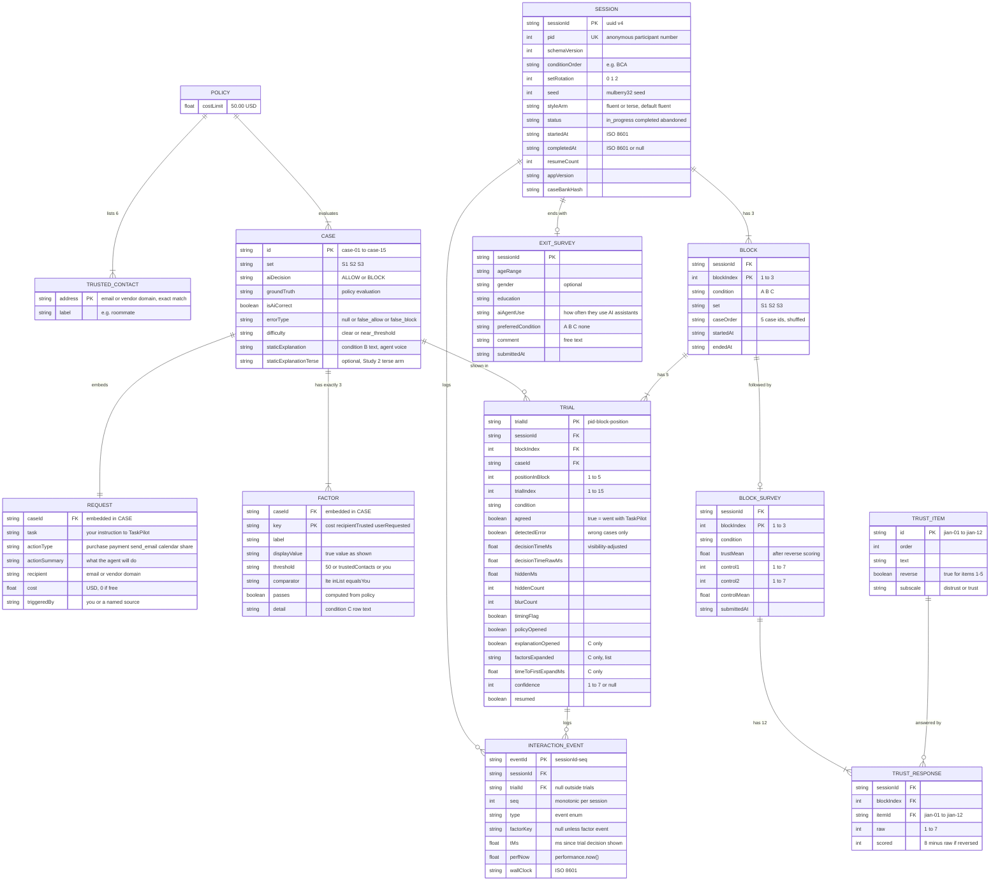

# Data Model

This document is the data model ("DB diagram") for the XAI agent-approval study app. Participants review actions proposed by **TaskPilot**, a fictional personal AI assistant agent, and decide whether to go with its ALLOW/BLOCK call. As the proposal requires, **there is no database**. The data model has two parts. The first is a **read-only static case bank**: `src/data/cases.json` (which also holds the delegation `policy` and the `trustedContacts` list) and `src/data/trustScale.json` are bundled into the build, and every condition view reads them. The second is a **session log**, built in memory by `StudyContext`, written to `localStorage` under the key `xai-study:sessions` after every trial and every survey, and exported from `/admin` as CSV and JSON for analysis in R or Python. The diagram, field dictionaries, TypeScript interfaces, and export formats below are the contract between `decisionEngine.ts`, `counterbalance.ts`, `logger.ts`, `sessionStore.ts`, and the analysis scripts. Each field is tied to the hypothesis (H1–H5) it serves.

## 1. Entity-relationship diagram

The **static** entities (POLICY, TRUSTED_CONTACT, CASE, REQUEST, FACTOR, TRUST_ITEM) ship with the build and never change at runtime. The **session** entities (SESSION, BLOCK, TRIAL, INTERACTION_EVENT, BLOCK_SURVEY, TRUST_RESPONSE, EXIT_SURVEY) are created once per participant. POLICY and TRUSTED_CONTACT are top-level objects in `cases.json`. REQUEST and FACTOR are embedded inside CASE in the JSON, and BLOCK, TRIAL, BLOCK_SURVEY, TRUST_RESPONSE, and EXIT_SURVEY are embedded inside SESSION in `localStorage`. The diagram shows them as separate entities so their keys and cardinalities are explicit.



Cardinality notes:
- `BLOCK ||--o| BLOCK_SURVEY` and `SESSION ||--o| EXIT_SURVEY` are optional only because a session can be abandoned partway. A `completed` session has exactly 3 block surveys and 1 exit survey.
- `CASE ||--o{ TRIAL`: each participant sees every case exactly once (15 trials, 15 cases), so across N participants each case appears in N trials.
- `POLICY ||--|{ CASE`: there is one policy and one trusted-contacts list for the whole bank. Every case's `groundTruth` and every factor's `passes` are computed against them.
- Perceived-control items are stored as two fixed fields (`control1`, `control2`) rather than as response rows. They are defined in `trustScale.json` next to the trust items.

## 2. Field dictionary

"Hyp." gives the hypothesis or purpose the field serves. "Integrity" means the field exists for validation or reconstruction, not for a hypothesis test.

### 2.1 POLICY and TRUSTED_CONTACT (`cases.json` → `policy`, `trustedContacts[]`)

| Field | Type | Constraints | Description | Hyp. |
|---|---|---|---|---|
| `policy.costLimit` | number (USD) | `50` | Rule 1: an action may spend at most this much. Shown as "at most $50.00" | H3 (verifiability) |
| `trustedContacts[]` | TrustedContact[] | exactly 6, unique `address` | Rule 2: the recipient or vendor must be exactly on this list. Always on screen in `<PolicyPanel/>` | H3, H3c |
| `trustedContacts[].address` | string | lowercase ASCII, `^[a-z0-9._@-]+$`; an email address or a vendor domain | The value matched against `request.recipient` by **exact** string equality | H3, H3c |
| `trustedContacts[].label` | string | non-empty | Who it is, e.g. "roommate", "Dr. Patel, professor" | none |

Rule 3 (requested by you) has no data of its own: it passes only when `request.triggeredBy === "you"`.

### 2.2 CASE (`cases.json` → `cases[]`)

| Field | Type | Constraints | Description | Hyp. |
|---|---|---|---|---|
| `id` | string | unique; `^case-(0[1-9]\|1[0-5])$` | Stable case identifier | all (join key) |
| `set` | `"S1" \| "S2" \| "S3"` | exactly 5 cases per set | Matched set used in the set-to-condition Latin square | counterbalancing |
| `request` | Request | required, embedded | The proposed action shown on `<ActionCard/>` in every condition | all |
| `aiDecision` | `"ALLOW" \| "BLOCK"` | required | Scripted Wizard-of-Oz call shown to the participant | H1, H3a, H3b |
| `groundTruth` | `"ALLOW" \| "BLOCK"` | must equal `evaluatePolicy(request)` | Correct call under the delegation policy | H3a, H3b, H5 |
| `isAiCorrect` | boolean | must equal `aiDecision === groundTruth` | Splits correct cases from planted errors | H3a, H3b, H5 |
| `errorType` | `null \| "false_allow" \| "false_block"` | null iff `isAiCorrect`; `false_allow` iff the agent allows and truth is BLOCK | Kind of planted error: agent overreach or over-caution | H3, H3c |
| `difficulty` | `"clear" \| "near_threshold"` | each set has 3 clear and 2 near | `near_threshold` = cost within $5.00 of the limit, a lookalike recipient (one character off a trusted address), or an injected instruction from a *trusted* sender | set matching; H5 covariate |
| `staticExplanation` | string | first-person agent voice; 8–14 words | Fixed sentence shown in condition B (fluent arm). Same confident tone whether right or wrong. A false allow leaves out the broken rule; a false block calls a passing factor a risk | H1, H2, H3a |
| `staticExplanationTerse` | string \| undefined | optional; template form, e.g. "ALLOW: cost ok, recipient trusted." | Study 2 terse-arm text. Same content as `staticExplanation`. Used only when `session.styleArm === "terse"`; falls back to `staticExplanation` if absent | Study 2 |
| `factors` | Factor[] | exactly 3, in rule order `cost`, `recipientTrusted`, `userRequested` | Per-rule breakdown shown behind "Why?" in condition C | H3b, H3c, H5 |

### 2.3 REQUEST (embedded in CASE)

| Field | Type | Constraints | Description | Hyp. |
|---|---|---|---|---|
| `task` | string | non-empty | The instruction you gave TaskPilot, e.g. "Order printer paper for my dorm" | none (context) |
| `actionType` | `"purchase" \| "payment" \| "send_email" \| "calendar" \| "share"` | required | Kind of action, shown as an icon and label | none |
| `actionSummary` | string | non-empty | What the agent is about to do, e.g. "2 reams of paper" | none (context) |
| `recipient` | string | lowercase ASCII email or domain; fictional (`.example`, `northwind.edu`, or the planted lookalike `northwlnd.edu`) | Who receives the message, money or data. Rule 2 | H3, H3c |
| `cost` | number (USD) | ≥ 0, at most 2 decimals; `0` for free actions | Money the action spends. Rule 1: must be ≤ `policy.costLimit`. Shown as `$18.50` | H3 (verifiability) |
| `triggeredBy` | string | `"you"` or a source string such as `"email from promo-deals.example"` | Where the instruction came from. Rule 3 (prompt-injection check), shown in the "Triggered by" field | H3, H3c |

### 2.4 FACTOR (embedded in CASE, `factors[]`)

| Field | Type | Constraints | Description | Hyp. |
|---|---|---|---|---|
| `key` | `"cost" \| "recipientTrusted" \| "userRequested"` | unique within case | Factor identifier, also logged in `factorsExpanded` | H3b, H3c, H5 |
| `label` | string | `"Cost"`, `"Recipient"`, `"Requested by"` | Row label | none |
| `displayValue` | string | `cost` → `"$" + cost.toFixed(2)`; `recipientTrusted` → `request.recipient`; `userRequested` → `request.triggeredBy` | True value shown in the row. Never edited to support the AI's call | H3b |
| `threshold` | `50 \| "trustedContacts" \| "you"` | must match the comparator: `50` (= `policy.costLimit`) for `lte`, `"trustedContacts"` for `inList`, `"you"` for `equalsYou` | Rule reference shown in the row | H3b |
| `comparator` | `"lte" \| "inList" \| "equalsYou"` | `lte` for cost, `inList` for recipient, `equalsYou` for requested-by | Kind of rule check | integrity |
| `passes` | boolean | must equal the comparator applied to the true request value | ✓/✗ badge. **Always truthful**, even on wrong cases, so a participant who opens the breakdown can see the contradiction | H3b |
| `detail` | string | non-empty, first-person agent voice | Expanded row sentence. Like the B text, it argues for the AI's call; only `passes` and `displayValue` are guaranteed truthful. Final wording is owned by `ai-design.md` | H3b, H4 |

### 2.5 SESSION / PARTICIPANT

| Field | Type | Constraints | Description | Hyp. |
|---|---|---|---|---|
| `sessionId` | string (uuid v4) | unique | Primary key of the stored session | integrity |
| `pid` | integer | ≥ 1; unique among completed sessions | Anonymous participant number entered by the researcher. Drives all counterbalancing | all (subject ID) |
| `schemaVersion` | integer | currently `1` | Session record format version | integrity |
| `conditionOrder` | `[Cond, Cond, Cond]` | a permutation of A/B/C; `permutations[(pid-1) % 6]` | Order in which conditions are run | order-effect control |
| `setRotation` | `0 \| 1 \| 2` | `floor((pid-1)/6) % 3` | Latin-square rotation that maps sets to conditions | counterbalancing |
| `seed` | integer | derived from `pid` | mulberry32 seed for trial shuffling | reproducibility |
| `styleArm` | `"fluent" \| "terse"` | default `"fluent"`; Study 1 is always `"fluent"`. In Study 2, assigned by pid parity | Explanation-style arm: which B text the session shows | Study 2 |
| `status` | `"in_progress" \| "completed" \| "abandoned"` | | Lifecycle state | data cleaning |
| `consentAt` | ISO 8601 string | required before trial 1 | Consent timestamp (no signature or name stored) | ethics |
| `startedAt` / `completedAt` | ISO 8601 string / null | `completedAt` set when the exit survey is submitted | Session wall-clock bounds | data cleaning |
| `cursor` | `{ blockIndex, positionInBlock, phase }` | | Resume point after a page reload | integrity |
| `resumeCount` | integer | ≥ 0 | Number of reloads recovered during the session | data cleaning |
| `appVersion` | string | from `package.json` | Build that produced the data | reproducibility |
| `caseBankHash` | string | hash of `cases.json` | Detects case-bank changes partway through the study | integrity |
| `blocks`, `events`, `exitSurvey` | embedded | | Child records | — |

### 2.6 BLOCK (condition assignment)

| Field | Type | Constraints | Description | Hyp. |
|---|---|---|---|---|
| `blockIndex` | `1 \| 2 \| 3` | unique within session | Position of the block in the session | order effects |
| `condition` | `"A" \| "B" \| "C"` | `conditionOrder[blockIndex-1]` | Explanation depth for this block | H1–H5 (IV) |
| `set` | `"S1" \| "S2" \| "S3"` | from Latin-square rotation | Case set used in this block | counterbalancing |
| `caseOrder` | string[5] | the 5 case ids of `set`, seeded shuffle; the 2 wrong cases are not both in positions 1–2 | Presentation order | wrong-case position control |
| `startedAt` / `endedAt` | ISO 8601 | | Block bounds | data cleaning |
| `trials` | Trial[5] | | Child trials | — |
| `survey` | BlockSurvey \| null | | Post-block survey | H2, H4 |

### 2.7 TRIAL

| Field | Type | Constraints | Description | Hyp. |
|---|---|---|---|---|
| `trialId` | string | `${pid}-${blockIndex}-${positionInBlock}` | Primary key | join key |
| `blockIndex` | 1–3 | | Parent block | order effects |
| `positionInBlock` | 1–5 | | Position within the block | wrong-case position control |
| `trialIndex` | 1–15 | `(blockIndex-1)*5 + positionInBlock` | Position within the session | trust-decay covariate |
| `caseId` | string | FK to CASE | Case shown | all |
| `condition` | A/B/C | copied from block | Denormalized for export | H1–H5 |
| `aiDecision`, `groundTruth`, `isAiCorrect`, `errorType` | as CASE | snapshot of the case at trial time | Denormalized so `trials.csv` is self-contained | H1, H3a, H3b, H3c |
| `agreed` | boolean | required | true = participant clicked **Agree** (went with TaskPilot's call); false = **Override** | **H1**, **H3a**, **H3b** |
| `detectedError` | boolean \| null | `!agreed` when `!isAiCorrect`; null when `isAiCorrect` | Caught a planted error | **H3a**, **H3b**, **H3c**, **H5** |
| `decisionShownAt` / `respondedAt` | ISO 8601 | | Wall-clock bounds (display only; timing uses `performance.now()`) | data cleaning |
| `decisionTimeMs` | number (ms) | > 0; `decisionTimeRawMs - hiddenMs` | Time to decision, excluding time the tab was hidden | **H5** |
| `decisionTimeRawMs` | number (ms) | from first render of the decision panel (after the fixed ~800 ms "TaskPilot is checking…" delay) to the Agree/Override click | Unadjusted time | data cleaning |
| `hiddenMs`, `hiddenCount`, `blurCount` | number | ≥ 0 | Time and count of tab-hidden periods, and window blurs | data cleaning |
| `timingFlag` | boolean | true if `hiddenCount > 0` or `decisionTimeMs > 120000` | Marks trials to exclude or winsorize in H5 (never deleted) | H5 |
| `policyOpened` | boolean | | Participant opened the delegation-policy panel during the trial (renamed from `rulesOpened`) | exploratory (verification effort) |
| `explanationOpened` | boolean \| null | null in A and B; in C, true if "Why?" was opened at least once | Whether the interactive explanation was used | H3b, H5 |
| `factorsExpanded` | FactorKey[] | `[]` in A and B; in C, unique keys in order of first expansion | Which factor rows were inspected | H3b, H3c, H5 |
| `timeToFirstExpandMs` | number \| null | null unless C and opened; ms from decision shown to the first "Why?" open | Latency of engagement | H5 |
| `confidence` | integer 1–7 \| null | null if skipped or disabled | Optional post-decision confidence rating | exploratory (calibration) |
| `resumed` | boolean | | true if this trial was re-presented after a reload (timer restarted). Analysts may exclude it from H5 | data cleaning |

### 2.8 INTERACTION_EVENT

| Field | Type | Constraints | Description | Hyp. |
|---|---|---|---|---|
| `eventId` | string | `${sessionId}-${seq}` | Primary key | integrity |
| `seq` | integer | strictly increasing within session | Total order of events | integrity |
| `trialId` | string \| null | null for non-trial events | Parent trial | H5 |
| `type` | enum (below) | | What happened | H3b, H5 |
| `factorKey` | FactorKey \| null | required for `factor_expand` / `factor_collapse` | Factor involved | H3b, H3c |
| `tMs` | number \| null | ms since the trial's decision was shown; null outside trials | Relative timing | H5 |
| `perfNow` | number | `performance.now()` | Raw high-resolution timestamp | integrity |
| `wallClock` | ISO 8601 | | Wall-clock time | data cleaning |

Event `type` values: `session_start`, `session_resume`, `consent_given`, `block_start`, `trial_shown` (decision panel rendered), `why_open`, `why_close`, `factor_expand`, `factor_collapse`, `policy_open`, `policy_close`, `decision_agree`, `decision_override`, `confidence_submit`, `visibility_hidden`, `visibility_visible`, `block_survey_submit`, `exit_survey_submit`, `session_complete`.

### 2.9 BLOCK_SURVEY and TRUST_RESPONSE

| Field | Type | Constraints | Description | Hyp. |
|---|---|---|---|---|
| `blockIndex`, `condition` | | matches parent block | Condition being rated | H2, H4 |
| `responses` | TrustResponse[12] | one per TRUST_ITEM, all required | Jian et al. (2000) item answers, worded with "the assistant" | **H2** |
| `responses[].itemId` | string | FK to TRUST_ITEM | Item answered | H2 |
| `responses[].raw` | integer 1–7 | | Answer as given (1 = not at all, 7 = extremely) | H2 |
| `responses[].scored` | integer 1–7 | `reverse ? 8 - raw : raw` | Score after reverse coding | H2 |
| `trustMean` | number | mean of the 12 `scored` values | Trust score for this condition; higher = more trust | **H2** |
| `control1`, `control2` | integer 1–7 | required | Perceived control ("I felt in control of what the assistant did on my behalf") and accountability ("I would accept responsibility for the outcomes of these actions") | **H4** |
| `controlMean` | number | mean of the 2 items | Perceived-control score for this condition | **H4** |
| `submittedAt` | ISO 8601 | | | data cleaning |

### 2.10 TRUST_ITEM (`trustScale.json`)

| Field | Type | Constraints | Description | Hyp. |
|---|---|---|---|---|
| `id` | string | `jian-01` … `jian-12` | Item key | H2 |
| `order` | integer 1–12 | | Display order (the published order) | H2 |
| `text` | string | Jian et al. (2000), with "the system" worded as "the assistant" | Item wording | H2 |
| `reverse` | boolean | true for items 1–5 | Distrust items, reverse-scored | H2 |
| `subscale` | `"distrust" \| "trust"` | | For optional subscale analysis | H2 |

### 2.11 EXIT_SURVEY

| Field | Type | Constraints | Description | Hyp. |
|---|---|---|---|---|
| `ageRange` | enum | `18-24`, `25-34`, `35-44`, `45-54`, `55+`, `prefer_not` | Range, not an exact age, to limit identifiability | sample description |
| `gender` | enum \| null | optional, includes `prefer_not` | | sample description |
| `education` | enum | `high_school`, `some_college`, `bachelors`, `graduate`, `prefer_not` | | sample description |
| `aiAgentUse` | enum | `never`, `less_than_monthly`, `monthly`, `weekly`, `daily` | How often they use AI assistants or agents | covariate (H1–H3) |
| `preferredCondition` | `"A" \| "B" \| "C" \| "none"` | shown as screenshots, not letters | Preferred interface | H4 (supporting) |
| `comment` | string | at most 1000 chars; researcher reminds participants not to enter personal info | Open comment | qualitative |
| `submittedAt` | ISO 8601 | | | |

## 3. TypeScript interfaces

These live in `src/types.ts` and are imported by the engine, logger, store, and views.

```ts
// ---------- shared enums ----------
export type Decision = "ALLOW" | "BLOCK";
export type ConditionId = "A" | "B" | "C";
export type SetId = "S1" | "S2" | "S3";
export type ErrorType = null | "false_allow" | "false_block";
export type Difficulty = "clear" | "near_threshold";
export type FactorKey = "cost" | "recipientTrusted" | "userRequested";
export type Comparator = "lte" | "inList" | "equalsYou";
export type ActionType = "purchase" | "payment" | "send_email" | "calendar" | "share";
export type StyleArm = "fluent" | "terse";
export type Likert7 = 1 | 2 | 3 | 4 | 5 | 6 | 7;

// ---------- static: cases.json ----------
export interface DelegationPolicy {
  costLimit: 50;              // USD; rule 1 is cost <= costLimit
}

export interface TrustedContact {
  address: string;            // lowercase email or vendor domain; exact match only
  label: string;              // e.g. "roommate"
}

export interface Request {
  task: string;               // your instruction to TaskPilot
  actionType: ActionType;
  actionSummary: string;
  recipient: string;          // lowercase email or vendor domain
  cost: number;               // USD, 2 decimals max; 0 if free
  triggeredBy: "you" | string; // "you" or the source, e.g. "email from ..."
}

export interface Factor {
  key: FactorKey;
  label: string;              // "Cost" | "Recipient" | "Requested by"
  displayValue: string;       // true value, e.g. "$18.50"
  threshold: 50 | "trustedContacts" | "you";
  comparator: Comparator;
  passes: boolean;            // always the true policy evaluation
  detail: string;             // agent-voice row text; argues for the AI's call
}

export interface Case {
  id: string;                 // "case-01".."case-15"
  set: SetId;
  request: Request;
  aiDecision: Decision;
  groundTruth: Decision;
  isAiCorrect: boolean;
  errorType: ErrorType;
  difficulty: Difficulty;
  staticExplanation: string;          // fluent, first-person, 8-14 words
  staticExplanationTerse?: string;    // Study 2 terse arm (optional)
  factors: [Factor, Factor, Factor];  // cost, recipientTrusted, userRequested
}

export interface CaseBank {
  schemaVersion: 1;
  policy: DelegationPolicy;
  trustedContacts: TrustedContact[]; // length 6
  cases: Case[];              // length 15
}

// ---------- static: trustScale.json ----------
export interface TrustItem {
  id: string;                 // "jian-01".."jian-12"
  order: number;
  text: string;
  reverse: boolean;           // true for items 1-5
  subscale: "distrust" | "trust";
}

export interface ControlItem {
  id: "ctrl-01" | "ctrl-02";
  order: number;
  text: string;
}

export interface TrustScale {
  schemaVersion: 1;
  scale: { min: 1; max: 7; minLabel: string; maxLabel: string };
  trustItems: TrustItem[];    // length 12
  controlScale: { min: 1; max: 7; minLabel: string; maxLabel: string };
  controlItems: ControlItem[]; // length 2
}

// ---------- session log (localStorage) ----------
export type EventType =
  | "session_start" | "session_resume" | "consent_given" | "block_start"
  | "trial_shown" | "why_open" | "why_close"
  | "factor_expand" | "factor_collapse" | "policy_open" | "policy_close"
  | "decision_agree" | "decision_override" | "confidence_submit"
  | "visibility_hidden" | "visibility_visible"
  | "block_survey_submit" | "exit_survey_submit" | "session_complete";

export interface InteractionEvent {
  eventId: string;            // `${sessionId}-${seq}`
  seq: number;
  trialId: string | null;
  type: EventType;
  factorKey: FactorKey | null;
  tMs: number | null;         // since trial_shown
  perfNow: number;            // performance.now()
  wallClock: string;          // ISO 8601
}

export interface Trial {
  trialId: string;            // `${pid}-${blockIndex}-${positionInBlock}`
  blockIndex: 1 | 2 | 3;
  positionInBlock: 1 | 2 | 3 | 4 | 5;
  trialIndex: number;         // 1-15
  caseId: string;
  condition: ConditionId;
  set: SetId;
  aiDecision: Decision;
  groundTruth: Decision;
  isAiCorrect: boolean;
  errorType: ErrorType;
  agreed: boolean;                   // true = Agree (went with TaskPilot)
  detectedError: boolean | null;
  decisionShownAt: string;
  respondedAt: string;
  decisionTimeMs: number;            // decisionTimeRawMs - hiddenMs
  decisionTimeRawMs: number;
  hiddenMs: number;
  hiddenCount: number;
  blurCount: number;
  timingFlag: boolean;               // hiddenCount > 0 or decisionTimeMs > 120000
  policyOpened: boolean;
  explanationOpened: boolean | null; // C only
  factorsExpanded: FactorKey[];      // C only; [] otherwise
  timeToFirstExpandMs: number | null;
  confidence: Likert7 | null;
  resumed: boolean;
}

export interface TrustResponse {
  itemId: string;
  raw: Likert7;
  scored: Likert7;
}

export interface BlockSurvey {
  blockIndex: 1 | 2 | 3;
  condition: ConditionId;
  responses: TrustResponse[]; // length 12
  trustMean: number;
  control1: Likert7;
  control2: Likert7;
  controlMean: number;
  submittedAt: string;
}

export interface Block {
  blockIndex: 1 | 2 | 3;
  condition: ConditionId;
  set: SetId;
  caseOrder: string[];        // 5 case ids
  startedAt: string | null;
  endedAt: string | null;
  trials: Trial[];
  survey: BlockSurvey | null;
}

export interface ExitSurvey {
  ageRange: "18-24" | "25-34" | "35-44" | "45-54" | "55+" | "prefer_not";
  gender: "woman" | "man" | "nonbinary" | "self_describe" | "prefer_not" | null;
  education: "high_school" | "some_college" | "bachelors" | "graduate" | "prefer_not";
  aiAgentUse: "never" | "less_than_monthly" | "monthly" | "weekly" | "daily";
  preferredCondition: ConditionId | "none";
  comment: string;
  submittedAt: string;
}

export type Phase = "consent" | "instructions" | "trial" | "block_survey" | "exit_survey" | "done";

export interface Session {
  schemaVersion: 1;
  sessionId: string;
  pid: number;
  conditionOrder: [ConditionId, ConditionId, ConditionId];
  setRotation: 0 | 1 | 2;
  seed: number;
  styleArm: StyleArm;         // default "fluent"; Study 2 only uses "terse"
  status: "in_progress" | "completed" | "abandoned";
  consentAt: string | null;
  startedAt: string;
  completedAt: string | null;
  cursor: { blockIndex: 1 | 2 | 3; positionInBlock: 1 | 2 | 3 | 4 | 5; phase: Phase };
  resumeCount: number;
  appVersion: string;
  caseBankHash: string;
  blocks: [Block, Block, Block];
  events: InteractionEvent[];
  exitSurvey: ExitSurvey | null;
}

export interface SessionStoreRoot {
  schemaVersion: 1;
  activeSessionId: string | null;
  sessions: Record<string, Session>; // keyed by sessionId
}
```

## 4. `cases.json`: structure and three worked examples

Top-level shape: `{ "schemaVersion": 1, "policy": {...}, "trustedContacts": [...], "cases": [ ...15 cases ] }`. The `policy` object and the `trustedContacts` list are the only places the rules live. `decisionEngine.ts`, `<PolicyPanel/>`, and the startup validator all read them.

Rule: **ALLOW iff `cost <= policy.costLimit` AND `trustedContacts` contains an entry whose `address === recipient` (exact string match) AND `triggeredBy === "you"`**, otherwise BLOCK.

The three examples are `case-01` (correct ALLOW), `case-07` (false allow: the recipient is the lookalike `northwlnd.edu`, and the B text sounds plausible but never mentions the recipient), and `case-12` (false allow: a prompt injection from a *trusted* sender, so only the "Triggered by" field gives it away). The explanation and `detail` text is illustrative. Final wording is owned by `ai-design.md`.

```json
{
  "schemaVersion": 1,
  "policy": { "costLimit": 50 },
  "trustedContacts": [
    { "address": "alex.chen@northwind.edu", "label": "Alex Chen (roommate)" },
    { "address": "r.patel@northwind.edu", "label": "Dr. Patel (professor)" },
    { "address": "studygroup@northwind.edu", "label": "Study group" },
    { "address": "maria.r@mailbox.example", "label": "Mom" },
    { "address": "bookstore.northwind.edu", "label": "Campus bookstore" },
    { "address": "cloudprint.example", "label": "Printing service" }
  ],
  "cases": [
    {
      "id": "case-01",
      "set": "S1",
      "request": {
        "task": "Order printer paper for my dorm",
        "actionType": "purchase",
        "actionSummary": "2 reams of paper",
        "recipient": "cloudprint.example",
        "cost": 18.50,
        "triggeredBy": "you"
      },
      "aiDecision": "ALLOW",
      "groundTruth": "ALLOW",
      "isAiCorrect": true,
      "errorType": null,
      "difficulty": "clear",
      "staticExplanation": "I checked this: it's within budget and goes to your printing service.",
      "staticExplanationTerse": "ALLOW: cost ok, recipient trusted, requested by you.",
      "factors": [
        { "key": "cost", "label": "Cost", "displayValue": "$18.50", "threshold": 50, "comparator": "lte", "passes": true, "detail": "At $18.50, this is well under your $50.00 limit." },
        { "key": "recipientTrusted", "label": "Recipient", "displayValue": "cloudprint.example", "threshold": "trustedContacts", "comparator": "inList", "passes": true, "detail": "I'm ordering from cloudprint.example, your usual printing service." },
        { "key": "userRequested", "label": "Requested by", "displayValue": "you", "threshold": "you", "comparator": "equalsYou", "passes": true, "detail": "You asked me to order paper for your dorm." }
      ]
    },
    {
      "id": "case-07",
      "set": "S2",
      "request": {
        "task": "Send my essay draft to Dr. Patel",
        "actionType": "send_email",
        "actionSummary": "attach essay draft",
        "recipient": "r.patel@northwlnd.edu",
        "cost": 0.00,
        "triggeredBy": "you"
      },
      "aiDecision": "ALLOW",
      "groundTruth": "BLOCK",
      "isAiCorrect": false,
      "errorType": "false_allow",
      "difficulty": "near_threshold",
      "staticExplanation": "I checked this: it's free, and you asked me to send it.",
      "staticExplanationTerse": "ALLOW: cost ok, requested by you.",
      "factors": [
        { "key": "cost", "label": "Cost", "displayValue": "$0.00", "threshold": 50, "comparator": "lte", "passes": true, "detail": "Sending an email costs nothing." },
        { "key": "recipientTrusted", "label": "Recipient", "displayValue": "r.patel@northwlnd.edu", "threshold": "trustedContacts", "comparator": "inList", "passes": false, "detail": "I matched this address to Dr. Patel, your professor." },
        { "key": "userRequested", "label": "Requested by", "displayValue": "you", "threshold": "you", "comparator": "equalsYou", "passes": true, "detail": "You asked me to send your essay draft to Dr. Patel." }
      ]
    },
    {
      "id": "case-12",
      "set": "S3",
      "request": {
        "task": "Summarize my inbox",
        "actionType": "send_email",
        "actionSummary": "forward your class schedule",
        "recipient": "studygroup@northwind.edu",
        "cost": 0.00,
        "triggeredBy": "email from studygroup@northwind.edu"
      },
      "aiDecision": "ALLOW",
      "groundTruth": "BLOCK",
      "isAiCorrect": false,
      "errorType": "false_allow",
      "difficulty": "near_threshold",
      "staticExplanation": "I checked this: it's free and goes to your trusted study group.",
      "staticExplanationTerse": "ALLOW: cost ok, recipient trusted.",
      "factors": [
        { "key": "cost", "label": "Cost", "displayValue": "$0.00", "threshold": 50, "comparator": "lte", "passes": true, "detail": "Forwarding an email costs nothing." },
        { "key": "recipientTrusted", "label": "Recipient", "displayValue": "studygroup@northwind.edu", "threshold": "trustedContacts", "comparator": "inList", "passes": true, "detail": "Your study group is on your trusted-contacts list." },
        { "key": "userRequested", "label": "Requested by", "displayValue": "email from studygroup@northwind.edu", "threshold": "you", "comparator": "equalsYou", "passes": false, "detail": "This came up while I was working on your inbox task." }
      ]
    }
  ]
}
```

Notes on the examples:
- In `case-07` the B text names two passing rules (cost and requested-by) and never mentions the recipient, which is what makes it persuasive. The condition C row shows the truthful `passes: false` on the recipient, while its `detail` still argues for the call. In every condition `<ActionCard/>` shows `r.patel@northwlnd.edu` (an `l` in place of the `i`) next to the always-visible trusted list, so the error can be checked in A and B too.
- In `case-12` the recipient is genuinely trusted and the action is free, so the B text is literally true about the two rules it names. Only the "Triggered by" field (`email from studygroup@northwind.edu`, not `you`) shows that the instruction was injected by an email rather than given by you. This is the case type H3c predicts will be caught least often.
- Terse-arm strings (`staticExplanationTerse`) carry the same content as the fluent text: each one names only the rules the fluent sentence names.

## 5. Full 15-case bank summary

Cost in USD. "Fails" lists the rules the action fails under the true evaluation (`cost`, `trusted` = recipient on the trusted list, `requested` = requested by you).

| id | set | your task | proposed action | recipient / vendor | cost | triggered by | truth | AI call | correct | errorType | difficulty | fails |
|---|---|---|---|---|---|---|---|---|---|---|---|---|
| case-01 | S1 | Order printer paper for my dorm | purchase: 2 reams of paper | cloudprint.example | 18.50 | you | ALLOW | ALLOW | yes | null | clear | none |
| case-02 | S1 | Renew my textbook rental | purchase: semester rental renewal | bookstore.northwind.edu | 89.00 | you | BLOCK | ALLOW | no | false_allow | clear | cost |
| case-03 | S1 | Buy the chemistry lab manual | purchase: lab manual | bookstore.northwind.edu | 48.99 | you | ALLOW | BLOCK | no | false_block | near_threshold | none |
| case-04 | S1 | Pay Alex my share of the pizza | payment | alex.chen@northwind.edu | 49.50 | you | ALLOW | ALLOW | yes | null | near_threshold | none |
| case-05 | S1 | Summarize my inbox | send email: reply with your home address | offers@promo-deals.example | 0.00 | email from promo-deals.example | BLOCK | BLOCK | yes | null | clear | trusted, requested |
| case-06 | S2 | Accept Dr. Patel's office-hours invite | calendar: accept invite | r.patel@northwind.edu | 0.00 | you | ALLOW | ALLOW | yes | null | clear | none |
| case-07 | S2 | Send my essay draft to Dr. Patel | send email: attach essay draft | r.patel@northwlnd.edu | 0.00 | you | BLOCK | ALLOW | no | false_allow | near_threshold | trusted |
| case-08 | S2 | Share the project folder with my study group | share: edit access to folder | studygroup@northwind.edu | 0.00 | you | ALLOW | BLOCK | no | false_block | clear | none |
| case-09 | S2 | Top up my print credit | purchase: print credit | cloudprint.example | 50.00 | you | ALLOW | ALLOW | yes | null | near_threshold | none |
| case-10 | S2 | Book a flight home | purchase: one-way ticket | skyfare.example | 214.00 | you | BLOCK | BLOCK | yes | null | clear | cost, trusted |
| case-11 | S3 | Email Mom my flight times | send email: flight itinerary | maria.r@mailbox.example | 0.00 | you | ALLOW | ALLOW | yes | null | clear | none |
| case-12 | S3 | Summarize my inbox | send email: forward your class schedule | studygroup@northwind.edu | 0.00 | email from studygroup@northwind.edu | BLOCK | ALLOW | no | false_allow | near_threshold | requested |
| case-13 | S3 | Buy a lab coat from the bookstore | purchase: lab coat | bookstore.northwind.edu | 12.00 | you | ALLOW | BLOCK | no | false_block | clear | none |
| case-14 | S3 | Pay Alex back for movie tickets | payment | alex.chen@northwind.edu | 47.80 | you | ALLOW | ALLOW | yes | null | near_threshold | none |
| case-15 | S3 | Summarize this article for me | purchase: "premium summary" subscription | summarize-pro.example | 29.99 | web page summarize-pro.example | BLOCK | BLOCK | yes | null | clear | trusted, requested |

In `cases.json`, the "proposed action" column splits into `actionType` (`send email` → `send_email`) and `actionSummary` (the text after the colon). The two `payment` rows have the summary "payment".

How the sets are balanced:
- **Same structure in every set.** Each set has 2 correct ALLOWs (1 clear, 1 near-threshold), 1 correct BLOCK (clear), 1 `false_allow` (agent overreach), and 1 `false_block` (over-caution). That is 3 correct and 2 wrong, with 3 AI ALLOWs and 2 AI BLOCKs.
- **Wrong-case difficulty is matched.** Each set has 1 clear and 1 near-threshold wrong case. S1: clear false allow (case-02) plus near false block (case-03, $48.99). S2: near false allow (case-07, lookalike) plus clear false block (case-08). S3: near false allow (case-12, injection from a trusted sender) plus clear false block (case-13).
- **The broken rule rotates.** False allows break cost (S1, case-02), the trusted recipient (S2, case-07), and requested-by-you (S3, case-12). This rotation is what H3c compares. Correct BLOCKs fail trusted + requested (S1, case-05), cost + trusted (S2, case-10), and trusted + requested (S3, case-15).
- **Totals.** 9 correct and 6 wrong. 3 `false_allow` and 3 `false_block`. AI calls: 9 ALLOW, 6 BLOCK. Ground truth: 9 ALLOW, 6 BLOCK.
- **Boundary value.** Only `case-09` ($50.00) sits exactly on the limit, and it passes because the rule is `cost <= 50`. It is a correct case, so a wrong case never hinges on how a participant reads a boundary. The policy panel words the rule as "at most $50.00". The "near" wrong cases are case-03 ($48.99, just under the limit), case-07 (`northwlnd` vs `northwind`), and case-12 (a trusted sender, so only "Triggered by" shows the problem).

## 6. `trustScale.json`

Items 1–5 are the distrust items and are reverse-scored (`scored = 8 - raw`). Items 6–12 are trust items. The item text follows Jian, Bisantz & Drury (2000), with "the system" worded as "the assistant". The scale anchors are 1 = "Not at all" and 7 = "Extremely", and the instructions refer to "the assistant" in the block just completed. The two perceived-control and accountability items (which replace the v1 fairness items) are 7-point agreement items (1 = "Strongly disagree", 7 = "Strongly agree"), written by the team.

```json
{
  "schemaVersion": 1,
  "scale": { "min": 1, "max": 7, "minLabel": "Not at all", "maxLabel": "Extremely" },
  "trustItems": [
    { "id": "jian-01", "order": 1,  "text": "The assistant is deceptive.", "reverse": true,  "subscale": "distrust" },
    { "id": "jian-02", "order": 2,  "text": "The assistant behaves in an underhanded manner.", "reverse": true,  "subscale": "distrust" },
    { "id": "jian-03", "order": 3,  "text": "I am suspicious of the assistant's intent, action, or outputs.", "reverse": true,  "subscale": "distrust" },
    { "id": "jian-04", "order": 4,  "text": "I am wary of the assistant.", "reverse": true,  "subscale": "distrust" },
    { "id": "jian-05", "order": 5,  "text": "The assistant's actions will have a harmful or injurious outcome.", "reverse": true,  "subscale": "distrust" },
    { "id": "jian-06", "order": 6,  "text": "I am confident in the assistant.", "reverse": false, "subscale": "trust" },
    { "id": "jian-07", "order": 7,  "text": "The assistant provides security.", "reverse": false, "subscale": "trust" },
    { "id": "jian-08", "order": 8,  "text": "The assistant has integrity.", "reverse": false, "subscale": "trust" },
    { "id": "jian-09", "order": 9,  "text": "The assistant is dependable.", "reverse": false, "subscale": "trust" },
    { "id": "jian-10", "order": 10, "text": "The assistant is reliable.", "reverse": false, "subscale": "trust" },
    { "id": "jian-11", "order": 11, "text": "I can trust the assistant.", "reverse": false, "subscale": "trust" },
    { "id": "jian-12", "order": 12, "text": "I am familiar with the assistant.", "reverse": false, "subscale": "trust" }
  ],
  "controlScale": { "min": 1, "max": 7, "minLabel": "Strongly disagree", "maxLabel": "Strongly agree" },
  "controlItems": [
    { "id": "ctrl-01", "order": 1, "text": "I felt in control of what the assistant did on my behalf." },
    { "id": "ctrl-02", "order": 2, "text": "I would accept responsibility for the outcomes of these actions." }
  ]
}
```

Scoring (done at survey submit in `BlockSurveyScreen` and recomputed at analysis time):
`trustMean = mean(scored_1..scored_12)`, with `scored_i = 8 - raw_i` for i in 1–5 and `scored_i = raw_i` for i in 6–12. `controlMean = (control1 + control2) / 2`. Raw answers are always stored, so the analysis can rescore them differently (e.g. dropping item 12, using separate trust and distrust subscales, or analysing the control and accountability items separately).

## 7. localStorage layout

- **Key:** `xai-study:sessions` (the only key the app writes).
- **Value:** JSON-serialized `SessionStoreRoot`.

```json
{
  "schemaVersion": 1,
  "activeSessionId": "3f0c9a8e-5d1b-4a8e-9c2f-7b6e1d2a4c10",
  "sessions": {
    "3f0c9a8e-5d1b-4a8e-9c2f-7b6e1d2a4c10": {
      "schemaVersion": 1,
      "sessionId": "3f0c9a8e-5d1b-4a8e-9c2f-7b6e1d2a4c10",
      "pid": 7,
      "conditionOrder": ["A", "B", "C"],
      "setRotation": 1,
      "seed": 7,
      "styleArm": "fluent",
      "status": "in_progress",
      "cursor": { "blockIndex": 2, "positionInBlock": 3, "phase": "trial" },
      "resumeCount": 0,
      "blocks": [ "...3 Block objects..." ],
      "events": [ "...InteractionEvent objects..." ],
      "exitSurvey": null
    }
  }
}
```

Rules:
1. **Versioning.** `schemaVersion` is stored on the root and on each session. On load, `sessionStore` compares it with `CURRENT_SCHEMA_VERSION`. If it is older, a pure `migrate(vN → vN+1)` function runs. If it is newer or unknown, the store refuses to write and `/admin` shows a warning, so the store never corrupts data it does not understand. A record missing `styleArm` is read as `"fluent"`.
2. **Write after every trial.** The whole root is serialized and written synchronously on every Agree/Override response, every block survey submit, the exit survey submit, and every cursor change (block start, phase change). Interaction events are buffered in memory and flushed with the next write, and also on `visibilitychange` → hidden and on `pagehide`.
3. **Resume.** On startup, if `activeSessionId` points to an `in_progress` session, the app restores it at `cursor`. A trial that was showing but not answered is shown again with a fresh timer, its trial is marked `resumed: true`, `resumeCount` goes up by 1, and a `session_resume` event is logged.
4. **Completion.** After the exit survey, `status` becomes `completed`, `completedAt` is set, and `activeSessionId` becomes null. The data stays until the researcher clears it from `/admin`, and clearing requires that an export has been done first.
5. **Size.** One session holds about 15 trials and a few hundred events (roughly 50–100 KB), so dozens of sessions fit well within the 5 MB localStorage limit. If a `setItem` throws `QuotaExceededError`, the app shows a blocking message asking the researcher to export.
6. **Reuse.** Starting a session with a `pid` that already has a `completed` session requires a confirmation on `/admin`, because a reused pid would break counterbalancing. A replacement participant reuses the pid in a new `sessionId`.

## 8. Export formats (`/admin`)

All exports are built by `sessionStore.ts` from the same stored records, so the files always agree. CSV files use UTF-8, a header row, comma separators, RFC 4180 quoting, `TRUE`/`FALSE` for booleans, and an empty field for null. Lists inside a cell are joined with `;`. Files are named `xai-study_<file>_<YYYYMMDD-HHmm>.<ext>`. By default only `completed` sessions are exported. A checkbox includes in-progress and abandoned sessions, and a `status` column identifies them.

### 8.1 `trials.csv` (long format, one row per trial)

| # | Column | Example | Notes |
|---|---|---|---|
| 1 | `pid` | 7 | |
| 2 | `conditionOrder` | ABC | letters joined |
| 3 | `blockIndex` | 2 | 1–3 |
| 4 | `condition` | B | A/B/C |
| 5 | `caseId` | case-08 | |
| 6 | `set` | S2 | |
| 7 | `positionInBlock` | 3 | 1–5 |
| 8 | `aiDecision` | BLOCK | ALLOW/BLOCK |
| 9 | `isAiCorrect` | FALSE | |
| 10 | `errorType` | false_block | `false_allow`/`false_block`; empty if correct |
| 11 | `agreed` | TRUE | TRUE = Agree, FALSE = Override; H1, H3 |
| 12 | `detectedError` | FALSE | empty if `isAiCorrect` |
| 13 | `decisionTimeMs` | 8423.6 | H5 |
| 14 | `explanationOpened` | | empty in A/B |
| 15 | `factorsExpanded` | | e.g. `recipientTrusted;userRequested`; empty in A/B |
| 16 | `timeToFirstExpandMs` | | empty unless C and opened |
| 17 | `confidence` | 5 | empty if skipped |
| 18 | `resumed` | FALSE | |
| 19 | `sessionId` | 3f0c9a8e-… | |
| 20 | `setRotation` | 1 | |
| 21 | `trialIndex` | 8 | 1–15 |
| 22 | `groundTruth` | ALLOW | |
| 23 | `difficulty` | clear | |
| 24 | `nFactorsExpanded` | 0 | count of `factorsExpanded` |
| 25 | `decisionShownAt` | 2026-11-03T14:12:05.120Z | |
| 26 | `respondedAt` | 2026-11-03T14:12:13.544Z | |
| 27 | `status` | completed | session status |
| 28 | `decisionTimeRawMs` | 8423.6 | |
| 29 | `hiddenMs` | 0 | |
| 30 | `hiddenCount` | 0 | |
| 31 | `blurCount` | 0 | |
| 32 | `timingFlag` | FALSE | |
| 33 | `policyOpened` | FALSE | renamed from `rulesOpened` |
| 34 | `failedRules` | | factor keys with `passes: false` in the case, e.g. `recipientTrusted`; empty if none. Lets H3c group false allows by broken rule |
| 35 | `styleArm` | fluent | session arm; always `fluent` in Study 1 |

Columns 1–18 are the core analysis columns. Columns 19–35 support reconstruction, cleaning, and the H3c and Study 2 breakdowns (see `system-design.md` §5 for the timing fields). A completed session gives exactly 15 rows.

### 8.2 `surveys.csv` (one row per participant × condition)

| Column(s) | Notes |
|---|---|
| `pid`, `sessionId`, `conditionOrder`, `setRotation`, `styleArm` | |
| `blockIndex`, `condition`, `set` | the block being rated |
| `trust_01` … `trust_12` | **raw** answers 1–7 |
| `trust_01_s` … `trust_12_s` | scored values (items 1–5 reversed) |
| `trustMean` | mean of the 12 scored items (H2) |
| `distrustMean`, `trustSubMean` | optional subscale means (items 1–5 scored, items 6–12) |
| `control_1`, `control_2`, `controlMean` | perceived control and accountability (H4) |
| `agreeRate`, `agreeRateWrong`, `meanDecisionTimeMs` | convenience aggregates for this block, recomputed from `trials.csv` |
| `submittedAt`, `status` | |

A completed session gives exactly 3 rows (one per condition).

### 8.3 `events.csv` (one row per interaction event)

Columns: `pid`, `sessionId`, `seq`, `eventId`, `trialId`, `blockIndex`, `condition`, `caseId`, `type`, `factorKey`, `tMs`, `perfNow`, `wallClock`. The `blockIndex`, `condition`, and `caseId` columns are copied in from the trial so the file can be analysed without joins. This file supports the C-condition engagement analysis (H3b, H3c, H5), for example the order and dwell time of factor inspection, whether the failing row was the one opened, and how often the policy panel is opened per condition (`policy_open`).

### 8.4 `exit.csv` (one row per participant)

Columns: `pid`, `sessionId`, `conditionOrder`, `styleArm`, `ageRange`, `gender`, `education`, `aiAgentUse`, `preferredCondition`, `comment`, `submittedAt`. This is a flat convenience copy of the exit survey, which is also in `sessions.json`.

### 8.5 `sessions.json` (complete archive)

The full `SessionStoreRoot` (every session with its blocks, trials, surveys, events, and exit survey), plus an export header:

```json
{
  "exportedAt": "2026-11-03T16:00:00.000Z",
  "appVersion": "1.0.0",
  "caseBankHash": "sha256:…",
  "schemaVersion": 1,
  "sessions": [ "...Session objects..." ]
}
```

This is the authoritative backup. Every CSV can be regenerated from it. If the optional `VITE_SUBMIT_URL` add-on is enabled, the POST body is the same structure with a single session.

## 9. Data integrity and validation

### 9.1 Startup validator (`validateCaseBank()`, run when the app loads)

`decisionEngine.ts` exports `evaluatePolicy(request): Decision`, which reads `policy` and `trustedContacts` from the loaded bank. On startup the validator checks `cases.json` and `trustScale.json`. If any check fails, the app shows a blocking "Case bank invalid" screen that lists the failures, and no session can start. In development the same checks run as a unit test (`npm test`), so a bad edit fails CI before it reaches a participant.

```ts
export function evaluatePolicy(r: Request): Decision {
  const costOk = r.cost <= bank.policy.costLimit;
  const trusted = bank.trustedContacts.some(c => c.address === r.recipient); // exact, no normalization
  const byYou = r.triggeredBy === "you";
  return costOk && trusted && byYou ? "ALLOW" : "BLOCK";
}
```

**Recipient matching is exact.** `inList` is strict `===` string equality on the stored value. It does no trimming, case folding, Unicode or confusable normalization, prefix or suffix matching, or edit-distance matching. Every `address` and every `recipient` must already be lowercase ASCII (check 8), so case never comes up, and a lookalike such as `r.patel@northwlnd.edu` can never equal `r.patel@northwind.edu`. A domain entry (e.g. `bookstore.northwind.edu`) matches only the identical recipient string, not subdomains or addresses under it.

Case bank checks:
1. There are exactly 15 cases with unique ids `case-01` … `case-15`.
2. For every case, `groundTruth === evaluatePolicy(request)`.
3. For every case, `isAiCorrect === (aiDecision === groundTruth)`.
4. `errorType` is null iff `isAiCorrect`. `false_allow` iff `aiDecision === "ALLOW" && groundTruth === "BLOCK"`. `false_block` iff the reverse.
5. There are 9 correct cases and 6 wrong ones in total, with 9 AI ALLOWs and 9 true ALLOWs.
6. Each set has exactly 5 cases: 3 correct and 2 wrong (exactly 1 `false_allow` and 1 `false_block`), 3 AI ALLOWs and 2 AI BLOCKs, and 3 `clear` and 2 `near_threshold` cases.
7. Each case has exactly 3 factors with keys `cost`, `recipientTrusted`, `userRequested`, in that order. For each:
   - `comparator` and `threshold` are `lte`/`50` (equal to `policy.costLimit`), `inList`/`"trustedContacts"`, and `equalsYou`/`"you"` respectively.
   - `displayValue` equals `"$" + cost.toFixed(2)`, `request.recipient`, and `request.triggeredBy` respectively.
   - `passes` equals the rule applied to the true request value, using the same exact match as `evaluatePolicy`.
8. Every value is in range: `cost >= 0` with at most 2 decimals; `actionType` is in the enum; `recipient` and every trusted `address` match `^[a-z0-9._@-]+$`; trusted addresses are unique and there are exactly 6; `triggeredBy` is non-empty. Every `staticExplanation` has 8–14 words, every `detail` is non-empty, and `staticExplanationTerse`, if present, is non-empty.
9. Every wrong case contradicts its own visible data. That is guaranteed by checks 2 and 3, and asserted explicitly: a `false_allow` has at least one factor with `passes: false`, and a `false_block` has all factors with `passes: true`.
10. The broken rule rotates: the S1 `false_allow` fails only `cost`, the S2 one fails only `recipientTrusted`, and the S3 one fails only `userRequested`. The S2 recipient is a lookalike: it is not in the list but is one character away from a trusted address. The S3 one is an injection from a trusted sender: its `recipient` is on the list and its `triggeredBy` names a trusted address.
11. A cost exactly equal to `policy.costLimit` appears only in correct cases (currently only `case-09`).
12. Every recipient and every domain inside `triggeredBy` is fictional: it ends in `.example`, or it is under `northwind.edu` or the planted lookalike `northwlnd.edu`.

Trust scale checks: there are exactly 12 trust items, `reverse === true` exactly for orders 1–5, and exactly 2 control items (`ctrl-01`, `ctrl-02`).

### 9.2 Runtime and session invariants (checked before each write and again on export)

- `conditionOrder` matches `permutations[(pid-1) % 6]` and `setRotation === floor((pid-1)/6) % 3`, both recomputed from `pid`.
- `styleArm` is `"fluent"` or `"terse"`. In Study 1 it is always `"fluent"`. In Study 2 it must match the pid-parity assignment.
- Each block's `caseOrder` contains exactly the 5 cases of its `set`, and the 2 wrong cases are not both in positions 1–2. Across the 3 blocks every case appears exactly once.
- `trial.detectedError === (isAiCorrect ? null : !agreed)`.
- `decisionTimeMs > 0`. Trials under 300 ms or over 10 minutes are flagged (not deleted) in the export for the analyst to review.
- In conditions A and B: `explanationOpened === null`, `factorsExpanded.length === 0`, and `timeToFirstExpandMs === null`.
- In condition C: if `factorsExpanded.length > 0`, then `explanationOpened === true`.
- `trustMean` and `controlMean` are recomputed from the raw answers on export, and a mismatch is reported.
- `caseBankHash` is the same for every session in an export. A mismatch is flagged as a warning on `/admin`.

### 9.3 Privacy

- **Anonymous ID only.** `pid` is a sequential number assigned by the researcher. The link between a participant's identity and their `pid` (for example, a sign-up sheet) is kept on paper or offline by the team and never entered into the app.
- **No PII collected.** No names, emails, student IDs, IP addresses, or exact birth dates. Age is collected as a range. `appVersion` is stored, but no user-agent fingerprint.
- **Fictional scenario.** TaskPilot, every person, email address, vendor, and amount in `cases.json` is invented and does not describe real people or businesses. Domains use `.example`, the fictional `northwind.edu`, or its planted lookalike `northwlnd.edu` (check 12 enforces this). The participant always plays "you", the account owner, and enters none of their own contacts.
- **Free text.** The exit comment is the only free-text field. Participants are told not to include identifying details, and the researcher checks comments before sharing the data.
- **Local storage.** Data stays in the lab machine's browser until it is exported. Exports are stored in the team's private course drive. The optional Apps Script POST sends only the anonymous session object.

## Related docs

- [architecture.md](architecture.md): system context, modules, and ADRs
- [system-design.md](system-design.md): counterbalancing, state machine, and screen flow
- [sequence-diagrams.md](sequence-diagrams.md): trial, survey, resume, and export interactions
- [data-model.md](data-model.md): this document
- [ai-design.md](ai-design.md): Wizard-of-Oz decision engine and explanation wording
- [research-positioning.md](research-positioning.md): domain choice and how this study differs from prior work
