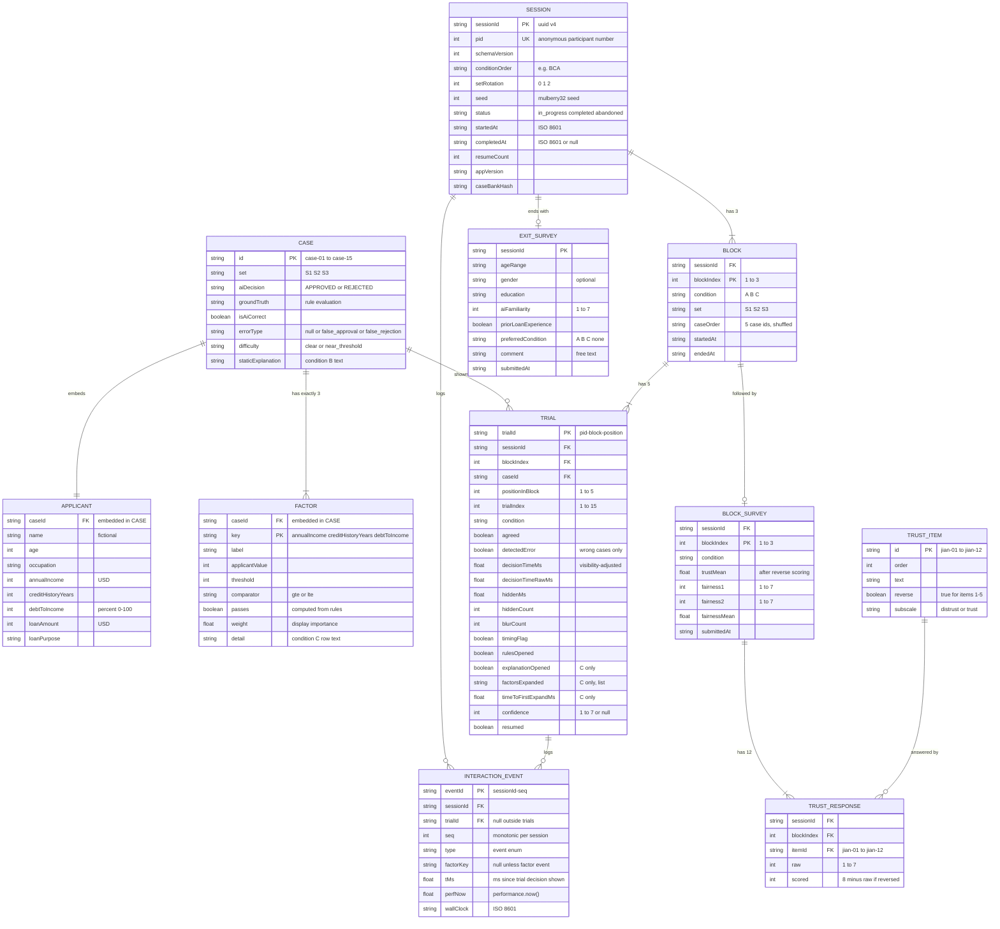

# Data Model

This document is the data model ("DB diagram") for the XAI loan-approval study app. As the proposal requires, **there is no database**. The data model has two parts. The first is a **read-only static case bank**: `src/data/cases.json` and `src/data/trustScale.json` are bundled into the build, and every condition view reads them. The second is a **session log**, built in memory by `StudyContext`, written to `localStorage` under the key `xai-study:sessions` after every trial and every survey, and exported from `/admin` as CSV and JSON for analysis in R or Python. The diagram, field dictionaries, TypeScript interfaces, and export formats below are the contract between `decisionEngine.ts`, `counterbalance.ts`, `logger.ts`, `sessionStore.ts`, and the analysis scripts. Each field is tied to the hypothesis (H1–H5) it serves.

## 1. Entity-relationship diagram

The **static** entities (CASE, APPLICANT, FACTOR, TRUST_ITEM) ship with the build and never change at runtime. The **session** entities (SESSION, BLOCK, TRIAL, INTERACTION_EVENT, BLOCK_SURVEY, TRUST_RESPONSE, EXIT_SURVEY) are created once per participant. APPLICANT and FACTOR are embedded inside CASE in the JSON, and BLOCK, TRIAL, BLOCK_SURVEY, TRUST_RESPONSE, and EXIT_SURVEY are embedded inside SESSION in `localStorage`. The diagram shows them as separate entities so their keys and cardinalities are explicit.



Cardinality notes:
- `BLOCK ||--o| BLOCK_SURVEY` and `SESSION ||--o| EXIT_SURVEY` are optional only because a session can be abandoned partway. A `completed` session has exactly 3 block surveys and 1 exit survey.
- `CASE ||--o{ TRIAL`: each participant sees every case exactly once (15 trials, 15 cases), so across N participants each case appears in N trials.
- Fairness items are stored as two fixed fields (`fairness1`, `fairness2`) rather than as response rows. They are defined in `trustScale.json` next to the trust items.

## 2. Field dictionary

"Hyp." gives the hypothesis or purpose the field serves. "Integrity" means the field exists for validation or reconstruction, not for a hypothesis test.

### 2.1 CASE (`cases.json` → `cases[]`)

| Field | Type | Constraints | Description | Hyp. |
|---|---|---|---|---|
| `id` | string | unique; `^case-(0[1-9]\|1[0-5])$` | Stable case identifier | all (join key) |
| `set` | `"S1" \| "S2" \| "S3"` | exactly 5 cases per set | Matched set used in the set-to-condition Latin square | counterbalancing |
| `applicant` | Applicant | required, embedded | Applicant data shown on `<ApplicantCard/>` in every condition | all |
| `aiDecision` | `"APPROVED" \| "REJECTED"` | required | Scripted Wizard-of-Oz decision shown to the participant | H1, H3a, H3b |
| `groundTruth` | `"APPROVED" \| "REJECTED"` | must equal `evaluateRules(applicant)` | Correct decision under the stated lending rules | H3a, H3b, H5 |
| `isAiCorrect` | boolean | must equal `aiDecision === groundTruth` | Splits correct cases from planted errors | H3a, H3b, H5 |
| `errorType` | `null \| "false_approval" \| "false_rejection"` | null iff `isAiCorrect`; `false_approval` iff AI approves and truth is rejection | Kind of planted error | H3 (exploratory breakdown) |
| `difficulty` | `"clear" \| "near_threshold"` | each set has 3 clear and 2 near | `near_threshold` = at least one value within a small margin of its threshold (income within $3,000, history within 1 year, DTI within 3 points) | set matching; H5 covariate |
| `staticExplanation` | string | non-empty, at most 300 chars | Fixed paragraph shown in condition B. For wrong cases it is persuasive and supports the wrong decision | H1, H2, H3a |
| `factors` | Factor[] | exactly 3, one per rule, in rule order | Per-factor breakdown shown behind "Why?" in condition C | H3b, H4, H5 |

### 2.2 APPLICANT (embedded in CASE)

| Field | Type | Constraints | Description | Hyp. |
|---|---|---|---|---|
| `name` | string | fictional; no real people | Display name for realism | none |
| `age` | integer | 21–70 | Display only; not a decision rule | none |
| `occupation` | string | non-empty | Display only | none |
| `annualIncome` | integer (USD) | > 0 | Rule 1: must be ≥ 45,000 | H3 (verifiability) |
| `creditHistoryYears` | integer (years) | ≥ 0 | Rule 2: must be ≥ 3 | H3 (verifiability) |
| `debtToIncome` | integer (percent) | 0–100 | Rule 3: must be ≤ 40. Stored as a whole percent (52 means 52%) | H3 (verifiability) |
| `loanAmount` | integer (USD) | > 0 | Display only; not a decision rule | none |
| `loanPurpose` | string | non-empty | Display only (e.g. "Car purchase") | none |

### 2.3 FACTOR (embedded in CASE, `factors[]`)

| Field | Type | Constraints | Description | Hyp. |
|---|---|---|---|---|
| `key` | `"annualIncome" \| "creditHistoryYears" \| "debtToIncome"` | unique within case; same name as the applicant field | Factor identifier, also logged in `factorsExpanded` | H3b, H5 |
| `label` | string | non-empty | Row label, e.g. "Debt-to-income ratio" | none |
| `applicantValue` | number | must equal `applicant[key]` | Value shown in the row | H3b |
| `threshold` | number | must equal the matching constant in `rules` | Threshold shown in the row | H3b |
| `comparator` | `">=" \| "<="` | `>=` for income and history, `<=` for DTI | Direction of the rule | integrity |
| `passes` | boolean | must equal `applicantValue comparator threshold` | Pass/fail badge. **Always truthful**, even on wrong cases, so a participant who opens the breakdown can see the contradiction | H3b |
| `weight` | number | 0–1; the 3 weights sum to 1.0 | Relative importance shown as a bar in C | H4 |
| `detail` | string | non-empty | One-line row text. Final wording is owned by `ai-design.md` | H3b, H4 |

### 2.4 SESSION / PARTICIPANT

| Field | Type | Constraints | Description | Hyp. |
|---|---|---|---|---|
| `sessionId` | string (uuid v4) | unique | Primary key of the stored session | integrity |
| `pid` | integer | ≥ 1; unique among completed sessions | Anonymous participant number entered by the researcher. Drives all counterbalancing | all (subject ID) |
| `schemaVersion` | integer | currently `1` | Session record format version | integrity |
| `conditionOrder` | `[Cond, Cond, Cond]` | a permutation of A/B/C; `permutations[(pid-1) % 6]` | Order in which conditions are run | order-effect control |
| `setRotation` | `0 \| 1 \| 2` | `floor((pid-1)/6) % 3` | Latin-square rotation that maps sets to conditions | counterbalancing |
| `seed` | integer | derived from `pid` | mulberry32 seed for trial shuffling | reproducibility |
| `status` | `"in_progress" \| "completed" \| "abandoned"` | | Lifecycle state | data cleaning |
| `consentAt` | ISO 8601 string | required before trial 1 | Consent timestamp (no signature or name stored) | ethics |
| `startedAt` / `completedAt` | ISO 8601 string / null | `completedAt` set when the exit survey is submitted | Session wall-clock bounds | data cleaning |
| `cursor` | `{ blockIndex, positionInBlock, phase }` | | Resume point after a page reload | integrity |
| `resumeCount` | integer | ≥ 0 | Number of reloads recovered during the session | data cleaning |
| `appVersion` | string | from `package.json` | Build that produced the data | reproducibility |
| `caseBankHash` | string | hash of `cases.json` | Detects case-bank changes partway through the study | integrity |
| `blocks`, `events`, `exitSurvey` | embedded | | Child records | — |

### 2.5 BLOCK (condition assignment)

| Field | Type | Constraints | Description | Hyp. |
|---|---|---|---|---|
| `blockIndex` | `1 \| 2 \| 3` | unique within session | Position of the block in the session | order effects |
| `condition` | `"A" \| "B" \| "C"` | `conditionOrder[blockIndex-1]` | Explanation depth for this block | H1–H5 (IV) |
| `set` | `"S1" \| "S2" \| "S3"` | from Latin-square rotation | Case set used in this block | counterbalancing |
| `caseOrder` | string[5] | the 5 case ids of `set`, seeded shuffle; the 2 wrong cases are not both in positions 1–2 | Presentation order | wrong-case position control |
| `startedAt` / `endedAt` | ISO 8601 | | Block bounds | data cleaning |
| `trials` | Trial[5] | | Child trials | — |
| `survey` | BlockSurvey \| null | | Post-block survey | H2, H4 |

### 2.6 TRIAL

| Field | Type | Constraints | Description | Hyp. |
|---|---|---|---|---|
| `trialId` | string | `${pid}-${blockIndex}-${positionInBlock}` | Primary key | join key |
| `blockIndex` | 1–3 | | Parent block | order effects |
| `positionInBlock` | 1–5 | | Position within the block | wrong-case position control |
| `trialIndex` | 1–15 | `(blockIndex-1)*5 + positionInBlock` | Position within the session | trust-decay covariate |
| `caseId` | string | FK to CASE | Case shown | all |
| `condition` | A/B/C | copied from block | Denormalized for export | H1–H5 |
| `aiDecision`, `groundTruth`, `isAiCorrect`, `errorType` | as CASE | snapshot of the case at trial time | Denormalized so `trials.csv` is self-contained | H1, H3a, H3b |
| `agreed` | boolean | required | true = participant clicked Agree with the AI | **H1**, **H3a**, **H3b** |
| `detectedError` | boolean \| null | `!agreed` when `!isAiCorrect`; null when `isAiCorrect` | Caught a planted error | **H3a**, **H3b**, **H5** |
| `decisionShownAt` / `respondedAt` | ISO 8601 | | Wall-clock bounds (display only; timing uses `performance.now()`) | data cleaning |
| `decisionTimeMs` | number (ms) | > 0; `decisionTimeRawMs - hiddenMs` | Time to decision, excluding time the tab was hidden | **H5** |
| `decisionTimeRawMs` | number (ms) | from first render of the decision panel to the agree/disagree click | Unadjusted time | data cleaning |
| `hiddenMs`, `hiddenCount`, `blurCount` | number | ≥ 0 | Time and count of tab-hidden periods, and window blurs | data cleaning |
| `timingFlag` | boolean | true if `hiddenCount > 0` or `decisionTimeMs > 120000` | Marks trials to exclude or winsorize in H5 (never deleted) | H5 |
| `rulesOpened` | boolean | | Participant opened the lending-rules panel during the trial | exploratory (verification effort) |
| `explanationOpened` | boolean \| null | null in A and B; in C, true if "Why?" was opened at least once | Whether the interactive explanation was used | H3b, H5 |
| `factorsExpanded` | FactorKey[] | `[]` in A and B; in C, unique keys in order of first expansion | Which factor rows were inspected | H3b, H5 |
| `timeToFirstExpandMs` | number \| null | null unless C and opened; ms from decision shown to the first "Why?" open | Latency of engagement | H5 |
| `confidence` | integer 1–7 \| null | null if skipped or disabled | Optional post-decision confidence rating | exploratory (calibration) |
| `resumed` | boolean | | true if this trial was re-presented after a reload (timer restarted). Analysts may exclude it from H5 | data cleaning |

### 2.7 INTERACTION_EVENT

| Field | Type | Constraints | Description | Hyp. |
|---|---|---|---|---|
| `eventId` | string | `${sessionId}-${seq}` | Primary key | integrity |
| `seq` | integer | strictly increasing within session | Total order of events | integrity |
| `trialId` | string \| null | null for non-trial events | Parent trial | H5 |
| `type` | enum (below) | | What happened | H3b, H5 |
| `factorKey` | FactorKey \| null | required for `factor_expand` / `factor_collapse` | Factor involved | H3b |
| `tMs` | number \| null | ms since the trial's decision was shown; null outside trials | Relative timing | H5 |
| `perfNow` | number | `performance.now()` | Raw high-resolution timestamp | integrity |
| `wallClock` | ISO 8601 | | Wall-clock time | data cleaning |

Event `type` values: `session_start`, `session_resume`, `consent_given`, `block_start`, `trial_shown` (decision panel rendered), `why_open`, `why_close`, `factor_expand`, `factor_collapse`, `rules_open`, `rules_close`, `decision_agree`, `decision_disagree`, `confidence_submit`, `visibility_hidden`, `visibility_visible`, `block_survey_submit`, `exit_survey_submit`, `session_complete`.

### 2.8 BLOCK_SURVEY and TRUST_RESPONSE

| Field | Type | Constraints | Description | Hyp. |
|---|---|---|---|---|
| `blockIndex`, `condition` | | matches parent block | Condition being rated | H2, H4 |
| `responses` | TrustResponse[12] | one per TRUST_ITEM, all required | Jian et al. (2000) item answers | **H2** |
| `responses[].itemId` | string | FK to TRUST_ITEM | Item answered | H2 |
| `responses[].raw` | integer 1–7 | | Answer as given (1 = not at all, 7 = extremely) | H2 |
| `responses[].scored` | integer 1–7 | `reverse ? 8 - raw : raw` | Score after reverse coding | H2 |
| `trustMean` | number | mean of the 12 `scored` values | Trust score for this condition; higher = more trust | **H2** |
| `fairness1`, `fairness2` | integer 1–7 | required | Perceived fairness items | **H4** |
| `fairnessMean` | number | mean of the 2 items | Fairness score for this condition | **H4** |
| `submittedAt` | ISO 8601 | | | data cleaning |

### 2.9 TRUST_ITEM (`trustScale.json`)

| Field | Type | Constraints | Description | Hyp. |
|---|---|---|---|---|
| `id` | string | `jian-01` … `jian-12` | Item key | H2 |
| `order` | integer 1–12 | | Display order (the published order) | H2 |
| `text` | string | verbatim from Jian et al. (2000) | Item wording | H2 |
| `reverse` | boolean | true for items 1–5 | Distrust items, reverse-scored | H2 |
| `subscale` | `"distrust" \| "trust"` | | For optional subscale analysis | H2 |

### 2.10 EXIT_SURVEY

| Field | Type | Constraints | Description | Hyp. |
|---|---|---|---|---|
| `ageRange` | enum | `18-24`, `25-34`, `35-44`, `45-54`, `55+`, `prefer_not` | Range, not an exact age, to limit identifiability | sample description |
| `gender` | enum \| null | optional, includes `prefer_not` | | sample description |
| `education` | enum | `high_school`, `some_college`, `bachelors`, `graduate`, `prefer_not` | | sample description |
| `aiFamiliarity` | integer 1–7 | | Self-rated familiarity with AI | covariate (H1–H3) |
| `priorLoanExperience` | boolean \| null | | Has applied for or reviewed a loan before | covariate |
| `preferredCondition` | `"A" \| "B" \| "C" \| "none"` | shown as screenshots, not letters | Preferred interface | H4 (supporting) |
| `comment` | string | at most 1000 chars; researcher reminds participants not to enter personal info | Open comment | qualitative |
| `submittedAt` | ISO 8601 | | | |

## 3. TypeScript interfaces

These live in `src/types.ts` and are imported by the engine, logger, store, and views.

```ts
// ---------- shared enums ----------
export type Decision = "APPROVED" | "REJECTED";
export type ConditionId = "A" | "B" | "C";
export type SetId = "S1" | "S2" | "S3";
export type ErrorType = null | "false_approval" | "false_rejection";
export type Difficulty = "clear" | "near_threshold";
export type FactorKey = "annualIncome" | "creditHistoryYears" | "debtToIncome";
export type Comparator = ">=" | "<=";
export type Likert7 = 1 | 2 | 3 | 4 | 5 | 6 | 7;

// ---------- static: cases.json ----------
export interface LendingRules {
  minAnnualIncome: 45000;
  minCreditHistoryYears: 3;
  maxDebtToIncome: 40; // percent
}

export interface Applicant {
  name: string;               // fictional
  age: number;
  occupation: string;
  annualIncome: number;       // USD
  creditHistoryYears: number; // whole years
  debtToIncome: number;       // whole percent, 0-100
  loanAmount: number;         // USD
  loanPurpose: string;
}

export interface Factor {
  key: FactorKey;
  label: string;
  applicantValue: number;
  threshold: number;
  comparator: Comparator;
  passes: boolean;            // always the true rule evaluation
  weight: number;             // 0-1, sums to 1 per case
  detail: string;
}

export interface Case {
  id: string;                 // "case-01".."case-15"
  set: SetId;
  applicant: Applicant;
  aiDecision: Decision;
  groundTruth: Decision;
  isAiCorrect: boolean;
  errorType: ErrorType;
  difficulty: Difficulty;
  staticExplanation: string;
  factors: [Factor, Factor, Factor];
}

export interface CaseBank {
  schemaVersion: 1;
  rules: LendingRules;
  cases: Case[];              // length 15
}

// ---------- static: trustScale.json ----------
export interface TrustItem {
  id: string;                 // "jian-01".."jian-12"
  order: number;
  text: string;
  reverse: boolean;           // true for items 1-5
  subscale: "distrust" | "trust";
}

export interface FairnessItem {
  id: "fair-01" | "fair-02";
  order: number;
  text: string;
}

export interface TrustScale {
  schemaVersion: 1;
  scale: { min: 1; max: 7; minLabel: string; maxLabel: string };
  trustItems: TrustItem[];    // length 12
  fairnessItems: FairnessItem[]; // length 2
}

// ---------- session log (localStorage) ----------
export type EventType =
  | "session_start" | "session_resume" | "consent_given" | "block_start"
  | "trial_shown" | "why_open" | "why_close"
  | "factor_expand" | "factor_collapse" | "rules_open" | "rules_close"
  | "decision_agree" | "decision_disagree" | "confidence_submit"
  | "visibility_hidden" | "visibility_visible"
  | "block_survey_submit" | "exit_survey_submit" | "session_complete";

export interface InteractionEvent {
  eventId: string;            // `${sessionId}-${seq}`
  seq: number;
  trialId: string | null;
  type: EventType;
  factorKey: FactorKey | null;
  tMs: number | null;         // since trial_shown
  perfNow: number;            // performance.now()
  wallClock: string;          // ISO 8601
}

export interface Trial {
  trialId: string;            // `${pid}-${blockIndex}-${positionInBlock}`
  blockIndex: 1 | 2 | 3;
  positionInBlock: 1 | 2 | 3 | 4 | 5;
  trialIndex: number;         // 1-15
  caseId: string;
  condition: ConditionId;
  set: SetId;
  aiDecision: Decision;
  groundTruth: Decision;
  isAiCorrect: boolean;
  errorType: ErrorType;
  agreed: boolean;
  detectedError: boolean | null;
  decisionShownAt: string;
  respondedAt: string;
  decisionTimeMs: number;           // decisionTimeRawMs - hiddenMs
  decisionTimeRawMs: number;
  hiddenMs: number;
  hiddenCount: number;
  blurCount: number;
  timingFlag: boolean;               // hiddenCount > 0 or decisionTimeMs > 120000
  rulesOpened: boolean;
  explanationOpened: boolean | null; // C only
  factorsExpanded: FactorKey[];      // C only; [] otherwise
  timeToFirstExpandMs: number | null;
  confidence: Likert7 | null;
  resumed: boolean;
}

export interface TrustResponse {
  itemId: string;
  raw: Likert7;
  scored: Likert7;
}

export interface BlockSurvey {
  blockIndex: 1 | 2 | 3;
  condition: ConditionId;
  responses: TrustResponse[]; // length 12
  trustMean: number;
  fairness1: Likert7;
  fairness2: Likert7;
  fairnessMean: number;
  submittedAt: string;
}

export interface Block {
  blockIndex: 1 | 2 | 3;
  condition: ConditionId;
  set: SetId;
  caseOrder: string[];        // 5 case ids
  startedAt: string | null;
  endedAt: string | null;
  trials: Trial[];
  survey: BlockSurvey | null;
}

export interface ExitSurvey {
  ageRange: "18-24" | "25-34" | "35-44" | "45-54" | "55+" | "prefer_not";
  gender: "woman" | "man" | "nonbinary" | "self_describe" | "prefer_not" | null;
  education: "high_school" | "some_college" | "bachelors" | "graduate" | "prefer_not";
  aiFamiliarity: Likert7;
  priorLoanExperience: boolean | null;
  preferredCondition: ConditionId | "none";
  comment: string;
  submittedAt: string;
}

export type Phase = "consent" | "instructions" | "trial" | "block_survey" | "exit_survey" | "done";

export interface Session {
  schemaVersion: 1;
  sessionId: string;
  pid: number;
  conditionOrder: [ConditionId, ConditionId, ConditionId];
  setRotation: 0 | 1 | 2;
  seed: number;
  status: "in_progress" | "completed" | "abandoned";
  consentAt: string | null;
  startedAt: string;
  completedAt: string | null;
  cursor: { blockIndex: 1 | 2 | 3; positionInBlock: 1 | 2 | 3 | 4 | 5; phase: Phase };
  resumeCount: number;
  appVersion: string;
  caseBankHash: string;
  blocks: [Block, Block, Block];
  events: InteractionEvent[];
  exitSurvey: ExitSurvey | null;
}

export interface SessionStoreRoot {
  schemaVersion: 1;
  activeSessionId: string | null;
  sessions: Record<string, Session>; // keyed by sessionId
}
```

## 4. `cases.json`: structure and three worked examples

Top-level shape: `{ "schemaVersion": 1, "rules": {...}, "cases": [ ...15 cases ] }`. The `rules` object is the only place the thresholds live. `decisionEngine.ts` and the startup validator both read it.

Rule: **APPROVED iff `annualIncome >= 45000` AND `creditHistoryYears >= 3` AND `debtToIncome <= 40`**, otherwise REJECTED.

The three examples are `case-01` (correct approval), `case-02` (false approval: DTI 52%, with a plausible-sounding explanation), and `case-03` (false rejection: passes every rule, near threshold). The explanation and `detail` text is illustrative. Final wording is owned by `ai-design.md`.

```json
{
  "schemaVersion": 1,
  "rules": {
    "minAnnualIncome": 45000,
    "minCreditHistoryYears": 3,
    "maxDebtToIncome": 40
  },
  "cases": [
    {
      "id": "case-01",
      "set": "S1",
      "applicant": {
        "name": "Dana Whitfield",
        "age": 38,
        "occupation": "Registered nurse",
        "annualIncome": 72000,
        "creditHistoryYears": 8,
        "debtToIncome": 24,
        "loanAmount": 18000,
        "loanPurpose": "Car purchase"
      },
      "aiDecision": "APPROVED",
      "groundTruth": "APPROVED",
      "isAiCorrect": true,
      "errorType": null,
      "difficulty": "clear",
      "staticExplanation": "Approved. The applicant's income of $72,000 is well above the $45,000 minimum, their 8-year credit history exceeds the 3-year requirement, and their debt-to-income ratio of 24% is comfortably below the 40% limit.",
      "factors": [
        { "key": "annualIncome", "label": "Annual income", "applicantValue": 72000, "threshold": 45000, "comparator": ">=", "passes": true, "weight": 0.40, "detail": "$72,000 vs. minimum $45,000" },
        { "key": "creditHistoryYears", "label": "Credit history length", "applicantValue": 8, "threshold": 3, "comparator": ">=", "passes": true, "weight": 0.25, "detail": "8 years vs. minimum 3 years" },
        { "key": "debtToIncome", "label": "Debt-to-income ratio", "applicantValue": 24, "threshold": 40, "comparator": "<=", "passes": true, "weight": 0.35, "detail": "24% vs. maximum 40%" }
      ]
    },
    {
      "id": "case-02",
      "set": "S1",
      "applicant": {
        "name": "Marcus Okafor",
        "age": 45,
        "occupation": "Sales manager",
        "annualIncome": 68000,
        "creditHistoryYears": 6,
        "debtToIncome": 52,
        "loanAmount": 25000,
        "loanPurpose": "Home renovation"
      },
      "aiDecision": "APPROVED",
      "groundTruth": "REJECTED",
      "isAiCorrect": false,
      "errorType": "false_approval",
      "difficulty": "clear",
      "staticExplanation": "Approved. The applicant earns a strong income of $68,000 and has a stable 6-year credit history, which together indicate a reliable ability to repay. Their existing obligations are manageable relative to their earnings.",
      "factors": [
        { "key": "annualIncome", "label": "Annual income", "applicantValue": 68000, "threshold": 45000, "comparator": ">=", "passes": true, "weight": 0.45, "detail": "$68,000 vs. minimum $45,000" },
        { "key": "creditHistoryYears", "label": "Credit history length", "applicantValue": 6, "threshold": 3, "comparator": ">=", "passes": true, "weight": 0.35, "detail": "6 years vs. minimum 3 years" },
        { "key": "debtToIncome", "label": "Debt-to-income ratio", "applicantValue": 52, "threshold": 40, "comparator": "<=", "passes": false, "weight": 0.20, "detail": "52% vs. maximum 40%" }
      ]
    },
    {
      "id": "case-03",
      "set": "S1",
      "applicant": {
        "name": "Lena Varga",
        "age": 27,
        "occupation": "Junior accountant",
        "annualIncome": 47500,
        "creditHistoryYears": 4,
        "debtToIncome": 38,
        "loanAmount": 9000,
        "loanPurpose": "Debt consolidation"
      },
      "aiDecision": "REJECTED",
      "groundTruth": "APPROVED",
      "isAiCorrect": false,
      "errorType": "false_rejection",
      "difficulty": "near_threshold",
      "staticExplanation": "Rejected. A credit history of only 3 years is too short to establish a reliable repayment record, and a debt-to-income ratio of 38% leaves little room for an additional monthly payment.",
      "factors": [
        { "key": "annualIncome", "label": "Annual income", "applicantValue": 47500, "threshold": 45000, "comparator": ">=", "passes": true, "weight": 0.25, "detail": "$47,500 vs. minimum $45,000" },
        { "key": "creditHistoryYears", "label": "Credit history length", "applicantValue": 3, "threshold": 3, "comparator": ">=", "passes": true, "weight": 0.40, "detail": "3 years vs. minimum 3 years" },
        { "key": "debtToIncome", "label": "Debt-to-income ratio", "applicantValue": 38, "threshold": 40, "comparator": "<=", "passes": true, "weight": 0.35, "detail": "38% vs. maximum 40%" }
      ]
    }
  ]
}
```

Notes on the examples:
- In `case-02` the static explanation (condition B) never mentions DTI, which is what makes it persuasive. The condition C breakdown shows the truthful `passes: false` on DTI. Conditions A and B still show 52% on `<ApplicantCard/>`, so the error can be checked in every condition.
- In `case-03` every factor passes (income $2,500 above the threshold, DTI 2 points under), but the explanation frames the borderline values as risks.

## 5. Full 15-case bank summary

Income in USD, history in years, DTI in percent. "Fails" lists the rules the applicant fails under the true evaluation.

| id | set | income | history | DTI | groundTruth | aiDecision | isAiCorrect | errorType | difficulty | fails |
|---|---|---|---|---|---|---|---|---|---|---|
| case-01 | S1 | 72,000 | 8 | 24 | APPROVED | APPROVED | true | null | clear | none |
| case-02 | S1 | 68,000 | 6 | 52 | REJECTED | APPROVED | false | false_approval | clear | DTI |
| case-03 | S1 | 47,500 | 4 | 38 | APPROVED | REJECTED | false | false_rejection | near_threshold | none |
| case-04 | S1 | 45,500 | 4 | 39 | APPROVED | APPROVED | true | null | near_threshold | none |
| case-05 | S1 | 31,000 | 5 | 33 | REJECTED | REJECTED | true | null | clear | income |
| case-06 | S2 | 88,000 | 12 | 18 | APPROVED | APPROVED | true | null | clear | none |
| case-07 | S2 | 61,000 | 2 | 29 | REJECTED | APPROVED | false | false_approval | near_threshold | history |
| case-08 | S2 | 95,000 | 10 | 21 | APPROVED | REJECTED | false | false_rejection | clear | none |
| case-09 | S2 | 51,000 | 3 | 40 | APPROVED | APPROVED | true | null | near_threshold | none |
| case-10 | S2 | 54,000 | 7 | 58 | REJECTED | REJECTED | true | null | clear | DTI |
| case-11 | S3 | 79,000 | 9 | 27 | APPROVED | APPROVED | true | null | clear | none |
| case-12 | S3 | 43,500 | 5 | 31 | REJECTED | APPROVED | false | false_approval | near_threshold | income |
| case-13 | S3 | 76,000 | 11 | 16 | APPROVED | REJECTED | false | false_rejection | clear | none |
| case-14 | S3 | 45,000 | 5 | 35 | APPROVED | APPROVED | true | null | near_threshold | none |
| case-15 | S3 | 26,000 | 1 | 45 | REJECTED | REJECTED | true | null | clear | income, history, DTI |

How the sets are balanced:
- **Same structure in every set.** Each set has 2 correct approvals (1 clear, 1 near-threshold), 1 correct rejection (clear), 1 false approval, and 1 false rejection. That is 3 correct and 2 wrong, with 3 AI approvals and 2 AI rejections.
- **Wrong-case difficulty is matched.** Each set has 1 clear and 1 near-threshold wrong case. S1: clear FA plus near FR. S2 and S3: near FA plus clear FR.
- **The failed rule varies.** False approvals fail DTI (S1), history (S2), and income (S3). Correct rejections fail income (S1), DTI (S2), and all three (S3).
- **Totals.** 9 correct and 6 wrong. 3 `false_approval` and 3 `false_rejection`. AI decisions: 9 APPROVED, 6 REJECTED. Ground truth: 9 APPROVED, 6 REJECTED.
- **Boundary values check the comparators.** `case-14` (income exactly 45,000) and `case-09` (history exactly 3, DTI exactly 40) all pass, because the rules use ≥ and ≤. Exact-threshold values appear only in correct cases, so a wrong case never hinges on how a participant reads a boundary. The rules panel words them as "at least" and "at most".

## 6. `trustScale.json`

Items 1–5 are the distrust items and are reverse-scored (`scored = 8 - raw`). Items 6–12 are trust items. The item text follows Jian, Bisantz & Drury (2000). The scale anchors are 1 = "Not at all" and 7 = "Extremely", and the instructions refer to "the AI system" in the block just completed. Fairness items are 7-point agreement items (1 = "Strongly disagree", 7 = "Strongly agree"), written by the team.

```json
{
  "schemaVersion": 1,
  "scale": { "min": 1, "max": 7, "minLabel": "Not at all", "maxLabel": "Extremely" },
  "trustItems": [
    { "id": "jian-01", "order": 1,  "text": "The system is deceptive.", "reverse": true,  "subscale": "distrust" },
    { "id": "jian-02", "order": 2,  "text": "The system behaves in an underhanded manner.", "reverse": true,  "subscale": "distrust" },
    { "id": "jian-03", "order": 3,  "text": "I am suspicious of the system's intent, action, or outputs.", "reverse": true,  "subscale": "distrust" },
    { "id": "jian-04", "order": 4,  "text": "I am wary of the system.", "reverse": true,  "subscale": "distrust" },
    { "id": "jian-05", "order": 5,  "text": "The system's actions will have a harmful or injurious outcome.", "reverse": true,  "subscale": "distrust" },
    { "id": "jian-06", "order": 6,  "text": "I am confident in the system.", "reverse": false, "subscale": "trust" },
    { "id": "jian-07", "order": 7,  "text": "The system provides security.", "reverse": false, "subscale": "trust" },
    { "id": "jian-08", "order": 8,  "text": "The system has integrity.", "reverse": false, "subscale": "trust" },
    { "id": "jian-09", "order": 9,  "text": "The system is dependable.", "reverse": false, "subscale": "trust" },
    { "id": "jian-10", "order": 10, "text": "The system is reliable.", "reverse": false, "subscale": "trust" },
    { "id": "jian-11", "order": 11, "text": "I can trust the system.", "reverse": false, "subscale": "trust" },
    { "id": "jian-12", "order": 12, "text": "I am familiar with the system.", "reverse": false, "subscale": "trust" }
  ],
  "fairnessScale": { "min": 1, "max": 7, "minLabel": "Strongly disagree", "maxLabel": "Strongly agree" },
  "fairnessItems": [
    { "id": "fair-01", "order": 1, "text": "The AI's decisions in this section were fair to the applicants." },
    { "id": "fair-02", "order": 2, "text": "The way the AI reached its decisions in this section was fair." }
  ]
}
```

Scoring (done at survey submit in `BlockSurveyScreen` and recomputed at analysis time):
`trustMean = mean(scored_1..scored_12)`, with `scored_i = 8 - raw_i` for i in 1–5 and `scored_i = raw_i` for i in 6–12. `fairnessMean = (fairness1 + fairness2) / 2`. Raw answers are always stored, so the analysis can rescore them differently (e.g. dropping item 12, or using separate trust and distrust subscales).

## 7. localStorage layout

- **Key:** `xai-study:sessions` (the only key the app writes).
- **Value:** JSON-serialized `SessionStoreRoot`.

```json
{
  "schemaVersion": 1,
  "activeSessionId": "3f0c9a8e-5d1b-4a8e-9c2f-7b6e1d2a4c10",
  "sessions": {
    "3f0c9a8e-5d1b-4a8e-9c2f-7b6e1d2a4c10": {
      "schemaVersion": 1,
      "sessionId": "3f0c9a8e-5d1b-4a8e-9c2f-7b6e1d2a4c10",
      "pid": 7,
      "conditionOrder": ["A", "B", "C"],
      "setRotation": 1,
      "seed": 7,
      "status": "in_progress",
      "cursor": { "blockIndex": 2, "positionInBlock": 3, "phase": "trial" },
      "resumeCount": 0,
      "blocks": [ "...3 Block objects..." ],
      "events": [ "...InteractionEvent objects..." ],
      "exitSurvey": null
    }
  }
}
```

Rules:
1. **Versioning.** `schemaVersion` is stored on the root and on each session. On load, `sessionStore` compares it with `CURRENT_SCHEMA_VERSION`. If it is older, a pure `migrate(vN → vN+1)` function runs. If it is newer or unknown, the store refuses to write and `/admin` shows a warning, so the store never corrupts data it does not understand.
2. **Write after every trial.** The whole root is serialized and written synchronously on every agree/disagree response, every block survey submit, the exit survey submit, and every cursor change (block start, phase change). Interaction events are buffered in memory and flushed with the next write, and also on `visibilitychange` → hidden and on `pagehide`.
3. **Resume.** On startup, if `activeSessionId` points to an `in_progress` session, the app restores it at `cursor`. A trial that was showing but not answered is shown again with a fresh timer, its trial is marked `resumed: true`, `resumeCount` goes up by 1, and a `session_resume` event is logged.
4. **Completion.** After the exit survey, `status` becomes `completed`, `completedAt` is set, and `activeSessionId` becomes null. The data stays until the researcher clears it from `/admin`, and clearing requires that an export has been done first.
5. **Size.** One session holds about 15 trials and a few hundred events (roughly 50–100 KB), so dozens of sessions fit well within the 5 MB localStorage limit. If a `setItem` throws `QuotaExceededError`, the app shows a blocking message asking the researcher to export.
6. **Reuse.** Starting a session with a `pid` that already has a `completed` session requires a confirmation on `/admin`, because a reused pid would break counterbalancing.

## 8. Export formats (`/admin`)

All exports are built by `sessionStore.ts` from the same stored records, so the files always agree. CSV files use UTF-8, a header row, comma separators, RFC 4180 quoting, `TRUE`/`FALSE` for booleans, and an empty field for null. Lists inside a cell are joined with `;`. Files are named `xai-study_<file>_<YYYYMMDD-HHmm>.<ext>`. By default only `completed` sessions are exported. A checkbox includes in-progress and abandoned sessions, and a `status` column identifies them.

### 8.1 `trials.csv` (long format, one row per trial)

| # | Column | Example | Notes |
|---|---|---|---|
| 1 | `pid` | 7 | |
| 2 | `conditionOrder` | ABC | letters joined |
| 3 | `blockIndex` | 2 | 1–3 |
| 4 | `condition` | B | A/B/C |
| 5 | `caseId` | case-08 | |
| 6 | `set` | S2 | |
| 7 | `positionInBlock` | 3 | 1–5 |
| 8 | `aiDecision` | REJECTED | |
| 9 | `isAiCorrect` | FALSE | |
| 10 | `errorType` | false_rejection | empty if correct |
| 11 | `agreed` | TRUE | H1, H3 |
| 12 | `detectedError` | FALSE | empty if `isAiCorrect` |
| 13 | `decisionTimeMs` | 8423.6 | H5 |
| 14 | `explanationOpened` | | empty in A/B |
| 15 | `factorsExpanded` | | e.g. `debtToIncome;annualIncome`; empty in A/B |
| 16 | `timeToFirstExpandMs` | | empty unless C and opened |
| 17 | `confidence` | 5 | empty if skipped |
| 18 | `resumed` | FALSE | |
| 19 | `sessionId` | 3f0c9a8e-… | |
| 20 | `setRotation` | 1 | |
| 21 | `trialIndex` | 8 | 1–15 |
| 22 | `groundTruth` | APPROVED | |
| 23 | `difficulty` | clear | |
| 24 | `nFactorsExpanded` | 0 | count of `factorsExpanded` |
| 25 | `decisionShownAt` | 2026-11-03T14:12:05.120Z | |
| 26 | `respondedAt` | 2026-11-03T14:12:13.544Z | |
| 27 | `status` | completed | session status |
| 28 | `decisionTimeRawMs` | 8423.6 | |
| 29 | `hiddenMs` | 0 | |
| 30 | `hiddenCount` | 0 | |
| 31 | `blurCount` | 0 | |
| 32 | `timingFlag` | FALSE | |
| 33 | `rulesOpened` | FALSE | |

Columns 1–18 are the core analysis columns. Columns 19–33 support reconstruction and cleaning (see `system-design.md` §5 for the timing fields). A completed session gives exactly 15 rows.

### 8.2 `surveys.csv` (one row per participant × condition)

| Column(s) | Notes |
|---|---|
| `pid`, `sessionId`, `conditionOrder`, `setRotation` | |
| `blockIndex`, `condition`, `set` | the block being rated |
| `trust_01` … `trust_12` | **raw** answers 1–7 |
| `trust_01_s` … `trust_12_s` | scored values (items 1–5 reversed) |
| `trustMean` | mean of the 12 scored items (H2) |
| `distrustMean`, `trustSubMean` | optional subscale means (items 1–5 scored, items 6–12) |
| `fairness_1`, `fairness_2`, `fairnessMean` | H4 |
| `agreeRate`, `agreeRateWrong`, `meanDecisionTimeMs` | convenience aggregates for this block, recomputed from `trials.csv` |
| `submittedAt`, `status` | |

A completed session gives exactly 3 rows (one per condition).

### 8.3 `events.csv` (one row per interaction event)

Columns: `pid`, `sessionId`, `seq`, `eventId`, `trialId`, `blockIndex`, `condition`, `caseId`, `type`, `factorKey`, `tMs`, `perfNow`, `wallClock`. The `blockIndex`, `condition`, and `caseId` columns are copied in from the trial so the file can be analysed without joins. This file supports the C-condition engagement analysis (H3b, H5), for example the order and dwell time of factor inspection, and how often the rules panel is opened per condition.

### 8.4 `exit.csv` (one row per participant)

Columns: `pid`, `sessionId`, `conditionOrder`, `ageRange`, `gender`, `education`, `aiFamiliarity`, `priorLoanExperience`, `preferredCondition`, `comment`, `submittedAt`. This is a flat convenience copy of the exit survey, which is also in `sessions.json`.

### 8.5 `sessions.json` (complete archive)

The full `SessionStoreRoot` (every session with its blocks, trials, surveys, events, and exit survey), plus an export header:

```json
{
  "exportedAt": "2026-11-03T16:00:00.000Z",
  "appVersion": "1.0.0",
  "caseBankHash": "sha256:…",
  "schemaVersion": 1,
  "sessions": [ "...Session objects..." ]
}
```

This is the authoritative backup. Every CSV can be regenerated from it. If the optional `VITE_SUBMIT_URL` add-on is enabled, the POST body is the same structure with a single session.

## 9. Data integrity and validation

### 9.1 Startup validator (`validateCaseBank()`, run when the app loads)

`decisionEngine.ts` exports `evaluateRules(applicant, rules): Decision`. On startup the validator checks `cases.json` and `trustScale.json`. If any check fails, the app shows a blocking "Case bank invalid" screen that lists the failures, and no session can start. In development the same checks run as a unit test (`npm test`), so a bad edit fails CI before it reaches a participant.

Case bank checks:
1. There are exactly 15 cases with unique ids `case-01` … `case-15`.
2. For every case, `groundTruth === evaluateRules(applicant, rules)`.
3. For every case, `isAiCorrect === (aiDecision === groundTruth)`.
4. `errorType` is null iff `isAiCorrect`. `false_approval` iff `aiDecision === "APPROVED" && groundTruth === "REJECTED"`. `false_rejection` iff the reverse.
5. There are 9 correct cases and 6 wrong ones in total.
6. Each set has exactly 5 cases: 3 correct and 2 wrong, at least one AI approval and one AI rejection, and 3 `clear` and 2 `near_threshold` cases.
7. Each case has exactly 3 factors with keys `annualIncome`, `creditHistoryYears`, `debtToIncome`. For each, `applicantValue === applicant[key]`, `threshold` and `comparator` match `rules`, and `passes` equals the comparison. The weights sum to 1.0 (±0.001).
8. Every value is in range: income > 0, history ≥ 0, 0 ≤ DTI ≤ 100. Every `staticExplanation` and `detail` is non-empty.
9. Every wrong case contradicts its own numbers. That is guaranteed by checks 2 and 3, and asserted explicitly: a `false_approval` has at least one factor with `passes: false`, and a `false_rejection` has all factors with `passes: true`.

Trust scale checks: there are exactly 12 trust items, `reverse === true` exactly for orders 1–5, and exactly 2 fairness items.

### 9.2 Runtime and session invariants (checked before each write and again on export)

- `conditionOrder` matches `permutations[(pid-1) % 6]` and `setRotation === floor((pid-1)/6) % 3`, both recomputed from `pid`.
- Each block's `caseOrder` contains exactly the 5 cases of its `set`, and the 2 wrong cases are not both in positions 1–2. Across the 3 blocks every case appears exactly once.
- `trial.detectedError === (isAiCorrect ? null : !agreed)`.
- `decisionTimeMs > 0`. Trials under 300 ms or over 10 minutes are flagged (not deleted) in the export for the analyst to review.
- In conditions A and B: `explanationOpened === null`, `factorsExpanded.length === 0`, and `timeToFirstExpandMs === null`.
- In condition C: if `factorsExpanded.length > 0`, then `explanationOpened === true`.
- `trustMean` and `fairnessMean` are recomputed from the raw answers on export, and a mismatch is reported.
- `caseBankHash` is the same for every session in an export. A mismatch is flagged as a warning on `/admin`.

### 9.3 Privacy

- **Anonymous ID only.** `pid` is a sequential number assigned by the researcher. The link between a participant's identity and their `pid` (for example, a sign-up sheet) is kept on paper or offline by the team and never entered into the app.
- **No PII collected.** No names, emails, student IDs, IP addresses, or exact birth dates. Age is collected as a range. `appVersion` is stored, but no user-agent fingerprint.
- **Fictional applicants.** All applicant names, occupations, and figures in `cases.json` are invented and do not describe real people.
- **Free text.** The exit comment is the only free-text field. Participants are told not to include identifying details, and the researcher checks comments before sharing the data.
- **Local storage.** Data stays in the lab machine's browser until it is exported. Exports are stored in the team's private course drive. The optional Apps Script POST sends only the anonymous session object.

## Related docs

- [architecture.md](architecture.md): system context, modules, and ADRs
- [system-design.md](system-design.md): counterbalancing, state machine, and screen flow
- [sequence-diagrams.md](sequence-diagrams.md): trial, survey, resume, and export interactions
- [data-model.md](data-model.md): this document
- [ai-design.md](ai-design.md): Wizard-of-Oz decision engine and explanation wording
