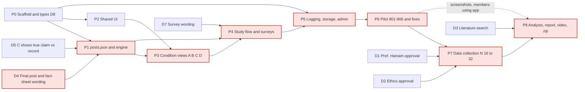

# Implementation Plan

**Implementation status (2026-10-18):** the app is implemented. The current user-authorized short protocol samples 8 posts (2 per part) from the full 24-post bank; saved legacy sessions remain supported. First-two-post interaction help, placeholder-free graduate HCI attribution, dynamic progress and version-labeled exports are implemented. Use [study-protocol.md](study-protocol.md) and [parts-and-study-defense.md](parts-and-study-defense.md) for the current procedure and rationale. The week-by-week plan below records the earlier full-length build, not a pending requirement to restore 24 trials.

This is the build-and-run plan for the v3 study: AI accuracy labels on made-up social media posts from the fictional town of Riverton, with four explanation conditions (A no explanation, B static reason, C interactive "Why?", D counterfactual), 24 posts in 4 matched sets of 6, and a target of N = 32 (minimum 16). It orders the work from an empty repo to the final submission that `implementation.txt` asks for: a source `.zip`, a video of the app running and a report. It covers the decisions to close first, nine phases in relative weeks, a proposed split of work across the six members, the critical path, a definition of done for each phase, the planned commands, a report checklist and the schedule risks. Weeks are relative (Week 0 to Week 8). The submission deadline isn't in the repo, so **map each week to real semester dates** once it is known. Module names follow `_shared-decisions.md`, field names follow `data-model.md`, and participant-facing wording follows `stimuli.md`. Where this plan disagrees with `_shared-decisions.md`, `_shared-decisions.md` wins.

The previous (v2.1) plan is archived at [archive/v2.1-agent-permission/implementation-plan.md](archive/v2.1-agent-permission/implementation-plan.md).

## 1. Decisions to close before (or during) Week 0

| # | Decision | Proposed owner | Blocks |
|---|---|---|---|
| D1 | **Professor Hamam's approval of the topic change.** The domain moves from loan approval to AI accuracy labels on posts, a fourth condition (D, counterfactual) is added, and tension and frustration measures are added. The research questions keep the proposal's core (agreement, trust, error detection, fairness). | Deepthi Reddy Chelladi drafts and sends it (it is her proposal); the whole group signs off | Phase 7. No real data is collected before approval. Building can start before it, because the engine and UI don't depend on the approval outcome. |
| D2 | **Ethics approval** for the deception (a scripted "AI" with deliberately wrong labels, made-up posts) and the stress measures (`tension`, NASA-TLX frustration). Confirm with the instructor whether a class study needs IRB review or an exemption, and get the consent and debrief text approved (drafts in `study-protocol.md`). | Md Shamimul Islam | Phase 7 |
| D3 | **Full literature search this week.** Google Scholar and the ACM DL, before the gap in `research-positioning.md` is claimed. This answers Deepthi's open question "who will do it?". | **Proposed: Bibek Gupta** (search and write-up), with Siwani Sah as second reader. Results go into `research-positioning.md`. | The report's introduction and positioning. It doesn't block the build. |
| D4 | **Final post and fact-sheet wording.** Freeze all 24 posts, fact sheets, B sentences, C row details and D sentences in `stimuli.md`, consistent with the post bank table in `_shared-decisions.md` and the field names in `data-model.md`. | Md Shamimul Islam with Deepthi Reddy Chelladi (posts and fact sheets), Siwani Sah (B), Bibek Gupta (C details), Afzal Hossain Sohag (D and debrief facts) | Phase 1 (`posts.json` is filled from `stimuli.md`) |
| D5 | **Confirm that C's "Claim vs record" row shows the true comparison**, so a wrong label can be checked from the row. This is the recommendation in `_shared-decisions.md` and it needs a team decision. | Bibek Gupta raises it; whole group decides | Phase 1 (`factors[]` data) and Phase 3 (C view) |
| D6 | **Optional consequence banner and anxiety scale.** Both are off by default and not built unless the team adds them. Decide by the end of Week 1. | Mohamed Sylla; whole group decides | Phase 4, only if either is turned on |
| D7 | **Survey wording.** The Jian et al. anchor labels with "the AI labels" wording, the 2 fairness items, `tension`, the TLX frustration item and the exit survey items, all in `surveyItems.json` | Mohamed Sylla | Phase 4 |
| D8 | **Work split and interface contracts.** Confirm the ownership in §3. Agree the `Post` and `Presentation` types, the condition-view props (`{ presentation, onExplanationEvent }`), and the logger API (`startTrial`, `logEvent`, `recordDecision`). | Whole group; Md Shamimul Islam (types and logger API), condition owners (view props) | Phase 0, and Phases 2–5 running in parallel |

## 2. Phased plan

| Phase | Weeks | Scope | Main outputs |
|---|---|---|---|
| 0 Setup | 0 | Vite + React 18 + TypeScript scaffold, ESLint + Prettier, Vitest, React Router, the source tree from `architecture.md` with empty files, `types.ts` with the D8 contracts, branch and PR rules | A repo that builds, lints and runs one passing test |
| 1 Data & engine | 1 | `src/data/posts.json` (24 posts in sets S1–S4, with fact sheets, `staticExplanation`, `factors[]`, `counterfactualExplanation`) filled from `stimuli.md`; `src/data/surveyItems.json`; `rng.ts` (mulberry32 seeded by pid); `labelEngine.ts` with `validatePost(post)` (ground truth agrees with the fact sheet's key fact), `buildPresentation(post, condition)` (allow-listed payload, no correctness fields) and `getTruth(postId)` (called only by `logger`); `counterbalance.ts` generalised to k = 4 (Williams orders ABDC, BCAD, CDBA, DACB; set rotation; seeded shuffle within a block, with the 2 wrong labels never both in positions 1–2) | `rng`, `labelEngine`, `postBank` and `counterbalance` test suites passing |
| 2 Shared UI | 1–2 | `PostCard` (author, verified badge, text, `postedAgo`, likes, reposts), `LabelPanel` (fixed ~800 ms "AI is checking…" delay, then "Likely accurate" ✓ or "Likely misleading" ⚠, then "Agree with label" / "Disagree with label"), `FactSheetPanel` (on-demand side panel behind "Fact sheet ▸", identical in every condition, open/close callbacks), `LikertScale` (7-point), `SliderScale` (0–100, step 5, starts at 50, must be moved), `PostRatingStrip` (confidence 1–7 after each post, required before Next); base styles | Every component in a dev-only gallery route, with the layout identical across conditions |
| 3 Condition views | 2–4 | `NoExplanationView` (A, label only), `StaticExplanationView` (B, one sentence), `InteractiveExplanationView` (C, "Why?" opening 3 rows: Source, Claim vs record, Wording, each expanding to one `detail` sentence, with open/expand callbacks), `CounterfactualView` (D, one "would be … if …" sentence); `conditionRegistry.ts`; a fixed-height explanation area so A–D differ only there | Four views rendering any post through `buildPresentation` |
| 4 Study flow + surveys | 3–5 | `StudyContext` + reducer, routing, `ConsentScreen`, `InstructionsScreen` (1 practice post), `TrialScreen` (header "Part x of 4 · Post y of 6"), `BlockSurveyScreen` (Jian 12 items, 2 fairness items, `tension` 1–7, `frustrationTlx` 0–100), `ExitSurveyScreen` (demographics, social media use, label familiarity, preferred condition, comment), `DebriefScreen` (shows the facts for every wrong label), resume on reload | The full participant flow, consent to debrief, for any pid |
| 5 Logging, storage, export, admin | 4–5 | `logger.ts` (`performance.now()`, `decisionTimeMs = decisionTimeRawMs - hiddenMs`, `hiddenCount`, `timingFlag`, `factSheetOpened`/`factSheetOpenMs`, `explanationOpened`, `factorsExpanded[]`, `timeToFirstExpandMs`, `detectedError`, `resumed`), `sessionStore.ts` (`xai-study:sessions`, saved after every trial and every survey), JSON + CSV export, `AdminScreen` (pid entry, assignment preview, export, confirm-to-clear) | Exports that load in R and pandas with no cleanup; `logger` and `sessionStore` suites passing |
| 6 Pilot + fixes | 5–6 | Manual checks in Chrome, Firefox and Edge; each member runs one full session as pid 901–906; check session length (~30–35 min), detection rates by error type, and wording; fix bugs; version the post bank if wording changes; tag the study build | Pilot log, fix list closed, frozen `dist/` build |
| 7 Data collection | 6–8 | Moderated sessions with the frozen build, following `study-protocol.md`; pids 1–16 first (one full cycle, the minimum), then 17–32 (the target); a withdrawn pid is rerun with a new `sessionId`; export after every session | ≥ 16 complete sessions (target 32), backed-up exports |
| 8 Analysis + submission | 7–8 | Analysis in R or Python (plan in `system-design.md`); report; demo video; screenshots; `.zip` from a clean checkout | Report, video and `.zip` submitted |

```mermaid
gantt
    title v3 build-and-run plan (relative weeks, map to semester dates)
    dateFormat X
    axisFormat %s
    section Decisions
    D1 D2 approvals requested      :d1, 0, 1
    D3 literature search           :d3, 0, 1
    D4 to D8 wording and contracts :d4, 0, 2
    section Build
    P0 Setup                       :p0, 0, 1
    P1 Data and engine             :p1, 1, 2
    P2 Shared UI                   :p2, 1, 3
    P3 Condition views A B C D     :p3, 2, 5
    P4 Study flow and surveys      :p4, 3, 6
    P5 Logging storage export admin :p5, 4, 6
    section Study
    P6 Pilot pids 901-906 and fixes :p6, 5, 7
    P7 Data collection N 16 to 32  :p7, 6, 9
    section Submission
    P8 Analysis report video zip   :p8, 7, 9
```

The axis shows week numbers, and each bar runs from the start of its first week to the end of its last (Week 8 ends at 9). Phases overlap on purpose. The logger API work in Phase 5 starts as soon as the D8 contract is agreed, analysis scripts are written against pilot exports, and the report draft starts during Phase 7. Data collection is a full three weeks because 32 sessions of about 30–35 minutes, plus setup, is roughly twice the v2 load.

## 3. Per-member tasks (PROPOSAL, to be confirmed under D8)

This matches the team split in `system-design.md` §7, which is canonical. Each condition view has one owner. The post bank, engine, counterbalancing and `logger` sit with one member, so every module that touches correctness data (`getTruth` in `logger`, `isAiCorrect` in `counterbalance`) is in one person's hands. Flow, surveys, storage, export and admin go to another. D is the smallest view, so its owner also takes the debrief content.

| Member | Area | Phases | Deliverables | Depends on |
|---|---|---|---|---|
| Deepthi Reddy Chelladi | **Condition A + shared trial components** | 2, 3 | `NoExplanationView` (A); `PostCard`, `LabelPanel`, `FactSheetPanel` (with open/close callbacks), base styles; visual parity across A–D (NFR-6); accessibility pass (NFR-10); content lead on the posts and fact sheets with the post-bank owner; D1 approval request | D4 wording; `buildPresentation` payload shape (D8) |
| Siwani Sah | **Condition B** | 1, 3 | `StaticExplanationView` (B); all 24 `staticExplanation` sentences (8–14 words, same confident tone on wrong labels), peer-reviewed by a non-author; second reader on D3 | D4; shared components |
| Bibek Gupta | **Condition C** | 1, 3 | `InteractiveExplanationView` (C); the 3 factor rows (Source, Claim vs record, Wording) and their `detail` sentences; expand/collapse events to `onExplanationEvent`; `timeToFirstExpandMs`; D5 decision; **D3 literature search (proposed owner)** | D4, D5; shared components; logger API (D8) |
| Afzal Hossain Sohag | **Condition D + debrief content** | 1, 3 | `CounterfactualView` (D); `conditionRegistry.ts`; the `DebriefScreen` wrong-label list; all 24 `counterfactualExplanation` sentences (10–16 words); the debrief's per-post facts (FR-20) | D4; shared components |
| Md Shamimul Islam | **Post bank + engine + counterbalancing + logger** | 0, 1, 5 | `types.ts` (`Post`, `Factor`, `Presentation`); `posts.json` (24 posts and fact sheets, written with Deepthi); `rng.ts`, `labelEngine.ts` (`validatePost`, `buildPresentation`, `getTruth`), `counterbalance.ts` (k = 4 Williams); `logger.ts` and the timing logic; the `rng`, `labelEngine`, `postBank`, `counterbalance` and `logger` test suites; D2 ethics | D4; Phase 0 scaffold |
| Mohamed Sylla | **Study flow + surveys + storage/export/admin** | 0, 4, 5, 8 | `StudyContext` + reducer, routes; `ConsentScreen`, `InstructionsScreen` (practice post), `TrialScreen` shell, `PostRatingStrip` (required confidence 1–7), `BlockSurveyScreen`, `ExitSurveyScreen`; `LikertScale`, `SliderScale`; `surveyItems.json`; `sessionStore.ts`, `AdminScreen`, CSV/JSON export; resume on reload; D6, D7; demo video; final `.zip` from a clean checkout | `assign(pid)`; condition views; logger API (D8); D7 |
| Everyone | All | 6, 7, 8 | One pilot session each; moderating about 5–6 real sessions each; the "code screenshots + explanation" report section for their own files | Frozen build |

## 4. Dependencies and critical path

The critical path (shaded) is D4 → P1 → P3 → P4 → P5 → P6 → P7 → P8. Final wording for 24 posts is the earliest item that can slip the whole plan, and four views make Phase 3 longer than in v2. D1 and D2 are off the build path but gate Phase 7, so both go out in Week 0. D3 only feeds the report, but it has to finish before the gap is claimed in writing. Screenshots of members using the app are taken during the pilot, which keeps them off the Phase 8 path.

## 5. Definition of done per phase

Every phase also needs: a PR reviewed by one member who isn't the author, `npm run lint` and `npm test` clean, and a short demo at the weekly group meeting.

| Phase | Done when |
|---|---|
| 0 | `npm run dev` shows a placeholder app; `npm test` runs one passing test; `npm run build` produces `dist/`; every member has cloned and run it |
| 1 | The `postBank` suite passes: 24 posts, each set S1–S4 has 2 correct "accurate", 2 correct "misleading", 1 false alarm and 1 miss, with one `clear` and one `subtle` wrong label; 12/12 labels and 12/12 truth overall. `validatePost` passes all 24 and rejects a deliberately mislabelled post. `buildPresentation` output contains no `groundTruth`, `isAiCorrect`, `errorType` or `difficulty` for any condition. The `rng` suite is deterministic per pid. The `counterbalance` suite passes: the orders are ABDC, BCAD, CDBA, DACB, every condition appears once in each position, every ordered pair of neighbours appears exactly once, every condition is paired with every set over pids 1–16, and the 2 wrong labels are never both in positions 1–2 over pids 1–1000. |
| 2 | Every shared component renders in the gallery; the label appears only after the ~800 ms delay; `FactSheetPanel` reports open and close; `SliderScale` blocks Continue until moved; keyboard focus order checked |
| 3 | The same post looks identical in A, B, C and D outside the explanation area; C emits open and expand/collapse events for all 3 rows, and its "Claim vs record" row shows the true comparison (per D5); A, B and D emit no explanation events |
| 4 | A participant can go from consent to debrief for any pid; reload mid-trial and mid-survey resumes correctly; each block survey has the 12 Jian items, 2 fairness items, `tension` and `frustrationTlx`; the debrief lists the facts for every wrong label shown; optional banner and anxiety scale are absent unless D6 turned them on |
| 5 | The `logger` and `sessionStore` suites pass; fields that don't apply outside C are `explanationOpened = null`, `timeToFirstExpandMs = null`, `factorsExpanded = []`; trial ids follow `${pid}-${blockIndex}-${positionInBlock}`; `/admin` preview for pids 1–16 matches the counterbalancing table in `system-design.md`; a completed session exports 24 trial rows; the CSV loads in R and pandas with no manual cleanup |
| 6 | No blocking bugs; median session ≤ 35 minutes; wrong-label detection is between 20% and 80% for **both** false alarms and misses (H1a needs both off floor and ceiling); no "Agree/Disagree with label" mapping errors; the build is tagged and the post bank version is set |
| 7 | ≥ 16 complete sessions covering pids 1–16 (one full cycle), aiming for 32 (pids 1–32); every session exported and backed up off the lab machine; incidents logged |
| 8 | Every item in §7 is ticked; the `.zip` builds and runs from a clean checkout on a second machine |

## 6. Commands

These are the real `package.json` scripts in `app/` (the scaffold already exists, so there is nothing to create). They are copied into `CLAUDE.md` and `app/README.md`, which is the full run guide for the report. Requirement: Node.js 22 or newer.

| Purpose | Command (run in `app/`) |
|---|---|
| Install | `cd app && npm install` (installs React, Express, `better-sqlite3`, Vitest and the rest) |
| Develop | `npm run dev` (Express API on `http://localhost:3001` + Vite on `http://localhost:5173` with an `/api` proxy; open `http://localhost:5173/admin`) |
| Unit and API tests | `npm test` (Vitest, all suites) |
| One test file | `npx vitest run <path>`, e.g. `npx vitest run shared/counterbalance.test.ts` |
| Type-check | `npm run typecheck` |
| Build | `npm run build` (type-check + static `dist/`) |
| Lab run | `npm start` (one process serving the API and `dist/` on `http://localhost:3001`; open `http://localhost:3001/admin`) |
| Configuration | `PORT` (default 3001), `DB_PATH` (default `data/study.db`, i.e. `app/data/study.db`), `ADMIN_TOKEN` (optional) |
| Back up data | stop the server and copy `app/data/study.db`, or download the exports from `/admin` |

## 7. Report deliverables checklist (`implementation.txt`)

| `implementation.txt` item | What goes in | Source / owner |
|---|---|---|
| Source code as one `.zip` | Clean checkout without `node_modules/` or `dist/`, with a README containing the run steps | Mohamed Sylla |
| Video of the app running | 4–6 min: `/admin` pid entry, consent, instructions and practice post, one trial in each of A, B, C and D (opening the fact sheet, "Why?" with rows expanded in C, and at least one wrong label), a block survey with the slider, debrief, export | Mohamed Sylla |
| Brief project description | Main question, the Riverton post scenario, the AI labels and fact sheets, conditions A–D, false alarms vs misses, Wizard-of-Oz design | `_shared-decisions.md`, `research-positioning.md` |
| Technologies used | React 18, TypeScript, Vite, React Router, Vitest; Node.js 22, Express 5, SQLite (`better-sqlite3`); JSON/CSV export; analysis in R or Python | `architecture.md` |
| Target devices | Desktop or laptop browser (Chrome, Firefox, Edge) in a moderated lab session; not designed for phones | `architecture.md` |
| Step-by-step run from source | Install Node.js 22+, unzip, `cd app && npm install`, `npm run dev`, open `http://localhost:5173/admin`; `npm test`; `npm run build` + `npm start` for the lab build (`http://localhost:3001/admin`); tested from a clean checkout | §6, `app/README.md` |
| How to interact with the app | Researcher: `/admin`, enter pid, preview, export. Participant: consent → instructions (1 practice post) → 4 parts × 6 posts ("Fact sheet ▸", "Agree with label" / "Disagree with label", confidence, "Why?" in C) → block survey after each part → exit survey → debrief | `study-protocol.md`, `wireframes.md` |
| Screenshots of source code + explanation | Each member, for their own files: `posts.json`, `labelEngine.ts`, `counterbalance.ts`, the four views, `StudyContext`, `BlockSurveyScreen`, `logger.ts`, `sessionStore.ts` | Each owner (§3) |
| Screenshots of the app running | Consent, instructions, a trial in each of A/B/C/D, the fact sheet open, C expanded, a block survey (Likert + slider), debrief, `/admin` | Deepthi Reddy Chelladi |
| Screenshots of group members using it | Taken during the Phase 6 pilot, all 6 members, no personal data on screen | Everyone |

## 8. Schedule risks

v3 is bigger than v2: 24 posts instead of 15, four views instead of three, four blocks per session and a cycle of 16. The plan has little slack, so the cut order is fixed in advance.

**What to cut first, in this order:**
1. **The anxiety scale.** It is optional and off by default. Don't build it.
2. **The consequence banner.** It is optional and off by default. Don't build it.

Nothing else is cut. The per-post confidence rating (1–7, `PostRatingStrip`) is required before Next and is not on the cut list. The 4 conditions, 24 posts, the fact sheet, the block surveys and the counterbalancing are the study.

| Risk | Effect | Mitigation |
|---|---|---|
| Professor Hamam's approval is late or refused | Phase 7 can't start | Ask in Week 0. The engine and UI don't depend on the domain wording, so a narrower fallback (for example, dropping D) only means editing `posts.json`, the registry and `counterbalance.ts` |
| Ethics approval for deception and stress measures takes longer than expected | Phase 7 slips | Ask in Week 0; pilot with group members only (pids 901–906) while waiting |
| 24 posts, fact sheets and three sets of explanations keep changing | Phase 1 and every later phase slip | Freeze `stimuli.md` by the end of Week 0 with clear owners (D4); later changes only through a post bank version bump |
| The literature search finds the gap is already covered | The positioning in the report has to change | Do it in Week 0 (D3) while the design can still move; it doesn't block the build |
| Four condition views drift visually | Differences outside the explanation area confound the conditions | Shared `PostCard`, `LabelPanel` and `FactSheetPanel`; a fixed-height explanation area; the Phase 3 parity check |
| Interface contracts (D8) drift between members | Integration breaks in Phases 4–5 | Agree `types.ts` in Week 0; changes need a PR reviewed by the affected owners |
| The pilot shows a floor or ceiling on misses or false alarms | Post rework and a second pilot | The pilot has a buffer (Weeks 5–6); change wording only, not the set structure |
| The session runs over 35 minutes | Fatigue in block 4 blurs the trust and affect measures | Apply the cut order above; time each phase from the event stream in the pilot |
| Fewer than 32 participants recruited | Only one cycle (the minimum, 16) | Recruit from Week 4, book sessions in advance, finish pids 1–16 before starting 17–32, so whatever is collected is a complete cycle |
| Data loss on the lab machine | Missing sessions unbalance the cycle | Export after every session; copy exports off the machine daily |
| Report and video left to the final week | Rushed submission | Draft report sections and take screenshots during Phases 5–6; record the video right after the build freeze |

## Related docs

- [architecture.md](architecture.md)
- [system-design.md](system-design.md)
- [sequence-diagrams.md](sequence-diagrams.md)
- [data-model.md](data-model.md)
- [ai-design.md](ai-design.md)
- [research-positioning.md](research-positioning.md)
- [implementation-plan.md](implementation-plan.md) (this document)
- [study-protocol.md](study-protocol.md)
- [stimuli.md](stimuli.md)
- [wireframes.md](wireframes.md)
