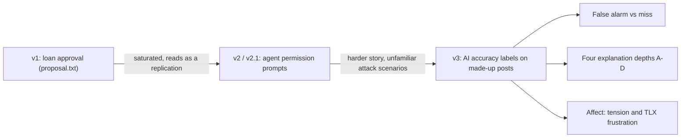

# Research positioning

This document explains where the v3 study (AI accuracy labels on made-up social media posts) sits in the research literature and how the course study could become a publishable paper. It covers the decision history (loan approval → agent permission prompts → content labels), an honest assessment of how crowded the area is, the specific combination the novelty rests on, the research questions and hypotheses, candidate contributions, ways to strengthen the design, threats to validity, the study plan, target venues, and what the team must do before claiming a gap. It follows `_shared-decisions.md`, which wins on any conflict. Items marked **(partially verified)** have not been fully checked against the primary source and must be confirmed before anything is submitted. The v2.1 version of this document, with the full earlier domain comparison, is in `archive/v2.1-agent-permission/research-positioning.md`.

## 1. Decision history

### v1: loan approval (the approved proposal)
Loan approval is one of the most heavily used tasks in XAI research. The closest prior study is **He, Aishwarya & Gadiraju, IUI 2025, "Is Conversational XAI All You Need? Human-AI Decision Making With a Conversational XAI Assistant"** (DOI 10.1145/3708359.3712133). It used a loan task with N = 306 and found that a richer, conversational explainer raised trust but made overreliance worse. A three-level explanation study on loans would read as a smaller replication of it. Students also have little feel for underwriting.

### v2 / v2.1: AI agent permission prompts
v2 moved to supervising a scripted assistant agent that proposed purchases, emails and file shares and approved or refused each one against a short set of user rules. It scored best in the v2 domain comparison (26/30), because the area was new and the planted errors could be checked on screen. v2.1 added a counterfactual condition D, an error-type comparison (wrongly approved vs wrongly refused actions) and affect measures. Its weaknesses were practical: the story took longer to explain to participants, some planted errors relied on attack scenarios most students had never heard of, and fairness had to be replaced with "perceived control".

### v3: AI accuracy labels on social media posts (Deepthi's proposal)
The team chose v3 on 2026-10-17 for four reasons:

1. **Clear story.** "An AI labels a post as accurate or misleading, and sometimes it's wrong" needs no tutorial. Everyone has seen platform labels.
2. **Fits XAI and HCI.** It's a human-AI decision task with explanations, trust, reliance and error detection, the core of the course and of `literature.txt`. Fairness (to the people who posted) comes back as a natural measure.
3. **Reuses planned work.** The Wizard-of-Oz engine, allow-listed payloads, counterbalancing, logging, block surveys, the C factor rows and the D counterfactual all carry over from v2.1 with new content.
4. **Enough parts for 6 people.** Four condition views, the post bank and fact sheets, the shared post and fact-sheet components, the survey layer, and the study infrastructure and analysis split cleanly across the team.

## 2. Saturation: an honest assessment

Misinformation and fact-check labels are a **crowded** area, and so is the effect of LLM explanations on reliance. A reviewer will know this work, and the paper must not claim that "explanations on AI labels" is new.

- **Si et al., NAACL 2024, "Large Language Models Help Humans Verify Truthfulness – Except When They Are Convincingly Wrong."** Fluent LLM explanations led people to over-trust wrong answers in a claim-verification task. This is the nearest result to our B and D conditions on wrong labels.
- **Kim et al., CHI 2025, "Fostering Appropriate Reliance on Large Language Models: The Role of Explanations, Sources, and Inconsistencies"** (DOI 10.1145/3706598.3714020). Explanations increased reliance on both correct and incorrect answers, while sources and visible inconsistencies reduced reliance on incorrect ones. This is the basis for condition C's "Claim vs record" row.
- **Epstein et al., ICWSM**, on whether explanations make AI-generated fake-news warnings more effective. It shows that explained warning labels are already studied. **(partially verified: confirm the authors, year and title in the primary source.)**
- **CISPA study of AI content labels, CHI 2026.** **(partially verified: the title, authors and findings have not been checked against the paper. Do not cite it until someone has read it.)**
- Supporting work already in the archived reading list: **Steyvers et al., 2025, *Nature Machine Intelligence* 7:221–231** (longer explanations raise confidence without improving accuracy) and **Spatharioti et al., CHI 2025** (overreliance on LLM search when the model is wrong).

**Where the novelty rests.** No single element of the design is new. The contribution is the **combination** Deepthi identified, tested in one within-subjects study:

1. **False alarms vs misses compared directly.** A TRUE post labelled "Likely misleading" and a FALSE post labelled "Likely accurate" appear in every condition for every participant, so the two error types can be compared head to head rather than across studies.
2. **Four explanation depths in one design**: none (A), static reason (B), interactive "Why?" breakdown (C) and counterfactual (D, after Wachter, Mittelstadt & Russell, 2017).
3. **Affect alongside trust and accuracy.** Tension and the NASA-TLX frustration item (Hart & Staveland, 1988) are measured per block next to Jian et al. trust [15], agreement and detection.

**The new question:** *Do explanations help people catch the AI's errors, or do they just make wrong labels feel more believable and less stressful?* That second outcome (B and D raise agreement with wrong labels and lower tension at the same time) would be a harmful kind of comfort, and existing work hasn't measured it.

The gap is **provisional** until the literature search in section 10 is done.

## 3. Research questions and hypotheses (v3)

Agreement, trust, error detection and fairness from `proposal.txt` are kept. Tension and frustration are new.

| ID | Research question | Hypothesis | Measures |
|---|---|---|---|
| RQ1 | Do explanations help people catch wrong labels, and does it differ for false alarms vs misses? | **H1:** detection of wrong labels differs by condition. | `detectedError` by condition |
| | | **H1a (headline):** misses are caught less often than false alarms, because "Likely accurate" invites no scrutiny. | `detectedError` by `errorType` |
| | | **H1b:** the gap between the two error types is smallest in C. | condition × `errorType` |
| RQ2 | Which explanation type gives the best error detection? | **H2:** detection is highest in C (the checkable claim-vs-record row) and lowest in B (a persuasive static reason). D is exploratory and could go either way. | `detectedError` by condition |
| RQ3 | Do wrong labels create tension, and does explanation type make it better or worse? | **H3:** tension and frustration rise with the number of wrong labels noticed in a block. | `tension`, `frustrationTlx`, `nWrongDetected` |
| | | **H3a:** B and D lower tension even on wrong labels (the "less stressful but more believable" risk). | `tension` by condition |
| | | **H3b (exploratory):** C raises tension when the ✗ row is visible. | `tension`, `factorsExpanded[]` |
| — | Trust and agreement | **H4:** overall agreement and Jian trust are higher in B, C and D than in A, whether or not the label is correct. | `agreed`, Jian scale |
| — | Fairness | **H5:** fairness is rated highest in C and D and lowest in A. | 2 fairness items |
| — | Time and clicks | **H6:** decisions take longest in C and D, and opening the fact sheet or expanding rows predicts detection. | `decisionTimeMs`, `factSheetOpened`, `factorsExpanded[]` |

H3a draws on Langer, Blank & Chanowitz's "placebic because" [18] and Eiband et al. [11]: a reason that sounds right can increase compliance whatever its content.

## 4. Candidate contributions

1. **C1.** A direct, within-subjects comparison of detection for false alarms and misses on AI content labels (H1a, H1b).
2. **C2.** Four explanation depths (none, static, interactive, counterfactual) compared in one design, with wrong labels that participants can check against a fact sheet (H1, H2).
3. **C3.** Evidence on whether explanations make wrong labels less stressful as well as more believable, from tension and frustration measured beside trust and detection (H3, H3a).
4. **C4.** Behavioural evidence of verification (fact-sheet opens and C-row expansions) linked to detection, rather than self-report alone (H6).
5. **C5.** Open materials: the 24-post bank with fact sheets, the explanation texts (`stimuli.md`) and the static React app, so others can replicate the study or run it online.

## 5. What would make it stronger

- **Treat C's "Claim vs record" row as a verification aid, and say so.** It shows the true comparison (✓/✗), so C tests whether people *look*, not whether they can work it out. Frame it as a design intervention (a cheap check built into the explanation), not as "the AI explaining itself honestly". The team still has to confirm this rule (`_shared-decisions.md`).
- **Report fact-sheet use as behavioural verification.** Split detection by `factSheetOpened` and `factSheetOpenMs` per condition. If B and D lower fact-sheet use on wrong labels, that is direct evidence that explanations replace checking.
- **Report everything by `errorType`.** Every detection, agreement and time result should be shown separately for false alarms and misses, not pooled.
- **Difficulty is balanced across error types (resolved).** An earlier bank had 3 of the 4 false alarms `clear` and 3 of the 4 misses `subtle`, so H1a couldn't tell "misses are harder to catch" from "the misses are subtler". The S3 difficulty swap (p15 now `subtle`, p16 now `clear`) fully crosses error type and difficulty: false alarms p03, p21 `clear` and p09, p15 `subtle`; misses p10, p16 `clear` and p04, p22 `subtle`. H1a is no longer confounded with difficulty. `difficulty` stays in the model as a covariate, and the 2 × 2 crossing must be kept if pilot edits change any item.
- **Pre-register** the hypotheses, the mixed-effects models and the exclusion rules before the main study.

## 6. Threats to validity

- **The fact sheet makes detection too easy or too hard.** If the key fact jumps out, detection hits ceiling in every condition and the explanation effects disappear. If it's buried, detection hits floor. The pilot (section 7) must check that detection on wrong labels is roughly between 30% and 80% in A.
- **Made-up posts.** Fictional Riverton posts carry no prior beliefs or partisan identity, which helps internal validity but means real-world misinformation (which is emotional, political and repeated) is likely to be harder to catch. Detection rates are a best case.
- **Students as participants.** Students are heavy social media users but aren't representative of all platform users, and recruiting from the course may add demand effects (for example, guessing that some labels are wrong).
- **30–35 minute session.** Twenty-four posts plus four block surveys may cause fatigue in later blocks. Counterbalancing spreads this across conditions, but block position should be tested as a covariate. A single session also measures first impressions, not long-term trust.
- **Cue confounds.** Wrong labels might be told apart by something other than the fact sheet: the author's verified badge, sensational wording, engagement counts, topic, or explanation length. The C rows also expose Source and Wording, which partly reveal the answer. Keep source, wording and engagement balanced across correct and wrong labels within each set, keep B and D text lengths in their fixed ranges, and keep the error type × difficulty crossing from section 5.
- **Within-subjects carry-over.** Seeing an AI error lowers trust for the rest of the session [10], and seeing C may teach people to check in later blocks. The Williams design balances first-order carry-over, but order effects should still be tested.

## 7. Study plan

- **Pilot.** 3–5 people outside the team run the full session. Check the session length, that the fact sheet and its key fact are understood, the A-condition detection range (section 6), the timing logs and the CSV export. Fix the materials before the main study and don't include pilot data.
- **Main study.** A moderated lab session, 4 conditions × 6 posts = 24 trials plus 1 practice post. Condition order uses the 4×4 Williams design, and set rotation completes a balanced cycle every 16 participants.
  - **Target N = 32** (2 full cycles).
  - **Minimum N = 16** (1 cycle). Deepthi's "20 or more" rounds up to 32, because 20 doesn't complete a cycle.
- **Analysis** in R or Python. Trial-level outcomes (`agreed`, `detectedError`) use mixed-effects logistic models with condition, `errorType` and their interaction as fixed effects, and random intercepts for participant and post. Block-level ratings (trust, fairness, tension, frustration) use linear mixed models with a random intercept for participant.
- **Power caveat.** Each participant sees only 2 wrong labels per condition (1 of each type), so N = 32 gives 32 trials per condition × error-type cell. The interaction (H1b) is underpowered. Report the course study as a pilot, with effect sizes and confidence intervals, and use the estimates to plan a larger online replication.

## 8. Target venues

- **Near term (the course study as a pilot):** CHI Late-Breaking Work, IUI posters or short papers, CSCW posters.
- **Content-label angle:** ICWSM.
- **Later (with a larger replication):** a CHI or IUI full paper.

Check the current calls for papers for each venue before planning around a deadline, because dates and formats change every year. Work backwards from the chosen deadline, and allow time for instructor approval, ethics review, the pilot, data collection, analysis and internal review.

## 9. Ethics

- **Deception.** Participants aren't told in advance that some labels are deliberately wrong. The debrief has to reveal this and show the facts for every wrong label.
- **Stress.** The tension and frustration items ask about emotional state, and wrong labels may be mildly upsetting. The consent form must name these measures, participants can skip any item, and the debrief should address any stress.
- **Content.** All people, accounts, places and agencies are fictional. There are no health-risk claims that would be harmful if believed, and no real brands.
- **Ask Prof. Hamam** whether the course study needs IRB review or an exemption, and whether publishing (and any later online recruiting or payment) needs full review.

## 10. Before claiming the gap: must-do list

1. **Topic-change approval.** The domain change, the fourth condition and the tension and frustration measures depart from the approved `proposal.txt`. Get written sign-off from Prof. Hamam before building.
2. **Ethics approval** for the deception and the stress measures (section 9).
3. **Literature search.** Search Google Scholar and the ACM Digital Library with at least these queries, and record what was found (query, date, relevant hits):
   - "false positive vs false negative AI labels explanation" (Deepthi's term, for C1 and H1a)
   - "emotional response to incorrect AI labels" (Deepthi's term, for C3 and H3)
   - "counterfactual explanation misinformation label" (for condition D)
   - "explanation depth content moderation overreliance" (for C2 and H2)
4. **Verify the partially verified items.** Confirm Epstein et al. (ICWSM) and the CISPA CHI 2026 study in the primary sources, and drop either one if it can't be confirmed. If either already compares false alarms with misses, or measures affect, revise the claimed combination in section 2.
5. **Update the literature review** for content labels, adding only papers that someone has read in the primary source. Until then, the only new references beyond those above are Wachter, Mittelstadt & Russell (2017, *Harvard Journal of Law & Technology*) and Hart & Staveland (1988).
6. **Keep difficulty crossed with error type** (section 5, now resolved): re-check the 2 clear / 2 subtle split per error type after any pilot wording change.

## Related docs

- [architecture.md](architecture.md)
- [system-design.md](system-design.md)
- [sequence-diagrams.md](sequence-diagrams.md)
- [data-model.md](data-model.md)
- [ai-design.md](ai-design.md)
- [implementation-plan.md](implementation-plan.md)
- [study-protocol.md](study-protocol.md)
- [stimuli.md](stimuli.md)
- [wireframes.md](wireframes.md)
