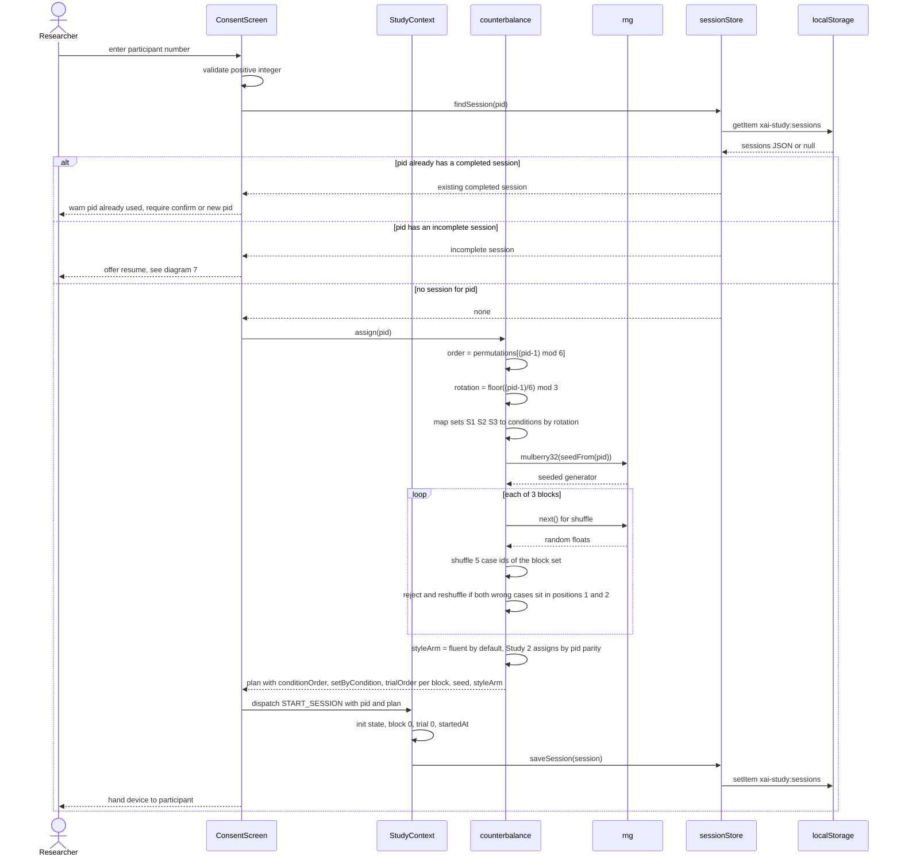
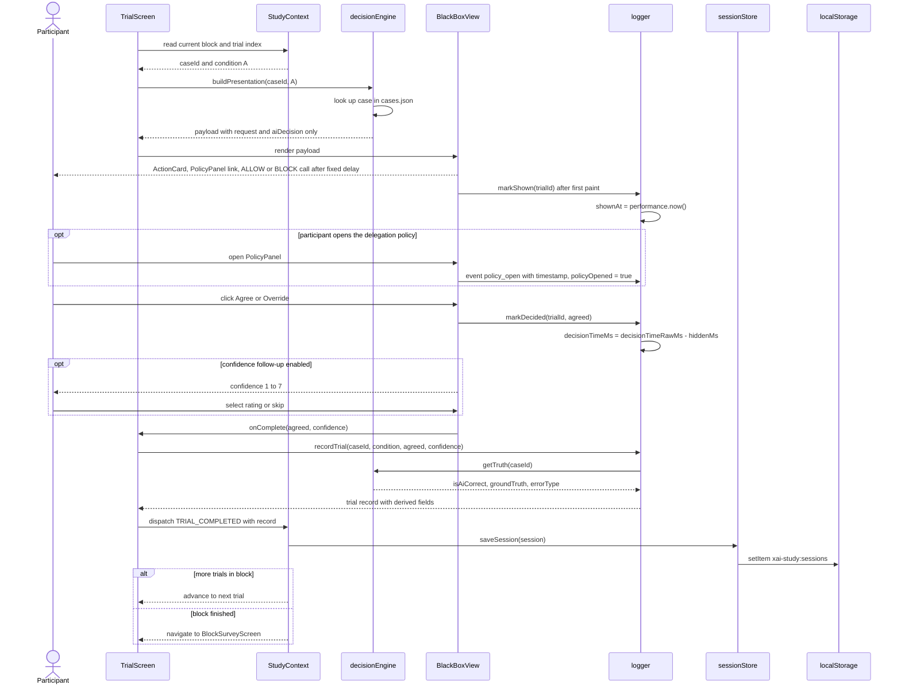
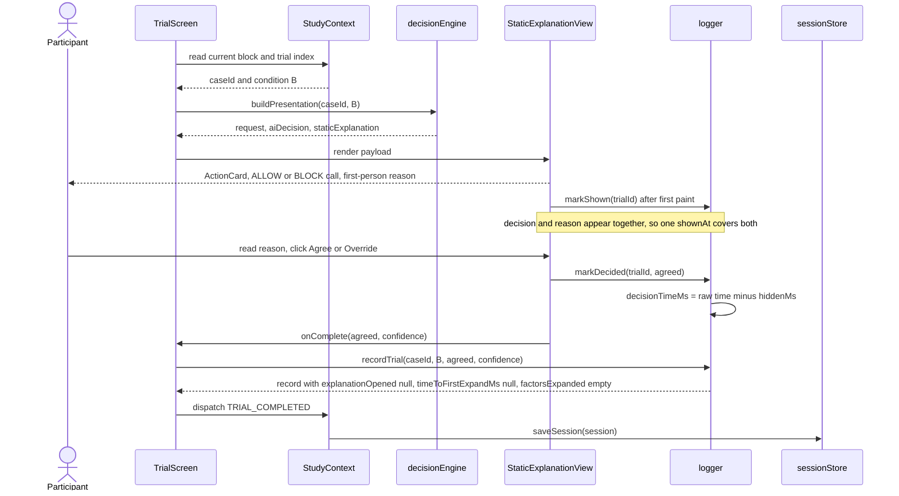
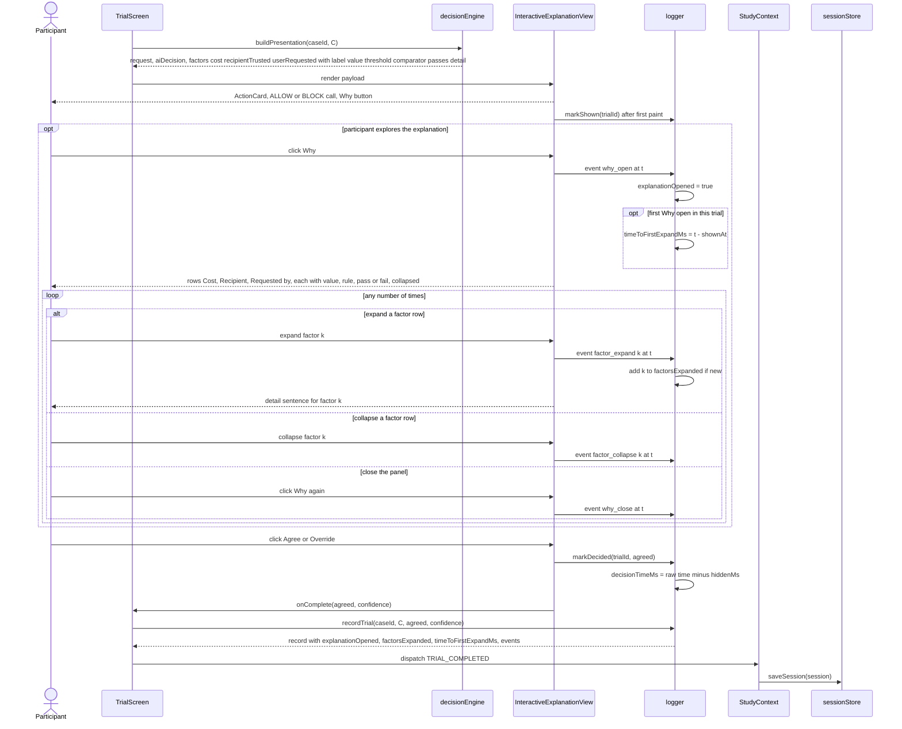
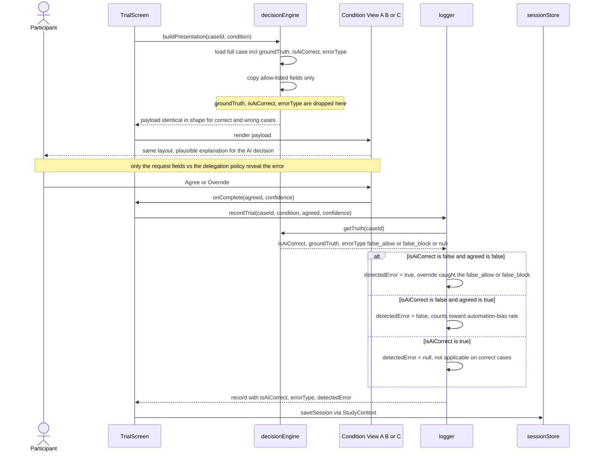
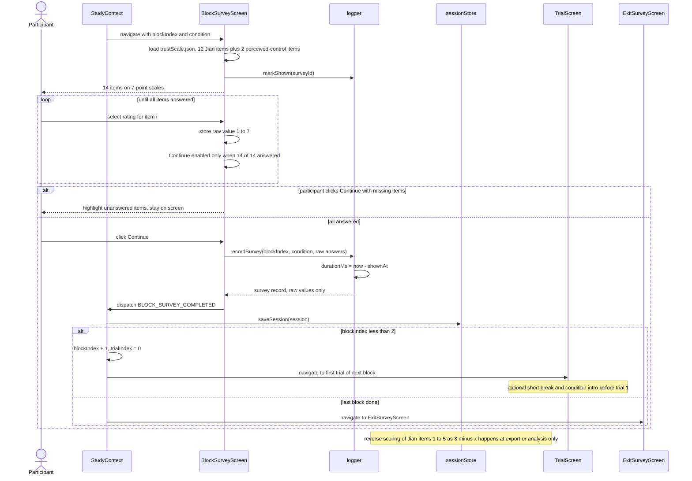
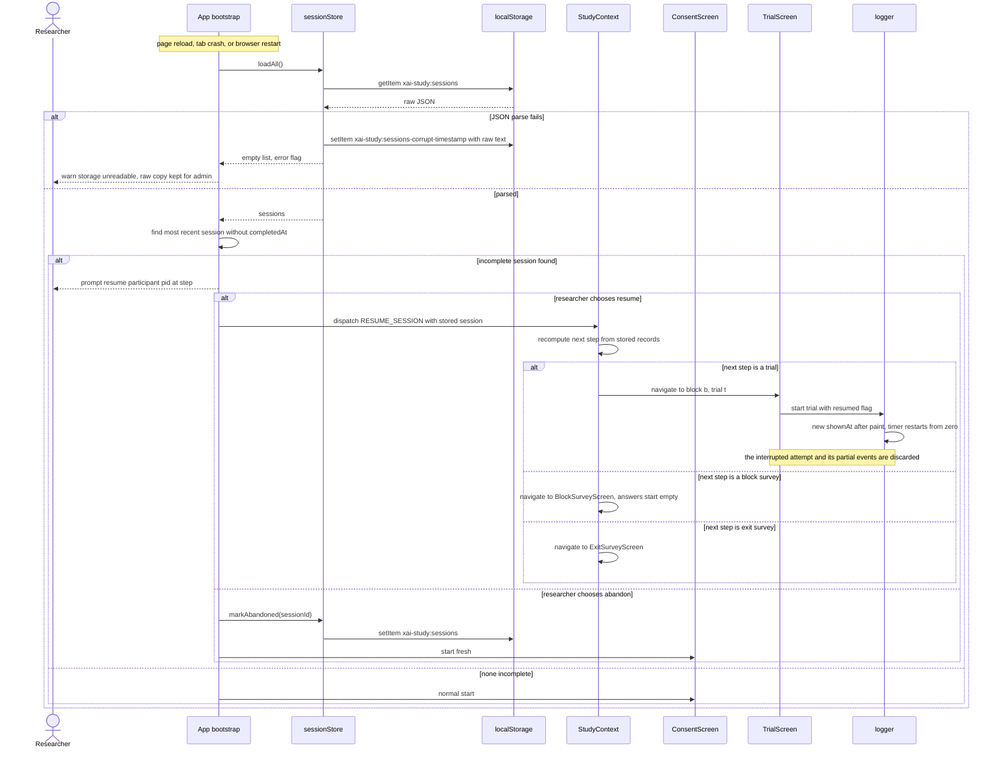
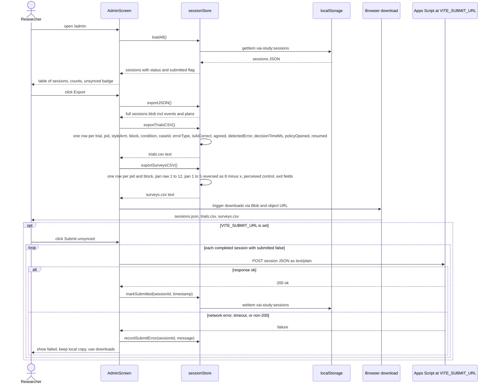

# Sequence Diagrams

This document shows how the study app's modules work together at runtime for the flows that matter most to data quality: assigning a participant, running a trial in each of the three conditions, handling the deliberately wrong TaskPilot calls (`false_allow` and `false_block`), collecting the block surveys, recovering from a refresh or crash, and exporting the data. Each diagram uses the module names from `_shared-decisions.md` (`StudyContext`, `decisionEngine`, `counterbalance`, `rng`, `logger`, `sessionStore`, and the screens in `src/study/`). In v2 the scripted AI is **TaskPilot**, a personal agent that checks each proposed action against the participant's delegation policy and calls ALLOW or BLOCK; the participant clicks Agree or Override. The flows themselves are domain-independent. The doc follows the same pattern throughout: a short explanation, the Mermaid diagram, then notes on edge cases. The app has no server. Every arrow happens inside the participant's browser, apart from the optional POST in diagram 8.

## Index

1. [Session start and assignment](#1-session-start-and-assignment)
2. [Trial in Condition A (Black Box)](#2-trial-in-condition-a-black-box)
3. [Trial in Condition B (Static Explanation)](#3-trial-in-condition-b-static-explanation)
4. [Trial in Condition C (Interactive Explanation)](#4-trial-in-condition-c-interactive-explanation)
5. [Wrong-AI-case handling](#5-wrong-ai-case-handling)
6. [Block survey and advancing to the next block](#6-block-survey-and-advancing-to-the-next-block)
7. [Refresh and crash recovery](#7-refresh-and-crash-recovery)
8. [Admin export and optional submission](#8-admin-export-and-optional-submission)

---

## 1. Session start and assignment

The researcher, not the participant, types the participant number (pid) before consent. `counterbalance.assign(pid)` works out the whole session plan in one deterministic step. The condition order comes from `permutations[(pid-1) % 6]`, the set-to-condition mapping from the Latin square rotation `floor((pid-1)/6) % 3`, the within-block trial order from a mulberry32 PRNG seeded with the pid, and `styleArm`, the Study 2 explanation-style flag, which defaults to `"fluent"` in this course build. `StudyContext` keeps the plan in memory, and `sessionStore` writes it to `localStorage` straight away, so the assignment survives a refresh even before the first trial.

**Edge cases**
- **Determinism.** Calling `assign(pid)` again for the same pid must give the identical plan. That lets the analysis rebuild the assignment from the pid alone, and lets diagram 7 check that a stored plan hasn't been tampered with. The seed and the full plan are saved anyway, so nothing depends on recomputing them.
- **Wrong-case constraint.** The constraint is applied by rejection sampling: reshuffle until the two wrong cases aren't both in positions 1 and 2. All the draws come from the same seeded generator, so the retries are deterministic too. The positions still vary across participants because the seed varies.
- **styleArm.** Study 1 always stores `styleArm = "fluent"`. The field is in the plan now so that Study 2 (fluent vs terse arm by pid parity) needs no schema change, and every B text lookup goes through it.
- **Invalid input.** Zero, negative, non-numeric or empty pids are refused on the screen and never reach `counterbalance`.
- **Reused pid.** A completed session for the same pid is never overwritten silently. The researcher has to confirm, and the old session is kept, with the new one stored next to it under a distinct `sessionId`.
- **Storage failure.** If `setItem` throws (quota exceeded or private mode), the researcher gets a blocking error before consent. The study must not run if its data can't be saved.

---

## 2. Trial in Condition A (Black Box)

Every trial follows the same skeleton, and diagrams 3 and 4 only change the middle of it. `TrialScreen` asks `StudyContext` for the current case id, `decisionEngine` builds a view payload for the block's condition, and `BlackBoxView` renders `<ActionCard/>` and `<DecisionPanel/>` with only TaskPilot's ALLOW or BLOCK call. The call appears after the fixed ~800 ms "TaskPilot is checking…" delay, and the decision timer starts once the call is actually painted. The Agree or Override click stops it, `logger` builds the trial record, and `sessionStore` saves the session before the next trial loads.

**Edge cases**
- **When the timer starts.** `shownAt` is taken in an effect after the first paint (for example via `requestAnimationFrame`), not when the component mounts, so slow rendering doesn't inflate `decisionTimeMs`.
- **Double clicks.** Agree and Override are disabled after the first click, so the first decision is the only one recorded. A second click is ignored and isn't logged as a decision.
- **Confidence is excluded.** The confidence prompt appears after the decision click, so its time never counts toward `decisionTimeMs`. If it's skipped, `confidence` is `null`.
- **Losing focus.** If the tab is hidden mid-trial, `logger` records `visibilitychange` and blur events with timestamps and sums them into `hiddenMs`, `hiddenCount` and `blurCount`. `decisionTimeMs = decisionTimeRawMs - hiddenMs`, and `timingFlag` marks trials the analysis should treat with care.
- **Same delay everywhere.** The ~800 ms "TaskPilot is checking…" delay is identical in every condition and for correct and wrong calls. Confidence is never shown.
- **A failed save.** The trial does not advance, and a blocking message asks the researcher to step in. A trial that isn't persisted is treated as not done.

---

## 3. Trial in Condition B (Static Explanation)

Condition B uses the skeleton from diagram 2. The only change is that `decisionEngine` adds the case's `staticExplanation` string to the payload, and `StaticExplanationView` shows it next to the decision. The explanation is visible from the moment the decision appears, so the participant doesn't need to do anything to see it, and no extra interaction events are logged apart from the shared `policy_open` event.

**Edge cases**
- **Fields that don't apply.** `explanationOpened` and `timeToFirstExpandMs` are stored as `null` in A and B rather than `false`, and `factorsExpanded` is `[]`. That way the analysis can't mistake "not applicable" for "did not open" (see `data-model.md` §2.6).
- **Same layout.** The reason text is rendered in the same position and type style for correct and wrong cases (see diagram 5). Its length is decided by the case bank author, not by the view.
- **Reading time.** B's `decisionTimeMs` includes the time spent reading the reason. That's intended, because H5 compares the full time-to-decision across conditions.

---

## 4. Trial in Condition C (Interactive Explanation)

In Condition C the decision first appears alone with a "Why?" button. Clicking it opens a panel with three rows: Cost, Recipient and Requested by. Each row shows the true value, the rule and a ✓ or ✗, and expands to a `detail` sentence. `logger` records every Why click, expand and collapse with a `performance.now()` timestamp, which lets the analysis tell whether participants actually checked the breakdown. `timeToFirstExpandMs` is measured from `shownAt` to the first "Why?" open, and `factorsExpanded[]` lists the distinct factor keys in the order they were first expanded.

**Edge cases**
- **No exploration.** If the participant decides without clicking Why, the record has `explanationOpened = false`, `factorsExpanded = []` and `timeToFirstExpandMs = null`. That is valid data and is central to H3b and H5.
- **Opened but not expanded.** If Why is opened but no row is expanded, `explanationOpened = true`, `timeToFirstExpandMs` is set from the Why open, and `factorsExpanded = []`. Per-row `factor_expand` timestamps stay in the event list for finer analysis.
- **Repeat expands.** Expanding the same factor again adds another `factor_expand` event but doesn't change `factorsExpanded` or `timeToFirstExpandMs`.
- **Decision without closing.** Agree and Override stay enabled while the panel is open. The panel's open state when the decision is made is implied by the event list, so no extra field is needed.
- **Rows start collapsed.** All factor rows start collapsed on every trial. Earlier trials never carry over expanded state, so each expand is a deliberate act.

---

## 5. Wrong-AI-case handling

From the participant's side a wrong case can't be told apart from a correct one. The layout, timing, wording style and controls are the same, and the explanation (B or C) argues for TaskPilot's wrong call. A `false_allow` lets through an action that breaks a rule (overreach), and a `false_block` pauses a valid one (over-caution). To guarantee this, `decisionEngine.buildPresentation` builds the view payload from an explicit allow-list of fields, so `groundTruth`, `isAiCorrect` and `errorType` never reach any view component or React props. Correctness only joins the record inside `logger`, after the participant has decided. There `detectedError` is derived and stored with the trial: `!agreed` on wrong cases, `null` on correct ones.

**Edge cases**
- **No leaks through rendering.** Payload types (`ViewPayloadA`, `ViewPayloadB`, `ViewPayloadC`) have no correctness fields at all. A unit test asserts that `JSON.stringify(payload)` never contains `isAiCorrect` or `groundTruth`. DOM attributes, CSS classes and test ids must not encode correctness either.
- **Factor rows in C.** For a wrong case, each factor row's `passes` flag is computed from the true request values (cost against $50.00, recipient against `trustedContacts`, "Triggered by" against "you"), so a careful participant can spot the contradiction. The `detail` text still sounds plausible and supports TaskPilot's call. This is how the case bank tests whether the breakdown makes verification easier (H3b).
- **Same timing.** The fixed ~800 ms "TaskPilot is checking…" delay is the same for correct and wrong cases, and no animation differs between them.
- **Data checks.** `decisionEngine` checks at load time that the stored `groundTruth` matches `evaluatePolicy(request)` against the policy and trusted contacts in `cases.json`, that `errorType` is `false_allow` exactly when `aiDecision` is ALLOW and the truth is BLOCK (and `false_block` for the reverse), and that `isAiCorrect == (aiDecision == groundTruth)`. A mismatch is a build-time and dev-time error, never something the participant sees.
- **Correct cases.** On correct cases `detectedError` is `null`. Analysis of H3a, H3b and H3c filters to `isAiCorrect == false` before using agreement or detection.

---

## 6. Block survey and advancing to the next block

After the fifth trial of a block, `StudyContext` sends the participant to `BlockSurveyScreen` for the condition they just used. The screen loads the 12 Jian et al. (2000) items from `trustScale.json` and shows them with the two perceived-control and accountability items on a 7-point scale. The items say "the assistant" where the original scale says "automation". Every item must be answered before Continue is enabled. Raw answers are stored exactly as given. Reverse-scoring of items 1–5 (8 minus the response) happens only at export or analysis time, so the stored data stays what the participant actually clicked. Submitting persists the survey and either starts the next block or, after block 3, moves to `ExitSurveyScreen`.

**Edge cases**
- **Which condition was rated.** Each survey record stores `condition` and `blockIndex` explicitly, so the analysis never has to infer from the order which condition a trust score belongs to.
- **Item order.** The Jian items are always presented in their published order. Shuffling items isn't part of the design, and keeping the order fixed keeps the reverse-scoring indices stable.
- **No defaults.** No item has a pre-selected value. That avoids midpoint bias and keeps the "every item answered" check meaningful.
- **Double submit.** Continue is disabled after the first click. A second dispatch for the same block is ignored by the reducer if that block's survey already exists.
- **Back navigation.** The browser Back button doesn't return to the block's trials. The router guard in `StudyContext` redirects to the current step, so answers can't be changed after the trust rating.
- **Exit survey.** The exit survey (demographics, how often they use AI assistants or agents, preferred condition, open comment) uses the same validation and save pattern. Only the open comment is optional. Submitting it sets `completedAt` and moves to `DebriefScreen`, which explains that TaskPilot was scripted and that some calls were wrong on purpose.

---

## 7. Refresh and crash recovery

Because `sessionStore` saves after every trial and every survey, a reload loses at most the trial or survey that was on screen. On startup the app reads `localStorage`, looks for a session with no `completedAt`, and offers the researcher a resume. Resuming puts the participant on the next unfinished step. If that step is a trial, the half-seen attempt is thrown away, the case is shown again with a fresh timer, and the new record is flagged `resumed = true` so the analysis can treat its timing with care.

**Edge cases**
- **Working out the next step.** The next step is computed from what's stored (the number of trial records per block and whether each block's survey exists), not from a separately saved "current screen" pointer. The stored data is the single source of truth.
- **Abandoned sessions are kept.** They're marked `status = "abandoned"`, still exported, and excluded by default in the analysis. They're never deleted automatically.
- **Plan check.** On resume, `counterbalance.assign(pid)` is recomputed and compared with the stored plan. A mismatch, for example after a code change between sessions, shows a warning, and the stored plan wins.
- **What `resumed` means.** `resumed = true` is set only on the trial that was interrupted. Later trials have `resumed = false`. The record also keeps a `resumeCount` on the session for transparency.
- **Two tabs.** Only one tab should run the study. A `storage` event listener detects writes from another tab and shows a warning, because both tabs would otherwise overwrite the same key.
- **Unsaved trial.** A crash between the click and the `setItem` loses that trial's decision. The case is shown again on resume, and the participant decides it a second time with `resumed = true`.

---

## 8. Admin export and optional submission

The researcher opens `/admin`, which the participant flow never links to. `AdminScreen` asks `sessionStore` for every session, shows a summary with completion status, and offers three downloads: the raw JSON of everything, a trial-level CSV with one row per trial, and a wide survey CSV with one row per participant and block (raw Jian items, reverse-scored items 1–5, and perceived control), with exit-survey answers joined by pid. If `VITE_SUBMIT_URL` is set, sessions can also be POSTed to the Google Apps Script web app. A failed POST never affects the local data, so the downloads are always the fallback.

**Edge cases**
- **No CORS preflight.** The POST uses `Content-Type: text/plain` so the browser doesn't send a preflight request, which Apps Script web apps don't handle. The script parses the body as JSON. A timeout (about 10 s via `AbortController`) counts as a failure.
- **Local data is never deleted.** A successful submission only sets `submitted` and `submittedAt`. Clearing local data is a separate admin action that requires typing a confirmation, and it's offered only after a download.
- **CSV safety.** Values are quoted and inner quotes are doubled. Free-text fields such as the open comment are escaped, and newlines inside them are preserved within quotes. Cells that start with `=`, `+`, `-` or `@` get a leading apostrophe so spreadsheets don't run them as formulas.
- **Where scoring happens.** Reverse-scored columns are computed during export from the raw values. They're never written back to storage, so re-exporting is idempotent.
- **Which sessions are exported.** Incomplete and abandoned sessions are included in the JSON and CSV, with a `status` column, so the researcher decides on exclusions during analysis.
- **Optional add-on.** If `VITE_SUBMIT_URL` isn't set, the Submit control doesn't appear at all. The core study path never depends on the network.

---

## Related docs

- [architecture.md](architecture.md): module boundaries and the overall structure of the app
- [system-design.md](system-design.md): routing, state management, storage and deployment
- [sequence-diagrams.md](sequence-diagrams.md): this document
- [data-model.md](data-model.md): case bank, session, trial, survey and export schemas
- [ai-design.md](ai-design.md): Wizard-of-Oz TaskPilot engine, explanation design and the wrong-case strategy
- [research-positioning.md](research-positioning.md): why the domain moved to agent permission prompts and how the study relates to prior work
- [_shared-decisions.md](_shared-decisions.md): the binding source of truth for every doc
