# Sequence Diagrams (v3: AI accuracy labels on social media posts)

This document shows how the study app's modules work together at runtime for the flows that matter most to data quality. It covers assigning a participant, running a trial in each of the four conditions, opening the fact sheet, handling the deliberately wrong labels (`false_alarm` and `miss`), the per-post confidence rating, the block surveys, recovering from a refresh or crash, and exporting the data. Each diagram uses the module names from `_shared-decisions.md`: `StudyContext`, `labelEngine`, `counterbalance`, `rng`, `logger`, `sessionStore`, `conditionRegistry`, the shared components (`PostCard`, `LabelPanel`, `FactSheetPanel`, `PostRatingStrip`) and the screens in `src/study/`. Participants read made-up posts from the fictional town of Riverton, each carrying a scripted AI label ("Likely accurate" or "Likely misleading"), and click **Agree with label** or **Disagree with label**. Event names, field names and export columns are exactly those in `data-model.md` (the authority; its §2.9 event list is the full set of `type` values), and participant-facing wording is quoted from `stimuli.md`. Every section follows the same pattern: a short explanation, the Mermaid diagram, then notes on edge cases. The app has no server. Every arrow happens inside the participant's browser, apart from the optional POST in diagram 11.

The previous v2.1 version of this document is archived at [archive/v2.1-agent-permission/sequence-diagrams.md](archive/v2.1-agent-permission/sequence-diagrams.md).

## Index

1. [Session start and assignment](#1-session-start-and-assignment)
2. [Trial in Condition A (No explanation)](#2-trial-in-condition-a-no-explanation)
3. [Trial in Condition B (Static reason)](#3-trial-in-condition-b-static-reason)
4. [Trial in Condition C (Interactive "Why?")](#4-trial-in-condition-c-interactive-why)
5. [Trial in Condition D (Counterfactual)](#5-trial-in-condition-d-counterfactual)
6. [Fact sheet open and close inside a trial](#6-fact-sheet-open-and-close-inside-a-trial)
7. [Wrong-label handling](#7-wrong-label-handling)
8. [Per-post confidence rating and the next trial](#8-per-post-confidence-rating-and-the-next-trial)
9. [Block survey and advancing to the next block](#9-block-survey-and-advancing-to-the-next-block)
10. [Refresh and crash recovery](#10-refresh-and-crash-recovery)
11. [Admin export and optional submission](#11-admin-export-and-optional-submission)

---

## 1. Session start and assignment

The researcher, not the participant, types the participant number (pid) before consent. `counterbalance.assign(pid)` works out the whole session plan in one deterministic step. The condition order comes from the 4×4 Williams square (`williams[(pid-1) % 4]`, one of ABDC, BCAD, CDBA, DACB), the set for each condition from the rotation `floor((pid-1)/4) % 4` (condition index A=0, B=1, C=2, D=3, set `S[(conditionIndex + rotation) % 4]`), and the order of the 6 posts in each block from a mulberry32 PRNG seeded with the pid. `StudyContext` keeps the plan in memory, and `sessionStore` writes it to `localStorage` straight away, so the assignment survives a refresh even before the first trial.

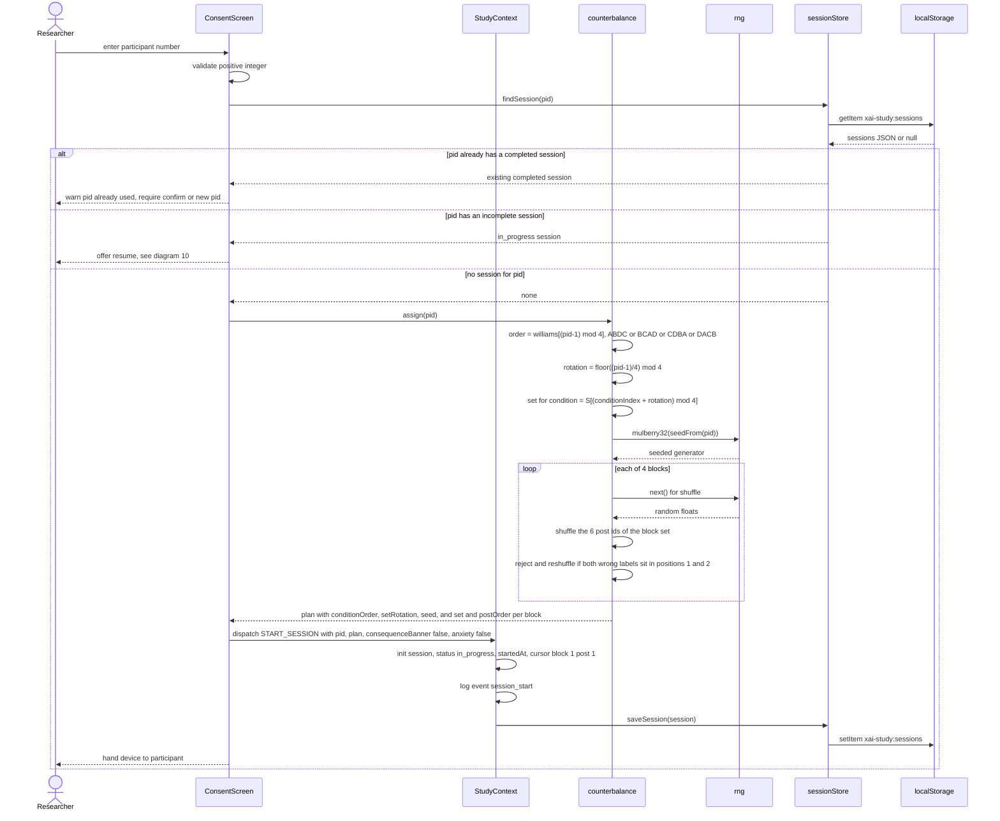

**Edge cases**
- **Determinism.** Calling `assign(pid)` again for the same pid must give the identical plan. That lets the analysis rebuild the assignment from the pid alone, and lets diagram 10 check that a stored plan hasn't changed. The seed and the full plan are saved anyway, so nothing depends on recomputing them.
- **Full balance.** One cycle of the Williams order and the set rotation needs 16 participants (4 orders × 4 rotations). The target is N = 32 (two cycles). The minimum is 16, and pids beyond a full cycle wrap round deterministically.
- **Wrong-label constraint.** Each block has exactly 2 wrong labels (1 false alarm, 1 miss). The constraint is applied by rejection sampling: reshuffle until the two aren't both in positions 1 and 2. All the draws come from the same seeded generator, so the retries are deterministic too, and positions still vary across participants because the seed varies.
- **Practice post.** The single practice post on `InstructionsScreen` isn't part of the plan or the 24-post bank, and it never produces a trial record.
- **Optional flags.** `consequenceBanner` and `anxiety` are stored as `false` by default. The flags exist so the optional features can be switched on without a schema change.
- **Consent.** "I agree" logs `consent_given` and sets `consentAt`; then `InstructionsScreen` and the practice post (`practice_start`, `practice_complete`, with `trialId: null`) run before block 1, whose start logs `block_start`.
- **Invalid input.** Zero, negative, non-numeric or empty pids are refused on the screen and never reach `counterbalance`.
- **Reused pid.** A completed session for the same pid is never overwritten silently. The researcher has to confirm. A replacement participant reuses the pid with a new `sessionId`, and the old session is kept next to it.
- **Storage failure.** If `setItem` throws (quota exceeded or private mode), the researcher gets a blocking error before consent. The study must not run if its data can't be saved.

---

## 2. Trial in Condition A (No explanation)

Every trial follows the same skeleton, and diagrams 3 to 5 only change the middle of it. Times in the diagrams are `tMs`, the milliseconds since the trial's `trial_shown` event. `TrialScreen` asks `StudyContext` for the current post id, `labelEngine.buildPresentation(post, A)` builds an allow-listed payload, and `conditionRegistry` picks `NoExplanationView`, which renders `PostCard` and `LabelPanel` with only the AI label. The label appears after the fixed ~800 ms "AI is checking…" delay, and the decision timer starts once the label is actually painted. The Agree or Disagree click stops it, the `PostRatingStrip` confidence step follows (diagram 8), and `logger` builds the trial record before `sessionStore` saves the session.

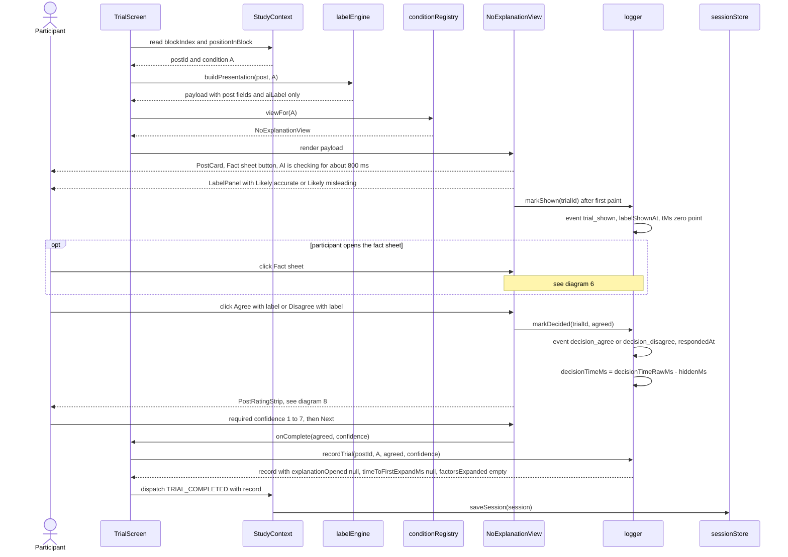

**Edge cases**
- **When the timer starts.** `trial_shown` is logged (and `labelShownAt` set) in a `requestAnimationFrame` callback after the label has painted, not when the component mounts, so the ~800 ms delay and slow rendering never count toward `decisionTimeMs`.
- **Same delay everywhere.** The "AI is checking…" delay is identical in every condition and for correct and wrong labels. The buttons are disabled during it. No AI confidence score is ever shown.
- **Double clicks.** Agree and Disagree are disabled after the first click, so the first decision is the only one recorded. A second click is ignored and isn't logged as a decision.
- **Losing focus.** If the tab is hidden mid-trial, `logger` records `visibility_hidden` and `visibility_visible` events and sums them into `hiddenMs` and `hiddenCount`. `decisionTimeMs = decisionTimeRawMs - hiddenMs`, and `timingFlag` marks trials the analysis should treat with care.
- **Fields that don't apply.** Outside C, `explanationOpened = null`, `timeToFirstExpandMs = null` and `factorsExpanded = []`, so "not applicable" can't be mistaken for "did not open".
- **A failed save.** The trial does not advance, and a blocking message asks the participant to call the researcher. A trial that isn't persisted is treated as not done.

---

## 3. Trial in Condition B (Static reason)

Condition B uses the skeleton from diagram 2. The only change is that `labelEngine` adds the post's `staticExplanation` (one fixed sentence of 8 to 14 words) to the payload, and `StaticExplanationView` shows it under the label. The reason is visible from the moment the label appears, so the participant doesn't need to do anything to see it, and no extra interaction events are logged apart from the shared fact-sheet events.

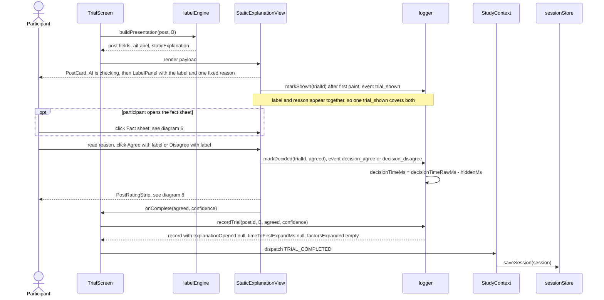

**Edge cases**
- **Same layout.** The reason is rendered in the same position and type style for correct and wrong labels, with the same confident tone (see diagram 7). Its wording comes from `stimuli.md`, not from the view.
- **Reading time.** B's `decisionTimeMs` includes the time spent reading the reason. That's intended, because H6 compares the full time-to-decision across conditions.
- **Fixed explanation-area height.** The explanation area keeps a fixed minimum height in every condition, so the Agree and Disagree buttons sit in the same place whether or not a reason is shown.

---

## 4. Trial in Condition C (Interactive "Why?")

In Condition C the label first appears alone with a "Why?" button. Clicking it opens a panel with three rows: **Source** (the account and its verified badge), **Claim vs record** (the post's key value against the fact-sheet value, with ✓ or ✗) and **Wording** (neutral or sensational). Each row expands to one `detail` sentence. `logger` records every "Why?" open and close and every row expand and collapse with a `performance.now()` timestamp, which lets the analysis tell whether participants actually checked the breakdown. `timeToFirstExpandMs` is the `tMs` of the first "Why?" open (time since `trial_shown`), and `factorsExpanded[]` lists the distinct factor keys in the order they were first expanded (exported as one pipe-separated cell).

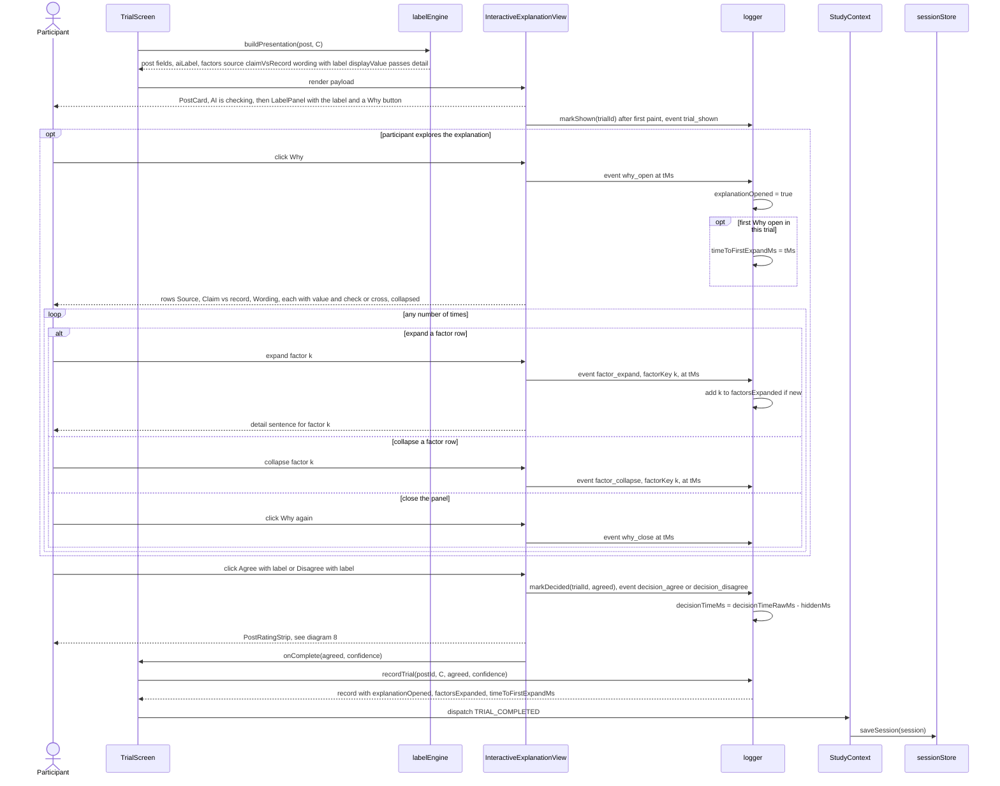

**Edge cases**
- **No exploration.** If the participant decides without clicking "Why?", the record has `explanationOpened = false`, `factorsExpanded = []` and `timeToFirstExpandMs = null`. That is valid data and is central to H2 and H6.
- **Opened but not expanded.** If "Why?" is opened but no row is expanded, `explanationOpened = true`, `timeToFirstExpandMs` is set from the "Why?" open, and `factorsExpanded = []`. The per-row `factor_expand` timestamps stay in the event list for finer analysis.
- **The ✓/✗ is visible before expanding.** The Claim vs record row shows both values and its ✓ or ✗ as soon as the panel opens, so a participant can catch an error without expanding any row. Expanding only adds the `detail` sentence.
- **Repeat expands.** Expanding the same factor again adds another `factor_expand` event but doesn't change `factorsExpanded` or `timeToFirstExpandMs`.
- **Decision without closing.** Agree and Disagree stay enabled while the panel is open. The panel's state at decision time is implied by the event list, so no extra field is needed.
- **Rows start collapsed.** The panel starts closed and every row starts collapsed on every trial. Earlier trials never carry over expanded state, so each open and expand is a deliberate act.

---

## 5. Trial in Condition D (Counterfactual)

Condition D uses the same skeleton as B. `labelEngine` adds the post's `counterfactualExplanation`, one "would be … if …" sentence of 10 to 16 words, and `CounterfactualView` shows it under the label straight away (for example "This would be labeled accurate if it cited the March test report."). Like B there is nothing to click, so the only extra events are the shared fact-sheet events, and the C-only fields are stored as not applicable.

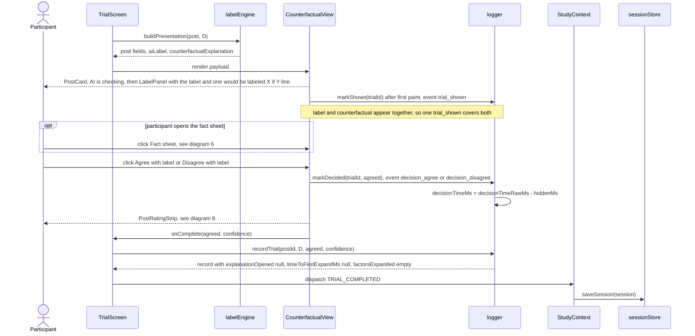

**Edge cases**
- **The line argues for the label.** On every post, right or wrong, the counterfactual names a change that would flip the AI's label, in the same confident tone. On wrong labels it cites a plausible but non-decisive factor (see diagram 7), so it never points at the real mismatch with the fact sheet.
- **Exploratory condition.** H2 treats D as exploratory: the counterfactual could prompt checking or could read as extra justification. The app logs D exactly like B so the two can be compared directly.
- **Same position as B.** The sentence sits in the same explanation area as B's reason, with the same type style, so any difference between B and D comes from the wording, not the layout.

---

## 6. Fact sheet open and close inside a trial

Every post has one fact sheet (a fictional official record with the key fact), and the "Fact sheet ▸" button opens it as a side panel in every condition. `FactSheetPanel` is identical across conditions and never mentions the label. `logger` writes a `fact_sheet_open` and `fact_sheet_close` event for each toggle, sets `factSheetOpened = true` on the first open, and adds each open interval to `factSheetOpenMs`. The decision timer keeps running the whole time, because checking the record is part of deciding.

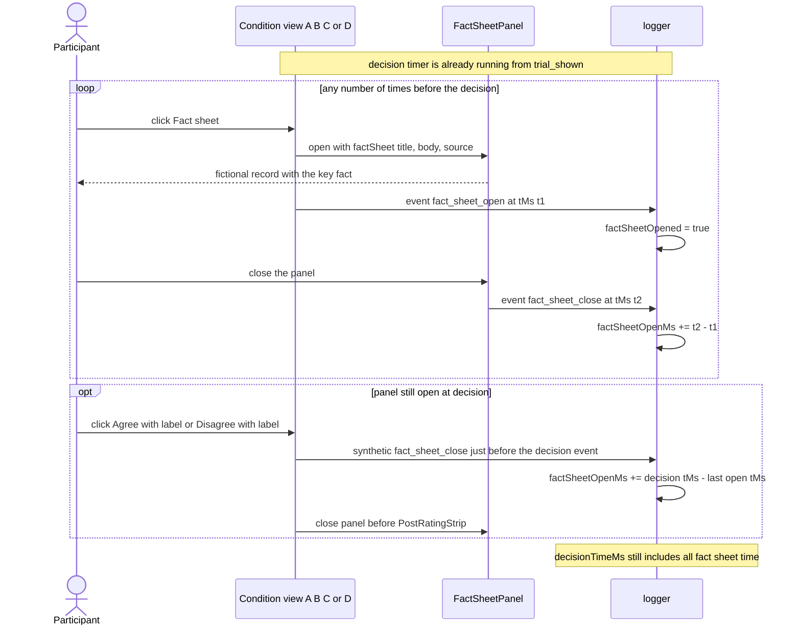

**Edge cases**
- **Timer keeps running.** `decisionTimeMs` includes time with the fact sheet open. `factSheetOpenMs` is a separate measure inside that window, so H6 can test whether opening the fact sheet predicts detection.
- **Never opened.** `factSheetOpened = false` and `factSheetOpenMs = 0`. That is valid data, not missing data.
- **Repeat opens.** Each open and close pair adds to `factSheetOpenMs`. The count of opens can be derived from the `fact_sheet_open` events.
- **Hidden time.** If the tab is hidden while the panel is open, the hidden interval is subtracted from `factSheetOpenMs` as well as from `decisionTimeMs`, so neither counts time away from the page.
- **No leaks.** The fact sheet text comes from `post.factSheet` and is the same in every condition. It never repeats or contradicts the label wording, so it can't act as a hidden explanation.
- **Closed between trials.** The panel always starts closed on a new trial, and its open state never carries over.

---

## 7. Wrong-label handling

From the participant's side a wrong label can't be told apart from a correct one. The layout, timing, wording style and controls are identical, and the explanation in B, C and D argues for the AI's label. A **false alarm** labels a TRUE post "Likely misleading", and a **miss** labels a FALSE post "Likely accurate". To guarantee this, `labelEngine.buildPresentation` builds the payload from an explicit allow-list, so `groundTruth`, `isAiCorrect`, `errorType` and `difficulty` never reach a view or React props. Correctness joins the record only inside `logger`, after the participant has decided, through `labelEngine.getTruth(postId)`. There `detectedError` is derived as `!agreed` on wrong labels and `null` on correct ones.

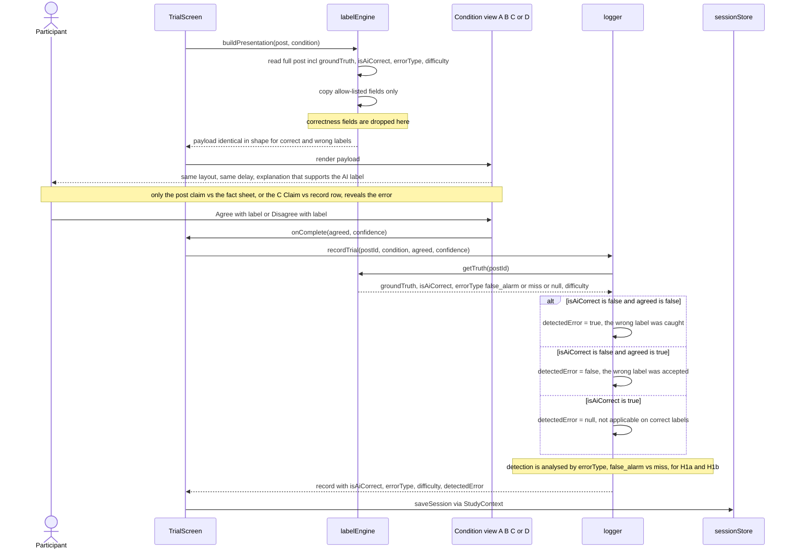

**Edge cases**
- **No leaks through rendering.** The payload types have no correctness fields at all. A unit test asserts that `JSON.stringify(payload)` never contains `groundTruth`, `isAiCorrect`, `errorType` or `difficulty`. DOM attributes, CSS classes and test ids must not encode correctness either. Only `logger` calls `getTruth`.
- **Claim vs record in C shows the true comparison.** On a wrong label the row still shows the post's real claim value and the real fact-sheet value with the honest ✓ or ✗, so a careful participant can spot the contradiction. The `detail` sentence still sounds plausible and supports the label. This is the C-shows-true-values principle, which the team still has to confirm.
- **B and D on wrong labels.** They cite a plausible but non-decisive factor (for example the topic or the wording) in the same confident tone, and never mention the key fact.
- **Same timing.** The fixed ~800 ms "AI is checking…" delay is the same for correct and wrong labels, and no animation differs between them.
- **Data checks.** `labelEngine.validatePost` checks at load time that `groundTruth` agrees with comparing `keyFact.claimValue` to `keyFact.recordValue`, that `errorType` is `false_alarm` exactly when the truth is TRUE and the label is misleading (and `miss` for FALSE with accurate), that `isAiCorrect` matches, and that each set has 2 correct accurate, 2 correct misleading, 1 false alarm and 1 miss. A mismatch is a dev-time and build-time error, never something the participant sees.
- **Correct labels.** On correct labels `detectedError` is `null`. Detection analyses filter to `isAiCorrect == false` first.
- **Split by error type (H1a).** `errorType` and `difficulty` are stored on every trial record, so comparing how often misses and false alarms are caught (and the clear vs subtle split) needs no join back to the post bank.

---

## 8. Per-post confidence rating and the next trial

After every decision, `PostRatingStrip` replaces the buttons with one 7-point question: "How confident are you in your decision?" (1 = "Not at all confident", 7 = "Extremely confident"). The rating is **required**: there is no skip, and the **Next** button is enabled only once a value is picked. Its time never counts toward `decisionTimeMs`, because `respondedAt` and the decision `tMs` were fixed by the Agree or Disagree click. The session is saved once after the decision (cursor phase `post_rating`) and again when Next writes the completed trial record, which then either loads the next post with a fresh "AI is checking…" delay or, after the sixth post, opens the block survey.

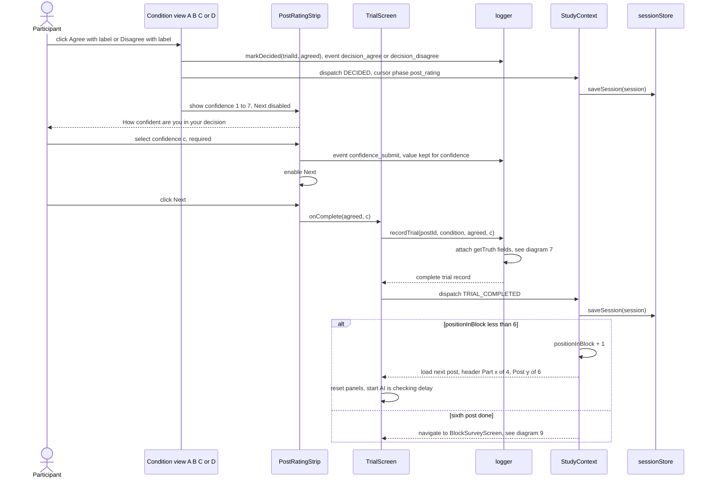

**Edge cases**
- **Required.** `confidence` is never null on a saved trial. Next stays disabled until a value is chosen, and there is no "skip" option.
- **Changing the rating.** The participant can change the confidence value before clicking Next. Only the last value is stored in `confidence`, and every change is still logged as a `confidence_submit` event (events carry no value; the value lives on the trial).
- **Decision is final.** Once the strip appears, the Agree and Disagree buttons are gone. The decision can't be changed while rating confidence.
- **Carry-over clicks.** Next is placed away from where the new trial's Agree and Disagree buttons will appear, and those buttons stay disabled during the delay, so a double click on Next can't register a decision on the next post.
- **Save before advance.** The next post loads only after `saveSession` succeeds. If the save fails, the strip stays on screen with a blocking message.

---

## 9. Block survey and advancing to the next block

After the sixth post of a block, `StudyContext` sends the participant to `BlockSurveyScreen` for the condition they just used. The items come from `surveyItems.json` in a fixed order: the 12 Jian et al. (2000) trust items with "the system" worded as "the AI labels", then the 2 fairness items, all on 7-point scales, then `tension` (1–7), then the NASA-TLX frustration slider (`frustrationTlx`, 0–100 in steps of 5, starting at 50). The slider counts as answered only once it has been moved (`frustrationTlxTouched = true`). On submit, `logger` stores the raw answers and computes `nWrongDetected`, the number of the block's 2 wrong labels the participant disagreed with, then the next block starts or, after block 4, the exit survey opens.

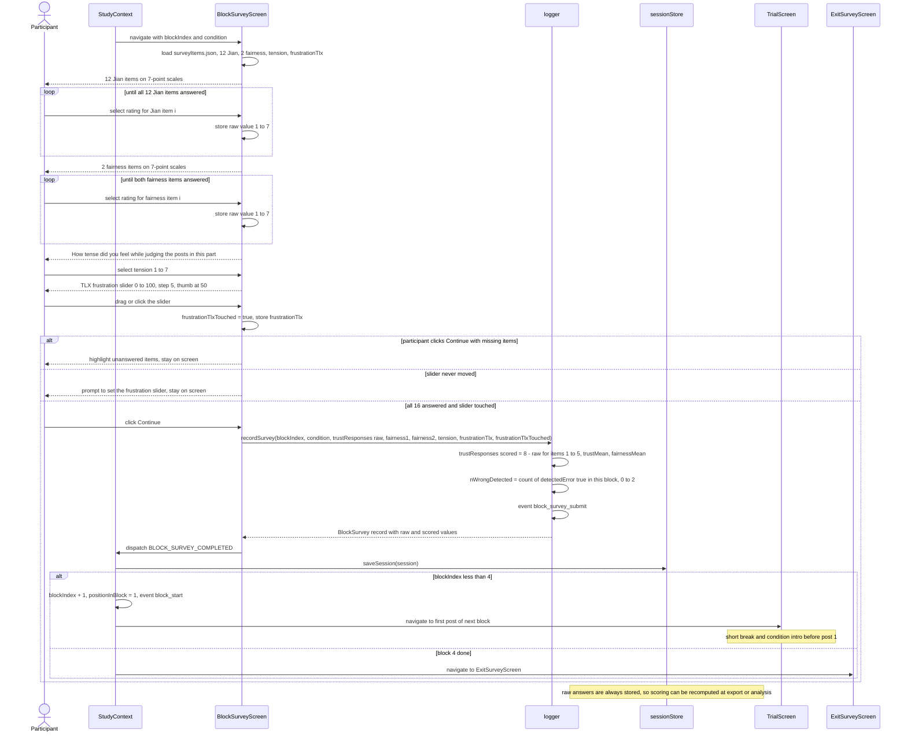

**Edge cases**
- **Which condition was rated.** Each survey record stores `condition` and `blockIndex` explicitly, so the analysis never has to infer from the order which condition a score belongs to.
- **Item order.** The order is always 12 Jian items, 2 fairness items, tension, then the slider. The Jian items keep their published order, which keeps the reverse-scoring indices stable. Asking the affect items last keeps them from priming the trust ratings.
- **No defaults on Likert items.** No 7-point item has a pre-selected value. That avoids midpoint bias and keeps the "every item answered" check meaningful.
- **Slider validation.** The thumb starts at 50, but `frustrationTlx` stays `null` until the first input event, which also sets `frustrationTlxTouched = true`. A participant who really means 50 has to move the thumb away and back. `frustrationTlxTouched` is saved so the analysis can confirm every value was set on purpose.
- **`nWrongDetected`.** It is computed from the block's stored trial records, not from anything on screen, so it is also recomputable from `trials.csv`. It is the H3 predictor for tension and frustration.
- **Double submit.** Continue is disabled after the first click. A second dispatch for the same block is ignored by the reducer if that block's survey already exists.
- **Back navigation.** The browser Back button doesn't return to the block's posts. The router guard in `StudyContext` redirects to the current step.
- **Exit survey.** The exit survey (`ageRange`, `gender`, `education`, `socialMediaUse`, `labelExposure`, `preferredCondition`, `comment`) uses the same validation and save pattern. Only `gender` and `comment` are optional. Submitting it logs `exit_survey_submit`, sets `status = "completed"` and `completedAt`, and moves to `DebriefScreen` (which logs `session_complete`), which explains that the labels were scripted, that 8 of the 24 were wrong on purpose, and shows the facts for every wrong label.

---

## 10. Refresh and crash recovery

Because `sessionStore` saves after every decision, every confidence submit, every survey and every `cursor` change, a reload loses at most the step that was on screen. On startup the app reads `localStorage`, follows `activeSessionId` to an `in_progress` session, and offers the researcher a resume. Resuming restores the stored `cursor` (`blockIndex`, `positionInBlock`, `phase`), logs `session_resume` and adds 1 to `resumeCount`. If the cursor is on an unanswered trial, the half-seen attempt is thrown away, the post is shown again with a fresh delay and timer, and the new record is flagged `resumed = true` so the analysis can treat its timing with care. If it is at `post_rating` (decision saved, confidence not yet given), only the confidence strip is shown again.

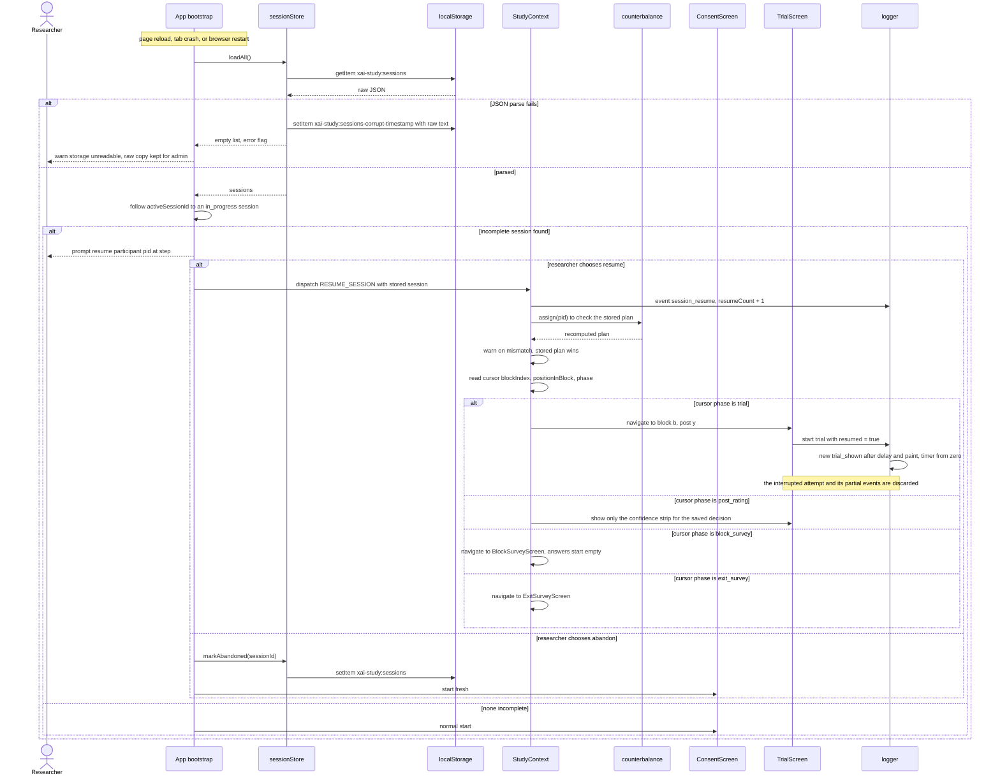

**Edge cases**
- **Working out the next step.** The resume point is the stored `cursor`, which is written on every phase change. On resume it is checked against the stored records (trial count per block, which block surveys exist), and a mismatch is shown to the researcher.
- **What `resumed` means.** `resumed = true` is set only on the trial that was interrupted. Later trials have `resumed = false`. The session also keeps a `resumeCount` for transparency.
- **Interrupted confidence step.** If the crash happens after the decision but before Next, the decision was already saved and the cursor is at `post_rating`, so only the required confidence strip is shown again. The decision and its timing are kept.
- **Fact sheet and C panel.** Both start closed on the resumed trial, and `factSheetOpenMs` and `factorsExpanded` restart from zero with the new attempt.
- **Abandoned sessions are kept.** They're marked `status = "abandoned"`, still exported, and excluded by default in the analysis. They're never deleted automatically. A replacement participant reuses the pid with a new `sessionId`.
- **Two tabs.** Only one tab should run the study. A `storage` event listener detects writes from another tab and shows a warning, because both tabs would otherwise overwrite the same key.

---

## 11. Admin export and optional submission

The researcher opens `/admin`, which the participant flow never links to. `AdminScreen` asks `sessionStore` for every session, shows a summary with completion status, and offers five downloads with the columns defined in `data-model.md` §8: `trials.csv` (one row per trial), `surveys.csv` (one row per pid and block), `events.csv` (one row per interaction event), `exit.csv` (one row per participant) and `sessions.json` (everything, including plans and raw events). If `VITE_SUBMIT_URL` is set, completed sessions can also be POSTed as `text/plain` to a Google Apps Script web app. A failed POST never touches the local data, so the downloads are always the fallback.

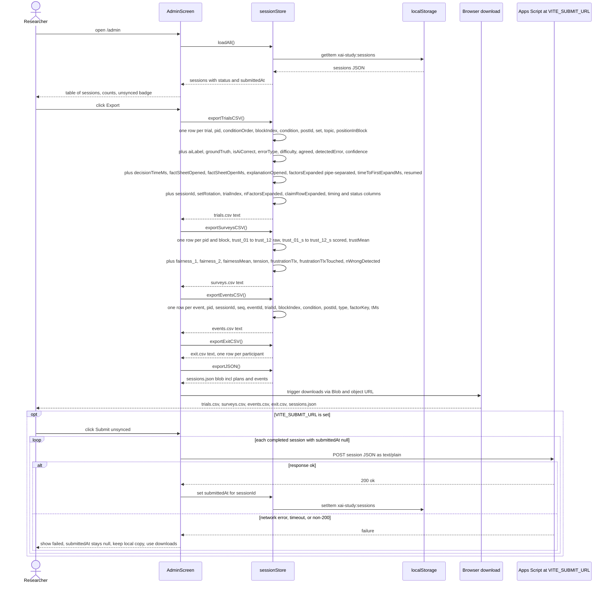

**Edge cases**
- **No CORS preflight.** The POST uses `Content-Type: text/plain` so the browser doesn't send a preflight request, which Apps Script web apps don't handle. The script parses the body as JSON. A timeout (about 10 s via `AbortController`) counts as a failure.
- **Local data is never deleted.** A successful submission only sets `submittedAt`. Clearing local data is a separate admin action that requires typing a confirmation, and it's offered only after a download.
- **CSV safety.** Values are quoted and inner quotes are doubled. Free-text fields such as the exit comment are escaped, and newlines inside them are kept within quotes. Cells that start with `=`, `+`, `-` or `@` get a leading apostrophe so spreadsheets don't run them as formulas. Booleans are written `TRUE`/`FALSE` and nulls as empty fields. `factorsExpanded` (and any other list) is written as one pipe-separated cell of keys in order of first expansion, e.g. `claimVsRecord|source`, and is empty when the list is empty.
- **Where scoring happens.** `trustResponses[].scored`, `trustMean` and `fairnessMean` are computed at submit and recomputed from the raw answers on export; a mismatch is reported. The `trust_NN_s` columns come from that recomputation, so re-exporting is idempotent.
- **Which sessions are exported.** Incomplete and abandoned sessions are included in every file with a `status` column, so the researcher decides on exclusions during analysis.
- **Optional add-on.** If `VITE_SUBMIT_URL` isn't set, the Submit control doesn't appear at all. The core study path never depends on the network.

---

## Related docs

- [architecture.md](architecture.md): module boundaries and the overall structure of the app
- [system-design.md](system-design.md): requirements, screens, routing, timing, logging and counterbalancing
- [sequence-diagrams.md](sequence-diagrams.md): this document
- [data-model.md](data-model.md): post bank, session, trial, survey and export schemas (the authority on field names)
- [ai-design.md](ai-design.md): the Wizard-of-Oz `labelEngine`, explanation design and the wrong-label strategy
- [research-positioning.md](research-positioning.md): why the domain moved to AI accuracy labels and how the study relates to prior work
- [implementation-plan.md](implementation-plan.md): build order, owners and milestones for the app
- [study-protocol.md](study-protocol.md): how a moderated session is run, from consent to debrief
- [stimuli.md](stimuli.md): final participant-facing wording for all 24 posts
- [wireframes.md](wireframes.md): screen layouts for the trial, survey and admin screens
- [_shared-decisions.md](_shared-decisions.md): the binding source of truth for every doc
