# Sequence Diagrams (v3: AI accuracy labels on social media posts)

This document shows how the study app's modules work together at runtime for the flows that matter most to data quality. It covers assigning a participant, running a trial in each of the four conditions, opening the fact sheet, handling the deliberately wrong labels (`false_alarm` and `miss`), the per-post confidence rating, the block surveys, recovering from a refresh or crash, and exporting the data. Each diagram uses the module names from `_shared-decisions.md`: `StudyContext`, `labelEngine`, `counterbalance`, `rng`, `logger`, `conditionRegistry`, the shared components (`PostCard`, `LabelPanel`, `FactSheetPanel`, `PostRatingStrip`), the screens in `src/study/`, and the local server (`Server API`, backed by the `SQLite` file `app/data/study.db`). Participants read made-up posts from the fictional town of Riverton, each carrying a scripted AI label ("Likely accurate" or "Likely misleading"), and click **Agree with label** or **Disagree with label**. Event names, field names and export columns are exactly those in `data-model.md` (the authority; its §2.9 event list is the full set of `type` values), and participant-facing wording is quoted from `stimuli.md`. Every section follows the same pattern: a short explanation, the Mermaid diagram, then notes on edge cases. The browser talks only to the study's Express server (`/api`, see `app/CONTRACT.md`), on the same laptop or, for participants on their own devices, over HTTPS through a reverse proxy. The server holds the post bank with its correctness fields, computes the assignment, derives the truth fields of each trial and writes everything to SQLite; the browser keeps only the active session id (`xai-study:activeSessionId`) while a session runs, and clears every study key once the exit survey is saved (diagram 9.1), so nothing is left in the browser after completion. **v2:** participants start the study themselves with a participation code (diagram 1), confidence is an inline chip row on the trial screen (diagram 8), and `/admin` is read-only data and KPIs (diagrams 11 and 12). Persistence moved from browser `localStorage` to this server in the build (see `architecture.md` ADR-4).

The previous v2.1 version of this document is archived at [archive/v2.1-agent-permission/sequence-diagrams.md](archive/v2.1-agent-permission/sequence-diagrams.md).

## Index

1. [Session start and assignment](#1-session-start-and-assignment)
2. [Trial in Condition A (No explanation)](#2-trial-in-condition-a-no-explanation)
3. [Trial in Condition B (Static reason)](#3-trial-in-condition-b-static-reason)
4. [Trial in Condition C (Interactive "Why?")](#4-trial-in-condition-c-interactive-why)
5. [Trial in Condition D (Counterfactual)](#5-trial-in-condition-d-counterfactual)
6. [Fact sheet open and close inside a trial](#6-fact-sheet-open-and-close-inside-a-trial)
7. [Wrong-label handling](#7-wrong-label-handling)
8. [Per-post confidence rating and the next trial](#8-per-post-confidence-rating-and-the-next-trial)
9. [Block survey and advancing to the next block](#9-block-survey-and-advancing-to-the-next-block)
   - 9.1 [Exit survey, clearing the browser, and debrief](#91-exit-survey-clearing-the-browser-and-debrief)
10. [Refresh and crash recovery](#10-refresh-and-crash-recovery)
11. [Admin export](#11-admin-export)
12. [Admin KPI polling](#12-admin-kpi-polling)

---

## 1. Session start and assignment

The participant starts the study themselves; no researcher is involved. On the Welcome screen (`/`) they type a short participation code (for example a university email or student ID) and press **Start** or Enter. `POST /api/sessions { participantCode }` normalises the code (`trim().toLowerCase()`, 3–120 characters) and computes `participant_hash = HMAC-SHA256(salt, code)`; the raw code is never stored or logged. Inside one `BEGIN IMMEDIATE` transaction the server checks the hash against existing sessions, marks stale sessions abandoned, allocates the pid (the lowest integer ≥ 1 with no `in_progress` or `completed` session, so abandoned pids are reused), runs `counterbalance.assign(pid)`, and writes the session row and its 4 block rows. The condition order comes from the 4×4 Williams square (`williams[(pid-1) % 4]`, one of ABDC, BCAD, CDBA, DACB), the set for each condition from the rotation `floor((pid-1)/4) % 4`, and the order of the 6 posts in each block from a mulberry32 PRNG seeded with the pid. The browser stores only the new `sessionId`.

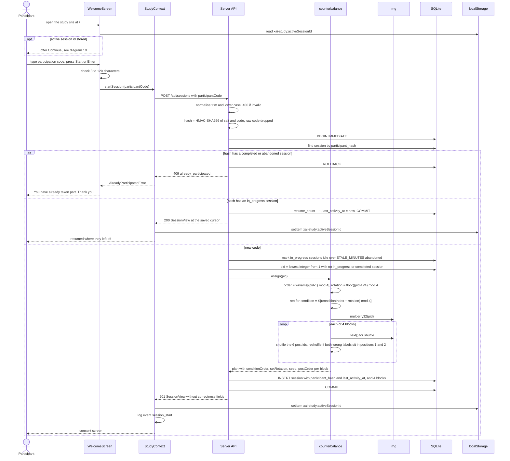

**Edge cases**
- **Once-only.** A code that already completed, or whose session was abandoned, gets 409 and the thank-you message. The server check is the only guard: the browser keeps no "participated" flag, and after a finished study it holds no study data at all (diagram 9.1), so a returning visitor on the same device sees the normal Welcome screen until they type a used code. A person who types a *different* code is not caught (see `system-design.md` R-15).
- **Same code, other device.** A code with an `in_progress` session resumes it (200) on any device, with `resume_count` + 1.
- **Concurrency.** `BEGIN IMMEDIATE` takes SQLite's write lock before the pid is chosen, so two people pressing Start at the same moment get different pids. The unique index on `participant_hash` stops one code from creating two sessions.
- **Stale sessions and pid reuse.** Before allocating, any `in_progress` session whose `last_activity_at` is older than `STALE_MINUTES` (default 120) is marked abandoned. Its pid is then free for the newcomer, which keeps each 16-participant cycle balanced. Pilot pids 901+ are never auto-assigned.
- **Salt.** `PARTICIPANT_SALT` from the environment, or 32 random bytes generated once and stored in `meta.participant_salt`. Changing it mid-study would let earlier codes start again.
- **Determinism.** `assign(pid)` gives the identical plan for the same pid, so the analysis can rebuild the assignment from the pid alone, and `GET /api/admin/assignments/:pid` previews it. The seed and the full plan are saved anyway (`sessions`, `blocks`).
- **Wrong-label constraint.** Each block has exactly 2 wrong labels (1 false alarm, 1 miss). Rejection sampling reshuffles until the two aren't both in positions 1 and 2; all draws come from the same seeded generator, so the retries are deterministic too.
- **No truth in the browser.** `SessionView` carries post ids only. Which ids are the wrong labels is known only to the server.
- **Consent.** "I agree" calls `POST /api/sessions/:id/consent`, which sets `consentAt`, moves the cursor to `instructions`, updates `last_activity_at` and logs `consent_given`; then `InstructionsScreen` and the inline practice post (`practice_start`, `practice_complete`, with `trialId: null`) run before block 1.
- **Server not reachable.** The Welcome screen shows the error and no session starts. The study must not run if its data can't be saved.

---

## 2. Trial in Condition A (No explanation)

Every trial follows the same skeleton, and diagrams 3 to 5 only change the middle of it. Times in the diagrams are `tMs`, the milliseconds since the trial's `trial_shown` event. `TrialScreen` asks `StudyContext` for the current post id, `labelEngine.buildPresentation(post, A)` builds an allow-listed payload, and `conditionRegistry` picks `NoExplanationView`, which renders `PostCard` and `LabelPanel` with only the AI label. The label appears after the fixed ~800 ms "AI is checking…" delay, and the decision timer starts once the label is actually painted. The Agree or Disagree click stops it, the inline `PostRatingStrip` confidence chips follow on the same screen (diagram 8), and the trial is sent to the server, which adds the truth fields and saves it to SQLite.

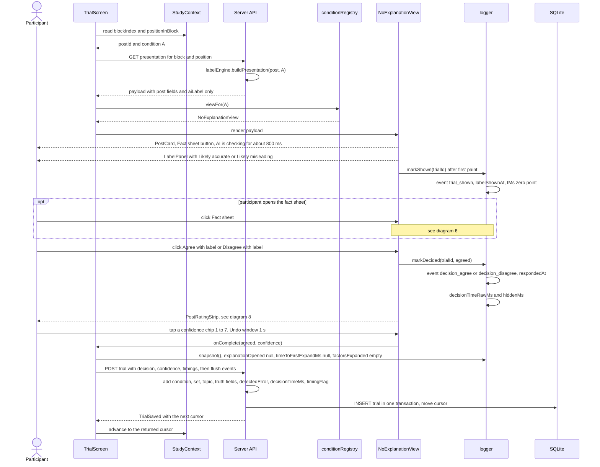

**Edge cases**
- **When the timer starts.** `trial_shown` is logged (and `labelShownAt` set) in a `requestAnimationFrame` callback after the label has painted, not when the component mounts, so the ~800 ms delay and slow rendering never count toward `decisionTimeMs`.
- **Same delay everywhere.** The "AI is checking…" delay is identical in every condition and for correct and wrong labels. The buttons are disabled during it. No AI confidence score is ever shown.
- **Double clicks.** Agree and Disagree are disabled after the first click, so the first decision is the only one recorded. A second click is ignored and isn't logged as a decision.
- **Losing focus.** If the tab is hidden mid-trial, `logger` records `visibility_hidden` and `visibility_visible` events and sums them into `hiddenMs` and `hiddenCount`. `decisionTimeMs = decisionTimeRawMs - hiddenMs`, and `timingFlag` marks trials the analysis should treat with care.
- **Fields that don't apply.** Outside C, `explanationOpened = null`, `timeToFirstExpandMs = null` and `factorsExpanded = []`, so "not applicable" can't be mistaken for "did not open".
- **A failed save.** If the POST fails (server stopped, network error), the trial does not advance, and a message asks the participant to call the researcher, with a Retry button. A trial that isn't in SQLite is treated as not done. A retried POST that the server had already saved returns 409 and is treated as saved.
- **Server-side timing fields.** The client sends `decisionTimeRawMs` and `hiddenMs`; the server stores `decisionTimeMs = decisionTimeRawMs - hiddenMs` and sets `timingFlag` when `hiddenCount > 0` or `decisionTimeMs > 120000`.

---

## 3. Trial in Condition B (Static reason)

Condition B uses the skeleton from diagram 2. The only change is that `labelEngine` adds the post's `staticExplanation` (one fixed sentence of 8 to 14 words) to the payload, and `StaticExplanationView` shows it under the label. The reason is visible from the moment the label appears, so the participant doesn't need to do anything to see it, and no extra interaction events are logged apart from the shared fact-sheet events.

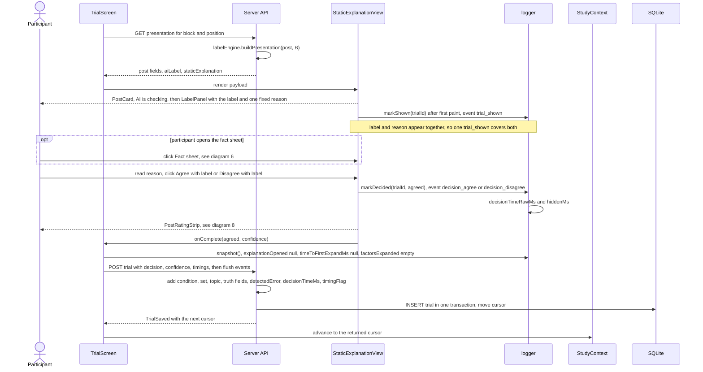

**Edge cases**
- **Same layout.** The reason is rendered in the same position and type style for correct and wrong labels, with the same confident tone (see diagram 7). Its wording comes from `stimuli.md`, not from the view.
- **Reading time.** B's `decisionTimeMs` includes the time spent reading the reason. That's intended, because H6 compares the full time-to-decision across conditions.
- **Fixed explanation-area height.** The explanation area keeps a fixed minimum height in every condition, so the Agree and Disagree buttons sit in the same place whether or not a reason is shown.

---

## 4. Trial in Condition C (Interactive "Why?")

In Condition C the label first appears alone with a "Why?" button. Clicking it opens a panel with three rows: **Source** (the account and its verified badge), **Claim vs record** (the post's key value against the fact-sheet value, with ✓ or ✗) and **Wording** (neutral or sensational). Each row expands to one `detail` sentence. `logger` records every "Why?" open and close and every row expand and collapse with a `performance.now()` timestamp, which lets the analysis tell whether participants actually checked the breakdown. `timeToFirstExpandMs` is the `tMs` of the first "Why?" open (time since `trial_shown`), and `factorsExpanded[]` lists the distinct factor keys in the order they were first expanded (exported as one pipe-separated cell).

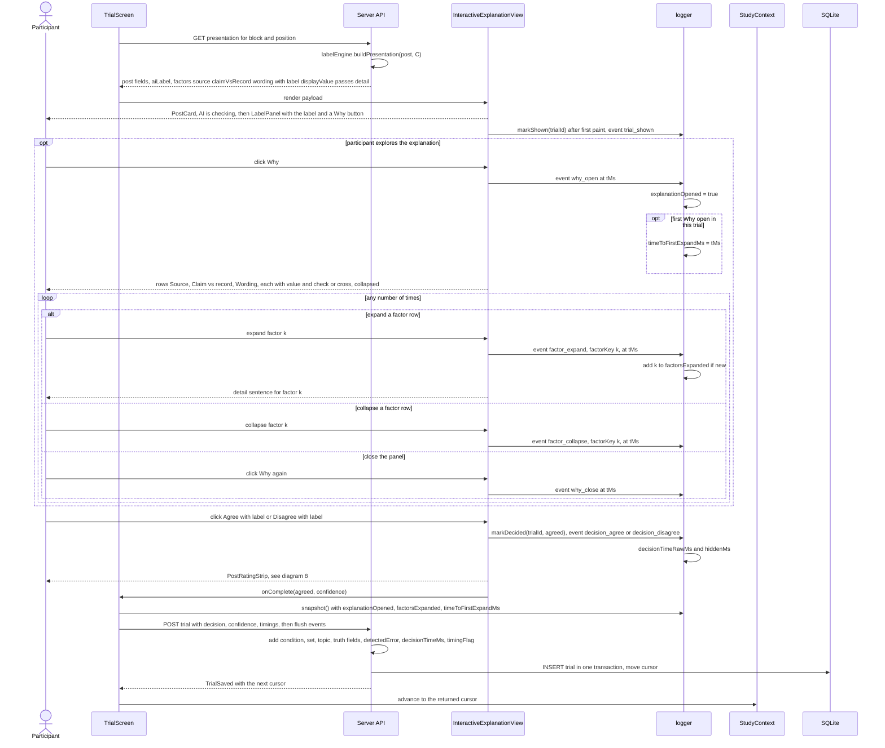

**Edge cases**
- **No exploration.** If the participant decides without clicking "Why?", the record has `explanationOpened = false`, `factorsExpanded = []` and `timeToFirstExpandMs = null`. That is valid data and is central to H2 and H6.
- **Opened but not expanded.** If "Why?" is opened but no row is expanded, `explanationOpened = true`, `timeToFirstExpandMs` is set from the "Why?" open, and `factorsExpanded = []`. The per-row `factor_expand` timestamps stay in the event list for finer analysis.
- **The ✓/✗ is visible before expanding.** The Claim vs record row shows both values and its ✓ or ✗ as soon as the panel opens, so a participant can catch an error without expanding any row. Expanding only adds the `detail` sentence.
- **Repeat expands.** Expanding the same factor again adds another `factor_expand` event but doesn't change `factorsExpanded` or `timeToFirstExpandMs`.
- **Decision without closing.** Agree and Disagree stay enabled while the panel is open. The panel's state at decision time is implied by the event list, so no extra field is needed.
- **Rows start collapsed.** The panel starts closed and every row starts collapsed on every trial. Earlier trials never carry over expanded state, so each open and expand is a deliberate act.

---

## 5. Trial in Condition D (Counterfactual)

Condition D uses the same skeleton as B. `labelEngine` adds the post's `counterfactualExplanation`, one "would be … if …" sentence of 10 to 16 words, and `CounterfactualView` shows it under the label straight away (for example "This would be labeled accurate if it cited the March test report."). Like B there is nothing to click, so the only extra events are the shared fact-sheet events, and the C-only fields are stored as not applicable.

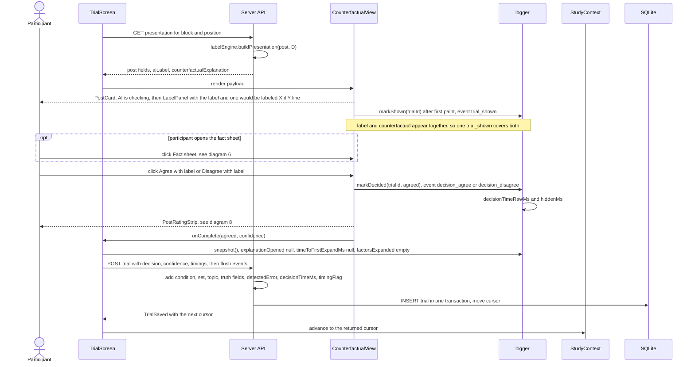

**Edge cases**
- **The line argues for the label.** On every post, right or wrong, the counterfactual names a change that would flip the AI's label, in the same confident tone. On wrong labels it cites a plausible but non-decisive factor (see diagram 7), so it never points at the real mismatch with the fact sheet.
- **Exploratory condition.** H2 treats D as exploratory: the counterfactual could prompt checking or could read as extra justification. The app logs D exactly like B so the two can be compared directly.
- **Same position as B.** The sentence sits in the same explanation area as B's reason, with the same type style, so any difference between B and D comes from the wording, not the layout.

---

## 6. Fact sheet open and close inside a trial

Every post has one fact sheet (a fictional official record with the key fact), and the "Fact sheet ▸" button opens it as a side panel in every condition. `FactSheetPanel` is identical across conditions and never mentions the label. `logger` writes a `fact_sheet_open` and `fact_sheet_close` event for each toggle, sets `factSheetOpened = true` on the first open, and adds each open interval to `factSheetOpenMs`. The decision timer keeps running the whole time, because checking the record is part of deciding.

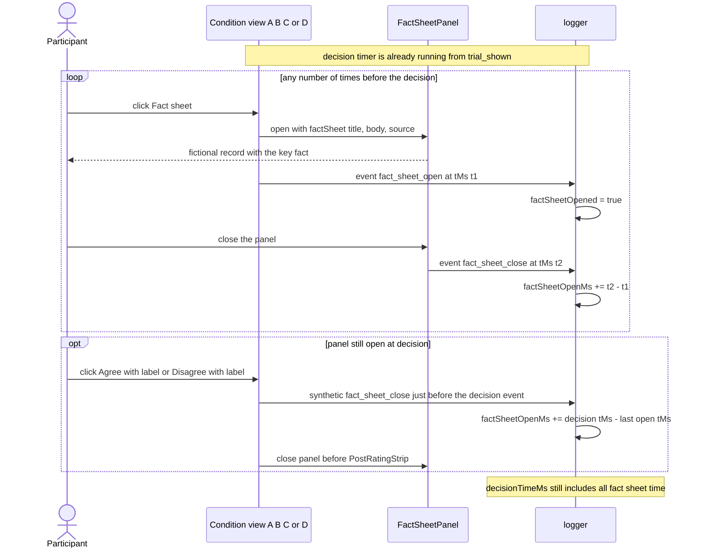

**Edge cases**
- **Timer keeps running.** `decisionTimeMs` includes time with the fact sheet open. `factSheetOpenMs` is a separate measure inside that window, so H6 can test whether opening the fact sheet predicts detection.
- **Never opened.** `factSheetOpened = false` and `factSheetOpenMs = 0`. That is valid data, not missing data.
- **Repeat opens.** Each open and close pair adds to `factSheetOpenMs`. The count of opens can be derived from the `fact_sheet_open` events.
- **Hidden time.** If the tab is hidden while the panel is open, the hidden interval is subtracted from `factSheetOpenMs` as well as from `decisionTimeMs`, so neither counts time away from the page.
- **No leaks.** The fact sheet text comes from `post.factSheet` and is the same in every condition. It never repeats or contradicts the label wording, so it can't act as a hidden explanation.
- **Closed between trials.** The panel always starts closed on a new trial, and its open state never carries over.

---

## 7. Wrong-label handling

From the participant's side a wrong label can't be told apart from a correct one. The layout, timing, wording style and controls are identical, and the explanation in B, C and D argues for the AI's label. A **false alarm** labels a TRUE post "Likely misleading", and a **miss** labels a FALSE post "Likely accurate". To guarantee this, the post bank lives only on the server, and `labelEngine.buildPresentation` builds the payload from an explicit allow-list, so `groundTruth`, `isAiCorrect`, `errorType` and `difficulty` never reach the browser, a view or React props. Correctness joins the record only on the server, after the participant has decided, when `POST /api/sessions/:id/trials` saves the trial. There `detectedError` is derived as `!agreed` on wrong labels and `null` on correct ones, and the response to the browser carries no truth fields.

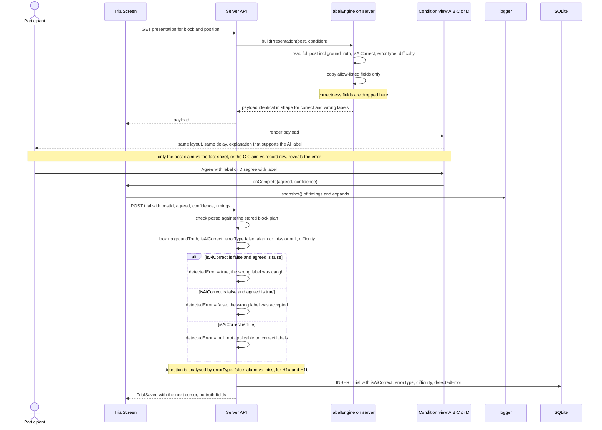

**Edge cases**
- **No leaks through rendering.** The payload types have no correctness fields at all. A unit test asserts that `JSON.stringify(payload)` never contains `groundTruth`, `isAiCorrect`, `errorType` or `difficulty`. DOM attributes, CSS classes and test ids must not encode correctness either. The client never imports `posts.json` or the truth functions, so the client bundle contains no ground truth; only server code reads it.
- **Claim vs record in C shows the true comparison.** On a wrong label the row still shows the post's real claim value and the real fact-sheet value with the honest ✓ or ✗, so a careful participant can spot the contradiction. The `detail` sentence still sounds plausible and supports the label. This is the C-shows-true-values principle, which the team still has to confirm.
- **B and D on wrong labels.** They cite a plausible but non-decisive factor (for example the topic or the wording) in the same confident tone, and never mention the key fact.
- **Same timing.** The fixed ~800 ms "AI is checking…" delay is the same for correct and wrong labels, and no animation differs between them.
- **Data checks.** `labelEngine.validatePost` checks at server start (via `loadPostBank`) and in the tests that `groundTruth` agrees with comparing `keyFact.claimValue` to `keyFact.recordValue`, that `errorType` is `false_alarm` exactly when the truth is TRUE and the label is misleading (and `miss` for FALSE with accurate), that `isAiCorrect` matches, and that each set has 2 correct accurate, 2 correct misleading, 1 false alarm and 1 miss. A mismatch stops the server from starting and fails `npm test`, so it is never something the participant sees.
- **Correct labels.** On correct labels `detectedError` is `null`. Detection analyses filter to `isAiCorrect == false` first.
- **Split by error type (H1a).** `errorType` and `difficulty` are stored on every trial record, so comparing how often misses and false alarms are caught (and the clear vs subtle split) needs no join back to the post bank.

---

## 8. Per-post confidence rating and the next trial

After every decision, the `PostRatingStrip` chip row slides in **on the same screen**: "How sure are you?" with chips 1–7 (1 = not at all sure, 7 = completely sure). The rating is **required**, and there is no Next button: tapping a chip (or pressing `1`–`7`) starts a 1 s "Undo" window and then submits. Its time never counts toward `decisionTimeMs`, because `respondedAt` was fixed by the Agree or Disagree click (`A` or `D` on the keyboard). The submit sends the decision, the confidence and the timings in one `POST`; the server saves the complete trial in one transaction, stamps `last_activity_at`, and returns the next cursor. While the participant was reading, `TrialScreen` already prefetched the next presentation, so the next post appears straight away and only the fixed ~800 ms "AI is checking…" delay separates them. After the sixth post the block survey opens. A progress bar shows "Post n of 24" and "Part x of 4".

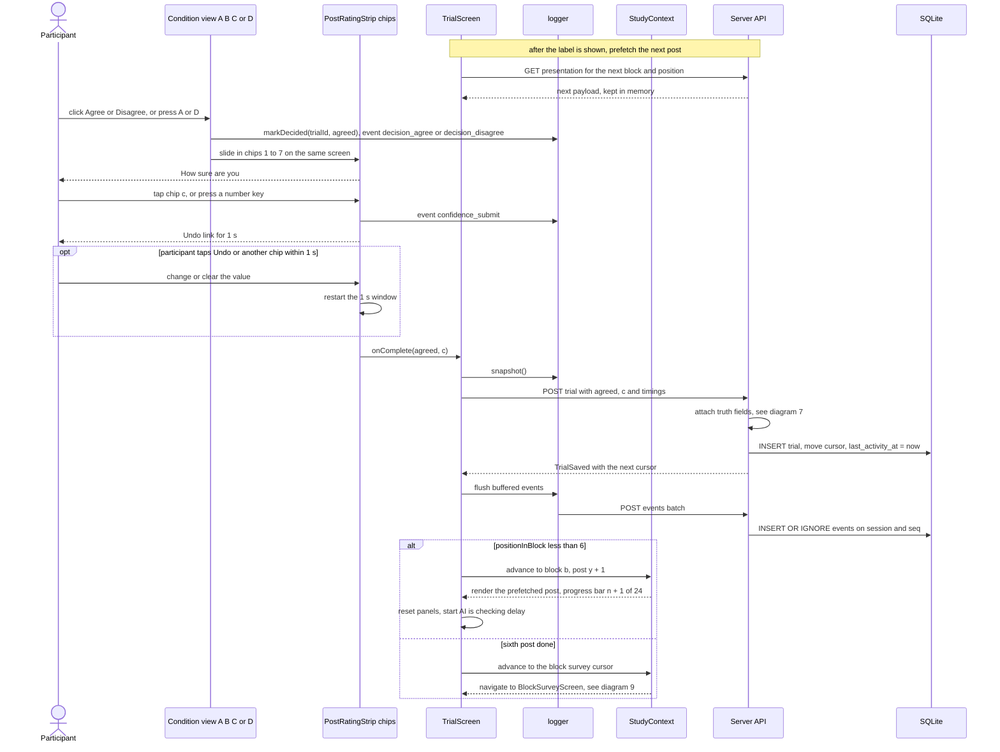

**Edge cases**
- **Required.** `confidence` is never null on a saved trial. There is no skip option, and nothing is submitted until a chip is chosen.
- **Undo.** During the 1 s window the participant can tap Undo or pick another chip; only the value at submit is stored in `confidence`. Every chip change is still logged as a `confidence_submit` event (events carry no value; the value lives on the trial).
- **Decision is final.** Once the chips appear, the Agree and Disagree buttons are locked. The decision can't be changed while rating confidence.
- **Keyboard.** `A`/`D` decide, `1`–`7` rate, `F` toggles the fact sheet, `W` toggles "Why?" in C, `Esc` closes an open panel. Keys are ignored during the ~800 ms delay and while a submit is in flight, so a held key can't answer the next post.
- **Prefetch.** The prefetched payload is the same allow-listed presentation as a normal fetch, so it carries no truth. If the prefetch failed, the post is fetched normally after the submit.
- **Save before advance.** The next post appears only after the server confirms the trial was saved. If the save fails, the screen shows Retry and asks the participant to contact the study email if it keeps failing; nothing advances.
- **Reload before submit.** Nothing is saved until the chip submits, so a reload brings the same post back with a fresh delay and timer, marked `resumed = true` (diagram 10).

---

## 9. Block survey and advancing to the next block

After the sixth post of a block, `StudyContext` sends the participant to `BlockSurveyScreen` for the condition they just used. The items come from `surveyItems.json` in a fixed order: the 12 Jian et al. (2000) trust items with "the system" worded as "the AI labels", then the 2 fairness items, all on 7-point scales, then `tension` (1–7), then the NASA-TLX frustration slider (`frustrationTlx`, 0–100 in steps of 5, starting at 50). The slider counts as answered only once it has been moved (`frustrationTlxTouched = true`). On submit, the browser sends the raw answers to the server, which scores them, computes `nWrongDetected` (the number of the block's 2 wrong labels the participant disagreed with, from the saved trials) and stores the survey in SQLite; then the next block starts or, after block 4, the exit survey opens.

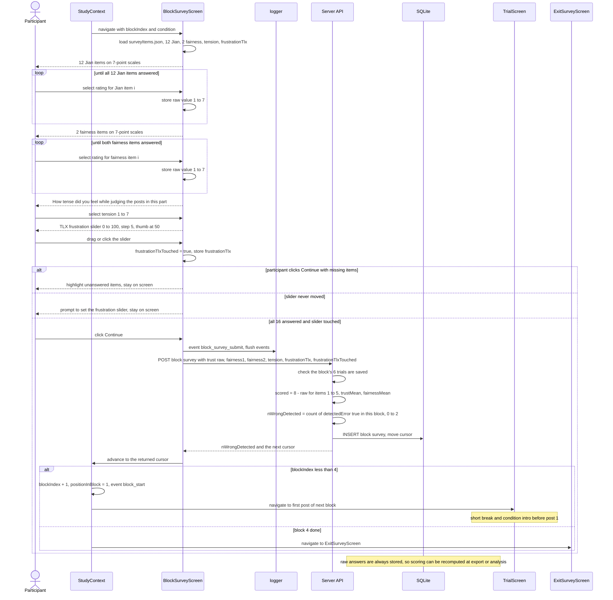

**Edge cases**
- **Which condition was rated.** Each survey record stores `condition` and `blockIndex` explicitly, so the analysis never has to infer from the order which condition a score belongs to.
- **Item order.** The order is always 12 Jian items, 2 fairness items, tension, then the slider. The Jian items keep their published order, which keeps the reverse-scoring indices stable. Asking the affect items last keeps them from priming the trust ratings.
- **No defaults on Likert items.** No 7-point item has a pre-selected value. That avoids midpoint bias and keeps the "every item answered" check meaningful.
- **Slider validation.** The thumb starts at 50, but `frustrationTlx` stays `null` until the first input event, which also sets `frustrationTlxTouched = true`. A participant who really means 50 has to move the thumb away and back. `frustrationTlxTouched` is saved so the analysis can confirm every value was set on purpose.
- **`nWrongDetected`.** It is computed from the block's stored trial records, not from anything on screen, so it is also recomputable from `trials.csv`. It is the H3 predictor for tension and frustration.
- **Double submit.** Continue is disabled after the first click. A second submission for the same block hits the primary key `(session_id, block_index)` and the server answers 409.
- **Back navigation.** The browser Back button doesn't return to the block's posts. The router guard redirects to the step given by the server cursor.
- **Exit survey.** The exit survey (`ageRange`, `gender`, `education`, `socialMediaUse`, `labelExposure`, `preferredCondition`, `comment`) uses the same validation and save pattern. Only `gender` and `comment` are optional. Submitting it logs `exit_survey_submit`; the server checks that all 4 block surveys exist, saves it, sets `status = "completed"` and `completedAt`, and the client then clears its storage and shows `DebriefScreen` (diagram 9.1).

### 9.1 Exit survey, clearing the browser, and debrief

Once the exit survey is saved on the server, the participant's answers are all in SQLite, so the browser no longer needs anything. The client flushes the last events, then removes every `xai-study:` key from `localStorage` and `sessionStorage`, except the researcher's `xai-study:adminToken`, and only then shows the debrief. The debrief renders from data the client already holds in memory (the pid and the wrong-label facts). **Next participant** on the debrief returns to the Welcome screen, so the next person on a shared lab device starts fresh. There is no browser "participated" flag; once-only is enforced only by the server's hashed-code check (diagram 1).

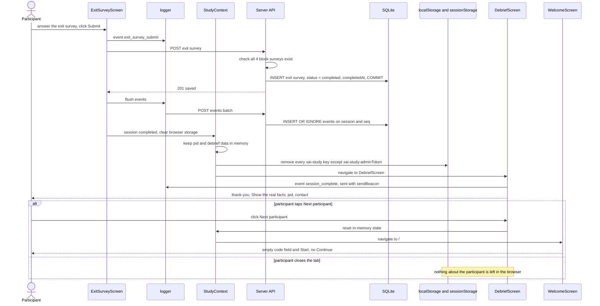

**Edge cases**
- **Order matters.** Storage is cleared only after the server has confirmed the exit survey (201) and the event flush has been sent. If the save fails, nothing is cleared: the screen shows Retry and the session can still resume.
- **`session_complete` after clearing.** The debrief's own event is sent with the session id held in memory, not read from storage. If it is lost, the session is still `completed` on the server, because `status` and `completedAt` are set by the exit-survey save.
- **What is kept.** Only `xai-study:adminToken`, the researcher's own admin login, survives, so a lab laptop that is also used for `/admin` doesn't need to log in again. Keys outside the `xai-study:` prefix are not touched.
- **Reload on the debrief.** Because storage is empty, a reload of the debrief lands on the Welcome screen. That is the intended state for the next participant; the debrief text is also available by email (`study-protocol.md` §13.3).
- **Returning on the same device.** The person sees a fresh Welcome screen. If they type the same code, the server answers 409 and they see "You've already taken part. Thank you!"; a different code is not caught (`system-design.md` R-15).

---

## 10. Refresh and crash recovery

Because the server saves every trial, every survey, every event batch and every `cursor` change as it arrives, a reload loses at most the step that was on screen. The only thing the browser keeps is `xai-study:activeSessionId`. On startup the app reads that id and calls `POST /api/sessions/:id/resume`, which adds 1 to `resumeCount` and returns the session with its stored `cursor` (`blockIndex`, `positionInBlock`, `phase`). If the cursor is on an unanswered trial, the half-seen attempt is thrown away, the post is shown again with a fresh delay and timer, and the new record is flagged `resumed = true` so the analysis can treat its timing with care. Because the data is on the server, a session can also be resumed from another browser or device by typing the same participation code on the Welcome screen (diagram 1, 200 response).

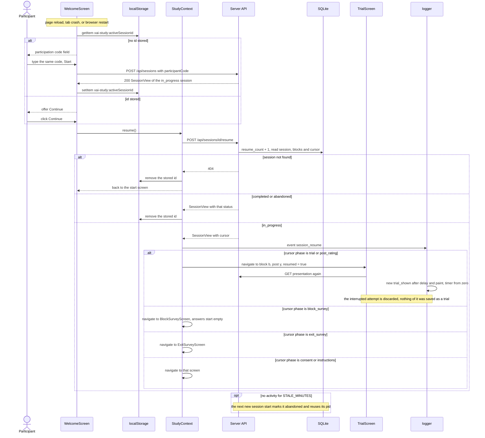

**Edge cases**
- **Working out the next step.** The resume point is the stored `cursor`, which the server moves on every saved trial and survey and on every `PUT /cursor`. The server also checks submissions against it (a trial for the wrong post is refused with 400, a duplicate with 409), so the browser cannot skip or repeat a step.
- **What `resumed` means.** `resumed = true` is set only on the trial that was interrupted. Later trials have `resumed = false`. The session also keeps a `resumeCount` for transparency.
- **Interrupted confidence step.** The decision and confidence are saved together when Next is clicked. If the crash happens after the decision but before Next, the trial is shown again from the start and marked `resumed = true`.
- **Events of the interrupted attempt.** Events flushed before the crash (every 5 s, and on `pagehide` via `sendBeacon`) stay in the `events` table, so the analysis can see the abandoned attempt. Duplicates are ignored on `(session_id, seq)`.
- **Fact sheet and C panel.** Both start closed on the resumed trial, and `factSheetOpenMs` and `factorsExpanded` restart from zero with the new attempt.
- **Abandoned sessions are kept.** They're marked `status = "abandoned"` from `/admin` or automatically after `STALE_MINUTES` without activity, still exported, and excluded by default in the analysis. They're never deleted automatically. The next new participant gets the freed pid with a new `sessionId`. The abandoned code itself cannot start again (409). Only a withdrawal (**Delete** on `/admin`) removes a session, with all its rows.
- **Server restart.** Stopping and restarting the server loses nothing that was saved: SQLite commits each write, and the session resumes from the database.
- **Two tabs.** Only one tab should run the study. If two tabs submit the same trial, the second gets a 409, so the data stays consistent.

---

## 11. Admin export

The researcher opens `/admin`, which the participant flow never links to. Admin routes need `ADMIN_TOKEN` when it is set and otherwise answer only from loopback (403 from anywhere else). `AdminScreen` asks the server for every session (`GET /api/admin/sessions`), shows a table with pid, status and trial count, and offers five downloads with the columns defined in `data-model.md` §8: `trials.csv` (one row per trial), `surveys.csv` (one row per pid and block), `events.csv` (one row per interaction event), `exit.csv` (one row per participant) and `sessions.json` (everything, including plans and raw events). Each file is built on the server from the SQLite tables. When `ADMIN_TOKEN` is set, every admin request carries the token.

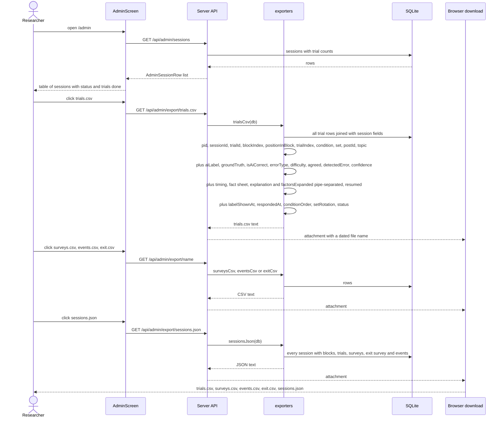

**Edge cases**
- **Backups.** The exports are one backup. The other is the SQLite file itself: stop the server and copy `app/data/study.db` (see `app/README.md`). Exporting never changes the database.
- **Deleting data.** Only a withdrawal deletes data: **Delete (withdrawal)** on `/admin` asks for a typed confirmation, then `DELETE /api/admin/sessions/:id` removes the session and, by cascade, all its rows.
- **CSV safety.** Values are quoted following RFC 4180 and inner quotes are doubled. Free-text fields such as the exit comment are escaped, and newlines inside them are kept within quotes. Booleans are written `TRUE`/`FALSE` and nulls as empty fields. `factorsExpanded` (and any other list) is written as one pipe-separated cell of keys in order of first expansion, e.g. `claimVsRecord|source`, and is empty when the list is empty.
- **Where scoring happens.** The server computes `trust_NN_s`, `trustMean` and `fairnessMean` when the block survey is saved and stores both raw and scored answers, so the analysis can recompute or rescore from the raw columns.
- **Which sessions are exported.** In-progress and abandoned sessions are included in every file with a `status` column on `trials.csv`, so the researcher decides on exclusions during analysis.
- **No third parties.** Exports are plain downloads from the study server. Nothing is sent to any other service.

---

## 12. Admin KPI polling

`/admin` is a read-only monitoring dashboard. On load and then every 15 s it fetches the KPIs and the session list in parallel. `GET /api/admin/kpis` is computed by `server/kpi.ts` from SQL over the session, trial and survey tables: session counts by status, completion rate, median and p90 duration, progress toward N = 32 (minimum 16) and per cycle, per-condition agreement, detection, fact-sheet use, confidence, decision time, trust, fairness, tension and frustration, detection per error type, completed sessions per condition order, and completions per day. Only completed sessions feed the condition and error KPIs, and pilot pids ≥ 900 are excluded everywhere. The charts are small inline SVG bars drawn by `KpiCharts`; there is no chart library.

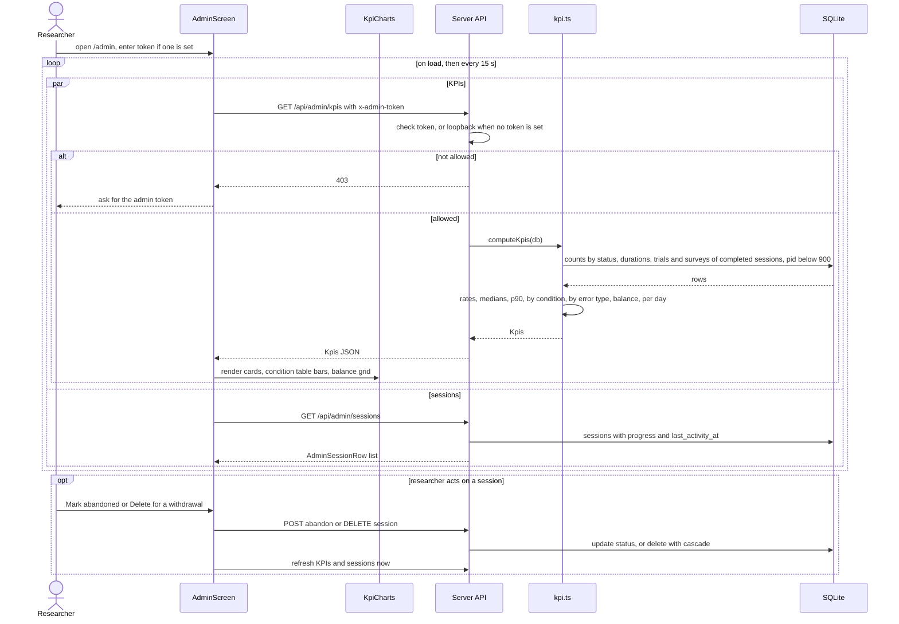

**Edge cases**
- **Read-only.** Polling never writes. There is no start-session form on `/admin`; participants start themselves (diagram 1).
- **Live sessions.** `in_progress` sessions appear in the counts and the sessions table (with last activity), but not in the condition or error KPIs, so partial data never moves the detection rates.
- **Empty data.** Rates and means are `null` when there is nothing to compute, and the dashboard shows a dash instead of 0.
- **Load.** Each poll is a handful of aggregate queries over at most a few thousand rows, which SQLite answers in milliseconds, so a 15 s refresh has no effect on participants' writes.
- **Hidden tab.** The dashboard may pause polling while its tab is hidden and refresh immediately when it becomes visible again.

---

## Related docs

- [architecture.md](architecture.md): module boundaries and the overall structure of the app
- [system-design.md](system-design.md): requirements, screens, routing, timing, logging and counterbalancing
- [sequence-diagrams.md](sequence-diagrams.md): this document
- [data-model.md](data-model.md): post bank, session, trial, survey and export schemas (the authority on field names)
- [ai-design.md](ai-design.md): the Wizard-of-Oz `labelEngine`, explanation design and the wrong-label strategy
- [research-positioning.md](research-positioning.md): why the domain moved to AI accuracy labels and how the study relates to prior work
- [implementation-plan.md](implementation-plan.md): build order, owners and milestones for the app
- [study-protocol.md](study-protocol.md): how a self-guided session runs, from the Welcome screen to the debrief
- [stimuli.md](stimuli.md): final participant-facing wording for all 24 posts
- [wireframes.md](wireframes.md): screen layouts for the trial, survey and admin screens
- [_shared-decisions.md](_shared-decisions.md): the binding source of truth for every doc
