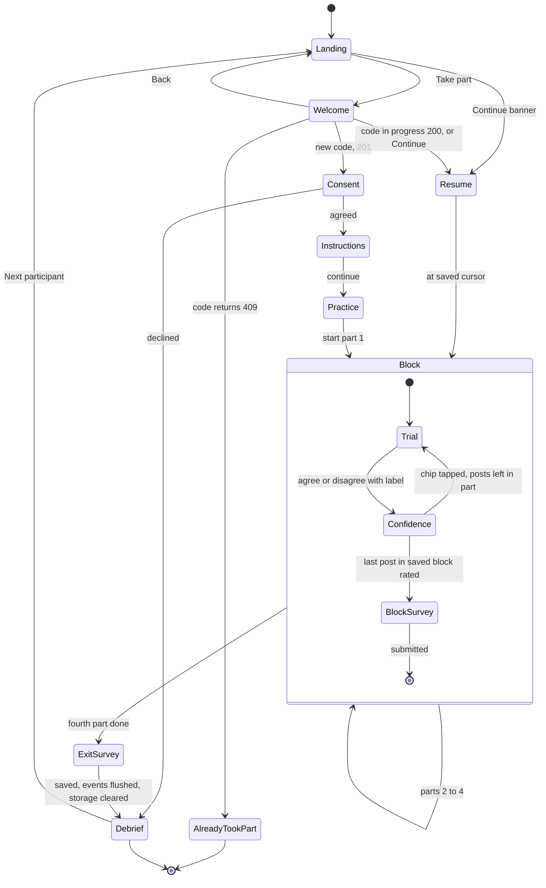
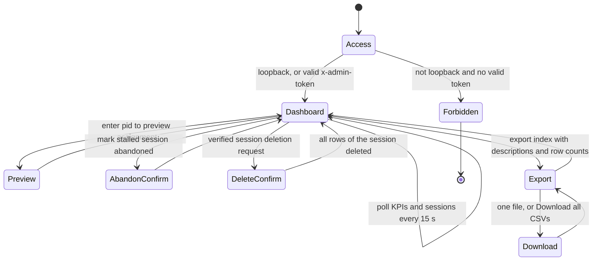

# System Design: Explanation Study App (v3: AI accuracy labels on social media posts)

**Full questionnaire restored (2026-10-19):** new sessions use `calibrated-full-v1` with `questionnaireVersion=full-v1`. After EACH of four parts, collect the original 12 Jian-based trust items, two fairness items, tension and frustration: 16 ratings per part, 64 total. Keep eight posts (two per part), appropriate reliance as primary, the unchanged paper title and the interface-package limitation. Trust is now measured separately for each explanation condition. Preserve previously started `calibrated-brief-v1` sessions and their brief surveys on resume; do not mix or relabel their data. Dashboard/KPI exports default to the restored full cohort. Earlier brief-default descriptions below document the superseded revision and apply only to saved brief sessions. Schema 4 preserves all earlier responses. Pilot the restored questionnaire burden; no completion-time or power guarantee is established.

**Study title: Do People Trust AI More When It Explains Itself? A Comparative Study of Explanation**

**Current protocol (2026-10-18):** new sessions use `protocolVersion=calibrated-brief-v1`: eight distinct analysed posts, two per part, plus practice, sampled from the unchanged 24-post bank. Each part contains one correct and one wrong label. `questionnaireVersion=brief-v1` requires custom trust, tension and frustration: three ratings per part, 12 total. Existing eight-post and 24-post sessions retain their saved assignments and full questionnaires under `legacy-full-v1`; migration/default handling treats absent protocol metadata as legacy. Trial count does not determine protocol. All transitions follow saved block lengths. This is a specification; implementation verification is separate.

HCI experiment conducted as part of graduate study at Florida Polytechnic University. Approval status is unknown; attribution does not imply authorization or endorsement. Do not add unfinished placeholders, invented contacts or approval claims. See [study defense](parts-and-study-defense.md), [protocol](study-protocol.md), [methods and limitations](methods-and-limitations.md) and [pilot and analysis plan](pilot-and-analysis-plan.md).

This document turns the study design into a buildable specification for the app, using the v3 scenario. Participants read made-up social media posts from the fictional town of Riverton. Each post carries a scripted AI label, "Likely accurate" or "Likely misleading". The participant checks the label against an on-demand fact sheet and clicks **Agree with label** or **Disagree with label**. This doc covers:

- the requirements and their relationship to primary reliance and secondary outcomes
- the participant and admin flows, and a spec for each screen
- ASCII wireframes for conditions A–D
- the exact counterbalancing for one 16-participant cycle
- timing and logging, and which logged fields feed which analysis
- the session-length budget and the optional measures
- the historical split of work across the six team members
- risks, the test and pilot plan, and later extensions

Where this doc and `_shared-decisions.md` disagree, `_shared-decisions.md` wins. Module and field names follow it, and `data-model.md` is the authority on field names and types. `stimuli.md` is the authority on all participant-facing wording, so the post text in the wireframes here is illustrative. The previous v2.1 design is archived at `archive/v2.1-agent-permission/system-design.md`.

The app is self-guided: eligible participants start without admin approval, using a participation code stored only as a salted HMAC hash. Admin monitors and exports; SQLite on the server persists responses. [The app contract](../app/CONTRACT.md) and shared TypeScript types define API and field shapes. The submitted loan proposal remains historical. The current study makes behavioral appropriate reliance primary and custom subjective trust secondary; it does not establish a validated short trust scale or a measured completion time.

---

## 1. Requirements

### 1.1 Functional requirements

| ID | Requirement |
|---|---|
| FR-0 | Public landing at `/`: exact study title, neutral introduction, Take part → `/start`, three steps describing eight posts, eligibility (18+, English), truthful pseudonymous data handling, voluntary stopping, FAQ and Continue for an active session. Do not reveal scripted/planted errors, promise duration or invent contacts. |
| FR-1 | The participant starts the session themselves on the Welcome screen (`/start`, reached from **Take part**; a **← Back** link returns to `/`) by typing a participation code (3–120 characters, e.g. a university email or student ID) and pressing Start or Enter. No researcher action is needed. The server assigns the `pid` (lowest free slot, abandoned slots reused). |
| FR-1a | **Once-only.** The server stores only `HMAC-SHA256(salt, normalisedCode)`. A code with a completed or abandoned session is refused (409 `already_participated`, shown as "You've already taken part. Thank you!"); a code with a session in progress resumes it. The browser keeps no "participated" flag: once the exit survey is saved, it clears all study data (every `xai-study:` key in `localStorage` and `sessionStorage` except `xai-study:adminToken`), and the debrief offers **Next participant**, so the next person on a shared device starts fresh. |
| FR-1b | **Continue.** If the browser holds an active session id, the landing page banner and the Welcome screen both offer Continue. Typing the same code on another device also resumes. |
| FR-2 | The participant must give informed consent before seeing any post. If they decline, the app goes straight to `DebriefScreen` and records no trial data. |
| FR-3 | `InstructionsScreen` explains the task ("an AI has labeled each post; check whether you agree"), the two labels, the fact sheet, and the two buttons. It ends with one practice post that is not in the bank. |
| FR-4 | The server loads the retained 24-post bank from `shared/data/posts.json`; questionnaire wording loads from `shared/data/surveyItems.json`. Participant views receive only condition-appropriate allow-listed presentations. The client must not import the full truth bank. |
| FR-5 | Condition A (`NoExplanationView`) shows the AI label only. |
| FR-6 | Condition B (`StaticExplanationView`) shows the label plus `staticExplanation`, one fixed sentence of 8–14 words. |
| FR-7 | Condition C (`InteractiveExplanationView`) shows the label plus a "Why?" button. It opens 3 rows: **Source**, **Claim vs record** and **Wording**. Each row shows its `displayValue` and ✓/✗, and expands to its `detail` sentence. The Claim vs record row always shows the TRUE comparison (`keyFact.claimValue` vs `keyFact.recordValue`). |
| FR-8 | Condition D (`CounterfactualView`) shows the label plus `counterfactualExplanation`, one "would be … if …" sentence of 10–16 words. |
| FR-9 | All four views render the shared `PostCard`, `LabelPanel` and "Fact sheet ▸" button. Only the explanation area differs. `conditionRegistry.ts` maps A–D to the views. |
| FR-10 | `FactSheetPanel` opens from "Fact sheet ▸" on every trial in every condition. It shows the fact sheet's title, body (with the key fact) and source. It is identical across conditions and never mentions the label. |
| FR-11 | Agree/Disagree records whether the participant accepts the label. Confidence and the common one-second Undo window follow before saving; failed saves remain retryable. |
| FR-12 | After the choice, `PostRatingStrip` slides in on the same screen with confidence chips 1–7 ("How sure are you?"), which are required. Tapping a chip saves the trial and moves to the next post after a 1 s Undo window; there is no separate Next button. The next presentation is prefetched. |
| FR-12a | **Keyboard.** `A` agree, `D` disagree, `1`–`7` confidence, `F` fact sheet, `W` "Why?" (C only), `Esc` closes a panel. A hint line lists them. On the block survey, number keys answer the focused row and move to the next. |
| FR-12b | Progress shows overall post count and part/post-in-part from saved block lengths: eight posts for new plans, 24 for older full plans. |
| FR-13 | `counterbalance.ts` assigns condition order, set-to-condition mapping and within-block post order, deterministically from `pid` (§4). |
| FR-14 | After the last trial in each saved block, select the questionnaire by stored protocol. New `calibrated-brief-v1`: three required ratings (custom trust 1–7, tension 1–7, frustration 0–100/step 5 and touched); 12 total. Legacy `legacy-full-v1`: retain full 12 Jian + 2 fairness + tension + frustration; 64 total, including saved eight-post sessions. |
| FR-15 | After block 4, `ExitSurveyScreen` asks demographics, social media use, how often they've seen platform labels, the preferred part, and an open comment. |
| FR-16 | The client buffers interaction/timing events; server routes and repository derive truth and scores. Only server code reads truth helpers and the full post bank. |
| FR-17 | The server writes each trial, event batch and survey to SQLite the moment it is submitted, and stamps `last_activity_at` on every participant write. |
| FR-18 | `/admin` lists sessions and exports all of them as JSON and as CSV (one row per trial, plus block-survey, event and exit-survey CSVs). It cannot start sessions. Admin routes require `ADMIN_TOKEN` when set, and answer only from loopback when it is not. |
| FR-18c | Seven allow-listed analysis exports retain fixed existing column order and append version/outcome fields as defined by the contract. Include protocol, questionnaire and planned-trial/study-variant metadata. Brief full-trust/fairness scores stay null, not zero or imputed. Export index includes descriptions and row counts. Exclude participation hashes and salt. |
| FR-18a | Admin polls approximately every 15 seconds. Show explicit protocol/trial-count cohort, appropriate reliance and its correct-acceptance/wrong-rejection components, overreliance, underreliance, custom brief trust and affect, confidence/timing/verification, balance and session status. Outcome summaries use completed non-pilot sessions within cohort; legacy full trust/fairness remain separate. |
| FR-18b | **Stale sessions.** An in-progress session with no activity for `STALE_MINUTES` (default 120) is marked abandoned when the next session starts, and its pid is reused. |
| FR-19 | If the page is reloaded mid-session, the app resumes at the first trial or survey with no saved response. The resumed trial gets `resumed = true`. |
| FR-20 | Debrief reveals that labels/explanations were scripted, corrects all assigned wrong labels and identifies fictional content. Use four wrong of eight for short plans and eight wrong of 24 for legacy full plans. Keep session/debrief state in memory after successful browser cleanup; Next participant returns to `/`. |
| FR-21 | Server derives label correctness and error type and `detectedError` (!agreed on wrong labels; null on correct). Derive reliance summaries from all trials. `nWrongDetected` is 0–1 in two-post blocks, 0–2 in six-post legacy blocks. |
| FR-22 | Optional consequence/anxiety manipulations remain off and are not part of the calibrated brief protocol. No new arms or measures are authorized by this specification. |

### 1.2 Non-functional requirements

| ID | Requirement |
|---|---|
| NFR-1 | React 18 + TypeScript + Vite SPA served by one Express 5 process with a SQLite file (`better-sqlite3`). It runs with `npm install && npm run dev`, or `npm run build && npm start`. |
| NFR-2 | It runs in current Chrome, Firefox, Edge and Safari, on desktop (1280 px) and on phones (from 360 px wide). On narrow screens the fact sheet is a bottom sheet and the survey matrix becomes one chip row per item; touch targets are at least 44 px; `prefers-reduced-motion` is respected. |
| NFR-3 | Times are measured with `performance.now()` to the millisecond. UI work between the label appearing and the click adds no more than one frame (about 16 ms) of bias. |
| NFR-4 | Assignment is reproducible: the same `pid` always gives the same order, sets and post sequence (mulberry32 seeded by `pid`). |
| NFR-5 | At most the trial in progress can be lost (FR-17). |
| NFR-6 | Visual parity: in all four conditions the post card, label, "Fact sheet ▸" button and the Agree/Disagree buttons have the same layout, size and position. The explanation area has a fixed minimum height. |
| NFR-7 | No correctness leak. The payload from `buildPresentation` is allow-listed and carries no `groundTruth`, `isAiCorrect`, `errorType` or `difficulty`. No AI confidence score is shown. Every label appears after the same fixed ~800 ms "AI is checking…" delay. B, C-detail and D text use the same confident tone on right and wrong labels. |
| NFR-8 | Data is pseudonymous: session UUID and pid identify responses, with the participation code kept only as a salted HMAC hash and never logged/exported. Fictional stimuli and confidential data handling do not establish absolute anonymity. |
| NFR-9 | Measure burden and completion time in the separate pilot; no validated duration is established. Affect remains once per part. |
| NFR-10 | Accessibility: everything works from the keyboard. Color is never the only cue: labels carry ✓/⚠ plus text, and factor rows carry ✓/✗ plus text. Contrast meets WCAG AA. |

### 1.3 Traceability

Primary outcome: **appropriate/calibrated reliance**, `(correct & agree + wrong & disagree) / all trials`. Decompose into correct acceptance / correct trials and wrong rejection / wrong trials; report overreliance (wrong agreement / wrong trials) and underreliance (correct disagreement / correct trials). Every zero-denominator rate is null. This behavioral measure does not prove comprehension or a latent calibrated-trust construct.

FR-5–FR-13 preserve categorical A–D interface packages, common verification access and assignment. C adds true factual comparison through Why?/Claim vs record, so differences involving C cannot isolate interactivity. A static equal-content comparison is a proposed follow-up only. FR-14 supports secondary custom subjective trust and affect in the new protocol; Jian/fairness apply only to legacy cohorts. FR-16–FR-21 support reproducibility, event integrity and outcome decomposition. The [shared decisions](_shared-decisions.md) and [analysis plan](pilot-and-analysis-plan.md) govern hypotheses and analysis; this document does not prescribe competing models or claim power.

---

## 2. Flows

### 2.1 Participant flow



- `Confidence` is the `PostRatingStrip` chip row inside `TrialScreen`. It is a second step on the same screen, and the route doesn't change. Tapping a chip (or pressing `1`–`7`) submits after a 1 s Undo window.
- `Landing` is `/`, the public page the recruitment link opens (FR-0). It shows the study, who can take part and privacy, and a Continue banner when an active session id is stored. `Welcome` is `/start`. It shows a Back link, the participation-code field, Continue when an active session id is stored, or the thank-you message when the server answers 409. Nothing in the browser marks a finished participant: storage is cleared after the exit survey is saved.
- The route is `/trial/:block/:pos`, and `StudyContext` holds the indices, so a reload lands in the right place (FR-19).
- Stored records use `blockIndex` 1–4 and `positionInBlock` 1–6. The displayed trial id is `${pid}-${blockIndex}-${positionInBlock}`; database identity also includes `sessionId`, because abandoned pids can be reused.

### 2.2 Admin (researcher) flow



- `/admin` isn't linked from any participant screen. The researcher opens it by URL, on the server machine (loopback) or with the `ADMIN_TOKEN` entered in the token field.
- The dashboard is **data and KPIs only**: it cannot start sessions. Participants start themselves (§2.1).
- **Preview** (`GET /api/admin/assignments/:pid`) shows the assignment for any pid, including pilot pids 901+, without creating anything. Use it to check §4.3.
- A pid whose session was abandoned (by the researcher or after `STALE_MINUTES` idle) is given to the next new participant, with a new `sessionId`. The abandoned session's rows are kept with status `abandoned`.

---

## 3. Screen specs

All screens are in `src/study/`. "Logged" means an event goes to `logger.ts` as `{type, ts: performance.now(), wallClock: ISO string, payload}`.

### 3.1 Screen table

| Screen | Shows | Inputs | Logged / stored |
|---|---|---|---|
| `LandingScreen` (`/`) | Hero (study name, one-line pitch, **Take part**, "How it works ↓"), 3 steps, who can take part, privacy, FAQ (collapsed), footer; a "You have a session in progress" banner with Continue when an active session id is stored. Wording per the recruitment rules (`study-protocol.md` §6) | Take part, Continue, FAQ toggles | Nothing (no session yet); Continue calls `POST /api/sessions/:id/resume` |
| `WelcomeScreen` (`/start`) | ← Back link to `/`, study title, 2-line description, duration only if established by pilot, participation-code field with a one-line privacy note ("Only used to make sure each person takes part once; stored scrambled."), Start; Continue when an active session is stored; "You've already taken part. Thank you!" when the server returns 409 (never from browser state) | Code (3–120 characters), Start / Enter, Continue | `POST /api/sessions` → 201 new, 200 resumed, 409 already participated |
| `AdminScreen` | KPI cards, per-condition table with inline SVG bars, balance grid, sessions table (pid, status, order, progress x/saved total, started, last activity), Abandon / Delete, export panel (7 files, each with a description, row count and download link, plus Download all CSVs), token field, pid preview. No start form. | Token, pid (preview), buttons | Nothing participant-side; reads `/api/admin/kpis` and `/api/admin/sessions` every 15 s, and `/api/admin/export` for the export index |
| `ConsentScreen` | Voluntary adult consent, short summary/full details, fictional task, data handling and stopping; no invented contacts/approval or promised duration | Consent/decline | Consent timestamp |
| `InstructionsScreen` | The scenario, a labeled tour of a `PostCard` and `LabelPanel`, the two labels (✓ Likely accurate, ⚠ Likely misleading), what "Fact sheet ▸" does, and the note "The AI can make mistakes" (the same for every pid). Then 1 practice post (below). | "Start" (enabled after the practice post is answered) | `instructions_viewed {durationMs}`, `practice_done {agreed, factSheetOpened}` (not a trial record) |
| `TrialScreen` | Progress bar "Post n of saved total" + "Part x of 4", keyboard hint line, `PostCard`, `LabelPanel`, the condition's explanation area, "Fact sheet ▸", "Agree with label" / "Disagree with label", then `PostRatingStrip` | Agree/Disagree (`A`/`D`); then a confidence chip 1–7 (`1`–`7`), which submits after a 1 s Undo window. `F` fact sheet; in C: "Why?" (`W`) and the row toggles | `trial_shown`, `factsheet_opened`/`factsheet_closed`, `explanation_opened`/`explanation_closed`, `factor_expanded`/`factor_collapsed {key}`, `decision {agreed}`, `confidence {value}`, `visibility {state}`, `trial_saved` |
| `BlockSurveyScreen` | Part N, protocol-specific brief or full questionnaire (§3.3), answer counter | Three required brief answers or 16 legacy answers; slider touched | Versioned survey submission and server-derived scores |
| `ExitSurveyScreen` | One screen; chips or radios for questions with ≤ 6 options. Age range, gender (optional), social media use (1–7), how often they've seen platform labels (1–7), preferred part (1–4, with a one-line reminder of each part's look), comment | Preferred part and social media use are required | `exit_survey_submitted {…}` |
| `DebriefScreen` | Scripted-label disclosure, actual assigned corrections, fiction and saved-data explanation; no unverified support/deletion promises | Next participant | Completion/early-exit events as applicable |

Participants never see condition letters or names. They see "Part 1–4", and the export maps each part to its condition.

**Practice post.** One neutral practice post outside the analysed bank, with a correct "Likely accurate" label and the first part's assigned condition. The final text is in `stimuli.md`; an example is "Riverton Library now opens at 9 am on Saturdays". Fact-sheet access is explained neutrally and remains optional; no forced verification or correctness feedback is introduced. No feedback on correctness is given.

### 3.2 `TrialScreen` and its parts

**Layout.** A progress bar runs across the top. On wide screens: on the left `PostCard`, with "Fact sheet ▸" under it; on the right `LabelPanel`, the explanation area (fixed minimum height, scrolls inside itself), and the two buttons. `PostRatingStrip` slides in under the buttons after a decision. On phones (< 720 px) everything stacks in one column, and the fact sheet opens as a bottom sheet. A hint line lists the keyboard shortcuts.

**Sequence on each trial:**
1. The trial mounts. `PostCard` shows at once. `LabelPanel` shows "AI is checking…" for a fixed ~800 ms. Both buttons and the explanation area stay disabled during the delay.
2. The label is revealed. `shownAt` is set (§5.1). In C, the "Why?" panel starts collapsed on every trial.
3. The participant may open "Fact sheet ▸" (any condition) and, in C, "Why?" and its rows.
4. They click Agree or Disagree. Both buttons lock, `FactSheetPanel` closes, and the explanation area stays visible but can no longer be toggled.
5. `PostRatingStrip` slides in on the same screen: "How sure are you?" chips 1 = not at all sure … 7 = completely sure. The rating is required.
6. Tapping a chip (or pressing `1`–`7`) shows a 1 s "Undo" link, then saves the trial (§5.5) and advances to the prefetched next post. There is no Next button.

| Component | Contents | Notes |
|---|---|---|
| `PostCard` | Avatar initial, `author.displayName`, `@author.handle`, verified badge if `author.verified`, `postedAgo`, `text`, `likes`, `reposts` (display only, not clickable) | Identical across conditions. The verified badge and engagement counts are content, not cues to correctness (see risk R-5). |
| `LabelPanel` | "AI label:" then "✓ Likely accurate" or "⚠ Likely misleading" | Same size and place in every condition. Never shows a confidence score. |
| Explanation area | A: empty. B: `staticExplanation`. C: "Why? ▸" opens `factors[]` rows (Source, Claim vs record, Wording), each with `label`, `displayValue`, ✓/✗ from `passes`, and a toggle to its `detail`. D: `counterfactualExplanation`. | Fixed minimum height, so the buttons never move (NFR-6). |
| "Fact sheet ▸" | Toggles `FactSheetPanel` | Same place and look in every condition. |
| `FactSheetPanel` | A side panel over the post column on wide screens, a bottom sheet on phones: `factSheet.title`, `factSheet.body` (contains the key fact), `factSheet.source` (e.g. "Riverton Public Works (fictional)"), and "Close ◂" | Overlay, so opening it moves nothing. Never mentions the label or the AI. Highlights nothing. Closes on decision. |
| `PostRatingStrip` | Confidence chips 1–7 and a 1 s Undo link | Required. Keyboard: `1`–`7`. Chips are ≥ 44 px. |

### 3.3 `BlockSurveyScreen`

Questionnaire selection uses the saved session protocol, including on resume, and never the number of trials or the current application default.

| Protocol | Questionnaire | Required ratings per part | Scoring/storage |
|---|---|---|---|
| `calibrated-brief-v1` | `brief-v1` | Custom `briefTrust` 1–7; tension 1–7; frustration 0–100, step 5 | Store custom trust separately; `trustResponses=[]`; `trustMean`, `fairness1`, `fairness2`, `fairnessMean` NULL |
| `legacy-full-v1` (including absent legacy metadata) | Full questionnaire | 12 Jian items, 2 fairness items, tension and frustration | Preserve raw trust responses; reverse items 1–5 as `8-raw`, keep items 6–12, and retain server-derived full trust/fairness means |

The custom brief trust item is not validated and is not a Jian short form. Fairness is not collected in brief sessions. Never impute a full scale from the brief response or combine brief/full means as the same measure. Across four parts the counts are **12 brief ratings versus 64 legacy ratings**, excluding confidence, practice and exit answers.

Continue enables only after the session-specific required answers are complete. The frustration slider starts at 50 and requires interaction (`frustrationTlxTouched=true`), even if the final value is 50; validate integer 0–100 divisible by 5. It is a single frustration item, not a full weighted NASA-TLX score. Number keys and visible focus support the active rating row; shortcuts must not interfere with inputs/dialogs. On reload, unfinished survey inputs can restart; saved surveys are never duplicated. Failed submissions remain retryable and cannot advance the cursor.

The server requires all trials in the saved block before accepting the survey and derives `nWrongDetected` from those rows: 0–1 for short blocks and 0–2 for legacy six-post blocks. Store questionnaire version and preserve the protocol when resuming old eight-post or 24-post sessions.

### 3.4 Trial wireframes (p15)

The example is **p15** (S3, `false_alarm`, `subtle`). A TRUE post, "Good news: Riverton tap water met all 12 safety limits in March.", is wrongly labeled "Likely misleading". Its fact sheet says all 12 March tests were within limits. `PostCard`, `LabelPanel`, "Fact sheet ▸" and the buttons are pixel-identical across conditions. Only the **EXPLANATION AREA** changes. The post, fact sheet and C rows below follow `stimuli.md`, which holds the final text. Full-screen wireframes for every screen are in `wireframes.md`.

**Condition A: No explanation (`NoExplanationView`)**

```
+--------------------------------------------------------------------------+
| Part 1 of 4 · Post 2 of 2                                                |
+------------------------------------+-------------------------------------+
| POST                               |  AI label:                          |
|  (R) Riverton Neighbors ✓          |  +-------------------------------+  |
|      @RivertonNeighbors · 6h       |  |  ⚠ Likely misleading          |  |
|  Good news: Riverton tap water     |  +-------------------------------+  |
|  met all 12 safety limits in       |  +- EXPLANATION AREA ------------+  |
|  March.                            |  |                               |  |
|                                    |  |   (empty: label only)         |  |
|  ♥ 187   ⟲ 52                      |  |                               |  |
|                                    |  +-------------------------------+  |
|  [ Fact sheet ▸ ]                  |  [ Agree with label ]               |
|                                    |  [ Disagree with label ]            |
+------------------------------------+-------------------------------------+
```

**Condition B: Static reason (`StaticExplanationView`)**

```
+--------------------------------------------------------------------------+
| Part 2 of 4 · Post 2 of 2                                                |
+------------------------------------+-------------------------------------+
| POST                               |  AI label:                          |
|  (identical PostCard)              |  +-------------------------------+  |
|                                    |  |  ⚠ Likely misleading          |  |
|                                    |  +-------------------------------+  |
|                                    |  +- EXPLANATION AREA ------------+  |
|                                    |  | Flagged: claims about water   |  |
|                                    |  | safety are often exaggerated. |  |
|                                    |  |                               |  |
|                                    |  +-------------------------------+  |
|  [ Fact sheet ▸ ]                  |  [ Agree with label ]               |
|                                    |  [ Disagree with label ]            |
+------------------------------------+-------------------------------------+
```

**Condition C: Interactive "Why?" (`InteractiveExplanationView`), panel open, one row expanded**

```
+--------------------------------------------------------------------------+
| Part 3 of 4 · Post 2 of 2                                                |
+------------------------------------+-------------------------------------+
| POST                               |  AI label:                          |
|  (identical PostCard)              |  +-------------------------------+  |
|                                    |  |  ⚠ Likely misleading          |  |
|                                    |  +-------------------------------+  |
|                                    |  +- EXPLANATION AREA ------------+  |
|                                    |  | [ Why? ▾ ]                    |  |
|                                    |  | ▾ Source  verified          ✓ |  |
|                                    |  |   "Community pages can be     |  |
|                                    |  |    verified without being     |  |
|                                    |  |    experts on water testing." |  |
|                                    |  | ▸ Claim vs record             |  |
|                                    |  |   all 12 limits met / all 12  |  |
|                                    |  |   tests within limits       ✓ |  |
|                                    |  | ▸ Wording  neutral          ✓ |  |
|                                    |  +-------------------------------+  |
|  [ Fact sheet ▸ ]                  |  [ Agree with label ]               |
|                                    |  [ Disagree with label ]            |
+------------------------------------+-------------------------------------+
```

**Condition D: Counterfactual (`CounterfactualView`)**

```
+--------------------------------------------------------------------------+
| Part 4 of 4 · Post 2 of 2                                                |
+------------------------------------+-------------------------------------+
| POST                               |  AI label:                          |
|  (identical PostCard)              |  +-------------------------------+  |
|                                    |  |  ⚠ Likely misleading          |  |
|                                    |  +-------------------------------+  |
|                                    |  +- EXPLANATION AREA ------------+  |
|                                    |  | This would be labeled         |  |
|                                    |  | accurate if it cited the      |  |
|                                    |  | March test report.            |  |
|                                    |  +-------------------------------+  |
|  [ Fact sheet ▸ ]                  |  [ Agree with label ]               |
|                                    |  [ Disagree with label ]            |
+------------------------------------+-------------------------------------+
```

**Fact sheet panel (identical in all conditions; overlays the post column)**

```
+- FACT SHEET -------------------------------+
| March Water Quality Report                 |
|                                            |
| In March, Riverton's tap water was tested  |
| for 12 regulated substances. All 12        |
| results were within safety limits.         |
|                                            |
| Source: Riverton Water Department          |
| (fictional)                                |
|                                [ Close ◂ ] |
+--------------------------------------------+
```

**After a decision (`PostRatingStrip`, inline under the locked buttons)**

```
+- How sure are you? -----------------------------------+
|  not at all [1][2][3][4][5][6][7] completely          |
|  tap a number (or press 1-7) to save · Undo (1 s)     |
+-------------------------------------------------------+
```

**How p15 works in each condition:**
- **B and D** argue for the wrong label. Each cites a plausible but non-decisive factor (water claims get exaggerated, no citation) in the same confident tone used on correct labels. This supplies a persuasive rationale; its effect is an empirical question.
- **C's** Claim vs record row shows the TRUE comparison and passes (✓). A participant who opens it can see that the label doesn't fit the record. This is additional factual evidence, confounded with interaction format in C. The Source row's `detail` still argues for the label, as the explanation rules require.
- In **every** condition, the fact sheet alone is enough to catch the error.

### 3.5 Burden and duration

New sessions have eight analysed trials and 12 block ratings; decisions, confidence, practice and exit answers add tasks. Saved legacy sessions retain their full questionnaires and eight- or 24-post plan. Duration remains unmeasured. The [pilot and analysis plan](pilot-and-analysis-plan.md) describes a 6–8-person pilot in a separate database to review burden, comprehension and technical feasibility. A time target is not evidence, and pilot significance is not an acceptance criterion. Preserve the 800 ms checking state and authorized measures.

### 3.6 Optional measures (off by default)

Consequence banners and anxiety scales are outside the new protocol. Do not enable them or change conditions, stimuli or measures to meet a time estimate. A later design would require an explicitly documented protocol change.

---

## 4. Counterbalancing

Implemented in `app/shared/counterbalance.ts`, using `app/shared/rng.ts` (mulberry32, seeded by `pid`). Condition indices are A = 0, B = 1, C = 2, D = 3. Sets are `S = [S1, S2, S3, S4]`.

### 4.1 The 4 Williams orders

`order = williams[(pid - 1) % 4]`

| Index | Order (block 1 → 2 → 3 → 4) |
|---|---|
| 0 | A → B → D → C |
| 1 | B → C → A → D |
| 2 | C → D → B → A |
| 3 | D → A → C → B |

This is a 4×4 balanced Latin square:
- Each condition appears once in each block position.
- Each condition comes immediately before each other condition exactly once. The 12 ordered pairs are AB, BD, DC, BC, CA, AD, CD, DB, BA, DA, AC and CB.

### 4.2 Set rotation

`rotation = floor((pid - 1) / 4) % 4`. The set for condition `c` is `S[(conditionIndex(c) + rotation) % 4]`.

| Rotation | A uses | B uses | C uses | D uses | pids |
|---|---|---|---|---|---|
| 0 | S1 | S2 | S3 | S4 | 1–4 |
| 1 | S2 | S3 | S4 | S1 | 5–8 |
| 2 | S3 | S4 | S1 | S2 | 9–12 |
| 3 | S4 | S1 | S2 | S3 | 13–16 |

Within each rotation, the 4 orders run once. So over one cycle of 16 (checked by script):
- each condition sits in each block position 4 times
- each condition is paired with each set 4 times
- each set appears in each block position 4 times
- each ordered condition-to-condition transition occurs 4 times

Each six-post set holds one false alarm and one miss. A short block samples only one of these; one person therefore sees only one error type per condition. The condition-index plus 16-slot-cycle parity schedule flips the selected type in the next cycle and requires 32 slots for condition × error-type balance.

### 4.3 Full assignment for pid 1–16 (one complete cycle)

Each cell is condition / set for that block. pid 17 starts the cycle again (same order/sets as pid 1, with the opposite short-plan error type and different seeded selection/order). Generated from the formulas above and verified with a short script.

| pid | Order idx | Order | Rotation | Block 1 | Block 2 | Block 3 | Block 4 |
|---|---|---|---|---|---|---|---|
| 1 | 0 | A-B-D-C | 0 | A / S1 | B / S2 | D / S4 | C / S3 |
| 2 | 1 | B-C-A-D | 0 | B / S2 | C / S3 | A / S1 | D / S4 |
| 3 | 2 | C-D-B-A | 0 | C / S3 | D / S4 | B / S2 | A / S1 |
| 4 | 3 | D-A-C-B | 0 | D / S4 | A / S1 | C / S3 | B / S2 |
| 5 | 0 | A-B-D-C | 1 | A / S2 | B / S3 | D / S1 | C / S4 |
| 6 | 1 | B-C-A-D | 1 | B / S3 | C / S4 | A / S2 | D / S1 |
| 7 | 2 | C-D-B-A | 1 | C / S4 | D / S1 | B / S3 | A / S2 |
| 8 | 3 | D-A-C-B | 1 | D / S1 | A / S2 | C / S4 | B / S3 |
| 9 | 0 | A-B-D-C | 2 | A / S3 | B / S4 | D / S2 | C / S1 |
| 10 | 1 | B-C-A-D | 2 | B / S4 | C / S1 | A / S3 | D / S2 |
| 11 | 2 | C-D-B-A | 2 | C / S1 | D / S2 | B / S4 | A / S3 |
| 12 | 3 | D-A-C-B | 2 | D / S2 | A / S3 | C / S1 | B / S4 |
| 13 | 0 | A-B-D-C | 3 | A / S4 | B / S1 | D / S3 | C / S2 |
| 14 | 1 | B-C-A-D | 3 | B / S1 | C / S2 | A / S4 | D / S3 |
| 15 | 2 | C-D-B-A | 3 | C / S2 | D / S3 | B / S1 | A / S4 |
| 16 | 3 | D-A-C-B | 3 | D / S3 | A / S4 | C / S2 | B / S1 |

**Recruitment and cohort isolation:**
- The target is **N = 32** for balance and feasibility, not demonstrated statistical power. Sixteen slots balance order/sets but not condition × error type. Verify completed cells; do not infer balance from participant count alone.
- The server assigns pids itself: the lowest pid with no in-progress or completed session. An abandoned or withdrawn participant's slot is refilled with the same `pid` and a new `sessionId` by the next person who starts, but completed balance still needs verification.
- Pilot sessions use a separate database and are excluded from analysis; self-start does not allocate the 900+ pilot range. Start the formal new cohort in another fresh file, retaining earlier files unchanged.

### 4.4 Within-block selection and shuffle

**Current short plan:** retain the full bank. In each assigned set, select one correct post and one wrong post of the type scheduled by condition index plus `floor((pid-1)/16)` parity, then shuffle the pair with the seeded stream. This yields four correct labels, two false alarms and two misses per participant. Never always put the wrong post second. Over 32 completed scheduled slots, each condition has 32 correct trials and 16 of each wrong-label type. Check actual item/difficulty/position distributions; assignment does not guarantee all such balances.

**Saved legacy six-post plans:** the following constrained full-set shuffle is retained as historical assignment behavior. Existing short and full plans are never recomputed or overwritten on resume.


Each set has 6 posts: 4 correct labels and 2 wrong ones (1 false alarm and 1 miss).
- Within a block, the 6 posts are put in random order with the seeded PRNG.
- One constraint applies: **the 2 wrong labels are never both in positions 1–2.** Two errors back to back at the start of a part would anchor trust in that condition (Dzindolet et al.).
- Of the C(6,2) = 15 possible position pairs for the wrong labels, 14 are allowed. Wrong labels therefore land in varied positions across participants, and `positionInBlock` is logged so it can be used as a covariate.

**Algorithm:**
- There is one mulberry32 stream per session, seeded with `pid` and consumed in block order (1 → 4).
- Each block is shuffled with Fisher–Yates. If the result breaks the constraint, it is reshuffled from the same stream. The expected number of attempts is 15/14, and the loop is capped at 100.
- If the cap were ever hit, a deterministic fallback swaps position 2 with the first correct-label post in positions 3–6.

### 4.5 Legacy full-plan `assign(pid)` pseudocode (k = 4)

```ts
const WILLIAMS = [["A","B","D","C"], ["B","C","A","D"],
                  ["C","D","B","A"], ["D","A","C","B"]] as const;
const SETS = ["S1", "S2", "S3", "S4"] as const;
const COND_INDEX = { A: 0, B: 1, C: 2, D: 3 } as const;
const K = 4;

function assign(pid: number, posts: Post[]): Assignment {
  if (!Number.isInteger(pid) || pid < 1) throw new Error("pid must be an integer >= 1");
  const orderIndex = (pid - 1) % K;
  const rotation   = Math.floor((pid - 1) / K) % K;
  const order      = WILLIAMS[orderIndex];
  const rng        = mulberry32(pid);                         // rng.ts, one stream per session

  const blocks = order.map((condition, i) => {
    const set      = SETS[(COND_INDEX[condition] + rotation) % K];
    const setPosts = posts.filter(p => p.set === set);        // exactly 6: 4 correct, 2 wrong
    const postIds  = constrainedShuffle(setPosts, rng).map(p => p.id);
    return { blockIndex: i + 1, condition, set, postIds };
  });

  return { pid, orderIndex, rotation, order: [...order], blocks };
}

function constrainedShuffle(xs: Post[], rng: () => number): Post[] {
  for (let attempt = 0; attempt < 100; attempt++) {
    const a = fisherYates([...xs], rng);
    if (a[0].isAiCorrect || a[1].isAiCorrect) return a;       // not both wrong in 1-2
  }
  const a = [...xs];                                          // deterministic fallback
  const j = a.findIndex((p, i) => i >= 2 && p.isAiCorrect);
  [a[1], a[j]] = [a[j], a[1]];
  return a;
}
```

`counterbalance.ts` reads `isAiCorrect` from the bank. That's an engine-internal read: the field never reaches a view, because views only get the payload from `buildPresentation`. The full `Assignment` is saved into the session when it's created, and exported. Analysis uses the stored copy, and a unit test checks that recomputing it gives the same result (§9.1).

---

## 5. Timing and logging

### 5.1 Decision timer

| Event | Action |
|---|---|
| Start | `TrialScreen` mounts and shows "AI is checking…" for a fixed ~800 ms in every condition. When the label is revealed, a `requestAnimationFrame` callback inside `useLayoutEffect` sets `shownAt = performance.now()` (after the label has painted) and logs `trial_shown`. |
| Stop | The first valid Agree/Disagree click sets `decidedAt = performance.now()`. |
| Included | Time spent reading, opening the fact sheet, and (in C) opening "Why?" and rows before the decision. This supports secondary timing and inspection summaries. |
| Excluded | The fixed delay (before `shownAt`). The confidence rating and Undo/save interval (after `decidedAt`). |
| Derived | `decisionTimeRawMs = decidedAt - shownAt` and `decisionTimeMs = decisionTimeRawMs - hiddenMs`. |
| C only | `timeToFirstExpandMs = firstExplanationOpenAt - shownAt`. It is null if "Why?" is never opened, and always null in A, B and D. |

### 5.2 Fact-sheet open time

- `factSheetOpened` is true if the panel was opened at least once before the decision.
- `factSheetOpenMs` is the summed time the panel was open and the tab visible, between `shownAt` and `decidedAt`. Each open interval runs from `factsheet_opened` to `factsheet_closed`, or to `decidedAt` if it was still open, minus any hidden time inside the interval.
- Every open and close goes into the event stream with its timestamp, so the order of opens (fact sheet vs "Why?" rows) can be rebuilt for secondary process summaries.

### 5.3 Hidden-tab subtraction

- While a trial is active, the logger listens to `document.visibilitychange`.
- On hidden it records `hiddenSince`. On visible it adds the gap to `hiddenMs` and increments `hiddenCount`. Each change is logged.
- A trial gets `timingFlag = true` if `hiddenCount > 0` or `decisionTimeMs > 120000`. Flagged trials are never deleted. Keep flags in exports; sensitivity handling follows the analysis plan, without silently deleting trials.
- Sessions are **unmoderated** (self-guided), so these fields are the main attention signals. `hiddenMs`, `hiddenCount`, `blurCount` and `timingFlag` are kept on every trial, and session duration (start to completion) is in the session record. Attention flags are not automatic exclusions; follow the prespecified analysis plan and report sensitivity decisions.

### 5.4 Per-trial record

`data-model.md` holds the canonical schema. Fields:

`pid, sessionId, blockIndex, condition, set, positionInBlock, trialIndex, postId, aiLabel, groundTruth, isAiCorrect, errorType, difficulty, agreed, detectedError, confidence, decisionTimeMs, decisionTimeRawMs, hiddenMs, hiddenCount, timingFlag, factSheetOpened, factSheetOpenMs, explanationOpened, factorsExpanded[], timeToFirstExpandMs, resumed`

- `agreed = true` means the participant went with the AI label, whatever that label was.
- `detectedError = !agreed` on wrong labels, and `null` on correct ones.
- `groundTruth`, `isAiCorrect`, `errorType` and `difficulty` are derived by the server from the assigned bank when the response is written. They are never on the view payload.
- Outside C: `explanationOpened = null`, `timeToFirstExpandMs = null` and `factorsExpanded = []`. In C, `factorsExpanded` lists the row keys (`source`, `claimVsRecord`, `wording`) in the order they were first expanded.
- The per-block record adds `nWrongDetected` (the count of `detectedError === true` in that block, 0–1 for short blocks; 0–2 for legacy six-post blocks) next to the survey answers.

### 5.5 Guards and persistence

**Guards:**
- **Synchronous lock:** Agree and Disagree share one `useRef` flag, `decidedRef`. It is set on the first click before any state update, so a second click (or React batching) can't register two decisions.
- **Carry-over clicks:** a decision counts only if both its `pointerdown` and its `click` land after `shownAt`. A double-click on the previous "Next" can't answer the new trial. The buttons are disabled during the ~800 ms delay. Focus starts on the header, not on a button, so a stray Enter does nothing.
- **Confidence chip:** the first chip (or key `1`–`7`) starts the 1 s Undo window; further chips during the window change the value, and the submit fires once. The reducer ignores `NEXT_TRIAL` if that trial is already saved, and the server rejects a duplicate with 409.
- **Survey submit:** validation runs first, then the button locks.
- **Reload mid-trial:** the trial is shown again with a fresh timer, gets `resumed = true`, and a `session_resume` event is logged.

**Persistence:** each trial, event batch and survey is one transactional SQLite write on the server (`POST /api/sessions/:id/trials` and friends). If a write fails, the screen shows a retry message and does not advance; it preserves retry controls and active-session storage. No unverified contact channel is promised. The app never carries on without saving.

---

## 6. Outcomes and analysis boundary

Appropriate reliance is primary; correct acceptance and wrong rejection are its required components. Report overreliance and underreliance with explicit denominators and null zero-denominator rates. In the new eight-post plan, condition-level appropriate reliance has only two observations per participant and wrong rejection only one. N=32 provides a planned balance/feasibility target and does not supply a power guarantee or a reliable condition × error-type interaction estimate.

Custom subjective trust and affect are secondary. Full trust/fairness apply only to legacy full-questionnaire cohorts. Exported protocol/questionnaire versions and planned-trial variant must permit separate analysis of new eight/brief, old eight/full and old 24/full sessions. No imputation converts brief trust to full scores. Raw exports retain partial/abandoned sessions, while primary completed non-pilot summaries must identify their cohort.

Use [pilot and analysis plan](pilot-and-analysis-plan.md) for the analysis procedure and [methods and limitations](methods-and-limitations.md) for methodological interpretation. Account for repeated participant/item observations, sparse cells, assignment cycle and self-selected verification. C comparisons evaluate the whole evidence/interface package; they cannot prove an effect of pure interactivity. A–D are not ordinal depths.

---

## 7. Historical team work breakdown (not current file ownership)

Each condition view has its own owner, as the proposal asks. Infrastructure is split so that the module that calls `getTruth` (`logger`) sits with the engine owner, keeping the correctness boundary in one person's hands.

| Member | Primary ownership | Files | Also responsible for |
|---|---|---|---|
| Deepthi Reddy Chelladi | Condition A + shared trial components | `NoExplanationView.tsx`, `PostCard`, `LabelPanel`, `FactSheetPanel`, base styles | Visual parity across A–D (NFR-6), accessibility pass (NFR-10). Content lead with the post-bank owner, since the v3 design is hers. |
| Siwani Sah | Condition B | `StaticExplanationView.tsx` | Drafting the 24 `staticExplanation` strings (8–14 words, same confident tone on right and wrong labels) in `stimuli.md` |
| Bibek Gupta | Condition C | `InteractiveExplanationView.tsx` | Factor rows (Source, Claim vs record, Wording), expand/collapse event hooks, `timeToFirstExpandMs`; drafting the C `factors[].detail` text |
| Afzal Hossain Sohag | Condition D + debrief content | `CounterfactualView.tsx`, `conditionRegistry.ts`, `DebriefScreen` wrong-label list | Drafting the 24 `counterfactualExplanation` strings (10–16 words); the debrief's per-post facts (FR-20) |
| Md Shamimul Islam | Post bank + engine + counterbalancing + logger | `posts.json`, `labelEngine.ts`, `counterbalance.ts`, `rng.ts`, `logger.ts` | Writing the 24 posts and fact sheets with Deepthi, `validatePost`, the timing logic (§5), the Vitest suites for the engine, counterbalancing and logger |
| Mohamed Sylla | Study flow + surveys + storage/export/admin | `StudyContext`, `ConsentScreen`, `InstructionsScreen`, `TrialScreen` shell, `PostRatingStrip`, `BlockSurveyScreen`, `ExitSurveyScreen`, `LikertScale`, `SliderScale`, `surveyItems.json`, `sessionStore.ts`, `AdminScreen` | Routing, resume on reload (FR-19), survey validation (§3.3), CSV/JSON export, the optional flags (§3.6) |

**Changes from the brief and why.** Moving `logger.ts` to the engine owner balances the load: flow + surveys + storage + export + admin is the largest share. It also keeps every module that touches correctness data (`getTruth` in `logger`, `isAiCorrect` in `counterbalance`) with one person. The D owner, whose view is the smallest, takes the debrief content.

**Shared work:**
- Technical walkthroughs support the separate 6–8-person pilot (§9.3).
- Each member writes the "code screenshots + explanation" report section for their own files.
- Mohamed Sylla records the demo video and builds the final `.zip` from a clean checkout.

**Week-1 interface contracts:**
- The `Post` type and the `Presentation` payload from `buildPresentation`
- The condition-view props, `{ presentation, onExplanationEvent }`
- The logger API: `logEvent(type, payload)`, `startTrial`, `recordDecision`, `recordConfidence`

---

## 8. Risks and mitigations

| ID | Risk | Effect on validity | Mitigation |
|---|---|---|---|
| R-1 | Session burden and fatigue | Later judgments and ratings may drift | Pilot eight posts and 12 brief ratings; preserve 64 legacy ratings. Measure duration rather than promise it. Order balancing does not remove fatigue. |
| R-2 | Ceiling/floor or unclear evidence | Sparse behavioral outcomes may be uninformative | Pilot comprehension and technical behavior; do not select materials to obtain significance or a favorable detection band. Document coordinated wording changes before collection. |
| R-3 | **Fact sheet too hard to use** (people never open it, or the key fact is buried) | Floor effect; detection measures guessing, not explanation help | The key fact appears in the first sentence of the body; practice explains optional fact-sheet access; `factSheetOpened` is logged, and the pilot asks "did you know you could open the fact sheet?" |
| R-4 | **Bank difficulty balanced across error types**. An earlier bank had 3 of 4 false alarms `clear` and 3 of 4 misses `subtle`. The difficulty swap in S3 (p15 now `subtle`, p16 now `clear`) fully crosses the two: false alarms p03, p21 `clear` and p09, p15 `subtle`; misses p10, p16 `clear` and p04, p22 `subtle`. | Bank counts are balanced; selected/completed item difficulty and recruitment-cycle effects still require checking | `difficulty` stays in the exports for the prespecified exposure/sensitivity summaries (and the `difficulty × errorType` cross-tab in `postBank.test.ts` checks 2/2/2/2). If pilot wording edits change an item's difficulty, the post-bank owner re-checks the crossing in `_shared-decisions.md` and `stimuli.md`. |
| R-5 | **Verified badges and sensational wording confounded with truth** | If TRUE posts are mostly verified and neutral and FALSE posts mostly unverified and sensational, people can judge from cues without the fact sheet, and C's Source/Wording rows give the answer away | Cross the cues with truth in the bank: verified and unverified authors, and neutral and sensational wording, appear on both TRUE and FALSE posts at roughly equal rates, and in every set. A `postBank.test.ts` check reports the cross-tab. C's Source and Wording rows argue for the label and are never decisive. Only Claim vs record carries the truth. |
| R-6 | **Misinformation exposure** (participants leave believing a false claim) | Ethical harm, and possible spill-over to real beliefs | Everything is fictional (Riverton, Alder County, fictional agencies); no health-risk claims and no real brands; the debrief lists every false post with its fact sheet and correct answer; every fact sheet is marked "(fictional)" |
| R-7 | Task-related tension/frustration | Burden and reactivity | Approval status is unknown. Preserve voluntary stopping, truthful consent and normalizing corrective debrief without invented support contacts. Optional manipulations remain off. |
| R-8 | **Order and carry-over effects** (seeing C makes A feel worse) | Condition confounded with block position | Williams square (each condition once per position, first-order carry-over balanced); neutral "Part 1–4" labels; condition × block checked |
| R-9 | Learning from wrong labels | Later trust/reliance may change | One wrong per short part; two per legacy six-post part. Shuffle the short pair and retain block position/order for interpretation. |
| R-10 | **Explanation text gives the answer away, or reads as obviously wrong** | B, C and D stop being comparable | One wording guide (`stimuli.md` §1): same tone on right and wrong labels, a plausible non-decisive factor on wrong labels, word limits; reviewed by someone who didn't write the item |
| R-11 | **C's "Why?" is never opened** | The additional C evidence may remain unseen; absence of use does not prove package equivalence | `explanationOpened` is logged and reported; the instructions mention "Why?" as neutrally as "Fact sheet ▸" |
| R-12 | **Matched sets aren't equivalent** | Set difficulty confounded with condition | Set rotation pairs each set with each condition 4 times per cycle; `(1|postId)`; per-set detection checked in the pilot |
| R-13 | **Data loss** | Missing participants unbalance the cycle | Save after every trial; resume on reload or with the same code; export after every session day; pids of abandoned sessions are reused for the next participant (ADR-12 in `architecture.md`) |
| R-15 | Different codes bypass duplicate checks | Responses may not be independent | Ask for one participation only; codes are pseudonymous identifiers, not verified people. Do not infer repeats from high performance alone. |
| R-16 | Unmoderated distractions | Timing and decisions may be noisy | Retain hidden/blur/timing/resume flags; follow prespecified sensitivity handling rather than automatic outcome-based exclusion. |
| R-17 | **Admin data exposed on a reachable server** | Privacy breach | Admin routes answer only from loopback unless `ADMIN_TOKEN` is set; serve participants over HTTPS through a reverse proxy; the participation code is only stored as a salted hash |
| R-14 | Approval status unknown | Research authorization cannot be inferred from the app | Record verified institutional requirements before recruitment; do not fabricate approval or endorsement. |

---

## 9. Pilot and test plan

### 9.1 Unit tests (planned, Vitest, `npm test`)

The app and tests exist. Run relevant suites against a temporary/in-memory database before claiming verification. The table describes checks to verify, not current pass results.

| Suite | Checks |
|---|---|
| `labelEngine.test.ts` | `validatePost` passes for all 24 posts: `groundTruth` agrees with `keyFact` and the fact sheet; `isAiCorrect === ((aiLabel === "accurate") === (groundTruth === "TRUE"))`; `errorType` is `false_alarm` for TRUE + misleading, `miss` for FALSE + accurate, else null. `buildPresentation` returns only allow-listed keys for every post × condition, with no `groundTruth`, `isAiCorrect`, `errorType` or `difficulty`. C's `claimVsRecord` row shows the true values. B, C and D text is present only for its own condition. |
| `postBank.test.ts` | 24 unique ids; 4 sets of 6; per set 2 correct accurate, 2 correct misleading, 1 false alarm, 1 miss, one `clear` and one `subtle` wrong label; totals 12/12 labels, 12/12 truth, 8 wrong; B is 8–14 words and D is 10–16 words; a verified × truth and wording × truth cross-tab (R-5); a difficulty × errorType cross-tab showing 2 clear and 2 subtle per error type (R-4) |
| `counterbalance.test.ts` | `assign` is deterministic; pids 1–16 reproduce the table in §4.3 exactly; over pids 1–16, each condition is 4× in each position, each condition × set 4×, and each ordered transition 4×; each block's `postIds` is a permutation of its set; for pids 1–1000 the 2 wrong labels are never both in positions 1–2, and all 14 allowed position pairs occur; invalid pid throws |
| `rng.test.ts` | mulberry32 gives the same sequence for the same seed; values lie in [0, 1) |
| `logger.test.ts` | With a fake `performance.now`: `decisionTimeMs` subtracts hidden time; `factSheetOpenMs` sums open intervals and clips at `decidedAt`; a second click is ignored; `timingFlag` rules; `agreed`/`detectedError` correct for both labels; null/[] rules outside C; `nWrongDetected` per block |
| `sessionStore.test.ts` | Save/load round trip; the CSV has one row per trial with the §5.4 columns; raw legacy Jian answers are kept and reverse-scoring happens only in their derived columns; brief full-scale fields stay empty/NULL |
| `BlockSurveyScreen.test.tsx` | New protocol requires three answers; legacy requires 16, including resumed eight-post sessions; both require touched frustration; `frustrationTlx` is validated as a multiple of 5 in [0, 100] |

### 9.2 Manual checks before the pilot

- Use `/admin` Preview for pids 1–16 and compare with §4.3.
- Start sessions from the Welcome screen with a fresh code, a repeated code (expect resume, then 409 after completion), and on a 360 px phone. Check the keyboard shortcuts and the bottom-sheet fact sheet.
- From another machine, check that `/admin` returns 403 without a token.
- Run a full session in Chrome, Firefox and Edge. Reload mid-trial and mid-survey, and check that the session resumes.
- Confirm the four views keep the buttons in exactly the same place, including C with every row expanded.
- Open the landing page on desktop and a 360 px phone, follow **Take part** to `/start` and **← Back**, and check the Continue banner after leaving mid-session.
- Export JSON and all CSVs (check the export index's row counts match the dashboard), and load `participants.csv` and `trials.csv` in R or pandas with no manual cleanup.

### 9.3 Pilot run

Plan 6–8 participants using a separate database, with phone/desktop coverage and all four Williams orders. Review burden of eight posts/12 block ratings, comprehension, accessible controls, fact-sheet/Why? discovery, frustration interaction, event integrity, retry/resume, debrief and exports. Team members with prior stimulus knowledge are technical testers and cannot establish difficulty. Follow [pilot and analysis plan](pilot-and-analysis-plan.md) for the detailed procedure. Pilot significance, a target detection band and an unmeasured time limit are not pass criteria. Keep the pilot file separate from a fresh formal-cohort file and preserve older study files.

---

## 10. Extensions (not part of the course build)

The data model already logs what these would need, so the course build doesn't change shape for them.

- **Consequence manipulation as a between-subjects factor.** Run the consequence banner (§3.6) on for one full cycle of 16 and off for another (N = 32 per arm, 64 total). This tests whether stakes change tension (RQ3) and detection.
- **Label feedback.** Show the correct answer after each post in a later study, to measure trust repair after an error is revealed (Dzindolet-style). It isn't built, because in-session feedback would contaminate the within-subjects comparison.
- **AI confidence display.** Add a confidence score as a fifth level, or as a crossed factor. The course build deliberately never shows one (NFR-7).

---

## Related docs

- [`architecture.md`](architecture.md): module structure, component tree, state and storage architecture
- [`system-design.md`](system-design.md): this document
- [`sequence-diagrams.md`](sequence-diagrams.md): runtime interactions (trial lifecycle, fact sheet, persistence, export)
- [`data-model.md`](data-model.md): canonical schemas for `posts.json`, the session record and the CSV export (the authority on field names)
- [`ai-design.md`](ai-design.md): the Wizard-of-Oz label engine, explanation rules and wrong-label design
- [`research-positioning.md`](research-positioning.md): why the domain changed to AI content labels, and how the study sits against prior work
- [`implementation-plan.md`](implementation-plan.md): build order, milestones and who does what when
- [`study-protocol.md`](study-protocol.md): the self-guided session procedure, consent, timings and debrief procedure
- [`stimuli.md`](stimuli.md): final participant-facing wording for all 24 posts, fact sheets and explanations (the authority on wording)
- [`wireframes.md`](wireframes.md): wireframes for every study screen
- [`_shared-decisions.md`](_shared-decisions.md): the binding source of truth for every doc
