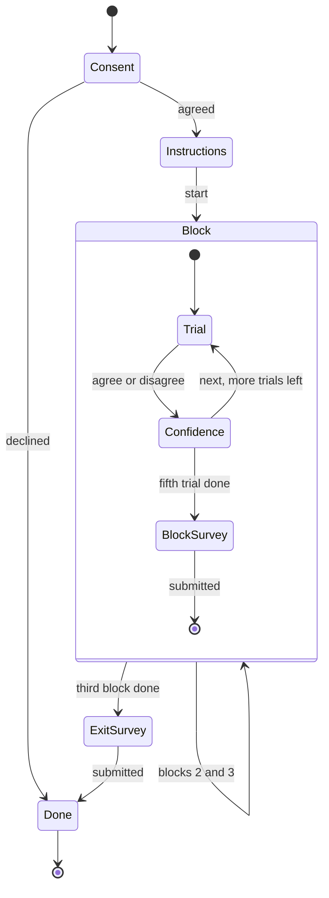
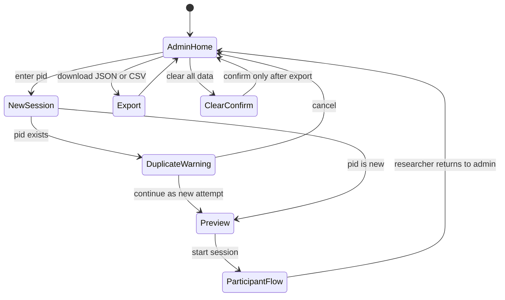

# System Design: Explanation Depth Study App

This document turns the approved proposal (`proposal.txt`) and the hypotheses in `literature.txt` §9 into a buildable specification for the study app. It covers the requirements and how each one traces back to the proposal or a hypothesis, the participant and admin flows, a screen-by-screen spec, the exact counterbalancing scheme for 18 participants, how timing and logging work, which logged fields feed which analysis, a proposed split of work across the six team members, risks, and the test and pilot plan. Where this doc and `_shared-decisions.md` disagree, `_shared-decisions.md` wins. Module and field names follow it exactly.

---

## 1. Requirements

### 1.1 Functional requirements

| ID | Requirement |
|---|---|
| FR-1 | The researcher starts a session by entering a numeric participant ID (`pid`) on `/admin`. The app warns if that `pid` already has a stored session. |
| FR-2 | The participant must give informed consent before seeing any case. If they decline, the app goes straight to `DoneScreen` and records no trial data. |
| FR-3 | The instructions screen shows the three lending rules (income ≥ $45,000, credit history ≥ 3 years, DTI ≤ 40%) and an example trial with no AI decision on it. |
| FR-4 | Every case is loaded from `src/data/cases.json`. The three condition views read the same case objects through `decisionEngine.ts`. |
| FR-5 | Condition A (`BlackBoxView`) shows only the AI decision. |
| FR-6 | Condition B (`StaticExplanationView`) shows the decision plus `staticExplanation`. |
| FR-7 | Condition C (`InteractiveExplanationView`) shows the decision plus a "Why?" button. The button opens a panel with one row per factor (value vs. threshold, pass/fail), and each row expands to show its `detail`. |
| FR-8 | All three views render the shared `<ApplicantCard/>` and `<DecisionPanel/>`. Only the explanation area differs between them. |
| FR-9 | The lending rules can be opened on every trial through a "Lending rules" toggle that looks the same in all conditions. |
| FR-10 | On each trial the participant either agrees or disagrees with the AI. The choice is final once clicked. |
| FR-11 | After the agree/disagree choice, the app asks an optional confidence rating (1–7) before the "Next" button. |
| FR-12 | `counterbalance.ts` assigns condition order, the set-to-condition mapping, and the within-block trial order, deterministically from `pid` (see §4). |
| FR-13 | After each block of 5 trials, the participant completes the block survey: Jian et al. 12 items plus 2 fairness items, all on 7-point scales. |
| FR-14 | After block 3, the participant completes the exit survey: demographics, AI familiarity, preferred condition, and an open comment. |
| FR-15 | The logger records per-trial measures and a timestamped event stream (see §5). |
| FR-16 | The session is written to `localStorage` (`xai-study:sessions`) after every trial and every survey submit. |
| FR-17 | `/admin` lists sessions and exports all of them as JSON and as CSV (one row per trial, plus a survey CSV). |
| FR-18 | Optional: when `VITE_SUBMIT_URL` is set, each finished session is POSTed to it. If the POST fails, nothing is lost, because localStorage is still the primary copy. |
| FR-19 | If the page is reloaded mid-session, the app resumes at the first trial or survey that has no saved response. |

### 1.2 Non-functional requirements

| ID | Requirement |
|---|---|
| NFR-1 | Static SPA (React 18 + TS + Vite). It needs no server and no database, and runs with `npm install && npm run dev`, or from the `npm run build` output. |
| NFR-2 | It runs on current desktop Chrome, Firefox, and Edge at a viewport of 1280×720 or larger. Mobile is out of scope. |
| NFR-3 | Decision time is measured with `performance.now()` and resolves to the millisecond. UI work between the decision appearing and the click doesn't add more than one frame (about 16 ms) of bias. |
| NFR-4 | Assignment is reproducible: the same `pid` always gives the same orders, sets, and trial sequence (seeded mulberry32). |
| NFR-5 | Losing data is limited to the trial in progress at most (FR-16). |
| NFR-6 | Visual parity: in all three conditions the applicant card, decision badge, buttons, and rules toggle have the same layout, size, and position. |
| NFR-7 | The UI shows no information that could leak a case's correctness: no `isAiCorrect`, no `errorType`, and no AI confidence score. |
| NFR-8 | Data is anonymous. The app stores only `pid` plus survey answers, with no names or emails. Applicant names are fictional. |
| NFR-9 | A full session takes about 20–30 minutes. |
| NFR-10 | Accessibility: everything can be done with the keyboard, color is never the only cue (pass/fail rows also show ✓/✗ and text), and contrast is WCAG AA. |

### 1.3 Traceability

| Requirement | Proposal element | Hypothesis served |
|---|---|---|
| FR-4, NFR-1 | "case-bank backend (a JSON file is sufficient)", "no database" | All |
| FR-5, FR-6, FR-7, FR-8, NFR-6 | "The Three Conditions" table | H1, H2, H3a, H3b, H4, H5 |
| FR-3, FR-9 | Wrong decisions "contradict the applicant's own stated numbers" | H3a, H3b |
| FR-10 | "agreement (yes/no)" | H1, H3a, H3b |
| FR-11 | Trust measured behaviourally and by self-report (Hoffman et al., lit. §8) | H2 (supporting) |
| FR-12, NFR-4 | "case order and condition-case pairing counterbalanced"; position of wrong cases (lit. §8) | All (controls order effects) |
| FR-13 | "trust score (Likert)", "Jian et al.", "fairness rating" | H2, H4 |
| FR-14 | Research question "Which condition is rated as most fair?" (preference supplements it) | H4 (supporting) |
| FR-15, NFR-3 | "time-to-decision" | H5 |
| FR-7 + FR-15 (expand events) | CLAUDE.md: needed to tell whether C was actually used | H3b, H5 |
| FR-16, FR-17, FR-19, NFR-5 | "Survey/data collection layer" | All |
| FR-18 | Optional Google-Form-style collection | All |
| FR-1, FR-2, NFR-8 | Study ethics, moderated lab session | — |
| NFR-7 | Planted errors must be detected from the data alone | H3a, H3b |
| NFR-2, NFR-9, NFR-10 | `implementation.txt`: target devices, run steps, demo | — |

---

## 2. Flows

### 2.1 Participant flow



`Confidence` is part of `TrialScreen`: the same screen gets a second step, and the route doesn't change. Block index (0–2) and trial index (0–4) are kept in `StudyContext`, and the URL is `/trial/:block/:trial`, so a reload lands in the right place (FR-19).

### 2.2 Admin (researcher) flow



`/admin` isn't linked from any participant screen, and the researcher opens it by URL. "Preview" shows the assignment for that `pid` (order, sets, case IDs, wrong-case positions), so the researcher can check it against the table in §4.3 before handing over the laptop.

---

## 3. Screen-by-screen spec

All screens are in `src/study/`. "Logged" means an event goes to `logger.ts`, with `{type, ts: performance.now(), wallClock: ISO string, payload}`.

| Screen | Shows | Inputs | Logged / stored |
|---|---|---|---|
| `AdminScreen` | Session list (pid, start time, status, trial count), the new-session form, assignment preview, export buttons, clear button | pid (int ≥ 1), buttons | `session_created {pid, assignment, attempt}`; nothing is logged for exports |
| `ConsentScreen` | Study purpose, duration, voluntariness, data use, contact | "I agree" / "I do not agree" | `consent {given: bool}` |
| `InstructionsScreen` | The task, the three lending rules, a static example ApplicantCard with no decision, and a note that "the AI may make mistakes" (wording is the same for every pid) | "Start" (enabled after 5 s, so it can't be skipped by accident) | `instructions_viewed {durationMs}` |
| `TrialScreen` | Progress ("Case 3 of 5 · Part 2 of 3"), `ApplicantCard`, the condition view's explanation area, `DecisionPanel`, and the "Lending rules" toggle | Agree / Disagree; then confidence 1–7 (optional) and "Next"; in C: "Why?" and factor rows | `trial_shown`, `rules_toggled`, `explanation_opened`/`explanation_closed`, `factor_expanded`/`factor_collapsed {key}`, `decision {agreed}`, `confidence {value|null}`, `visibility {state}`, `trial_saved`; the per-trial record (§5.3) |
| `BlockSurveyScreen` | The heading "About the AI you just used (Part N)" and 14 items (12 Jian + 2 fairness) in a fixed order, as 7-point radio rows | All 14 are required | `block_survey_submitted {block, condition, responses[], durationMs}` |
| `ExitSurveyScreen` | Age range, gender (optional), field of study, AI familiarity (1–7), preferred part (1/2/3 with a one-line reminder of each), and an open comment | Required: preferred part and AI familiarity | `exit_survey_submitted {…}` |
| `DoneScreen` | A thank-you message and an instruction to call the researcher. It has no data and no back button. | — | `session_completed`; triggers the optional POST (FR-18) |

The surveys never name the condition letter or "black box". Participants see "Part 1/2/3", and the export maps each part to its condition.

### 3.1 Trial screen wireframes

`<ApplicantCard/>` (left) and `<DecisionPanel/>` (bottom right) are pixel-identical across conditions. Only the box marked **EXPLANATION AREA** changes. It keeps a fixed minimum height, so the buttons sit in the same place in all three conditions (NFR-6).

**Condition A: Black Box (`BlackBoxView`)**

```
+--------------------------------------------------------------------------+
| Part 1 of 3 · Case 2 of 5                                [Lending rules v]|
+-----------------------------------+--------------------------------------+
| APPLICANT                         |  AI RECOMMENDATION                   |
|  Name:        Jordan Ellis        |  +--------------------------------+  |
|  Age:         34                  |  |          REJECTED              |  |
|  Occupation:  Nurse               |  +--------------------------------+  |
|  Annual income:      $52,000      |                                      |
|  Credit history:     5 years      |  +- EXPLANATION AREA -------------+  |
|  Debt-to-income:     28%          |  |                                |  |
|  Loan amount:        $15,000      |  |   (empty: decision only)       |  |
|  Purpose:            Car          |  |                                |  |
|                                   |  +--------------------------------+  |
|                                   |  Do you agree with the AI?           |
|                                   |  [  Agree  ]        [ Disagree ]     |
+-----------------------------------+--------------------------------------+
```

**Condition B: Static (`StaticExplanationView`)**

```
+--------------------------------------------------------------------------+
| Part 2 of 3 · Case 2 of 5                                [Lending rules v]|
+-----------------------------------+--------------------------------------+
| APPLICANT                         |  AI RECOMMENDATION                   |
|  (identical ApplicantCard)        |  +--------------------------------+  |
|                                   |  |          REJECTED              |  |
|                                   |  +--------------------------------+  |
|                                   |  +- EXPLANATION AREA -------------+  |
|                                   |  | Reason: "Rejected because the  |  |
|                                   |  | applicant's debt load relative |  |
|                                   |  | to income is too high for the  |  |
|                                   |  | requested amount."             |  |
|                                   |  +--------------------------------+  |
|                                   |  Do you agree with the AI?           |
|                                   |  [  Agree  ]        [ Disagree ]     |
+-----------------------------------+--------------------------------------+
```

**Condition C: Interactive (`InteractiveExplanationView`), after "Why?" and one row expanded**

```
+--------------------------------------------------------------------------+
| Part 3 of 3 · Case 2 of 5                                [Lending rules v]|
+-----------------------------------+--------------------------------------+
| APPLICANT                         |  AI RECOMMENDATION                   |
|  (identical ApplicantCard)        |  +--------------------------------+  |
|                                   |  |          REJECTED              |  |
|                                   |  +--------------------------------+  |
|                                   |  +- EXPLANATION AREA -------------+  |
|                                   |  | [ Why? ^ ]                     |  |
|                                   |  | > Income $52,000 vs ≥$45,000 ✓ |  |
|                                   |  | v Credit 5 yrs vs ≥3 yrs      ✓ |  |
|                                   |  |    "Five years of on-time..."  |  |
|                                   |  | > DTI    28% vs ≤40%          ✓ |  |
|                                   |  +--------------------------------+  |
|                                   |  Do you agree with the AI?           |
|                                   |  [  Agree  ]        [ Disagree ]     |
+-----------------------------------+--------------------------------------+
```

The example is a `false_rejection` case: every factor passes but the AI says REJECTED. In C, the factor rows show each row's `passes` value, which `decisionEngine.ts` computes from the applicant's numbers, so the breakdown is truthful and verification gets easier (the H3b mechanism). In B, the scripted `staticExplanation` sounds plausible and supports the wrong decision (the H3a mechanism). In C, the row `detail` text may carry a plausible framing too, but the ✓/✗ is always computed from the rules. The `ai-design.md` doc owns the wording rules.

The panel in C starts collapsed on every trial. Opening it doesn't move the buttons, because the explanation area has a fixed height and scrolls inside itself if it overflows.

---

## 4. Counterbalancing

Implemented in `src/engine/counterbalance.ts`, using `src/engine/rng.ts`.

### 4.1 The 6 condition orders

`order = permutations[(pid - 1) % 6]`

| Index | Order (block 1 → 2 → 3) |
|---|---|
| 0 | A → B → C |
| 1 | A → C → B |
| 2 | B → A → C |
| 3 | B → C → A |
| 4 | C → A → B |
| 5 | C → B → A |

Over every 6 participants, each condition appears exactly twice in each block position, and each condition comes immediately before each other condition exactly once.

### 4.2 Latin-square set rotation

`rotation = floor((pid - 1) / 6) % 3`. The set for condition `c` (A=0, B=1, C=2) is `S[(c + rotation) % 3 + 1]`.

| Rotation | A uses | B uses | C uses | pids |
|---|---|---|---|---|
| 0 | S1 | S2 | S3 | 1–6 |
| 1 | S2 | S3 | S1 | 7–12 |
| 2 | S3 | S1 | S2 | 13–18 |

Each set is paired with each condition for exactly 6 of the 18 participants. Because the order varies independently, each set also shows up in each block position 6 times.

### 4.3 Full assignment for pid 1–18 (one complete cycle)

Each cell is condition / set for that block position. pid 19 starts the cycle again, so it's the same as pid 1, apart from its within-block shuffle.

| pid | Order idx | Order | Rotation | Block 1 | Block 2 | Block 3 |
|---|---|---|---|---|---|---|
| 1 | 0 | A-B-C | 0 | A / S1 | B / S2 | C / S3 |
| 2 | 1 | A-C-B | 0 | A / S1 | C / S3 | B / S2 |
| 3 | 2 | B-A-C | 0 | B / S2 | A / S1 | C / S3 |
| 4 | 3 | B-C-A | 0 | B / S2 | C / S3 | A / S1 |
| 5 | 4 | C-A-B | 0 | C / S3 | A / S1 | B / S2 |
| 6 | 5 | C-B-A | 0 | C / S3 | B / S2 | A / S1 |
| 7 | 0 | A-B-C | 1 | A / S2 | B / S3 | C / S1 |
| 8 | 1 | A-C-B | 1 | A / S2 | C / S1 | B / S3 |
| 9 | 2 | B-A-C | 1 | B / S3 | A / S2 | C / S1 |
| 10 | 3 | B-C-A | 1 | B / S3 | C / S1 | A / S2 |
| 11 | 4 | C-A-B | 1 | C / S1 | A / S2 | B / S3 |
| 12 | 5 | C-B-A | 1 | C / S1 | B / S3 | A / S2 |
| 13 | 0 | A-B-C | 2 | A / S3 | B / S1 | C / S2 |
| 14 | 1 | A-C-B | 2 | A / S3 | C / S2 | B / S1 |
| 15 | 2 | B-A-C | 2 | B / S1 | A / S3 | C / S2 |
| 16 | 3 | B-C-A | 2 | B / S1 | C / S2 | A / S3 |
| 17 | 4 | C-A-B | 2 | C / S2 | A / S3 | B / S1 |
| 18 | 5 | C-B-A | 2 | C / S2 | B / S1 | A / S3 |

Recruitment target: a multiple of 18 completers (18 is the minimum). If a participant withdraws, the next new participant takes that participant's `pid` slot in a new session (new `sessionId`; the withdrawn session is kept with status `abandoned`), so the cycle stays balanced. Pilot sessions use `pid` ≥ 900 and are left out of the analysis.

### 4.4 Within-block trial shuffle

Each set has 5 cases: 3 correct and 2 wrong. Within a block, the 5 cases are put in a random order using the seeded PRNG, with one constraint: **the two wrong cases must not take positions 1 and 2 together.** A participant who sees two errors back to back right at the start of a block would have their trust in that condition anchored by those errors (Dzindolet et al., lit. §8).

Out of the C(5,2) = 10 possible wrong-case position pairs, 9 are allowed. Across participants, the two wrong cases land in different positions, which keeps position from being confounded with condition. The analysis can include the wrong case's trial position as a covariate, because it's logged.

The PRNG is a single mulberry32 stream seeded with `pid`. It's consumed in block order (block 1, then 2, then 3), so the sequence for each block is fixed by `pid` alone. Shuffling uses rejection sampling: shuffle with Fisher–Yates, and if the constraint is violated, shuffle again from the same stream. The expected number of attempts is 10/9, and the loop is capped at 100 attempts, which in practice is never reached. If the cap were hit, the fallback deterministically swaps the case at position 2 with the first correct case found in positions 3–5.

### 4.5 `assign(pid)` pseudocode

```ts
const PERMS = [["A","B","C"],["A","C","B"],["B","A","C"],
               ["B","C","A"],["C","A","B"],["C","B","A"]] as const;
const SETS = ["S1","S2","S3"] as const;
const COND_INDEX = { A: 0, B: 1, C: 2 };

function assign(pid: number, cases: Case[]): Assignment {
  if (!Number.isInteger(pid) || pid < 1) throw new Error("pid must be integer >= 1");
  const order    = PERMS[(pid - 1) % 6];
  const rotation = Math.floor((pid - 1) / 6) % 3;
  const rng      = mulberry32(pid);                       // rng.ts

  const blocks = order.map((condition, blockIdx) => {
    const set      = SETS[(COND_INDEX[condition] + rotation) % 3];
    const setCases = cases.filter(c => c.set === set);    // exactly 5: 3 correct, 2 wrong
    const caseIds  = constrainedShuffle(setCases, rng).map(c => c.id);
    return { blockIdx, condition, set, caseIds };
  });

  return { pid, orderIndex: (pid - 1) % 6, rotation, order, blocks };
}

function constrainedShuffle(xs: Case[], rng: () => number): Case[] {
  for (let attempt = 0; attempt < 100; attempt++) {
    const a = fisherYates([...xs], rng);
    const bothWrongFirstTwo = !a[0].isAiCorrect && !a[1].isAiCorrect;
    if (!bothWrongFirstTwo) return a;
  }
  // deterministic fallback (practically unreachable)
  const a = [...xs];
  const j = a.findIndex((c, i) => i >= 2 && c.isAiCorrect);
  [a[1], a[j]] = [a[j], a[1]];
  return a;
}
```

The full `Assignment` object is saved into the session at creation time and exported. Analysis never recomputes it, but a unit test checks that recomputing gives the same result (§9).

---

## 5. Timing and logging

### 5.1 Decision timer

| Event | Action |
|---|---|
| Start | `TrialScreen` mounts with the case. Inside a `useLayoutEffect`, a `requestAnimationFrame` callback sets `shownAt = performance.now()` and logs `trial_shown`. This happens after the decision badge has been painted. |
| Stop | The first valid Agree/Disagree click: `decidedAt = performance.now()`. |
| Not counted | The confidence rating and "Next" come after `decidedAt`. Opening rules or "Why?" happens before the decision, so it is included (that's the point of H5). |
| Derived | `decisionTimeRawMs = decidedAt - shownAt`; `decisionTimeMs = decisionTimeRawMs - hiddenMs`. |
| C-specific | `timeToFirstExpandMs = firstExplanationOpenAt - shownAt` (null if never opened). |

### 5.2 Tab blur / visibility change

- The logger listens to `document.visibilitychange` and `window.blur`/`focus` while a trial is active.
- When the tab goes hidden, it records `hiddenSince = performance.now()`. When it becomes visible again, it adds the gap to `hiddenMs` and increments `hiddenCount`. Every change also goes into the event stream.
- `window.blur` without a hidden tab (for example, clicking on another monitor) only increments `blurCount`. It isn't subtracted, because the participant may still be reading.
- If a trial has `hiddenCount > 0` or `decisionTimeMs > 120000`, it gets `timingFlag = true`. Analysis can exclude flagged trials or winsorize them. They are never deleted.
- The session is moderated, so the researcher discourages tab switching during the briefing. These fields are there to catch accidents.

### 5.3 Per-trial record

This is the core record the app writes. `data-model.md` holds the canonical schema.

`pid, sessionId, blockIndex, condition, set, positionInBlock, trialIndex, caseId, aiDecision, groundTruth, isAiCorrect, errorType, agreed, detectedError, decisionTimeMs, decisionTimeRawMs, hiddenMs, hiddenCount, blurCount, timingFlag, explanationOpened, factorsExpanded[] (keys in order), timeToFirstExpandMs, rulesOpened, confidence, resumed`

### 5.4 Double-click and accidental-input guards

- **Synchronous lock:** Agree and Disagree share one `useRef` flag, `decidedRef`. The first click sets it before any state update, and later clicks return immediately. This guards against React batching letting two clicks through.
- **Carry-over clicks:** a decision only counts if its `pointerdown` *and* `click` both land on the button after `shownAt`. That stops a double-click on the previous screen's "Next" from registering on the new trial's button. Keyboard activation (Enter/Space on a focused button) is accepted, but focus starts on the page heading, not on a button.
- **Next:** disabled after the first press. Navigation is idempotent: the reducer ignores `NEXT_TRIAL` if the trial record at that index is already saved.
- **Survey submit:** disabled once pressed, and validation runs before the lock.
- **Reload mid-trial:** a trial with no saved decision is shown again with a new timer, and gets `resumed = true`, and a `session_resume` event is logged.

### 5.5 Persistence

`sessionStore.save(session)` writes the whole storage root (`{schemaVersion, activeSessionId, sessions}` under the single key `xai-study:sessions`, with sessions keyed by `sessionId`; see `data-model.md` §7) after every `decision` and confidence/Next, and after every survey submit. A failed write (quota or private mode) shows a blocking banner telling the participant to call the researcher. The app never carries on silently without saving.

---

## 6. Measures to hypotheses

All analysis is done outside the app in R or Python, working from the trial CSV and the survey CSV. With N = 18 and 2 wrong cases per condition per participant, the tests on wrong cases (H3a/H3b) have low power. They should be reported with effect sizes and CIs, and H3b stays exploratory.

| Hypothesis | Logged fields used | Derived measure | Primary analysis | Secondary / robustness |
|---|---|---|---|---|
| H1: agreement A < B < C | `agreed`, `condition`, `pid`, `caseId` | Agreement rate per pid × condition (all 15 trials) | Mixed-effects logistic regression `agreed ~ condition + (1|pid) + (1|caseId)`; planned contrasts A<B, B<C | Repeated-measures ANOVA on per-pid rates, or Friedman with Page's trend test for the ordering |
| H2: trust B, C > A | Block survey Jian items 1–12, `condition` | Mean trust per pid × condition (items 1–5 reverse-scored: 8 − x) | One-way repeated-measures ANOVA (Greenhouse–Geisser if needed); Holm-corrected contrasts B vs A, C vs A | Friedman + Wilcoxon signed-rank; Cronbach's α per condition |
| H3a: on wrong cases, agreement B > A | `agreed`, `isAiCorrect`, `condition`, `errorType` | Automation-bias rate = agreement on `isAiCorrect = false` | `agreed ~ condition * isAiCorrect + (1|pid) + (1|caseId)` (logit); contrast B vs A within `isAiCorrect = false` | Wilcoxon on per-pid wrong-case agreement (0, 0.5, 1); `errorType` as a covariate |
| H3b (exploratory): on wrong cases, agreement C < B | As H3a, plus `explanationOpened`, `factorsExpanded` | As H3a | Same model; contrast C vs B within `isAiCorrect = false` | Within C, `agreed ~ explanationOpened` on wrong cases (descriptive, since opening is self-selected) |
| H4: fairness C highest, A lowest | Block survey fairness items 1–2 | Mean fairness per pid × condition | Repeated-measures ANOVA + contrasts C>B, B>A (or Friedman + Page's test) | Cross-check against exit-survey `preferredCondition` (χ² goodness of fit) |
| H5: time longest in C; longer time → better detection | `decisionTimeMs`, `timingFlag`, `condition`, `agreed`, `isAiCorrect` | log(decisionTimeMs); detection = `!agreed` on wrong cases | LMM `log(time) ~ condition + (1|pid) + (1|caseId)`, contrast C vs A, B; then `detected ~ timeWithinPid_z * condition + (1|pid) + (1|caseId)` on wrong cases (time centered within pid) | Excluding flagged trials; `timeToFirstExpandMs` in C |
| Order/position checks | `blockIdx`, `trialIdx`, wrong-case positions | — | Add `blockIdx` as a fixed effect to the H1/H3 models; check the condition × block interaction | Trust drop after a wrong case is seen (Dzindolet effect) |

---

## 7. Team work breakdown (PROPOSAL, to be confirmed by the group)

This split gives each condition view its own owner, as the proposal asks, and spreads the infrastructure across the other three members.

| Member | Primary ownership | Files | Also responsible for |
|---|---|---|---|
| Deepthi Reddy Chelladi | Condition A + shared trial components | `BlackBoxView.tsx`, `ApplicantCard`, `DecisionPanel`, base styles | Visual parity across A/B/C (NFR-6), accessibility pass (NFR-10) |
| Siwani Sah | Condition B | `StaticExplanationView.tsx` | Writing all 15 `staticExplanation` strings with the case-bank owner, plausible-but-wrong wording for the 6 wrong cases |
| Bibek Gupta | Condition C | `InteractiveExplanationView.tsx` | Factor-row interaction, expand/collapse logging hooks, `timeToFirstExpandMs` |
| Afzal Hossain Sohag | Case bank + engine | `cases.json`, `decisionEngine.ts`, `counterbalance.ts`, `rng.ts` | Set matching (S1–S3), Vitest suite for the engine and counterbalancing |
| Md Shamimul Islam | Study flow + surveys | `ConsentScreen`, `InstructionsScreen`, `TrialScreen` shell, `BlockSurveyScreen`, `ExitSurveyScreen`, `DoneScreen`, `StudyContext`, `trustScale.json` | Routing, resume-on-reload (FR-19), survey wording |
| Mohamed Sylla | Logging, storage, export, admin | `logger.ts`, `sessionStore.ts`, `AdminScreen` | CSV schema, the optional `VITE_SUBMIT_URL` POST, analysis-ready export |

Shared work: everyone runs one pilot session (§9). The report sections in `implementation.txt` are split by ownership, so each member writes the "code screenshots + explanation" part for their own files. The demo video is recorded by Md Shamimul Islam (flow owner), and Mohamed Sylla puts the final `.zip` together from a clean checkout.

Interface contracts to agree on in week 1 so that work can run in parallel: the `Case` type, the props of the condition views (`{ case, onExplanationEvent }`), and the logger API (`logEvent(type, payload)`, `startTrial`, `recordDecision`).

---

## 8. Risks and mitigations

| Risk | Effect on validity | Mitigation |
|---|---|---|
| Order and carry-over effects (Binns et al.; seeing C makes A look worse) | Condition effects get confounded with block position | All 6 orders balanced; `blockIdx` included in the models; condition × block interaction checked; the parts are labelled neutrally ("Part 1/2/3") |
| Error exposure lowers trust for the rest of the session (Dzindolet et al.) | Later blocks show lower trust whatever their condition | Wrong cases are spread evenly (2 per block); they're never both in the first two positions; positions are logged and modelled |
| Ceiling effects: rules are simple, so everyone catches every error | No variance on wrong-case agreement, so H3 can't be tested | Each set has one clear and one near-threshold wrong case (for example `case-07`, approved with 2 years of history, and `case-12`, approved at $43,500 income; see `data-model.md` §5); the pilot checks detection rates; target wrong-case agreement in the pilot is 20–80% |
| Wrong cases too subtle: nobody catches them, or they read as ambiguous | Floor effect; the cases stop testing verification | Every wrong case breaks at least one rule by an amount that's unambiguous when checked (wrong cases never sit exactly on a threshold); rules are available on every trial; the pilot asks "was any case unclear?" |
| Matched sets aren't equivalent | Set difficulty gets confounded with condition | Latin-square rotation pairs each set with each condition equally; `(1|caseId)` random effect; per-set agreement is checked in the pilot |
| Timing noise (tab switches, interruptions, slow first trial) | H5 is distorted | Visibility-adjusted time, `timingFlag`, log transform, `(1|pid)`; the instructions include a non-scored example; moderated lab setting |
| Data loss (refresh, crash, cleared storage, researcher clears the wrong thing) | Missing participants unbalance the cycle | Save after every trial; resume on reload; export after every session (procedure); clearing needs confirmation, and the export button comes first; optional POST backup; withdrawn pids are replaced in the same slot |
| Static text gives the answer away, or reads as obviously wrong | B and C are no longer comparable | One wording guide for all `staticExplanation` strings (length, tone, cites 1–2 factors); peer review by someone who isn't the case author |
| C panel is never opened | H3b turns into "C with nothing opened ≈ A" | `explanationOpened` is logged and reported; the instructions mention "Why?" in a neutral way, as they mention the rules toggle |
| Small N (18) | Low power, especially for H3 | Effect sizes + CIs; mixed models use trial-level data; H3b is pre-labelled as exploratory |

---

## 9. Pilot and test plan

### 9.1 Unit tests (planned, Vitest, `npm run test`)

None of these exist yet. They are written alongside the engine.

| Suite | Checks |
|---|---|
| `decisionEngine.test.ts` | For every case in `cases.json`, `groundTruth` equals the rule evaluation; `isAiCorrect === (aiDecision === groundTruth)`; `errorType` matches (approved but fails → `false_approval`, rejected but passes → `false_rejection`, else null); every `factors[].passes` agrees with `applicantValue`, `comparator`, and `threshold` |
| `caseBank.test.ts` | Exactly 15 unique IDs; 9 correct / 6 wrong; each set has 5 cases, 3 correct / 2 wrong, with at least one APPROVED and one REJECTED; no case sits exactly on a threshold if it's a wrong case |
| `counterbalance.test.ts` | `assign(pid)` is deterministic (two calls deep-equal); across pids 1–18, each condition appears 6× in each block position, and each set × condition pair occurs 6×; each block's `caseIds` is a permutation of its set; for pids 1–1000, wrong cases never take positions 1 and 2 together; all 9 allowed wrong-position pairs occur; invalid pid throws |
| `rng.test.ts` | mulberry32 with the same seed gives the same sequence; values are in [0, 1) |
| `sessionStore.test.ts` | Round trip save/load; the CSV has one row per trial with the §5.3 columns; Jian items 1–5 are reverse-scored only in the derived columns, while raw answers are kept |
| `logger.test.ts` | With a fake `performance.now`, `decisionTimeMs` subtracts hidden time; a second click is ignored; `timingFlag` is set on hidden time > 0 |

### 9.2 Manual checks before the pilot

- Use `/admin` Preview for pids 1–18 and compare against §4.3.
- Run one full session in each of Chrome, Firefox, and Edge. Reload in the middle of a trial and in the middle of a survey, and check that it resumes correctly.
- Export JSON and CSV and load the CSV in R or pandas.

### 9.3 Pilot run

- **Who:** the 6 group members, as `pid` 901–906. That covers all 6 orders, rotation `floor(900/6) % 3 = 0`. The data is excluded from analysis.
- **Rule:** each member completes the full flow as a participant before reviewing results. Members who authored case answers (case-bank owner, Condition B owner) are noted in the pilot log, and their agreement rates are not used to judge case difficulty.
- **What gets checked:** session length (target ≤ 30 min); wrong-case agreement rate (target 20–80%, see the ceiling risk); whether any rule or explanation wording was unclear; whether the C panel was opened; flagged trials; whether the export opens in R or Python with no manual cleanup.
- **Exit criteria:** no blocking bugs, every unit test passes, wrong cases sit in the target difficulty band, and the CSV loads with no manual cleanup. If case difficulty changes, `cases.json` is versioned (`caseBankVersion` stored in each session) before real data collection starts.

---

## Related docs

- [`architecture.md`](architecture.md): module structure, component tree, state and storage architecture
- [`system-design.md`](system-design.md): this document
- [`sequence-diagrams.md`](sequence-diagrams.md): runtime interactions (trial lifecycle, persistence, export)
- [`data-model.md`](data-model.md): canonical schemas for `cases.json`, the session record, and the CSV export
- [`ai-design.md`](ai-design.md): the Wizard-of-Oz decision engine, explanation wording, wrong-case design
- [`_shared-decisions.md`](_shared-decisions.md): the binding source of truth for every doc
