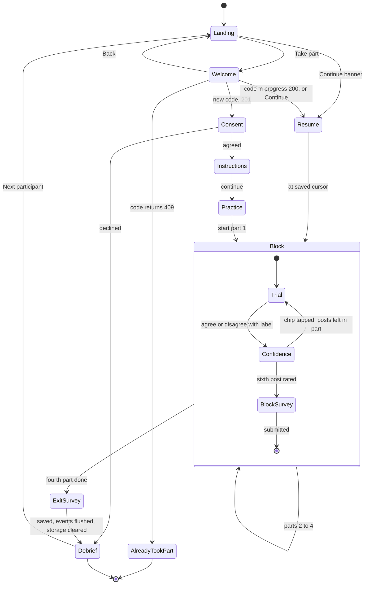
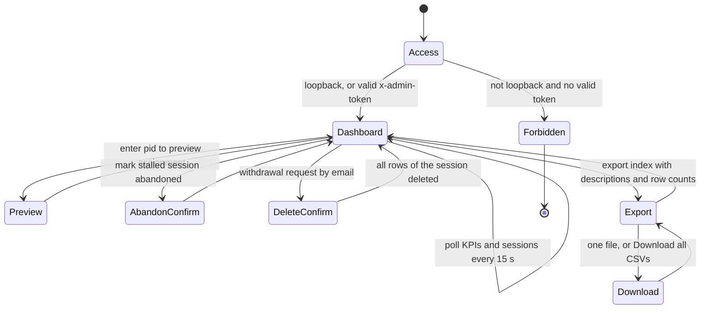

# System Design: Explanation Study App (v3: AI accuracy labels on social media posts)

**Current short-study override (2026-10-18):** new sessions show 2 distinct posts per part, 8 total, with one correct and one wrong label per part. Each part has compact dismissible help explaining the current A–D controls. All questionnaire items remain. Stored legacy sessions retain six-post blocks; screens and server transitions follow saved lengths. Participant copy uses Florida Polytechnic University graduate HCI experiment attribution without unfinished contact/approval placeholders. See [study defense](parts-and-study-defense.md), [updated wireframes](wireframes.md) and [protocol](study-protocol.md); older full-length examples below are legacy specifications.

This document turns the study design into a buildable specification for the app, using the v3 scenario. Participants read made-up social media posts from the fictional town of Riverton. Each post carries a scripted AI label, "Likely accurate" or "Likely misleading". The participant checks the label against an on-demand fact sheet and clicks **Agree with label** or **Disagree with label**. This doc covers:

- the requirements, and how each traces to RQ1–RQ3 and H1–H6
- the participant and admin flows, and a spec for each screen
- ASCII wireframes for conditions A–D
- the exact counterbalancing for one 16-participant cycle
- timing and logging, and which logged fields feed which analysis
- the session-length budget and the optional measures
- a proposed split of work across the six team members
- risks, the test and pilot plan, and later extensions

Where this doc and `_shared-decisions.md` disagree, `_shared-decisions.md` wins. Module and field names follow it, and `data-model.md` is the authority on field names and types. `stimuli.md` is the authority on all participant-facing wording, so the post text in the wireframes here is illustrative. The previous v2.1 design is archived at `archive/v2.1-agent-permission/system-design.md`.

> **v2 app change (self-guided, once-only).** The study is now self-guided: anyone opens the site on a lab laptop or their own desktop or phone, types a participation code and starts. Each person takes part once (the code is stored only as a salted hash), the server assigns the pid, and `/admin` is read-only data and KPIs. The trial and survey screens are faster (inline confidence chips, keyboard shortcuts, progress bar, survey matrix), with a target of 15–20 minutes. Posts, conditions, counterbalancing and every measure are unchanged. The binding API is [app/CONTRACT.md](../app/CONTRACT.md). Persistence is SQLite on the server, not `localStorage`; older mentions of `sessionStore` below map to the server repository.

> **Deviation from the approved proposal.** v3 departs from `proposal.txt` in three ways:
> 1. **Domain:** loan approval becomes AI accuracy labels on fictional social media posts.
> 2. **A fourth condition:** D (counterfactual) is added to A/B/C.
> 3. **Affect measures:** per-block tension and NASA-TLX frustration are added.
>
> The core research questions stay: agreement, trust, error detection and fairness. **This needs Professor Hamam's approval, and ethics approval because of the deception (scripted AI, deliberately wrong labels) and the stress measures, before any real data is collected.** The rationale is in `research-positioning.md`.

---

## 1. Requirements

### 1.1 Functional requirements

| ID | Requirement |
|---|---|
| FR-0 | **Landing page.** The study link and QR code open a public landing page at `/` (`LandingScreen`): a hero with the study name, a one-line pitch and a **Take part** button (→ `/start`); "How it works" in 3 steps (enter a participation code; read 24 short made-up posts and say whether you agree with each AI label; answer a few quick questions; about 15–20 minutes, phone or computer); who can take part (anyone aged 18 or over who reads English, once per person, no experience needed); privacy (anonymous, only a scrambled version of the code is kept, stop at any time, contact placeholder); a collapsed FAQ; and a footer. When the browser holds an active session id, a "You have a session in progress" banner offers **Continue**. Its wording follows the recruitment rules (`study-protocol.md` §6), so it never hints that labels can be wrong. It makes no API call and logs nothing. |
| FR-1 | The participant starts the session themselves on the Welcome screen (`/start`, reached from **Take part**; a **← Back** link returns to `/`) by typing a participation code (3–120 characters, e.g. a university email or student ID) and pressing Start or Enter. No researcher action is needed. The server assigns the `pid` (lowest free slot, abandoned slots reused). |
| FR-1a | **Once-only.** The server stores only `HMAC-SHA256(salt, normalisedCode)`. A code with a completed or abandoned session is refused (409 `already_participated`, shown as "You've already taken part. Thank you!"); a code with a session in progress resumes it. The browser keeps no "participated" flag: once the exit survey is saved, it clears all study data (every `xai-study:` key in `localStorage` and `sessionStorage` except `xai-study:adminToken`), and the debrief offers **Next participant**, so the next person on a shared device starts fresh. |
| FR-1b | **Continue.** If the browser holds an active session id, the landing page banner and the Welcome screen both offer Continue. Typing the same code on another device also resumes. |
| FR-2 | The participant must give informed consent before seeing any post. If they decline, the app goes straight to `DebriefScreen` and records no trial data. |
| FR-3 | `InstructionsScreen` explains the task ("an AI has labeled each post; check whether you agree"), the two labels, the fact sheet, and the two buttons. It ends with one practice post that is not in the bank. |
| FR-4 | All 24 posts and their fact sheets load from `src/data/posts.json`, and the survey items from `src/data/surveyItems.json`. All four condition views read the same post objects through `labelEngine.buildPresentation(post, condition)`. |
| FR-5 | Condition A (`NoExplanationView`) shows the AI label only. |
| FR-6 | Condition B (`StaticExplanationView`) shows the label plus `staticExplanation`, one fixed sentence of 8–14 words. |
| FR-7 | Condition C (`InteractiveExplanationView`) shows the label plus a "Why?" button. It opens 3 rows: **Source**, **Claim vs record** and **Wording**. Each row shows its `displayValue` and ✓/✗, and expands to its `detail` sentence. The Claim vs record row always shows the TRUE comparison (`keyFact.claimValue` vs `keyFact.recordValue`). |
| FR-8 | Condition D (`CounterfactualView`) shows the label plus `counterfactualExplanation`, one "would be … if …" sentence of 10–16 words. |
| FR-9 | All four views render the shared `PostCard`, `LabelPanel` and "Fact sheet ▸" button. Only the explanation area differs. `conditionRegistry.ts` maps A–D to the views. |
| FR-10 | `FactSheetPanel` opens from "Fact sheet ▸" on every trial in every condition. It shows the fact sheet's title, body (with the key fact) and source. It is identical across conditions and never mentions the label. |
| FR-11 | On each trial the participant clicks **Agree with label** or **Disagree with label**. `agreed = true` means they went with the AI label. The choice is final once clicked. |
| FR-12 | After the choice, `PostRatingStrip` slides in on the same screen with confidence chips 1–7 ("How sure are you?"), which are required. Tapping a chip saves the trial and moves to the next post after a 1 s Undo window; there is no separate Next button. The next presentation is prefetched. |
| FR-12a | **Keyboard.** `A` agree, `D` disagree, `1`–`7` confidence, `F` fact sheet, `W` "Why?" (C only), `Esc` closes a panel. A hint line lists them. On the block survey, number keys answer the focused row and move to the next. |
| FR-12b | **Progress.** A top progress bar shows "Post n of 24" and "Part x of 4". |
| FR-13 | `counterbalance.ts` assigns condition order, set-to-condition mapping and within-block post order, deterministically from `pid` (§4). |
| FR-14 | After every block of 6 posts, `BlockSurveyScreen` asks on one compact screen, in a fixed order, 12 Jian trust items as a matrix (rows = items, columns = chips 1–7), then 2 fairness items, then `tension` (1–7), then the `frustrationTlx` slider (§3.3). An "x of 16 answered" counter is shown; Continue is enabled when all are answered. |
| FR-15 | After block 4, `ExitSurveyScreen` asks demographics, social media use, how often they've seen platform labels, the preferred part, and an open comment. |
| FR-16 | `logger.ts` records the per-trial record (§5.4), the per-block record, and a timestamped event stream. It is the only module that calls `labelEngine.getTruth(postId)`. |
| FR-17 | The server writes each trial, event batch and survey to SQLite the moment it is submitted, and stamps `last_activity_at` on every participant write. |
| FR-18 | `/admin` lists sessions and exports all of them as JSON and as CSV (one row per trial, plus block-survey, event and exit-survey CSVs). It cannot start sessions. Admin routes require `ADMIN_TOKEN` when set, and answer only from loopback when it is not. |
| FR-18c | **Analysis-ready exports.** Besides the per-record files, `/admin` exports `participants.csv` (one row per session, every status, pilots flagged with `isPilot`: totals, detection overall and by error type, per-condition agreement, detection, trust, fairness, tension and frustration, and the exit answers; never `participant_hash`) and `kpis.csv` (the dashboard KPIs in long form: `section, key, metric, value`). `GET /api/admin/export` returns an index of all 7 files with a one-line description and the current row count; the export panel shows these next to each download link and offers **Download all CSVs**. Columns: `data-model.md` §8.7–§8.9. |
| FR-18a | **KPIs.** `/admin` shows, refreshed every 15 s from `GET /api/admin/kpis`: completed / target (N = 32, minimum 16), in progress, completion rate, median and p90 duration; per condition A–D trials, agreement, detection (all, false alarm, miss), fact-sheet open rate, mean confidence, median decision time, mean trust, fairness, tension and frustration; detection per error type; completed sessions per condition order (balance); completions per day. Completed sessions only; pilot pids ≥ 900 excluded. |
| FR-18b | **Stale sessions.** An in-progress session with no activity for `STALE_MINUTES` (default 120) is marked abandoned when the next session starts, and its pid is reused. |
| FR-19 | If the page is reloaded mid-session, the app resumes at the first trial or survey with no saved response. The resumed trial gets `resumed = true`. |
| FR-20 | `DebriefScreen` says the AI was scripted, that 8 of the 24 labels were deliberately wrong, and that every post, person and agency was fictional. It shows each wrong-label post with its fact sheet and the correct answer. |
| FR-21 | Every trial record carries `errorType` (`false_alarm`/`miss`/null), `difficulty` and `detectedError`. The block record carries `nWrongDetected`, so H1a/H1b and H3 can be computed from the export alone. |
| FR-22 | Optional, off by default: the session flags `consequenceBanner` and an anxiety scale (§3.6). With the flags off, neither is rendered or logged. |

### 1.2 Non-functional requirements

| ID | Requirement |
|---|---|
| NFR-1 | React 18 + TypeScript + Vite SPA served by one Express 5 process with a SQLite file (`better-sqlite3`). It runs with `npm install && npm run dev`, or `npm run build && npm start`. |
| NFR-2 | It runs in current Chrome, Firefox, Edge and Safari, on desktop (1280 px) and on phones (from 360 px wide). On narrow screens the fact sheet is a bottom sheet and the survey matrix becomes one chip row per item; touch targets are at least 44 px; `prefers-reduced-motion` is respected. |
| NFR-3 | Times are measured with `performance.now()` to the millisecond. UI work between the label appearing and the click adds no more than one frame (about 16 ms) of bias. |
| NFR-4 | Assignment is reproducible: the same `pid` always gives the same order, sets and post sequence (mulberry32 seeded by `pid`). |
| NFR-5 | At most the trial in progress can be lost (FR-17). |
| NFR-6 | Visual parity: in all four conditions the post card, label, "Fact sheet ▸" button and the Agree/Disagree buttons have the same layout, size and position. The explanation area has a fixed minimum height. |
| NFR-7 | No correctness leak. The payload from `buildPresentation` is allow-listed and carries no `groundTruth`, `isAiCorrect`, `errorType` or `difficulty`. No AI confidence score is shown. Every label appears after the same fixed ~800 ms "AI is checking…" delay. B, C-detail and D text use the same confident tone on right and wrong labels. |
| NFR-8 | Data is anonymous: only `pid` plus answers, with no names or emails. The participation code is kept only as a salted HMAC hash and is never logged. All posts, accounts, places and agencies are fictional, with no real brands and no health-risk claims that could cause harm if believed. |
| NFR-9 | A full session takes about 15–20 minutes (§3.5). Affect is asked once per block, not per trial. |
| NFR-10 | Accessibility: everything works from the keyboard. Color is never the only cue: labels carry ✓/⚠ plus text, and factor rows carry ✓/✗ plus text. Contrast meets WCAG AA. |

### 1.3 Traceability

**Research questions and hypotheses** (full text in `_shared-decisions.md`):

| Code | Short form |
|---|---|
| RQ1 | Do explanations help people catch wrong labels, and does that differ for false alarms vs misses? H1: detection differs by condition. H1a (headline): misses are caught less often than false alarms. H1b: the gap is smallest in C. |
| RQ2 | Which explanation type detects errors best? H2: C highest, B lowest, D exploratory. |
| RQ3 | Do wrong labels create tension, and does explanation type change it? H3: tension and frustration rise with `nWrongDetected`. H3a: B and D lower tension even on wrong labels. H3b (exploratory): C raises tension when a ✗ row is visible. |
| H4 | Agreement and Jian trust are higher in B, C and D than in A. |
| H5 | Fairness is highest in C and D and lowest in A. |
| H6 | Decisions take longest in C and D. Opening the fact sheet or expanding rows predicts detection. |

| Requirement | Source in the design | RQ / hypothesis served |
|---|---|---|
| FR-4, NFR-1 | Proposal: "a JSON file is sufficient", no database | All |
| FR-5 – FR-9, NFR-6 | Conditions table (A/B/C from the proposal, D added in v3) | RQ1, RQ2, H4, H5, H6 |
| FR-7 (true Claim vs record row) | C-shows-true-values principle (team to confirm) | H1b, H2, H3b |
| FR-10, FR-20 | Wrong labels must be checkable against data on screen | RQ1, RQ2, H6 |
| FR-11 | Proposal: "agreement (yes/no)" | H1, H1a, H1b, H2, H4 |
| FR-12 | Per-post confidence, from Deepthi's v3 proposal | H4 (supporting) |
| FR-13, NFR-4 | Proposal: condition order, case order and pairing counterbalanced, plus the position of wrong labels | All (controls order effects) |
| FR-14 (Jian) | Proposal: "trust score (Likert)", Jian et al. | H4 |
| FR-14 (fairness) | Proposal: fairness rating | H5 |
| FR-14 (tension, TLX) | v3 addition (deviation) | RQ3: H3, H3a, H3b |
| FR-15 | Proposal: preferred condition | H4, H5 (supporting) |
| FR-16, NFR-3 | Proposal: "time-to-decision"; CLAUDE.md: log C expansions | H6, H1b |
| FR-21 | False alarm vs miss, the v3 headline comparison | H1a, H1b, H3 |
| FR-17 – FR-19, FR-18c, NFR-5 | Proposal: survey/data collection layer | All (FR-18c: one row per participant for the within-subjects tests) |
| FR-0, FR-1, FR-1a, FR-1b, FR-2, FR-20, NFR-8 | Ethics, deception, self-guided once-only session, debrief | — (one person = one row set, so the within-subjects design holds) |
| FR-12a, FR-12b, FR-18a, NFR-2 | v2 PI decision: fast, interactive, any device; KPIs for monitoring unmoderated collection | All (data quality and balance) |
| NFR-7 | Errors must be found from the data, not from cues | RQ1, RQ2 |
| FR-22 | Optional consequence banner and anxiety scale (Deepthi's "drop if too big") | RQ3 (exploratory) |
| NFR-2, NFR-10 | `implementation.txt`: target devices, run steps, demo | — |
| NFR-9 | Session length; per-block affect | H3 (keeps fatigue out of the affect ratings) |

---

## 2. Flows

### 2.1 Participant flow



- `Confidence` is the `PostRatingStrip` chip row inside `TrialScreen`. It is a second step on the same screen, and the route doesn't change. Tapping a chip (or pressing `1`–`7`) submits after a 1 s Undo window.
- `Landing` is `/`, the public page the recruitment link opens (FR-0). It shows the study, who can take part and privacy, and a Continue banner when an active session id is stored. `Welcome` is `/start`. It shows a Back link, the participation-code field, Continue when an active session id is stored, or the thank-you message when the server answers 409. Nothing in the browser marks a finished participant: storage is cleared after the exit survey is saved.
- The route is `/trial/:block/:pos`, and `StudyContext` holds the indices, so a reload lands in the right place (FR-19).
- Stored records use `blockIndex` 1–4 and `positionInBlock` 1–6. The trial id is `${pid}-${blockIndex}-${positionInBlock}`.

### 2.2 Admin (researcher) flow



- `/admin` isn't linked from any participant screen. The researcher opens it by URL, on the server machine (loopback) or with the `ADMIN_TOKEN` entered in the token field.
- The dashboard is **data and KPIs only**: it cannot start sessions. Participants start themselves (§2.1).
- **Preview** (`GET /api/admin/assignments/:pid`) shows the assignment for any pid, including pilot pids 901+, without creating anything. Use it to check §4.3.
- A pid whose session was abandoned (by the researcher or after `STALE_MINUTES` idle) is given to the next new participant, with a new `sessionId`. The abandoned session's rows are kept with status `abandoned`.

---

## 3. Screen specs

All screens are in `src/study/`. "Logged" means an event goes to `logger.ts` as `{type, ts: performance.now(), wallClock: ISO string, payload}`.

### 3.1 Screen table

| Screen | Shows | Inputs | Logged / stored |
|---|---|---|---|
| `LandingScreen` (`/`) | Hero (study name, one-line pitch, **Take part**, "How it works ↓"), 3 steps, who can take part, privacy, FAQ (collapsed), footer; a "You have a session in progress" banner with Continue when an active session id is stored. Wording per the recruitment rules (`study-protocol.md` §6) | Take part, Continue, FAQ toggles | Nothing (no session yet); Continue calls `POST /api/sessions/:id/resume` |
| `WelcomeScreen` (`/start`) | ← Back link to `/`, study title, 2-line description, "About 15–20 minutes", participation-code field with a one-line privacy note ("Only used to make sure each person takes part once; stored scrambled."), Start; Continue when an active session is stored; "You've already taken part. Thank you!" when the server returns 409 (never from browser state) | Code (3–120 characters), Start / Enter, Continue | `POST /api/sessions` → 201 new, 200 resumed, 409 already participated |
| `AdminScreen` | KPI cards, per-condition table with inline SVG bars, balance grid, sessions table (pid, status, order, progress x/24, started, last activity), Abandon / Delete, export panel (7 files, each with a description, row count and download link, plus Download all CSVs), token field, pid preview. No start form. | Token, pid (preview), buttons | Nothing participant-side; reads `/api/admin/kpis` and `/api/admin/sessions` every 15 s, and `/api/admin/export` for the export index |
| `ConsentScreen` | Short plain text plus a "Read full consent details" disclosure: purpose ("how people judge AI labels on social media posts"), about 15–20 min, self-guided (contact email instead of "call the researcher"), voluntary, may stop at any time, anonymous data use, contact. The deception isn't disclosed until the debrief, which ethics must approve. | "I agree" / "I do not agree" | `consent {given}` |
| `InstructionsScreen` | The scenario, a labeled tour of a `PostCard` and `LabelPanel`, the two labels (✓ Likely accurate, ⚠ Likely misleading), what "Fact sheet ▸" does, and the note "The AI can make mistakes" (the same for every pid). Then 1 practice post (below). | "Start" (enabled after the practice post is answered) | `instructions_viewed {durationMs}`, `practice_done {agreed, factSheetOpened}` (not a trial record) |
| `TrialScreen` | Progress bar "Post n of 24" + "Part x of 4", keyboard hint line, `PostCard`, `LabelPanel`, the condition's explanation area, "Fact sheet ▸", "Agree with label" / "Disagree with label", then `PostRatingStrip` | Agree/Disagree (`A`/`D`); then a confidence chip 1–7 (`1`–`7`), which submits after a 1 s Undo window. `F` fact sheet; in C: "Why?" (`W`) and the row toggles | `trial_shown`, `factsheet_opened`/`factsheet_closed`, `explanation_opened`/`explanation_closed`, `factor_expanded`/`factor_collapsed {key}`, `decision {agreed}`, `confidence {value}`, `visibility {state}`, `trial_saved` |
| `BlockSurveyScreen` | "About the AI labels in Part N", then 16 items on one screen in a fixed order (§3.3): trust matrix, fairness ×2, tension, TLX slider, with an "x of 16 answered" counter | All 16 required; the slider must be touched; number keys answer the focused row | `block_survey_submitted {blockIndex, condition, jian[12], fairness[2], tension, frustrationTlx, frustrationTlxTouched, durationMs}` |
| `ExitSurveyScreen` | One screen; chips or radios for questions with ≤ 6 options. Age range, gender (optional), social media use (1–7), how often they've seen platform labels (1–7), preferred part (1–4, with a one-line reminder of each part's look), comment | Preferred part and social media use are required | `exit_survey_submitted {…}` |
| `DebriefScreen` | Thank-you, then: (1) the AI was not real and every label was scripted; (2) 8 of the 24 labels were deliberately wrong, 4 true posts labeled misleading and 4 false posts labeled accurate, to see whether people noticed; (3) each wrong-label post with its fact sheet and the correct answer; (4) agreeing with a wrong label is common and says nothing bad about the participant; (5) all posts, people, places and agencies were fictional; (6) a pointer to support if they felt stressed, and a reminder they can withdraw their data by emailing the contact address with their pid (shown). Self-guided: no "call the researcher"; the real facts sit in a "Show the real facts" disclosure. No back button. | — | `session_completed` |

Participants never see condition letters or names. They see "Part 1–4", and the export maps each part to its condition.

**Practice post.** One neutral post, not in the bank, with a correct "Likely accurate" label and **no explanation area**, so no condition is previewed. The final text is in `stimuli.md`; an example is "Riverton Library now opens at 9 am on Saturdays". The participant is prompted to open "Fact sheet ▸" once, compare the claim with the record, and answer. No feedback on correctness is given.

### 3.2 `TrialScreen` and its parts

**Layout.** A progress bar runs across the top. On wide screens: on the left `PostCard`, with "Fact sheet ▸" under it; on the right `LabelPanel`, the explanation area (fixed minimum height, scrolls inside itself), and the two buttons. `PostRatingStrip` slides in under the buttons after a decision. On phones (< 720 px) everything stacks in one column, and the fact sheet opens as a bottom sheet. A hint line lists the keyboard shortcuts.

**Sequence on each trial:**
1. The trial mounts. `PostCard` shows at once. `LabelPanel` shows "AI is checking…" for a fixed ~800 ms. Both buttons and the explanation area stay disabled during the delay.
2. The label is revealed. `shownAt` is set (§5.1). In C, the "Why?" panel starts collapsed on every trial.
3. The participant may open "Fact sheet ▸" (any condition) and, in C, "Why?" and its rows.
4. They click Agree or Disagree. Both buttons lock, `FactSheetPanel` closes, and the explanation area stays visible but can no longer be toggled.
5. `PostRatingStrip` slides in on the same screen: "How sure are you?" chips 1 = not at all sure … 7 = completely sure. The rating is required.
6. Tapping a chip (or pressing `1`–`7`) shows a 1 s "Undo" link, then saves the trial (§5.5) and advances to the prefetched next post. There is no Next button.

| Component | Contents | Notes |
|---|---|---|
| `PostCard` | Avatar initial, `author.displayName`, `@author.handle`, verified badge if `author.verified`, `postedAgo`, `text`, `likes`, `reposts` (display only, not clickable) | Identical across conditions. The verified badge and engagement counts are content, not cues to correctness (see risk R-5). |
| `LabelPanel` | "AI label:" then "✓ Likely accurate" or "⚠ Likely misleading" | Same size and place in every condition. Never shows a confidence score. |
| Explanation area | A: empty. B: `staticExplanation`. C: "Why? ▸" opens `factors[]` rows (Source, Claim vs record, Wording), each with `label`, `displayValue`, ✓/✗ from `passes`, and a toggle to its `detail`. D: `counterfactualExplanation`. | Fixed minimum height, so the buttons never move (NFR-6). |
| "Fact sheet ▸" | Toggles `FactSheetPanel` | Same place and look in every condition. |
| `FactSheetPanel` | A side panel over the post column on wide screens, a bottom sheet on phones: `factSheet.title`, `factSheet.body` (contains the key fact), `factSheet.source` (e.g. "Riverton Public Works (fictional)"), and "Close ◂" | Overlay, so opening it moves nothing. Never mentions the label or the AI. Highlights nothing. Closes on decision. |
| `PostRatingStrip` | Confidence chips 1–7 and a 1 s Undo link | Required. Keyboard: `1`–`7`. Chips are ≥ 44 px. |

### 3.3 `BlockSurveyScreen`

Items load from `surveyItems.json` and are always shown in this order, on one compact screen, with no randomisation. The 12 trust items form a `LikertMatrix` (rows = items, columns = chips 1–7; on phones each item becomes its own chip row). The affect items come last so they can't color the trust and fairness answers.

| # | Item(s) | Field | Format | Hypothesis |
|---|---|---|---|---|
| 1–12 | Jian et al. (2000) Trust in Automation, with "the system" worded as "the AI labels". Items 1–5 are reverse-scored at analysis (8 − x). | `jian[0..11]` | Matrix row of 7 chips, 1 = not at all, 7 = extremely | H4 |
| 13 | "The AI labels were fair to the people who posted" | fairness item 1 | 7-point radio row, 1 = strongly disagree, 7 = strongly agree | H5 |
| 14 | "The AI labels treated posts consistently" | fairness item 2 | 7-point radio row | H5 |
| 15 | "How tense did you feel while judging the posts in this part?" | `tension` | 7-point radio row, 1 = not at all tense, 7 = extremely tense | H3, H3a, H3b |
| 16 | NASA-TLX frustration: "How irritated, stressed or annoyed did you feel during this part?" | `frustrationTlx` | Slider 0–100, step 5, starting at 50, ends "Very low" / "Very high" | H3, H3a, H3b |

**Validation:**
- "Continue" stays disabled until all 16 items are answered. Unanswered items are outlined, a summary line says how many are left ("2 questions still need an answer"), and focus moves to the first one.
- The slider counts as answered only once it has been moved (pointer or arrow keys), tracked by `frustrationTlxTouched`. Moving away and back to 50 counts. Pressing Continue while it's untouched outlines the slider with "Please set this slider, even if you leave it at 50."
- The stored `frustrationTlx` must be an integer in [0, 100] divisible by 5. Anything else is rejected before saving.
- Raw values are stored as given, and nothing is reverse-scored in storage.
- Submit locks once pressed. On a reload mid-survey the survey is shown again empty, and `frustrationTlxTouched` resets.
- `nWrongDetected` (0–2) for the block is computed by `logger` from the block's trial records and saved with the block record. It is never shown.

### 3.4 Trial wireframes (p15)

The example is **p15** (S3, `false_alarm`, `subtle`). A TRUE post, "Good news: Riverton tap water met all 12 safety limits in March.", is wrongly labeled "Likely misleading". Its fact sheet says all 12 March tests were within limits. `PostCard`, `LabelPanel`, "Fact sheet ▸" and the buttons are pixel-identical across conditions. Only the **EXPLANATION AREA** changes. The post, fact sheet and C rows below follow `stimuli.md`, which holds the final text. Full-screen wireframes for every screen are in `wireframes.md`.

**Condition A: No explanation (`NoExplanationView`)**

```
+--------------------------------------------------------------------------+
| Part 1 of 4 · Post 3 of 6                                                |
+------------------------------------+-------------------------------------+
| POST                               |  AI label:                          |
|  (R) Riverton Neighbors ✓          |  +-------------------------------+  |
|      @RivertonNeighbors · 6h       |  |  ⚠ Likely misleading          |  |
|  Good news: Riverton tap water     |  +-------------------------------+  |
|  met all 12 safety limits in       |  +- EXPLANATION AREA ------------+  |
|  March.                            |  |                               |  |
|                                    |  |   (empty: label only)         |  |
|  ♥ 187   ⟲ 52                      |  |                               |  |
|                                    |  +-------------------------------+  |
|  [ Fact sheet ▸ ]                  |  [ Agree with label ]               |
|                                    |  [ Disagree with label ]            |
+------------------------------------+-------------------------------------+
```

**Condition B: Static reason (`StaticExplanationView`)**

```
+--------------------------------------------------------------------------+
| Part 2 of 4 · Post 3 of 6                                                |
+------------------------------------+-------------------------------------+
| POST                               |  AI label:                          |
|  (identical PostCard)              |  +-------------------------------+  |
|                                    |  |  ⚠ Likely misleading          |  |
|                                    |  +-------------------------------+  |
|                                    |  +- EXPLANATION AREA ------------+  |
|                                    |  | Flagged: claims about water   |  |
|                                    |  | safety are often exaggerated. |  |
|                                    |  |                               |  |
|                                    |  +-------------------------------+  |
|  [ Fact sheet ▸ ]                  |  [ Agree with label ]               |
|                                    |  [ Disagree with label ]            |
+------------------------------------+-------------------------------------+
```

**Condition C: Interactive "Why?" (`InteractiveExplanationView`), panel open, one row expanded**

```
+--------------------------------------------------------------------------+
| Part 3 of 4 · Post 3 of 6                                                |
+------------------------------------+-------------------------------------+
| POST                               |  AI label:                          |
|  (identical PostCard)              |  +-------------------------------+  |
|                                    |  |  ⚠ Likely misleading          |  |
|                                    |  +-------------------------------+  |
|                                    |  +- EXPLANATION AREA ------------+  |
|                                    |  | [ Why? ▾ ]                    |  |
|                                    |  | ▾ Source  verified          ✓ |  |
|                                    |  |   "Community pages can be     |  |
|                                    |  |    verified without being     |  |
|                                    |  |    experts on water testing." |  |
|                                    |  | ▸ Claim vs record             |  |
|                                    |  |   all 12 limits met / all 12  |  |
|                                    |  |   tests within limits       ✓ |  |
|                                    |  | ▸ Wording  neutral          ✓ |  |
|                                    |  +-------------------------------+  |
|  [ Fact sheet ▸ ]                  |  [ Agree with label ]               |
|                                    |  [ Disagree with label ]            |
+------------------------------------+-------------------------------------+
```

**Condition D: Counterfactual (`CounterfactualView`)**

```
+--------------------------------------------------------------------------+
| Part 4 of 4 · Post 3 of 6                                                |
+------------------------------------+-------------------------------------+
| POST                               |  AI label:                          |
|  (identical PostCard)              |  +-------------------------------+  |
|                                    |  |  ⚠ Likely misleading          |  |
|                                    |  +-------------------------------+  |
|                                    |  +- EXPLANATION AREA ------------+  |
|                                    |  | This would be labeled         |  |
|                                    |  | accurate if it cited the      |  |
|                                    |  | March test report.            |  |
|                                    |  +-------------------------------+  |
|  [ Fact sheet ▸ ]                  |  [ Agree with label ]               |
|                                    |  [ Disagree with label ]            |
+------------------------------------+-------------------------------------+
```

**Fact sheet panel (identical in all conditions; overlays the post column)**

```
+- FACT SHEET -------------------------------+
| March Water Quality Report                 |
|                                            |
| In March, Riverton's tap water was tested  |
| for 12 regulated substances. All 12        |
| results were within safety limits.         |
|                                            |
| Source: Riverton Water Department          |
| (fictional)                                |
|                                [ Close ◂ ] |
+--------------------------------------------+
```

**After a decision (`PostRatingStrip`, inline under the locked buttons)**

```
+- How sure are you? -----------------------------------+
|  not at all [1][2][3][4][5][6][7] completely          |
|  tap a number (or press 1-7) to save · Undo (1 s)     |
+-------------------------------------------------------+
```

**How p15 works in each condition:**
- **B and D** argue for the wrong label. Each cites a plausible but non-decisive factor (water claims get exaggerated, no citation) in the same confident tone used on correct labels. This is the H2/H3a "persuasive" mechanism.
- **C's** Claim vs record row shows the TRUE comparison and passes (✓). A participant who opens it can see that the label doesn't fit the record. This is the H1b/H2 verification mechanism. The Source row's `detail` still argues for the label, as the explanation rules require.
- In **every** condition, the fact sheet alone is enough to catch the error.

### 3.5 Session-length budget

Target: about **15–20 minutes** (NFR-9). The pilot (§9.3) times each phase from the event stream, and `/admin` shows the live median and p90 duration of completed sessions.

| Phase | Contents | Estimated time |
|---|---|---|
| Landing + Welcome | Read the landing page, Take part, participation code, Start | 0.5 min |
| Consent | Short text (full details in a disclosure), agree/decline | 1 min |
| Instructions + practice | 3 bullets and the inline practice post, no reading lock | 1–1.5 min |
| Trials | 4 parts × 6 posts = 24 trials at about 18–25 s each (800 ms delay, reading, optional fact sheet, two taps) | 7.5–10 min |
| Block surveys | 4 × 16 items on one screen (trust matrix, fairness, tension, slider) at about 1–1.5 min each | 4–6 min |
| Exit survey | One screen of chips and radios, comment | 1 min |
| Debrief | Scripted-AI disclosure, "Show the real facts", support info | 1–1.5 min |
| **Total** | | **≈ 16–21 min** |

If the pilot runs over 20 minutes, cut in this order:
1. The optional consequence banner and anxiety scale (§3.6). These are off by default anyway, so they're the first thing dropped if anyone has turned them on.
2. Shorten the instructions and consent summary.

Never cut a hypothesis measure (agreement, confidence, Jian, fairness, tension, frustration), and never cut the 800 ms delay, which is part of the design.

### 3.6 Optional measures (off by default)

Both are listed in `_shared-decisions.md` as optional. Neither is built unless the team adds it.

| Option | What it does | Storage | Cost |
|---|---|---|---|
| Consequence banner | A fixed banner above `PostCard` on every trial in every condition: "Posts you agree are accurate stay visible to other users." It raises the stakes for RQ3. | Session flag `consequenceBanner` (default `false`), exported on every row | Little time cost, but it is a manipulation: it must be the same for a whole cycle of 16, never mixed within one |
| Anxiety scale | A short state-anxiety scale (for example a 6-item short form), once after consent and once after block 4 | Session flag, plus two scale records | About 1.5 min. It is the first thing dropped if the session runs long. |

---

## 4. Counterbalancing

Implemented in `src/engine/counterbalance.ts`, using `src/engine/rng.ts` (mulberry32, seeded by `pid`). Condition indices are A = 0, B = 1, C = 2, D = 3. Sets are `S = [S1, S2, S3, S4]`.

### 4.1 The 4 Williams orders

`order = williams[(pid - 1) % 4]`

| Index | Order (block 1 → 2 → 3 → 4) |
|---|---|
| 0 | A → B → D → C |
| 1 | B → C → A → D |
| 2 | C → D → B → A |
| 3 | D → A → C → B |

This is a 4×4 balanced Latin square:
- Each condition appears once in each block position.
- Each condition comes immediately before each other condition exactly once. The 12 ordered pairs are AB, BD, DC, BC, CA, AD, CD, DB, BA, DA, AC and CB.

### 4.2 Set rotation

`rotation = floor((pid - 1) / 4) % 4`. The set for condition `c` is `S[(conditionIndex(c) + rotation) % 4]`.

| Rotation | A uses | B uses | C uses | D uses | pids |
|---|---|---|---|---|---|
| 0 | S1 | S2 | S3 | S4 | 1–4 |
| 1 | S2 | S3 | S4 | S1 | 5–8 |
| 2 | S3 | S4 | S1 | S2 | 9–12 |
| 3 | S4 | S1 | S2 | S3 | 13–16 |

Within each rotation, the 4 orders run once. So over one cycle of 16 (checked by script):
- each condition sits in each block position 4 times
- each condition is paired with each set 4 times
- each set appears in each block position 4 times
- each ordered condition-to-condition transition occurs 4 times

Each set holds 1 false alarm and 1 miss, so every condition sees both error types in every session.

### 4.3 Full assignment for pid 1–16 (one complete cycle)

Each cell is condition / set for that block. pid 17 starts the cycle again (same as pid 1 apart from its within-block shuffle, which is seeded by `pid`). Generated from the formulas above and verified with a short script.

| pid | Order idx | Order | Rotation | Block 1 | Block 2 | Block 3 | Block 4 |
|---|---|---|---|---|---|---|---|
| 1 | 0 | A-B-D-C | 0 | A / S1 | B / S2 | D / S4 | C / S3 |
| 2 | 1 | B-C-A-D | 0 | B / S2 | C / S3 | A / S1 | D / S4 |
| 3 | 2 | C-D-B-A | 0 | C / S3 | D / S4 | B / S2 | A / S1 |
| 4 | 3 | D-A-C-B | 0 | D / S4 | A / S1 | C / S3 | B / S2 |
| 5 | 0 | A-B-D-C | 1 | A / S2 | B / S3 | D / S1 | C / S4 |
| 6 | 1 | B-C-A-D | 1 | B / S3 | C / S4 | A / S2 | D / S1 |
| 7 | 2 | C-D-B-A | 1 | C / S4 | D / S1 | B / S3 | A / S2 |
| 8 | 3 | D-A-C-B | 1 | D / S1 | A / S2 | C / S4 | B / S3 |
| 9 | 0 | A-B-D-C | 2 | A / S3 | B / S4 | D / S2 | C / S1 |
| 10 | 1 | B-C-A-D | 2 | B / S4 | C / S1 | A / S3 | D / S2 |
| 11 | 2 | C-D-B-A | 2 | C / S1 | D / S2 | B / S4 | A / S3 |
| 12 | 3 | D-A-C-B | 2 | D / S2 | A / S3 | C / S1 | B / S4 |
| 13 | 0 | A-B-D-C | 3 | A / S4 | B / S1 | D / S3 | C / S2 |
| 14 | 1 | B-C-A-D | 3 | B / S1 | C / S2 | A / S4 | D / S3 |
| 15 | 2 | C-D-B-A | 3 | C / S2 | D / S3 | B / S1 | A / S4 |
| 16 | 3 | D-A-C-B | 3 | D / S3 | A / S4 | C / S2 | B / S1 |

**Recruitment:**
- The target is **N = 32** (2 full cycles). The minimum is 16. Deepthi's "20 or more" rounds up to 32, because 20 doesn't complete a cycle.
- The server assigns pids itself: the lowest pid with no in-progress or completed session. An abandoned or withdrawn participant's slot is refilled with the same `pid` and a new `sessionId` by the next person who starts, so the cycle stays balanced.
- Pilot sessions use `pid` ≥ 900 and are left out of the analysis.

### 4.4 Within-block shuffle

Each set has 6 posts: 4 correct labels and 2 wrong ones (1 false alarm and 1 miss).
- Within a block, the 6 posts are put in random order with the seeded PRNG.
- One constraint applies: **the 2 wrong labels are never both in positions 1–2.** Two errors back to back at the start of a part would anchor trust in that condition (Dzindolet et al.).
- Of the C(6,2) = 15 possible position pairs for the wrong labels, 14 are allowed. Wrong labels therefore land in varied positions across participants, and `positionInBlock` is logged so it can be used as a covariate.

**Algorithm:**
- There is one mulberry32 stream per session, seeded with `pid` and consumed in block order (1 → 4).
- Each block is shuffled with Fisher–Yates. If the result breaks the constraint, it is reshuffled from the same stream. The expected number of attempts is 15/14, and the loop is capped at 100.
- If the cap were ever hit, a deterministic fallback swaps position 2 with the first correct-label post in positions 3–6.

### 4.5 `assign(pid)` pseudocode (k = 4)

```ts
const WILLIAMS = [["A","B","D","C"], ["B","C","A","D"],
                  ["C","D","B","A"], ["D","A","C","B"]] as const;
const SETS = ["S1", "S2", "S3", "S4"] as const;
const COND_INDEX = { A: 0, B: 1, C: 2, D: 3 } as const;
const K = 4;

function assign(pid: number, posts: Post[]): Assignment {
  if (!Number.isInteger(pid) || pid < 1) throw new Error("pid must be an integer >= 1");
  const orderIndex = (pid - 1) % K;
  const rotation   = Math.floor((pid - 1) / K) % K;
  const order      = WILLIAMS[orderIndex];
  const rng        = mulberry32(pid);                         // rng.ts, one stream per session

  const blocks = order.map((condition, i) => {
    const set      = SETS[(COND_INDEX[condition] + rotation) % K];
    const setPosts = posts.filter(p => p.set === set);        // exactly 6: 4 correct, 2 wrong
    const postIds  = constrainedShuffle(setPosts, rng).map(p => p.id);
    return { blockIndex: i + 1, condition, set, postIds };
  });

  return { pid, orderIndex, rotation, order: [...order], blocks };
}

function constrainedShuffle(xs: Post[], rng: () => number): Post[] {
  for (let attempt = 0; attempt < 100; attempt++) {
    const a = fisherYates([...xs], rng);
    if (a[0].isAiCorrect || a[1].isAiCorrect) return a;       // not both wrong in 1-2
  }
  const a = [...xs];                                          // deterministic fallback
  const j = a.findIndex((p, i) => i >= 2 && p.isAiCorrect);
  [a[1], a[j]] = [a[j], a[1]];
  return a;
}
```

`counterbalance.ts` reads `isAiCorrect` from the bank. That's an engine-internal read: the field never reaches a view, because views only get the payload from `buildPresentation`. The full `Assignment` is saved into the session when it's created, and exported. Analysis uses the stored copy, and a unit test checks that recomputing it gives the same result (§9.1).

---

## 5. Timing and logging

### 5.1 Decision timer

| Event | Action |
|---|---|
| Start | `TrialScreen` mounts and shows "AI is checking…" for a fixed ~800 ms in every condition. When the label is revealed, a `requestAnimationFrame` callback inside `useLayoutEffect` sets `shownAt = performance.now()` (after the label has painted) and logs `trial_shown`. |
| Stop | The first valid Agree/Disagree click sets `decidedAt = performance.now()`. |
| Included | Time spent reading, opening the fact sheet, and (in C) opening "Why?" and rows before the decision. That is what H6 measures. |
| Excluded | The fixed delay (before `shownAt`). The confidence rating and "Next" (after `decidedAt`). |
| Derived | `decisionTimeRawMs = decidedAt - shownAt` and `decisionTimeMs = decisionTimeRawMs - hiddenMs`. |
| C only | `timeToFirstExpandMs = firstExplanationOpenAt - shownAt`. It is null if "Why?" is never opened, and always null in A, B and D. |

### 5.2 Fact-sheet open time

- `factSheetOpened` is true if the panel was opened at least once before the decision.
- `factSheetOpenMs` is the summed time the panel was open and the tab visible, between `shownAt` and `decidedAt`. Each open interval runs from `factsheet_opened` to `factsheet_closed`, or to `decidedAt` if it was still open, minus any hidden time inside the interval.
- Every open and close goes into the event stream with its timestamp, so the order of opens (fact sheet vs "Why?" rows) can be rebuilt for H6.

### 5.3 Hidden-tab subtraction

- While a trial is active, the logger listens to `document.visibilitychange`.
- On hidden it records `hiddenSince`. On visible it adds the gap to `hiddenMs` and increments `hiddenCount`. Each change is logged.
- A trial gets `timingFlag = true` if `hiddenCount > 0` or `decisionTimeMs > 120000`. Flagged trials are never deleted. Analysis can exclude or winsorize them.
- Sessions are **unmoderated** (self-guided), so these fields are the main attention signals. `hiddenMs`, `hiddenCount`, `blurCount` and `timingFlag` are kept on every trial, and session duration (start to completion) is in the session record. The analysis plan should pre-register an attention rule, for example excluding sessions with many flagged trials or a total time far below the median.

### 5.4 Per-trial record

`data-model.md` holds the canonical schema. Fields:

`pid, sessionId, blockIndex, condition, set, positionInBlock, trialIndex, postId, aiLabel, groundTruth, isAiCorrect, errorType, difficulty, agreed, detectedError, confidence, decisionTimeMs, decisionTimeRawMs, hiddenMs, hiddenCount, timingFlag, factSheetOpened, factSheetOpenMs, explanationOpened, factorsExpanded[], timeToFirstExpandMs, resumed`

- `agreed = true` means the participant went with the AI label, whatever that label was.
- `detectedError = !agreed` on wrong labels, and `null` on correct ones.
- `groundTruth`, `isAiCorrect`, `errorType` and `difficulty` are filled in by `logger` through `getTruth(postId)` when the record is written. They are never on the view payload.
- Outside C: `explanationOpened = null`, `timeToFirstExpandMs = null` and `factorsExpanded = []`. In C, `factorsExpanded` lists the row keys (`source`, `claimVsRecord`, `wording`) in the order they were first expanded.
- The per-block record adds `nWrongDetected` (the count of `detectedError === true` in that block, 0–2) next to the survey answers.

### 5.5 Guards and persistence

**Guards:**
- **Synchronous lock:** Agree and Disagree share one `useRef` flag, `decidedRef`. It is set on the first click before any state update, so a second click (or React batching) can't register two decisions.
- **Carry-over clicks:** a decision counts only if both its `pointerdown` and its `click` land after `shownAt`. A double-click on the previous "Next" can't answer the new trial. The buttons are disabled during the ~800 ms delay. Focus starts on the header, not on a button, so a stray Enter does nothing.
- **Confidence chip:** the first chip (or key `1`–`7`) starts the 1 s Undo window; further chips during the window change the value, and the submit fires once. The reducer ignores `NEXT_TRIAL` if that trial is already saved, and the server rejects a duplicate with 409.
- **Survey submit:** validation runs first, then the button locks.
- **Reload mid-trial:** the trial is shown again with a fresh timer, gets `resumed = true`, and a `session_resume` event is logged.

**Persistence:** each trial, event batch and survey is one transactional SQLite write on the server (`POST /api/sessions/:id/trials` and friends). If a write fails, the screen shows a retry message and does not advance; it tells the participant to contact the study email if the problem persists. The app never carries on without saving.

---

## 6. Measures → hypotheses → analysis

All analysis is done outside the app, in R (`lme4`, `emmeans`) or Python, from the trial CSV and the block-survey CSV.

**Power.** With N = 32 there are 2 wrong labels per condition per participant: 64 wrong-label trials per condition, and 128 per error type. Wrong-label tests therefore have modest power. They are reported with odds ratios or estimates and 95% CIs. H1b, H3b and D in H2 are pre-labeled exploratory.

| Hypothesis | Logged fields | Derived measure | Primary analysis | Secondary / robustness |
|---|---|---|---|---|
| **H1**: detection differs by condition | `detectedError`, `condition`, `errorType`, `pid`, `postId` | Detection on wrong-label trials (8 per pid) | Mixed logistic `detectedError ~ condition * errorType + (1|pid) + (1|postId)` on wrong trials; omnibus test of `condition` (likelihood-ratio test) | Add `blockIndex` and `positionInBlock`; per-pid detection rates by condition (Friedman) |
| **H1a (headline)**: misses caught less than false alarms | as H1 | as H1 | Main effect of `errorType` (miss < false alarm) in the H1 model, reported as an OR with 95% CI | Add `difficulty` as a covariate (crossed with `errorType`, see R-4); per-pid paired Wilcoxon on detection by type |
| **H1b**: the error-type gap is smallest in C | as H1 | Gap = P(detect | false alarm) − P(detect | miss) per condition | The `condition × errorType` interaction; contrast of the gap in C vs the mean of A, B, D (`emmeans`) | Within C, gap split by whether `claimVsRecord` was expanded (descriptive, since expanding is self-selected) |
| **H2**: detection C highest, B lowest, D exploratory | as H1 | as H1 | Planned contrasts from the H1 model: C > A, C > B, C > D, B < A (Holm-corrected); D vs A two-sided | Same contrasts on all 24 trials using `agreed ~ condition * isAiCorrect`; contrasts within `isAiCorrect = false` |
| **H3**: tension and frustration rise with `nWrongDetected` | Block record: `tension`, `frustrationTlx`, `condition`, `nWrongDetected`, `blockIndex` | Raw `tension` (1–7) and `frustrationTlx` (0–100) per pid × block | Two LMMs: `tension ~ condition + nWrongDetected + (1|pid)` and `frustrationTlx ~ condition + nWrongDetected + (1|pid)`; slope of `nWrongDetected` > 0 | Add `blockIndex` (fatigue); `condition × nWrongDetected`; correlation of the two items |
| **H3a**: B and D lower tension even on wrong labels | as H3 | as H3 | Contrasts B < A and D < A on `tension` and `frustrationTlx` from the H3 models | Read alongside H2: lower tension plus lower detection = "less stressful but more believable" |
| **H3b (exploratory)**: C raises tension when a ✗ row is visible | as H3, plus `explanationOpened`, `factorsExpanded` | Per C block: whether any ✗ row was viewed | Contrast C > A on `tension`; descriptive comparison of C blocks with vs without a viewed ✗ row | Friedman as a non-parametric check |
| **H4**: agreement and Jian trust higher in B, C, D than A | `agreed`, `isAiCorrect`, `condition`; Jian items 1–12 | Agreement rate (all 24 trials); mean Jian per pid × condition (items 1–5 reversed: 8 − x) | Trust: one-way RM-ANOVA over the 4 conditions (Greenhouse–Geisser if needed), Holm-corrected contrasts B, C, D vs A. Agreement: `agreed ~ condition * isAiCorrect + (1|pid) + (1|postId)` | Friedman + Wilcoxon; Cronbach's α per condition; `blockIndex` as a covariate |
| **H5**: fairness highest in C and D, lowest in A | Fairness items 1–2, `condition` | Mean of the 2 items per pid × condition | RM-ANOVA; contrasts C > A, D > A, C and D > B | Each item separately; Friedman; cross-check with exit `preferredCondition` (χ² goodness of fit) |
| **H6**: time longest in C and D; fact sheet and expansions predict detection | `decisionTimeMs`, `timingFlag`, `factSheetOpened`, `factSheetOpenMs`, `factorsExpanded`, `detectedError` | log(`decisionTimeMs`); clicks per trial | LMM `log(decisionTimeMs) ~ condition + (1|pid) + (1|postId)`, contrasts C, D > A, B. Then mixed logistic on wrong trials: `detectedError ~ factSheetOpened + condition + (1|pid)`, and within C, `+ claimVsRecordExpanded` | Exclude flagged trials; time centered within pid; `factSheetOpenMs` in place of `factSheetOpened`; `timeToFirstExpandMs` |
| Order and position checks | `blockIndex`, `positionInBlock` | — | `blockIndex` as a fixed effect in the H1 and H4 models; condition × block interaction | Trust drop after a wrong label is detected (Dzindolet effect) |

---

## 7. Team work breakdown (PROPOSAL, to be confirmed by the group)

Each condition view has its own owner, as the proposal asks. Infrastructure is split so that the module that calls `getTruth` (`logger`) sits with the engine owner, keeping the correctness boundary in one person's hands.

| Member | Primary ownership | Files | Also responsible for |
|---|---|---|---|
| Deepthi Reddy Chelladi | Condition A + shared trial components | `NoExplanationView.tsx`, `PostCard`, `LabelPanel`, `FactSheetPanel`, base styles | Visual parity across A–D (NFR-6), accessibility pass (NFR-10). Content lead with the post-bank owner, since the v3 design is hers. |
| Siwani Sah | Condition B | `StaticExplanationView.tsx` | Drafting the 24 `staticExplanation` strings (8–14 words, same confident tone on right and wrong labels) in `stimuli.md` |
| Bibek Gupta | Condition C | `InteractiveExplanationView.tsx` | Factor rows (Source, Claim vs record, Wording), expand/collapse event hooks, `timeToFirstExpandMs`; drafting the C `factors[].detail` text |
| Afzal Hossain Sohag | Condition D + debrief content | `CounterfactualView.tsx`, `conditionRegistry.ts`, `DebriefScreen` wrong-label list | Drafting the 24 `counterfactualExplanation` strings (10–16 words); the debrief's per-post facts (FR-20) |
| Md Shamimul Islam | Post bank + engine + counterbalancing + logger | `posts.json`, `labelEngine.ts`, `counterbalance.ts`, `rng.ts`, `logger.ts` | Writing the 24 posts and fact sheets with Deepthi, `validatePost`, the timing logic (§5), the Vitest suites for the engine, counterbalancing and logger |
| Mohamed Sylla | Study flow + surveys + storage/export/admin | `StudyContext`, `ConsentScreen`, `InstructionsScreen`, `TrialScreen` shell, `PostRatingStrip`, `BlockSurveyScreen`, `ExitSurveyScreen`, `LikertScale`, `SliderScale`, `surveyItems.json`, `sessionStore.ts`, `AdminScreen` | Routing, resume on reload (FR-19), survey validation (§3.3), CSV/JSON export, the optional flags (§3.6) |

**Changes from the brief and why.** Moving `logger.ts` to the engine owner balances the load: flow + surveys + storage + export + admin is the largest share. It also keeps every module that touches correctness data (`getTruth` in `logger`, `isAiCorrect` in `counterbalance`) with one person. The D owner, whose view is the smallest, takes the debrief content.

**Shared work:**
- Everyone runs one pilot session (§9.3).
- Each member writes the "code screenshots + explanation" report section for their own files.
- Mohamed Sylla records the demo video and builds the final `.zip` from a clean checkout.

**Week-1 interface contracts:**
- The `Post` type and the `Presentation` payload from `buildPresentation`
- The condition-view props, `{ presentation, onExplanationEvent }`
- The logger API: `logEvent(type, payload)`, `startTrial`, `recordDecision`, `recordConfidence`

---

## 8. Risks and mitigations

| ID | Risk | Effect on validity | Mitigation |
|---|---|---|---|
| R-1 | **Session length and fatigue with 24 posts** (4 parts + 4 surveys) | Careless answers in later parts; trust, affect and detection drift with `blockIndex` | Budget about 15–20 min (§3.5) with two taps per post and one-screen surveys; affect asked per block, not per trial; Williams orders spread fatigue evenly across conditions; `blockIndex` in every model; the pilot times each phase and checks for straight-lining on the Jian items; optional measures off by default and dropped first; a short "take a breath" line between parts |
| R-2 | **Fact sheet makes detection trivial** (everyone opens it every time and catches everything) | Ceiling effect, so H1/H2 can't separate conditions | The fact sheet is on demand, not shown by default; a neutral 1–3 sentence record that never mentions the label; `clear` and `subtle` wrong labels in every set; the pilot target is 20–80% detection per error type. If detection is at ceiling, make the subtle items subtler (e.g. p04 "lowest since 2019" vs "record low"), not hide the fact sheet. |
| R-3 | **Fact sheet too hard to use** (people never open it, or the key fact is buried) | Floor effect; detection measures guessing, not explanation help | The key fact appears in the first sentence of the body; the practice post requires one fact-sheet check; `factSheetOpened` is logged, and the pilot asks "did you know you could open the fact sheet?" |
| R-4 | **Difficulty confounded with error type** (resolved). An earlier bank had 3 of 4 false alarms `clear` and 3 of 4 misses `subtle`. The difficulty swap in S3 (p15 now `subtle`, p16 now `clear`) fully crosses the two: false alarms p03, p21 `clear` and p09, p15 `subtle`; misses p10, p16 `clear` and p04, p22 `subtle`. | Resolved by the swap, so the H1a headline (misses caught less) is no longer confounded with difficulty | `difficulty` is still logged and stays in the H1 model as a covariate (and the `difficulty × errorType` cross-tab in `postBank.test.ts` checks 2/2/2/2). If pilot wording edits change an item's difficulty, the post-bank owner re-checks the crossing in `_shared-decisions.md` and `stimuli.md`. |
| R-5 | **Verified badges and sensational wording confounded with truth** | If TRUE posts are mostly verified and neutral and FALSE posts mostly unverified and sensational, people can judge from cues without the fact sheet, and C's Source/Wording rows give the answer away | Cross the cues with truth in the bank: verified and unverified authors, and neutral and sensational wording, appear on both TRUE and FALSE posts at roughly equal rates, and in every set. A `postBank.test.ts` check reports the cross-tab. C's Source and Wording rows argue for the label and are never decisive. Only Claim vs record carries the truth. |
| R-6 | **Misinformation exposure** (participants leave believing a false claim) | Ethical harm, and possible spill-over to real beliefs | Everything is fictional (Riverton, Alder County, fictional agencies); no health-risk claims and no real brands; the debrief lists every false post with its fact sheet and correct answer; every fact sheet is marked "(fictional)" |
| R-7 | **Stress from wrong labels, the stress measures and the optional banner** | Ethical risk; reactivity (asking about tension raises tension) | Ethics approval before data collection; voluntary, may stop at any time; affect items are last in each survey with neutral wording ("in this part"); the same items after every part so reactivity is spread evenly; the banner is off by default and, if used, is the same for a full cycle; the debrief normalises agreeing with wrong labels and gives support contacts |
| R-8 | **Order and carry-over effects** (seeing C makes A feel worse) | Condition confounded with block position | Williams square (each condition once per position, first-order carry-over balanced); neutral "Part 1–4" labels; condition × block checked |
| R-9 | **Error exposure lowers trust for the rest of the session** (Dzindolet et al.) | Later blocks show lower trust whatever the condition | Wrong labels spread evenly (2 per part); never both in positions 1–2; positions logged and modelled |
| R-10 | **Explanation text gives the answer away, or reads as obviously wrong** | B, C and D stop being comparable | One wording guide (`stimuli.md` §1): same tone on right and wrong labels, a plausible non-decisive factor on wrong labels, word limits; reviewed by someone who didn't write the item |
| R-11 | **C's "Why?" is never opened** | H1b and H2 reduce to "C ≈ A" | `explanationOpened` is logged and reported; the instructions mention "Why?" as neutrally as "Fact sheet ▸" |
| R-12 | **Matched sets aren't equivalent** | Set difficulty confounded with condition | Set rotation pairs each set with each condition 4 times per cycle; `(1|postId)`; per-set detection checked in the pilot |
| R-13 | **Data loss** | Missing participants unbalance the cycle | Save after every trial; resume on reload or with the same code; export after every session day; pids of abandoned sessions are reused for the next participant (ADR-12 in `architecture.md`) |
| R-15 | **Duplicate participation with different codes** | The same person appears twice, so their data is not independent and they have already seen the debrief (they know 8 labels are wrong) | The server refuses a repeated code (409); this is the only guard, since the browser keeps nothing after completion, so a new code gets through. Ask for an institutional code (university email or student ID) in the invitation; consent says to take part once; the exit survey can ask "Have you done this study before?"; at analysis, flag sessions from the same day with near-identical answer patterns. Accept the residual risk and report it. |
| R-16 | **Unmoderated attention** (no researcher in the room; phones, distractions, speeding) | Noisy detection and decision times; inflated agreement from clicking through | Keep and export every attention signal: `hiddenMs`, `hiddenCount`, `blurCount`, `timingFlag` (hidden or > 120 s), fact-sheet use, per-trial decision time and total session duration. Pre-register exclusion rules (e.g. median decision time < 2 s, or many flagged trials). `/admin` shows median and p90 duration to spot speeders early. |
| R-17 | **Admin data exposed on a reachable server** | Privacy breach | Admin routes answer only from loopback unless `ADMIN_TOKEN` is set; serve participants over HTTPS through a reverse proxy; the participation code is only stored as a salted hash |
| R-14 | **Approval not obtained** (domain change, 4th condition, affect measures) | The project doesn't match what was approved | Written rationale in `research-positioning.md`; Professor Hamam's approval and ethics approval before any real data |

---

## 9. Pilot and test plan

### 9.1 Unit tests (planned, Vitest, `npm test`)

There is no code yet. These suites are written alongside the engine.

| Suite | Checks |
|---|---|
| `labelEngine.test.ts` | `validatePost` passes for all 24 posts: `groundTruth` agrees with `keyFact` and the fact sheet; `isAiCorrect === ((aiLabel === "accurate") === (groundTruth === "TRUE"))`; `errorType` is `false_alarm` for TRUE + misleading, `miss` for FALSE + accurate, else null. `buildPresentation` returns only allow-listed keys for every post × condition, with no `groundTruth`, `isAiCorrect`, `errorType` or `difficulty`. C's `claimVsRecord` row shows the true values. B, C and D text is present only for its own condition. |
| `postBank.test.ts` | 24 unique ids; 4 sets of 6; per set 2 correct accurate, 2 correct misleading, 1 false alarm, 1 miss, one `clear` and one `subtle` wrong label; totals 12/12 labels, 12/12 truth, 8 wrong; B is 8–14 words and D is 10–16 words; a verified × truth and wording × truth cross-tab (R-5); a difficulty × errorType cross-tab showing 2 clear and 2 subtle per error type (R-4) |
| `counterbalance.test.ts` | `assign` is deterministic; pids 1–16 reproduce the table in §4.3 exactly; over pids 1–16, each condition is 4× in each position, each condition × set 4×, and each ordered transition 4×; each block's `postIds` is a permutation of its set; for pids 1–1000 the 2 wrong labels are never both in positions 1–2, and all 14 allowed position pairs occur; invalid pid throws |
| `rng.test.ts` | mulberry32 gives the same sequence for the same seed; values lie in [0, 1) |
| `logger.test.ts` | With a fake `performance.now`: `decisionTimeMs` subtracts hidden time; `factSheetOpenMs` sums open intervals and clips at `decidedAt`; a second click is ignored; `timingFlag` rules; `agreed`/`detectedError` correct for both labels; null/[] rules outside C; `nWrongDetected` per block |
| `sessionStore.test.ts` | Save/load round trip; the CSV has one row per trial with the §5.4 columns; raw Jian answers are kept and reverse-scoring happens only in derived columns |
| `BlockSurveyScreen.test.tsx` | Continue stays disabled until all 16 items are answered and the slider is touched; `frustrationTlx` is validated as a multiple of 5 in [0, 100] |

### 9.2 Manual checks before the pilot

- Use `/admin` Preview for pids 1–16 and compare with §4.3.
- Start sessions from the Welcome screen with a fresh code, a repeated code (expect resume, then 409 after completion), and on a 360 px phone. Check the keyboard shortcuts and the bottom-sheet fact sheet.
- From another machine, check that `/admin` returns 403 without a token.
- Run a full session in Chrome, Firefox and Edge. Reload mid-trial and mid-survey, and check that the session resumes.
- Confirm the four views keep the buttons in exactly the same place, including C with every row expanded.
- Open the landing page on desktop and a 360 px phone, follow **Take part** to `/start` and **← Back**, and check the Continue banner after leaving mid-session.
- Export JSON and all CSVs (check the export index's row counts match the dashboard), and load `participants.csv` and `trials.csv` in R or pandas with no manual cleanup.

### 9.3 Pilot run

**Who:** the 6 team members, as pids 901–906. These get orders 0, 1, 2, 3, 0, 1, rotation 1 for 901–904 and rotation 2 for 905–906. Their data is excluded from analysis. Members who wrote post content or explanation text are noted, and their detection rates aren't used to judge difficulty. If possible, 2–4 people outside the team also pilot (pids 907+).

**What gets checked:**
- Session length per phase (target 15–20 min)
- Detection rate per error type and per difficulty (target 20–80%)
- Whether the fact sheet was found and used
- Whether "Why?" was opened
- Whether any post, fact sheet or explanation was unclear
- Whether the affect items and slider were understood
- Pile-up of `frustrationTlx` at 50
- Flagged trials
- Whether the debrief left anyone believing a false post

**Exit criteria:** no blocking bugs; all unit tests pass; detection is inside the target band for both error types; the CSV loads with no cleanup; the session takes 20 minutes or less. If any post changes, `posts.json` gets a new `postBankVersion`, which is stored in each session, before real data collection.

---

## 10. Extensions (not part of the course build)

The data model already logs what these would need, so the course build doesn't change shape for them.

- **Consequence manipulation as a between-subjects factor.** Run the consequence banner (§3.6) on for one full cycle of 16 and off for another (N = 32 per arm, 64 total). This tests whether stakes change tension (RQ3) and detection.
- **Label feedback.** Show the correct answer after each post in a later study, to measure trust repair after an error is revealed (Dzindolet-style). It isn't built, because in-session feedback would contaminate the within-subjects comparison.
- **AI confidence display.** Add a confidence score as a fifth level, or as a crossed factor. The course build deliberately never shows one (NFR-7).

---

## Related docs

- [`architecture.md`](architecture.md): module structure, component tree, state and storage architecture
- [`system-design.md`](system-design.md): this document
- [`sequence-diagrams.md`](sequence-diagrams.md): runtime interactions (trial lifecycle, fact sheet, persistence, export)
- [`data-model.md`](data-model.md): canonical schemas for `posts.json`, the session record and the CSV export (the authority on field names)
- [`ai-design.md`](ai-design.md): the Wizard-of-Oz label engine, explanation rules and wrong-label design
- [`research-positioning.md`](research-positioning.md): why the domain changed to AI content labels, and how the study sits against prior work
- [`implementation-plan.md`](implementation-plan.md): build order, milestones and who does what when
- [`study-protocol.md`](study-protocol.md): the self-guided session procedure, consent, timings and debrief procedure
- [`stimuli.md`](stimuli.md): final participant-facing wording for all 24 posts, fact sheets and explanations (the authority on wording)
- [`wireframes.md`](wireframes.md): wireframes for every study screen
- [`_shared-decisions.md`](_shared-decisions.md): the binding source of truth for every doc
