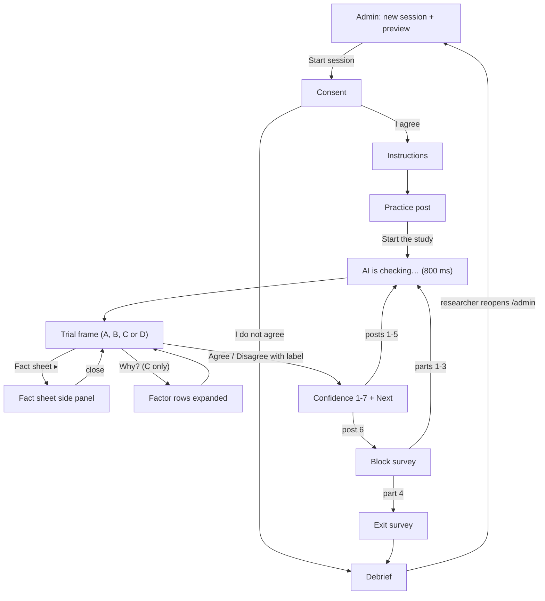

# Wireframes: AI label study app (low fidelity)

This document gives a low-fidelity ASCII wireframe for every screen in the v3 study app, where participants judge made-up social media posts from the fictional town of Riverton and decide whether to agree with an AI accuracy label. The goal is that every team member builds the same layout, and that the report can show the planned interface next to screenshots of the running app. Each wireframe is at most 46 characters wide so it reads on a phone and in the PDF. The real app is laid out for a desktop browser (see `architecture.md`), so treat these as content and order, not pixel layout. Under each wireframe, 2–4 notes say what is logged and which interaction rules apply. Field and event names follow `data-model.md`. Participant-facing wording (instructions, the practice post, post cards, fact sheets, B/C/D text) is copied from `stimuli.md`, which wins if the two ever differ; `_shared-decisions.md` is binding on the post bank and condition rules.

Conventions: `[ Button ]` is a button, `( )` is a radio option, `▸` is a collapsed row, `▾` an expanded one, `✓`/`⚠` are the two label icons, and `♡`/`↻` are likes and reposts.

The previous design (v2.1, approving an AI agent's actions) has its own wireframes in `archive/v2.1-agent-permission/wireframes.md`.

---

## 1. Consent (`ConsentScreen`)

```
┌──────────────────────────────────────────┐
│ Judging AI labels on social media posts  │
├──────────────────────────────────────────┤
│ This study looks at how people use AI    │
│ labels when they read social media posts.│
│                                          │
│ • About 30–35 minutes                    │
│ • You will read 24 made-up posts and     │
│   answer short questions, including how  │
│   tense or frustrated you felt           │
│ • Taking part is voluntary; you can stop │
│   at any time                            │
│ • Answers are stored under a number,     │
│   not your name                          │
│ • Contact: research team (on handout)    │
│                                          │
│ [ I agree ]         [ I do not agree ]   │
└──────────────────────────────────────────┘
```

- "I agree" logs `consent_given` and sets `consentAt`.
- "I do not agree" goes straight to the Debrief (short version), and no trial data is recorded.
- No back button, and no link to `/admin` appears anywhere in the participant flow.

## 2. Instructions (`InstructionsScreen`)

```
┌──────────────────────────────────────────┐
│ How this study works                     │
├──────────────────────────────────────────┤
│ You will read 24 short social media      │
│ posts from Riverton, a small town in     │
│ Alder County. The town, the people and   │
│ the accounts are all made up.            │
│                                          │
│ An AI tool has read each post and given  │
│ it an AI label:                          │
│   ✓ Likely accurate: claim is correct    │
│   ⚠ Likely misleading: claim is wrong    │
│                                          │
│ In some parts of the study, the label    │
│ comes with an explanation from the AI.   │
│                                          │
│ Every post has a fact sheet: the         │
│ official town or county record on the    │
│ topic. Open it any time with             │
│ [ Fact sheet ▸ ].                        │
│                                          │
│ For each post, choose one:               │
│  [ Agree with label ]                    │
│  [ Disagree with label ]                 │
│ Then rate how confident you are.         │
│                                          │
│ 4 parts of 6 posts, with a short         │
│ questionnaire after each part. First     │
│ comes one practice post (not scored).    │
│                       [ Start practice ] │
└──────────────────────────────────────────┘
```

- Wording is the instructions text in `stimuli.md` §2 (condensed here to fit). "Start practice" logs `practice_start`.
- The button stays disabled for the first 5 s so the page can't be skipped by accident.
- The text never says that labels may be wrong, and it is the same for every pid.

## 3. Practice post (part of `InstructionsScreen`)

```
┌──────────────────────────────────────────┐
│ Practice · not scored                    │
├──────────────────────────────────────────┤
│ ┌──────────────────────────────────────┐ │
│ │ Riverton Parks ✔                     │ │
│ │ @RivertonParks · 2h                  │ │
│ │ The Birch Road dog park reopens      │ │
│ │ Saturday, April 4, with new fencing  │ │
│ │ and a separate small-dog area.       │ │
│ │ ♡ 74   ↻ 9                           │ │
│ └──────────────────────────────────────┘ │
│ AI label: ✓ Likely accurate              │
│ ┌─ EXPLANATION AREA ───────────────────┐ │
│ │ part 1's condition: none, B, C or D  │ │
│ └──────────────────────────────────────┘ │
│                          [ Fact sheet ▸ ]│
│                                          │
│ Name, @handle: who posted it (✔ means a  │
│   verified account)                      │
│ Text: what the post claims               │
│ AI label: the AI's call on the post      │
│ Fact sheet: the record to check it with  │
│                                          │
│ [Agree with label] [Disagree with label] │
│ then the confidence strip (§9)           │
│ (buttons work here, nothing is saved)    │
│                    [ Start the study ]   │
└──────────────────────────────────────────┘
```

- The practice post (`practice-01`, `stimuli.md` §3) is not in the 24-post bank and carries a correct "Likely accurate" label on a TRUE post. It is shown in the condition of part 1, so the explanation area shows part 1's B sentence, C rows or D sentence (or nothing for A).
- The fact sheet ("Birch Road Dog Park Reopening") opens exactly as in trials, so the participant learns where it is. Nothing is logged as a trial; the events have `trialId: null`.
- "Start the study" logs `practice_complete`, then `block_start`, and opens post 1 of part 1.

## 4. Trial frame, shared by all conditions (`TrialScreen`)

```
┌──────────────────────────────────────────┐
│ Part 3 of 4 · Post 2 of 6                │
├──────────────────────────────────────────┤
│ ┌─ POST (PostCard) ────────────────────┐ │
│ │ Riverton Neighbors ✔                 │ │
│ │ @RivertonNeighbors · 6h              │ │
│ │                                      │ │
│ │ Good news: Riverton tap water met    │ │
│ │ all 12 safety limits in March.       │ │
│ │                                      │ │
│ │ ♡ 187   ↻ 52                         │ │
│ └──────────────────────────────────────┘ │
│ ┌─ LabelPanel ─────────────────────────┐ │
│ │ AI label: ⚠ Likely misleading        │ │
│ └──────────────────────────────────────┘ │
│ ┌─ EXPLANATION AREA (fixed height) ────┐ │
│ │   varies by condition, see §5        │ │
│ └──────────────────────────────────────┘ │
│                          [ Fact sheet ▸ ]│
│ [Agree with label] [Disagree with label] │
└──────────────────────────────────────────┘
```

- `PostCard`, `LabelPanel`, [Fact sheet ▸] and the two buttons are identical in every condition. Only the explanation area changes, and its fixed height keeps the buttons in the same place. A verified account (like this one) shows `✔` after the display name; an unverified one shows nothing.
- Logs `trial_shown` (sets `labelShownAt`, the zero point for `tMs`), `decision_agree` / `decision_disagree` (sets `respondedAt`, `agreed`) and `visibility_hidden` / `visibility_visible`. `decisionTimeMs = decisionTimeRawMs - hiddenMs`, so fact-sheet and "Why?" time counts.
- Both buttons share one synchronous lock, and a click only counts if it lands after `trial_shown`. The confidence strip (§9) follows on the same route.

## 5. Explanation area variants (p15)

p15 is a `false_alarm` (`difficulty: subtle`): the post is TRUE (the March report says all 12 results were within safety limits), but the AI labels it "⚠ Likely misleading". The account is verified and the wording neutral, so all three C rows show ✓.

**A: No explanation (`NoExplanationView`)**

```
┌─ EXPLANATION AREA ───────────────────────┐
│                                          │
│            (empty: label only)           │
│                                          │
└──────────────────────────────────────────┘
```

**B: Static reason (`StaticExplanationView`)**

```
┌─ EXPLANATION AREA ───────────────────────┐
│ Flagged: claims about water safety are   │
│ often exaggerated.                       │
│                                          │
└──────────────────────────────────────────┘
```

**C: Interactive "Why?" (`InteractiveExplanationView`), collapsed**

```
┌─ EXPLANATION AREA ───────────────────────┐
│ [ Why? ▾ ]                               │
│                                          │
└──────────────────────────────────────────┘
```

**C: after "Why?", with the Source row expanded**

```
┌─ EXPLANATION AREA ───────────────────────┐
│ [ Why? ▴ ]                               │
│ ▾ Source                                 │
│   @RivertonNeighbors · verified       ✓  │
│     Community pages can be verified      │
│     without being experts on water       │
│     testing.                             │
│ ▸ Claim vs record                        │
│   Post: all 12 limits met in March       │
│   Record: all 12 tests within limits  ✓  │
│ ▸ Wording     Neutral                 ✓  │
└──────────────────────────────────────────┘
```

**D: Counterfactual (`CounterfactualView`)**

```
┌─ EXPLANATION AREA ───────────────────────┐
│ This would be labeled accurate if it     │
│ cited the March test report.             │
│                                          │
└──────────────────────────────────────────┘
```

- A logs nothing extra. Outside C, `explanationOpened = null`, `timeToFirstExpandMs = null` and `factorsExpanded = []`.
- B and D argue for the label in the same confident tone whether it is right or wrong. On a wrong label they cite a plausible but non-decisive factor (here, the topic and the missing citation), never the fact-sheet value.
- C starts collapsed on every trial. It logs `why_open` / `why_close` and `factor_expand` / `factor_collapse` (with `factorKey`), sets `explanationOpened`, appends to `factorsExpanded[]` in order (exported as a pipe-separated cell), and sets `timeToFirstExpandMs` from the first "Why?". ✓/✗ always comes from the true values, so the Claim vs record ✓ is the checkable clue; only the `detail` sentence argues for the label. C row text is from `stimuli.md` p15.
- No condition ever shows an AI confidence score. Final wording for every post is in `stimuli.md`.

## 6. Fact sheet side panel (`FactSheetPanel`, p15)

```
┌──────────────────────────────────────────┐
│ Part 3 of 4 · Post 2 of 6                │
├─────────────────┬────────────────────────┤
│ (post, label,   │ FACT SHEET         [×] │
│  explanation    │                        │
│  and buttons    │ March Water Quality    │
│  stay visible   │ Report                 │
│  and usable)    │                        │
│                 │ In March, Riverton's   │
│ ┌─────────────┐ │ tap water was tested   │
│ │ Good news:  │ │ for 12 regulated       │
│ │ Riverton    │ │ substances. All 12     │
│ │ tap water…  │ │ results were within    │
│ └─────────────┘ │ safety limits.         │
│ ⚠ Likely misl…  │                        │
│ [Fact sheet ◂]  │ Source: Riverton Water │
│                 │ Department (fictional) │
└─────────────────┴────────────────────────┘
```

- Logs `fact_sheet_open` and `fact_sheet_close`, sets `factSheetOpened = true`, and adds the open time to `factSheetOpenMs` (summed over repeat opens). The time counts toward `decisionTimeMs` (H6).
- It is a side panel, so opening it never covers the post or the buttons. [×], Esc or the button again closes it, and the participant can decide with it open.
- The panel is identical across conditions and never mentions the label.

## 7. A miss in condition C (p10)

p10 is a `miss` (`difficulty: clear`): the post is FALSE (downtown parking remains $2 per hour), but the AI labels it "✓ Likely accurate". Post, rows and detail are from `stimuli.md` p10.

```
┌──────────────────────────────────────────┐
│ Part 1 of 4 · Post 4 of 6                │
├──────────────────────────────────────────┤
│ ┌─ POST ───────────────────────────────┐ │
│ │ Riverton Community News ✔            │ │
│ │ @RivertonCommNews · 7h               │ │
│ │                                      │ │
│ │ Downtown Riverton parking now costs  │ │
│ │ $4 an hour, starting this month.     │ │
│ │ Meters still take cards and coins.   │ │
│ │                                      │ │
│ │ ♡ 233   ↻ 140                        │ │
│ └──────────────────────────────────────┘ │
│ ┌─ LabelPanel ─────────────────────────┐ │
│ │ AI label: ✓ Likely accurate          │ │
│ └──────────────────────────────────────┘ │
│ ┌─ EXPLANATION AREA ───────────────────┐ │
│ │ [ Why? ▴ ]                           │ │
│ │ ▸ Source                             │ │
│ │   @RivertonCommNews · verified     ✓ │ │
│ │ ▾ Claim vs record                    │ │
│ │   Post: $4 per hour                  │ │
│ │   Record: $2 per hour              ✗ │ │
│ │     News outlets often report fee    │ │
│ │     changes before city pages        │ │
│ │     update.                          │ │
│ │ ▸ Wording     Neutral              ✓ │ │
│ └──────────────────────────────────────┘ │
│                          [ Fact sheet ▸ ]│
│ [Agree with label] [Disagree with label] │
└──────────────────────────────────────────┘
```

- `agreed = true` still means "went with the AI label". Here disagreeing is correct, so `detectedError = true` if they disagree.
- The ✗ on Claim vs record is the true comparison, while the detail sentence still argues for the label. This is the case H1b and H3b look at: whether a visible ✗ narrows the miss vs false-alarm gap and raises tension.
- If the area overflows, it scrolls inside itself so the buttons don't move.

## 8. "AI is checking…" state (~800 ms)

```
┌──────────────────────────────────────────┐
│ Part 3 of 4 · Post 2 of 6                │
├──────────────────────────────────────────┤
│ ┌─ POST ───────────────────────────────┐ │
│ │ (PostCard already visible)           │ │
│ └──────────────────────────────────────┘ │
│ ┌─ LabelPanel ─────────────────────────┐ │
│ │ ◌ AI is checking…                    │ │
│ └──────────────────────────────────────┘ │
│ ┌─ EXPLANATION AREA ───────────────────┐ │
│ │ (empty, same height)                 │ │
│ └──────────────────────────────────────┘ │
│                          [ Fact sheet ▸ ]│
│ [Agree with label] [Disagree with label] │
│     (disabled)           (disabled)      │
└──────────────────────────────────────────┘
```

- The delay is fixed at ~800 ms in every condition and for every post, so timing never hints at correctness.
- Both buttons, "Why?" and [Fact sheet ▸] are disabled during the delay. `trial_shown` is logged (and `labelShownAt` set) in a `requestAnimationFrame` after the label paints, so the delay isn't counted.
- Focus starts on the page heading, not on a button, so a stray Enter can't decide the trial.

## 9. Per-post confidence strip (`PostRatingStrip`)

```
┌──────────────────────────────────────────┐
│ Part 3 of 4 · Post 2 of 6                │
├──────────────────────────────────────────┤
│ You chose: Disagree with label           │
│                                          │
│ How confident are you in your decision?  │
│ 1 = Not at all confident                 │
│ 7 = Extremely confident                  │
│  1   2   3   4   5   6   7               │
│ ( ) ( ) ( ) ( ) ( ) ( ) ( )              │
│ (required: Next stays disabled until a   │
│  value is chosen)                        │
│                              [ Next ]    │
└──────────────────────────────────────────┘
```

- Shown after every post, on the same route as the trial; the decision is already locked and can't be changed. Wording and anchors are the `confidence` item in `surveyItems.json`.
- Confidence is **required**: there is no skip, Next enables only once a value is chosen, and it disables after one press. Each choice logs `confidence_submit`; the last value is stored in the trial's `confidence` (1–7).
- The record is saved to `localStorage` after the decision and again after Next. Post 6 leads to the block survey.

## 10. Block survey (`BlockSurveyScreen`)

```
┌──────────────────────────────────────────┐
│ About the AI labels in Part 2            │
├──────────────────────────────────────────┤
│ 1 = Not at all      7 = Extremely        │
│  1. The AI labels are deceptive.         │
│     ( )( )( )( )( )( )( )                │
│  2. The AI labels behave in an           │
│     underhanded manner.                  │
│     ( )( )( )( )( )( )( )                │
│  ⋮  items 3–11                           │
│ 12. I am familiar with the AI labels.    │
│     ( )( )( )( )( )( )( )                │
├──────────────────────────────────────────┤
│ 1 = Strongly disagree 7 = Strongly agree │
│ 13. The AI labels were fair to the       │
│     people who posted.                   │
│     ( )( )( )( )( )( )( )                │
│ 14. The AI labels treated posts          │
│     consistently.                        │
│     ( )( )( )( )( )( )( )                │
├──────────────────────────────────────────┤
│ 15. How tense did you feel while judging │
│     the posts in this part?              │
│     1 = not at all  7 = extremely tense  │
│     ( )( )( )( )( )( )( )                │
│ 16. How irritated, stressed or annoyed   │
│     did you feel during this part?       │
│     Very low                  Very high  │
│     0 ├───────────●───────────┤ 100      │
│                  50 (not yet set)        │
├──────────────────────────────────────────┤
│                          [ Continue ]    │
└──────────────────────────────────────────┘
```

- Fixed order: 12 Jian items (`jian-01`…`jian-12`; items 1–5 are reverse-scored into `trustResponses[].scored` at submit and recomputed at export), then the 2 fairness items, then `tension` (1–7), then `frustrationTlx` (NASA-TLX frustration, 0–100 in steps of 5).
- All 16 items are required, and Continue names any that are missing. The slider starts at 50 but only counts once the participant moves it (`frustrationTlxTouched`), so an untouched default is never stored. The value shows under the thumb.
- Logs `block_survey_submit` and saves the block's `survey` record; `nWrongDetected` is computed from the block's trials. The heading says "Part N" and never names the condition. Continue disables once pressed.

## 11. Exit survey (`ExitSurveyScreen`)

```
┌──────────────────────────────────────────┐
│ A few last questions                     │
├──────────────────────────────────────────┤
│ Age range        [ 18–24          ▾ ]    │
│ Gender (opt.)    [ prefer not say ▾ ]    │
│ Education        [ some college   ▾ ]    │
│                                          │
│ How often do you use social media? *     │
│ ( ) never      ( ) less than weekly      │
│ ( ) weekly     ( ) daily  ( ) many/day   │
│                                          │
│ How often have you seen accuracy or      │
│ fact-check labels on real platforms? *   │
│ ( ) never  ( ) rarely  ( ) sometimes     │
│ ( ) often                                │
│                                          │
│ Which part did you prefer? *             │
│ ( ) Part 1  [thumbnail]                  │
│ ( ) Part 2  [thumbnail]                  │
│ ( ) Part 3  [thumbnail]                  │
│ ( ) Part 4  [thumbnail]                  │
│ ( ) No preference                        │
│                                          │
│ Any comments? (no personal info)         │
│ ┌──────────────────────────────────────┐ │
│ │                                      │ │
│ └──────────────────────────────────────┘ │
│                            [ Submit ]    │
└──────────────────────────────────────────┘
```

- Required: social media use, label exposure and preferred part. The parts are shown as thumbnails in the session's own order, and the export maps them back to A/B/C/D.
- The comment is capped at 1000 characters.
- Logs `exit_survey_submit`, and sets `status = completed` and `completedAt`.

## 12. Debrief (`DebriefScreen`)

```
┌──────────────────────────────────────────┐
│ Thank you!                               │
├──────────────────────────────────────────┤
│ • The AI labels were not made by a real  │
│   AI. Every label was scripted by the    │
│   research team.                         │
│ • 8 of the 24 labels were wrong on       │
│   purpose: 4 true posts were labeled     │
│   misleading and 4 false posts were      │
│   labeled accurate.                      │
│ • Agreeing with a wrong label is common  │
│   and says nothing bad about you.        │
│ • Riverton, Alder County, every account  │
│   and every agency were made up.         │
│                                          │
│ [ Show the real facts ▾ ]                │
│ ┌──────────────────────────────────────┐ │
│ │ Tap water met all 12 limits in March │ │
│ │  → TRUE. All 12 tests were within    │ │
│ │    safety limits.                    │ │
│ │ Parking now costs $4 an hour         │ │
│ │  → FALSE. It is still $2 an hour.    │ │
│ │ ⋮ (all 8 wrong-label posts)          │ │
│ └──────────────────────────────────────┘ │
│                                          │
│ Please call the researcher now.          │
└──────────────────────────────────────────┘
```

- Logs `session_complete`, and triggers the optional POST to `VITE_SUBMIT_URL` if one is set.
- The facts list covers all 8 wrong-label posts (p03, p04, p09, p10, p15, p16, p21, p22), whichever ones this participant saw, so no false claim leaves the room uncorrected.
- No back button and no navigation away. A declined consent lands here too, with only the thank-you and contact lines.

## 13. Admin (`AdminScreen`, `/admin`, opened by URL only)

```
┌──────────────────────────────────────────┐
│ Researcher admin                         │
├──────────────────────────────────────────┤
│ New session                              │
│ Participant ID [  7  ]  [ Preview ]      │
│ ┌─ Assignment preview, pid 7 ──────────┐ │
│ │ Williams order   C → D → B → A       │ │
│ │ Set rotation     1                   │ │
│ │ Part 1 · C · S4  20 23 21 19 22 24   │ │
│ │ Part 2 · D · S1  04 01 05 03 06 02   │ │
│ │ Part 3 · B · S3  13 16 18 14 15 17   │ │
│ │ Part 4 · A · S2  11 07 10 12 09 08   │ │
│ │ wrong-label positions                │ │
│ │   3,5 · 1,4 · 2,5 · 3,5              │ │
│ └──────────────────────────────────────┘ │
│ ⚠ pid 7 already has a session (attempt 2)│
│                     [ Start session ]    │
├──────────────────────────────────────────┤
│ Sessions                                 │
│ pid  started      status     trials      │
│ 5    10-20 09:02  completed  24/24       │
│ 6    10-20 10:15  completed  24/24       │
│ 7    10-21 13:40  abandoned  11/24       │
├──────────────────────────────────────────┤
│ [ Export JSON ]  [ Export CSV ]          │
│ [ Clear all data ]  (needs export first) │
└──────────────────────────────────────────┘
```

- "Start session" logs `session_start` for the new session. Exports aren't logged.
- The preview comes from `assign(pid)` in `counterbalance.ts`: order `williams[(pid-1) % 4]` (pid 7 → CDBA), rotation `floor((pid-1)/4) % 4`, and set `S[(conditionIndex + rotation) % 4]`. The post order shown is illustrative; the two wrong labels are never both in positions 1–2.
- A duplicate pid shows the warning, and continuing creates a new `sessionId` with the same pid.
- "Clear all data" stays disabled until an export has been done in this browser, and then asks for confirmation.

## 14. Consequence banner (optional, off by default)

```
┌──────────────────────────────────────────┐
│ Part 3 of 4 · Post 2 of 6                │
├──────────────────────────────────────────┤
│ ┌─ optional, off by default ───────────┐ │
│ │ ⓘ Posts you agree are accurate stay  │ │
│ │   visible to other users.            │ │
│ └──────────────────────────────────────┘ │
│ ┌─ POST ───────────────────────────────┐ │
│ │ (PostCard, as in §4)                 │ │
│ └──────────────────────────────────────┘ │
│ (LabelPanel, explanation area,           │
│  Fact sheet ▸ and buttons as in §4)      │
└──────────────────────────────────────────┘
```

- Not built unless the team adds it. When on, it is set per session (`consequenceBanner = true`) and shows on every trial in every condition, above the post, at a fixed height.
- It is static text: no interaction and no extra events. The flag is exported with the session so analysis can separate the two groups.

---

## Screen flow



---

## Related docs

- [`architecture.md`](architecture.md): module structure, component tree, state and storage
- [`system-design.md`](system-design.md): requirements, screen-by-screen spec, counterbalancing, timing
- [`sequence-diagrams.md`](sequence-diagrams.md): runtime interactions (trial lifecycle, persistence, export)
- [`data-model.md`](data-model.md): canonical schemas, post bank and survey items
- [`ai-design.md`](ai-design.md): the Wizard-of-Oz label engine, explanation wording, wrong-label design
- [`research-positioning.md`](research-positioning.md): why the domain changed to AI accuracy labels
- [`implementation-plan.md`](implementation-plan.md): build order and owners
- [`study-protocol.md`](study-protocol.md): how a session is run
- [`stimuli.md`](stimuli.md): final participant-facing text for the practice post and all 24 posts (the wording authority)
- [`wireframes.md`](wireframes.md): this document
