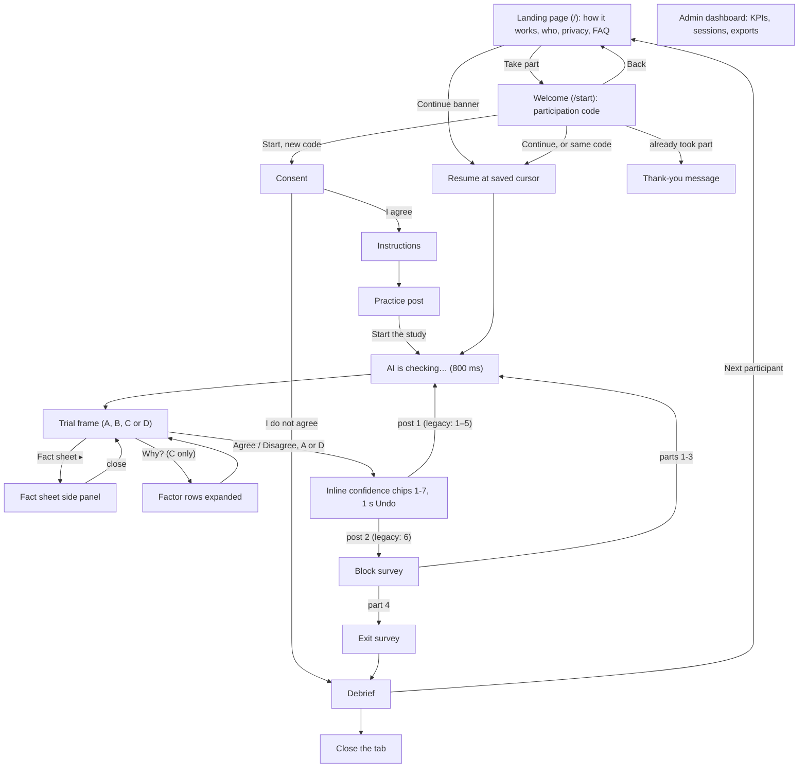

# Wireframes: AI label study app (low fidelity)

This document gives a low-fidelity ASCII wireframe for every screen in the v3 study app, where participants judge made-up social media posts from the fictional town of Riverton and decide whether to agree with an AI accuracy label. The goal is that every team member builds the same layout, and that the report can show the planned interface next to screenshots of the running app. Wireframes prioritize readable content and order; attribution wraps across lines on narrow screens. The real app works from 360 px phones to 1280 px laptops (see `architecture.md`); on wide screens the trial puts the post and the label side by side, and on phones it stacks them (§15). Treat these as content and order, not pixel layout. **v2:** the study is self-guided and once-only (public landing page at `/`, §0a, then the participation-code screen at `/start`, §0b), each post takes two taps (decision, then an inline confidence chip, §9), a progress bar and keyboard hints sit on every trial, the block survey is one matrix screen (§10), and `/admin` is a read-only KPI dashboard (§13). Under each wireframe, 2–4 notes say what is logged and which interaction rules apply. Field and event names follow `data-model.md`. Participant-facing wording (instructions, the practice post, post cards, fact sheets, B/C/D text) is copied from `stimuli.md`, which wins if the two ever differ; `_shared-decisions.md` is binding on the post bank and condition rules.

Conventions: `[ Button ]` is a button, `[1]` a tappable chip, `○`/`●` an empty/filled matrix cell, `▓░` the progress bar, `( )` is a radio option, `▸` is a collapsed row, `▾` an expanded one, `✓`/`⚠` are the two label icons, and `♡`/`↻` are likes and reposts.

HCI experiment conducted as part of graduate study at Florida Polytechnic University.

**Active flow:** new sessions have **8 analysed posts**, four parts of two posts, plus one practice post. Each part has one correct and one wrong label; each participant sees two false alarms and two misses. Across 32 new-session completers, each condition must receive 16 false alarms and 16 misses. These are assignment constraints for the team, not participant-facing disclosures. Saved legacy sessions keep six posts per part and 24 overall, their saved assignment, cursor and completion requirements. Render progress and debrief from the session version; do not pool eight-post and 24-post responses in analysis. The diagrams below describe new sessions unless explicitly marked otherwise. Implementation must be verified separately.

The previous design (v2.1, approving an AI agent's actions) has its own wireframes in `archive/v2.1-agent-permission/wireframes.md`.

---

## 0a. Landing page (`LandingScreen`, `/`)

The public page that the recruitment link and QR code open. Desktop (about 1280 px; the hero puts the text and an illustration side by side, and "Who can take part" and "Your privacy" sit in two columns):

```
┌──────────────────────────────────────────┐
│ You have a session in progress.          │
│                             [ Continue ] │
├──────────────────────────────────────────┤
│ Post Review Study       ┌──────────────┐ │
│                         │ ▭ post       │ │
│ Help us understand how  │ ✓ AI label   │ │
│ people use AI labels on │ [Agree] [..] │ │
│ social media posts.     └──────────────┘ │
│                          (illustration)  │
│ [ Take part ]  How it works ↓            │
├──────────────────────────────────────────┤
│ How it works                             │
│ ① Enter a  ② Read 8 short   ③ Answer a  │
│   code.      made-up posts;    few quick │
│              agree or not      questions.│
│              with each label             │
│ Four parts · phone or computer  │
├──────────────────────────────────────────┤
│ Who can take part   │ Your privacy       │
│ • Anyone aged 18+   │ • Pseudonymous     │
│   who reads English │ • Only a scrambled │
│ • Once per person   │   code is kept     │
│ • No experience     │ • Stop at any time │
│   needed            │                   │
├──────────────────────────────────────────┤
│ Questions                                │
│ ▸ How long does it take?                 │
│ ▸ Do I need to know about AI?            │
│ ▸ Can I stop?                            │
│ ▸ What if I close the tab?               │
├──────────────────────────────────────────┤
│ HCI experiment conducted as part of     │
│ graduate study at Florida Polytechnic   │
│ University.                             │
└──────────────────────────────────────────┘
```

Phone (360 px; one column, full-width buttons, the illustration under the call to action):

```
┌────────────────────────────────┐
│ Session in progress            │
│ [         Continue           ] │
├────────────────────────────────┤
│ Post Review Study              │
│ Help us understand how people  │
│ use AI labels on social media  │
│ posts.                         │
│ [         Take part          ] │
│ How it works ↓                 │
│        (illustration)          │
├────────────────────────────────┤
│ How it works                   │
│ ① Enter a participation code.  │
│ ② Read 8 short made-up posts  │
│   and say whether you agree    │
│   with each AI label.          │
│ ③ Answer a few quick questions.│
│ Four parts · phone or PC  │
├────────────────────────────────┤
│ Who can take part              │
│ • Anyone aged 18 or over who   │
│   reads English                │
│ • Once per person              │
│ • No experience needed         │
├────────────────────────────────┤
│ Your privacy                   │
│ • Responses are pseudonymous  │
│ • Only a scrambled version of  │
│   your code is kept            │
│ • You can stop at any time     │
│ • Saved answers remain stored │
├────────────────────────────────┤
│ Questions                      │
│ ▸ How long does it take?       │
│ ▸ Do I need to know about AI?  │
│ ▸ Can I stop?                  │
│ ▸ What if I close the tab?     │
├────────────────────────────────┤
│ HCI experiment conducted as    │
│ part of graduate study at      │
│ Florida Polytechnic University.│
└────────────────────────────────┘
```

- **Take part** goes to `/start` (§0b). "How it works ↓" scrolls to the steps. A "Skip to main content" link is the first focusable element. Nothing is logged: no session exists yet, and the page makes no API call.
- The **session in progress** banner, with **Continue**, appears only when the browser holds `xai-study:activeSessionId`. Continue resumes at the saved cursor; if the server no longer has the session, the banner is replaced by "We couldn't find your previous session. Choose 'Take part' and enter your code to continue."
- The wording follows the recruitment rules in `study-protocol.md` §6: plain and neutral, with no hint that labels can be wrong or are scripted. The FAQ items are collapsed `<details>`: how long (duration still requires an eight-post pilot), AI knowledge (none needed), stopping (at any time, no penalty), closing the tab (continue with the same code within 2 hours). Use the university attribution above without an institutional authorization claim. Do not display an unverified assistance or deletion-request channel. Stopping is voluntary; closing the tab retains saved answers.

## 0b. Welcome / participation code (`WelcomeScreen`, `/start`)

```
┌──────────────────────────────────────────┐
│ ← Back                                   │
│ Judging AI labels on social media posts  │
├──────────────────────────────────────────┤
│ Read 8 made-up posts, each with an AI   │
│ label, and decide if you agree. Short    │
│ questions after each part.               │
│                                          │
│ Four parts · desktop or phone   │
│                                          │
│ Participation code                       │
│ ┌──────────────────────────────────────┐ │
│ │ e.g. your university email           │ │
│ └──────────────────────────────────────┘ │
│ Only used so each person takes part      │
│ once. Stored scrambled, never as typed.  │
│                                          │
│                                [ Start ] │
│ Enter also starts.                       │
├──────────────────────────────────────────┤
│ Started already on this device?          │
│                             [ Continue ] │
└──────────────────────────────────────────┘
```

- **Start** (or Enter) sends `POST /api/sessions { participantCode }`. 201 → consent; 200 → resumes at the saved cursor; 409 → the "already taken part" state below; 400 → "Please enter 3–120 characters". The raw code is never stored; the server keeps only its salted hash.
- **← Back** returns to the landing page (`/`). **Continue** appears only when the browser holds `xai-study:activeSessionId`. No researcher step and no pid entry anywhere.
- When the server answers 409 (the code already has a completed or abandoned session), the screen shows only the message below. Nothing in the browser triggers it: after a finished study the browser holds no study data, so a returning visitor sees the normal screen above until they type a used code.

```
┌──────────────────────────────────────────┐
│ Judging AI labels on social media posts  │
├──────────────────────────────────────────┤
│ You've already taken part. Thank you!    │
│                                          │
│ You can close this page.                │
└──────────────────────────────────────────┘
```

## 1. Consent (`ConsentScreen`)

```
┌──────────────────────────────────────────┐
│ Before you start                         │
├──────────────────────────────────────────┤
│ This study looks at how people use AI    │
│ labels on social media posts.            │
│                                          │
│ • Four parts, on your own       │
│ • 8 made-up posts and short questions,  │
│   including how tense you felt           │
│ • Voluntary: stop at any time            │
│ • Stored under a number, not your name   │
│ • Saved answers remain if you stop      │
│                                          │
│ [ Read full consent details ▸ ]          │
│                                          │
│ [✓] I have read this and agree to take   │
│     part                                 │
│                             [ Continue ] │
│ [ I do not agree ]                       │
└──────────────────────────────────────────┘
```

- The short text is always visible; "Read full consent details ▸" expands the full consent text in place. Continue enables only once the box is ticked, and logs `consent_given` and sets `consentAt`.
- "I do not agree" goes straight to the Debrief (short version), and no trial data is recorded.
- Self-guided wording: no "call the researcher" anywhere; the copy preserves the right to stop without promising unverified follow-up. No back button and no link to `/admin`.

## 2. Instructions (`InstructionsScreen`)

```
┌──────────────────────────────────────────┐
│ How it works                             │
├──────────────────────────────────────────┤
│ • An AI labeled each post ✓ Likely       │
│   accurate or ⚠ Likely misleading.       │
│ • Open [ Fact sheet ▸ ] to check the     │
│   official record, any time.             │
│ • Agree or Disagree, then tap how sure   │
│   you are (1–7). Keys: A D 1–7 F.        │
├──────────────────────────────────────────┤
│ Practice · not scored                    │
│ ┌──────────────────────────────────────┐ │
│ │ Riverton Parks ✔ · @RivertonParks    │ │
│ │ The Birch Road dog park reopens      │ │
│ │ Saturday, April 4, with new fencing  │ │
│ │ and a separate small-dog area.       │ │
│ └──────────────────────────────────────┘ │
│ AI label: ✓ Likely accurate              │
│                         [ Fact sheet ▸ ] │
│ [Agree with label] [Disagree with label] │
│ How sure? [1][2][3][4][5][6][7]          │
│                                          │
│                      [ Start the study ] │
└──────────────────────────────────────────┘
```

- One short screen: 3 bullets, then the practice post inline (details in §3). There is no 5 s reading lock any more.
- The keyboard hint names the shortcuts once; trials repeat it in a small hint line. The text never says that labels may be wrong, and it is the same for every pid.
- "Start the study" enables after the practice post has been answered, logs `practice_complete` and `block_start`, and opens post 1 of 8.

## 3. Practice post (inline on `InstructionsScreen`, §2)

The practice card from §2 in more detail:

```
┌──────────────────────────────────────────┐
│ Practice · not scored                    │
├──────────────────────────────────────────┤
│ ┌──────────────────────────────────────┐ │
│ │ Riverton Parks ✔                     │ │
│ │ @RivertonParks · 2h                  │ │
│ │ The Birch Road dog park reopens      │ │
│ │ Saturday, April 4, with new fencing  │ │
│ │ and a separate small-dog area.       │ │
│ │ ♡ 74   ↻ 9                           │ │
│ └──────────────────────────────────────┘ │
│ AI label: ✓ Likely accurate              │
│ ┌─ EXPLANATION AREA ───────────────────┐ │
│ │ part 1's condition: none, B, C or D  │ │
│ └──────────────────────────────────────┘ │
│                          [ Fact sheet ▸ ]│
│                                          │
│ Name, @handle: who posted it (✔ means a  │
│   verified account)                      │
│ Text: what the post claims               │
│ AI label: the AI's call on the post      │
│ Fact sheet: the record to check it with  │
│                                          │
│ [Agree with label] [Disagree with label] │
│ then the confidence chips (§9)           │
│ (buttons work here, nothing is saved)    │
│                    [ Start the study ]   │
└──────────────────────────────────────────┘
```

- The practice post (`practice-01`, `stimuli.md` §3) is not in the 24-post bank and carries a correct "Likely accurate" label on a TRUE post. It is shown in the condition of part 1, so the explanation area shows part 1's B sentence, C rows or D sentence (or nothing for A).
- The fact sheet ("Birch Road Dog Park Reopening") opens exactly as in trials, so the participant learns where it is. Nothing is logged as a trial; the events have `trialId: null`.
- "Start the study" logs `practice_complete`, then `block_start`, and opens post 1 of part 1.

## 4. Trial frame, shared by all conditions (`TrialScreen`)

```
┌──────────────────────────────────────────┐
│ Post 6 of 8 · Part 3 of 4              │
│ ▓▓▓▓▓▓▓▓▓▓▓▓▓▓▓▓▓▓▓▓▓▓░░░░░░░░░░░░░░░░░  │
├──────────────────────────────────────────┤
│ ┌─ POST (PostCard) ────────────────────┐ │
│ │ Riverton Neighbors ✔                 │ │
│ │ @RivertonNeighbors · 6h              │ │
│ │                                      │ │
│ │ Good news: Riverton tap water met    │ │
│ │ all 12 safety limits in March.       │ │
│ │                                      │ │
│ │ ♡ 187   ↻ 52                         │ │
│ └──────────────────────────────────────┘ │
│ ┌─ LabelPanel ─────────────────────────┐ │
│ │ AI label: ⚠ Likely misleading        │ │
│ └──────────────────────────────────────┘ │
│ ┌─ EXPLANATION AREA (fixed height) ────┐ │
│ │   varies by condition, see §5        │ │
│ └──────────────────────────────────────┘ │
│                         [ Fact sheet ▸ ] │
│ [Agree with label] [Disagree with label] │
│ A agree · D disagree · F fact sheet      │
└──────────────────────────────────────────┘
```

- The progress bar shows "Post n of 8" overall and "Part x of 4". `PostCard`, `LabelPanel`, [Fact sheet ▸] and the two buttons are identical in every condition. Only the explanation area changes, and its fixed height keeps the buttons in the same place. A verified account shows `✔` after the display name.
- Keyboard: `A` agree, `D` disagree, `F` fact sheet, `W` "Why?" (C only), `Esc` closes a panel, `1`–`7` confidence once the chips show. The hint line lists them; on phones it is hidden.
- Logs `trial_shown` (sets `labelShownAt`), `decision_agree` / `decision_disagree` (sets `respondedAt`, `agreed`) and `visibility_hidden` / `visibility_visible`. `decisionTimeMs = decisionTimeRawMs - hiddenMs`.
- Both buttons share one synchronous lock, and a click or key only counts after `trial_shown`. The confidence chips (§9) slide in on the same screen. The next post is prefetched while this one is shown.

## 4a. Compact guidance for the first two posts of each part

This is the requested interaction specification; verify the running app before calling it implemented. New sessions have only two posts per part, and both remain analysed trials, not extra practice. In legacy six-post parts, show the same cues only at positions 1 and 2 without changing later trials or saved state. Keep cues inline in a consistent location, visible without extra clicks, with no modal tour, forced wait or automatic panel opening. Avoid adding motion when the part changes; preserve visible focus, keyboard access and reduced-motion support.

| Assigned condition | Post 1 cue | Post 2 reminder | What differs in this part |
|---|---|---|---|
| A | “Read the post and its label. You can open the fact sheet before deciding.” | “Agree or disagree, then rate how sure you are.” | Label-only baseline; fact sheet remains optional. |
| B | “A short reason appears below the label. The fact sheet is available too.” | “Read the reason if useful, then decide.” | A visible scripted reason, with no extra control. |
| C | “Use Why? to explore Source, Claim vs record and Wording, if useful.” | “Each row opens separately. You choose what to explore.” | Optional Why? and independent row expansion; preserve the true comparison. |
| D | “The sentence below the label describes what would change the label.” | “Consider the if-statement, then decide.” | A scripted alternative scenario, with no new mandatory action. |

Part numbers follow the participant's Williams order; Part 1 is not always A. Do not introduce a Why? button in A/B/D, force verification, reveal errors or change canonical explanation text to manufacture variety. All parts keep the same post, label, fact sheet and Agree/Disagree → confidence controls, common checking delay and Undo. The explanation area remains comparable across conditions; inspect wrappers and clipping before treating blank space as a bug. These interface differences motivate the within-person comparison; they are not findings that any interface helps. Condition-specific cue wording itself may influence behavior and must be documented as a limitation.

## 5. Explanation area variants (p15)

p15 is a `false_alarm` (`difficulty: subtle`): the post is TRUE (the March report says all 12 results were within safety limits), but the AI labels it "⚠ Likely misleading". The account is verified and the wording neutral, so all three C rows show ✓.

**A: No explanation (`NoExplanationView`)**

```
┌─ EXPLANATION AREA ───────────────────────┐
│                                          │
│            (empty: label only)           │
│                                          │
└──────────────────────────────────────────┘
```

**B: Static reason (`StaticExplanationView`)**

```
┌─ EXPLANATION AREA ───────────────────────┐
│ Flagged: claims about water safety are   │
│ often exaggerated.                       │
│                                          │
└──────────────────────────────────────────┘
```

**C: Interactive "Why?" (`InteractiveExplanationView`), collapsed**

```
┌─ EXPLANATION AREA ───────────────────────┐
│ [ Why? ▾ ]                               │
│                                          │
└──────────────────────────────────────────┘
```

**C: after "Why?", with the Source row expanded**

```
┌─ EXPLANATION AREA ───────────────────────┐
│ [ Why? ▴ ]                               │
│ ▾ Source                                 │
│   @RivertonNeighbors · verified       ✓  │
│     Community pages can be verified      │
│     without being experts on water       │
│     testing.                             │
│ ▸ Claim vs record                        │
│   Post: all 12 limits met in March       │
│   Record: all 12 tests within limits  ✓  │
│ ▸ Wording     Neutral                 ✓  │
└──────────────────────────────────────────┘
```

**D: Counterfactual (`CounterfactualView`)**

```
┌─ EXPLANATION AREA ───────────────────────┐
│ This would be labeled accurate if it     │
│ cited the March test report.             │
│                                          │
└──────────────────────────────────────────┘
```

- A logs nothing extra. Outside C, `explanationOpened = null`, `timeToFirstExpandMs = null` and `factorsExpanded = []`.
- B and D argue for the label in the same confident tone whether it is right or wrong. On a wrong label they cite a plausible but non-decisive factor (here, the topic and the missing citation), never the fact-sheet value.
- C starts collapsed on every trial. It logs `why_open` / `why_close` and `factor_expand` / `factor_collapse` (with `factorKey`), sets `explanationOpened`, appends to `factorsExpanded[]` in order (exported as a pipe-separated cell), and sets `timeToFirstExpandMs` from the first "Why?". ✓/✗ always comes from the true values, so the Claim vs record ✓ is the checkable clue; only the `detail` sentence argues for the label. C row text is from `stimuli.md` p15.
- No condition ever shows an AI confidence score. Final wording for every post is in `stimuli.md`.

## 6. Fact sheet side panel (`FactSheetPanel`, p15)

```
┌──────────────────────────────────────────┐
│ Part 3 of 4 · Post 2 of 2                │
├─────────────────┬────────────────────────┤
│ (post, label,   │ FACT SHEET         [×] │
│  explanation    │                        │
│  and buttons    │ March Water Quality    │
│  stay visible   │ Report                 │
│  and usable)    │                        │
│                 │ In March, Riverton's   │
│ ┌─────────────┐ │ tap water was tested   │
│ │ Good news:  │ │ for 12 regulated       │
│ │ Riverton    │ │ substances. All 12     │
│ │ tap water…  │ │ results were within    │
│ └─────────────┘ │ safety limits.         │
│ ⚠ Likely misl…  │                        │
│ [Fact sheet ◂]  │ Source: Riverton Water │
│                 │ Department (fictional) │
└─────────────────┴────────────────────────┘
```

- Logs `fact_sheet_open` and `fact_sheet_close`, sets `factSheetOpened = true`, and adds the open time to `factSheetOpenMs` (summed over repeat opens). The time counts toward `decisionTimeMs` (H6).
- It is a side panel, so opening it never covers the post or the buttons. [×], Esc or the button again closes it, and the participant can decide with it open.
- The panel is identical across conditions and never mentions the label.

## 7. A miss in condition C (p10)

p10 is a `miss` (`difficulty: clear`): the post is FALSE (downtown parking remains $2 per hour), but the AI labels it "✓ Likely accurate". Post, rows and detail are from `stimuli.md` p10.

```
┌──────────────────────────────────────────┐
│ Part 1 of 4 · Post 2 of 2                │
├──────────────────────────────────────────┤
│ ┌─ POST ───────────────────────────────┐ │
│ │ Riverton Community News ✔            │ │
│ │ @RivertonCommNews · 7h               │ │
│ │                                      │ │
│ │ Downtown Riverton parking now costs  │ │
│ │ $4 an hour, starting this month.     │ │
│ │ Meters still take cards and coins.   │ │
│ │                                      │ │
│ │ ♡ 233   ↻ 140                        │ │
│ └──────────────────────────────────────┘ │
│ ┌─ LabelPanel ─────────────────────────┐ │
│ │ AI label: ✓ Likely accurate          │ │
│ └──────────────────────────────────────┘ │
│ ┌─ EXPLANATION AREA ───────────────────┐ │
│ │ [ Why? ▴ ]                           │ │
│ │ ▸ Source                             │ │
│ │   @RivertonCommNews · verified     ✓ │ │
│ │ ▾ Claim vs record                    │ │
│ │   Post: $4 per hour                  │ │
│ │   Record: $2 per hour              ✗ │ │
│ │     News outlets often report fee    │ │
│ │     changes before city pages        │ │
│ │     update.                          │ │
│ │ ▸ Wording     Neutral              ✓ │ │
│ └──────────────────────────────────────┘ │
│                          [ Fact sheet ▸ ]│
│ [Agree with label] [Disagree with label] │
└──────────────────────────────────────────┘
```

- `agreed = true` still means "went with the AI label". Here disagreeing is correct, so `detectedError = true` if they disagree.
- The ✗ on Claim vs record is the true comparison, while the detail sentence still argues for the label. This is the case H1b and H3b look at: whether a visible ✗ narrows the miss vs false-alarm gap and raises tension.
- If the area overflows, it scrolls inside itself so the buttons don't move.

## 8. "AI is checking…" state (~800 ms)

```
┌──────────────────────────────────────────┐
│ Post 6 of 8 · Part 3 of 4              │
│ ▓▓▓▓▓▓▓▓▓▓▓▓▓▓▓▓▓▓▓▓▓▓░░░░░░░░░░░░░░░░░  │
├──────────────────────────────────────────┤
│ ┌─ POST ───────────────────────────────┐ │
│ │ (PostCard already visible)           │ │
│ └──────────────────────────────────────┘ │
│ ┌─ LabelPanel ─────────────────────────┐ │
│ │ ◌ AI is checking…                    │ │
│ └──────────────────────────────────────┘ │
│ ┌─ EXPLANATION AREA ───────────────────┐ │
│ │ (empty, same height)                 │ │
│ └──────────────────────────────────────┘ │
│                         [ Fact sheet ▸ ] │
│ [Agree with label] [Disagree with label] │
│     (disabled)           (disabled)      │
└──────────────────────────────────────────┘
```

- The delay is fixed at ~800 ms in every condition and for every post, so timing never hints at correctness. It stays in v2 because it is part of the design.
- Buttons, "Why?", [Fact sheet ▸] and all shortcut keys are disabled during the delay. `trial_shown` is logged in a `requestAnimationFrame` after the label paints, so the delay isn't counted.
- Focus starts on the page heading, not on a button, so a stray Enter can't decide the trial.

## 9. Per-post confidence strip (`PostRatingStrip`)

```
┌──────────────────────────────────────────┐
│ Post 6 of 8 · Part 3 of 4              │
│ ▓▓▓▓▓▓▓▓▓▓▓▓▓▓▓▓▓▓▓▓▓▓░░░░░░░░░░░░░░░░░  │
├──────────────────────────────────────────┤
│ (post, label and explanation stay        │
│  on screen above)                        │
│                                          │
│ [Agree with label] [■Disagree w. label]  │
│         (locked after the choice)        │
│ ┌─ slides in ──────────────────────────┐ │
│ │ How sure are you?                    │ │
│ │ [1] [2] [3] [4] [5] [6] [7]          │ │
│ │ not at all          completely       │ │
│ └──────────────────────────────────────┘ │
│ Saving… 5   [ Undo ]   (1 s)             │
│ 1–7 rate · Esc closes a panel            │
└──────────────────────────────────────────┘
```

- Inline on the trial screen: after Agree or Disagree, the chosen button stays highlighted and locked, and the chip row slides in under it (no slide when `prefers-reduced-motion` is set). Chips are at least 44 px.
- Confidence is **required**. Tapping a chip (or pressing `1`–`7`) shows "Saving… · Undo" for 1 s, then saves the trial and shows the next (prefetched) post. There is no Next button. Each chip choice logs `confidence_submit`; the value at submit is stored in `confidence` (1–7).
- Undo within the 1 s window cancels the submit and lets the participant pick again. Post 2 of a new-session part leads to the block survey.

## 10. Block survey (`BlockSurveyScreen`)

```
┌──────────────────────────────────────────┐
│ About the AI labels in Part 2            │
├──────────────────────────────────────────┤
│ 1 = Not at all · 7 = Extremely           │
│                      1 2 3 4 5 6 7       │
│  1 Deceptive         ○ ○ ○ ● ○ ○ ○       │
│  2 Underhanded       ○ ○ ● ○ ○ ○ ○       │
│ ▶3 Suspicious        ○ ○ ○ ○ ○ ○ ○       │
│  ⋮ items 4–11                            │
│ 12 Familiar          ○ ○ ○ ○ ○ ○ ○       │
├──────────────────────────────────────────┤
│ 1 Strongly disagree · 7 Strongly agree   │
│ 13 Fair to posters   ○ ○ ○ ○ ○ ○ ○       │
│ 14 Consistent        ○ ○ ○ ○ ○ ○ ○       │
├──────────────────────────────────────────┤
│ 15 How tense did you feel in this part?  │
│    [1][2][3][4][5][6][7]                 │
│ 16 How irritated, stressed or annoyed?   │
│    Very low ├─────●─────┤ Very high      │
│             50 (not yet set)             │
├──────────────────────────────────────────┤
│ 2 of 16 answered · keys 1–7 answer ▶ row │
│                       [ Continue ] (off) │
└──────────────────────────────────────────┘
```

- One compact screen. The 12 Jian items are a matrix (rows = items, columns = 1–7); the short stems here stand for the full item text from `surveyItems.json`, which the app shows. Then the 2 fairness items, `tension` (1–7 chips) and `frustrationTlx` (NASA-TLX frustration, 0–100 in steps of 5). Items 1–5 are reverse-scored by the server.
- Keyboard: `▶` marks the focused row; a number key answers it and moves focus to the next row. The counter "x of 16 answered" updates live, and Continue enables only at 16 of 16.
- The slider starts at 50 but only counts once moved (`frustrationTlxTouched`). Logs `block_survey_submit`; `nWrongDetected` is computed by the server. Across all four parts this remains **64 required ratings**: 48 trust, 8 fairness, 4 tension and 4 frustration, in addition to decisions, confidence, practice and exit questions. Pilot this burden and total duration; fewer posts alone do not establish a short study. The heading says "Part N" and never names the condition. On phones each trust item becomes its own chip row (§15).

## 11. Exit survey (`ExitSurveyScreen`)

```
┌──────────────────────────────────────────┐
│ A few last questions                     │
├──────────────────────────────────────────┤
│ Age  [18–24][25–34][35–44][45+][skip]    │
│ Gender (optional)                        │
│   [woman][man][non-binary][other][skip]  │
│ Education [ some college        ▾ ]      │
│                                          │
│ Social media use? *                      │
│   [never][<weekly][weekly][daily][many]  │
│ Seen fact-check labels before? *         │
│   [never][rarely][sometimes][often]      │
│                                          │
│ Which part did you prefer? *             │
│   [Part 1][Part 2][Part 3][Part 4][none] │
│                                          │
│ Any comments? (no personal info)         │
│ ┌──────────────────────────────────────┐ │
│ │                                      │ │
│ │                                      │ │
│ └──────────────────────────────────────┘ │
│                               [ Submit ] │
└──────────────────────────────────────────┘
```

- One screen. Questions with 6 or fewer options are chips or radios; only education (more options) stays a select. Required: social media use, label exposure and preferred part. Parts are shown in the session's own order, and the export maps them back to A/B/C/D.
- The comment is capped at 1000 characters.
- Logs `exit_survey_submit` and sets `status = completed` and `completedAt`. Once the server has saved the survey and the last events are flushed, the client removes every `xai-study:` key from `localStorage` and `sessionStorage` (except `xai-study:adminToken`) and then shows the debrief. Participant storage keys are removed; the debrief uses session state in memory.

## 12. Debrief (`DebriefScreen`)

```
┌──────────────────────────────────────────┐
│ Thank you!                               │
├──────────────────────────────────────────┤
│ • The AI labels were scripted by the     │
│   research team, not made by a real AI.  │
│ • 4 of the 8 labels were wrong on       │
│   purpose: 2 true posts were labeled     │
│   misleading, 2 false posts accurate.    │
│ • This task is not a test of your        │
│   ability.                              │
│ • Riverton, every account and agency     │
│   were made up.                          │
│                                          │
│ [ Show the real facts ▾ ]                │
│ ┌──────────────────────────────────────┐ │
│ │ Tap water met all 12 limits in March │ │
│ │ → TRUE. All 12 tests were within     │ │
│ │   safety limits.                     │ │
│ │ ⋮ (4 assigned wrong-label posts)     │ │
│ └──────────────────────────────────────┘ │
│                                          │
│ Your participant number: 7               │
│ Closing this page does not delete       │
│ answers already saved.                  │
│ You can close this tab now.              │
├──────────────────────────────────────────┤
│ Shared device? Hand it to the next       │
│ person:                                  │
│                   [ Next participant ]   │
└──────────────────────────────────────────┘
```

- Self-guided: the participant number identifies the displayed assignment, but a reused pid is not a unique session identifier. No verified remote deletion-request channel or self-service deletion control is established; do not promise one. Stopping remains voluntary and does not erase saved responses.
- "Show the real facts" lists the four wrong-label posts actually assigned from the bank (p03, p04, p09, p10, p15, p16, p21, p22) in a new session, or all eight in a legacy session, so each assigned wrong label receives a correction. Logs `session_complete`.
- No back button. A declined consent lands here too, with only a thank-you and the right to stop; do not imply trials were completed.
- The debrief is drawn from data already in memory (pid, wrong-label facts); browser storage has been cleared by the time it shows. **Next participant** returns to the landing page (`/`) with no **Continue** banner, and the next person taps **Take part** for an empty code field; a reload of the page does the same.

## 13. Admin (`AdminScreen`, `/admin`, opened by URL only)

```
┌──────────────────────────────────────────┐
│ Study dashboard · updated 14:32:05       │
├──────────────────────────────────────────┤
│ ┌─────────┐┌─────────┐┌───────┐┌──────┐  │
│ │Completed││In prog. ││Compl. ││Median│  │
│ │ 11 / 32 ││    2    ││ 85 %  ││17 min│  │
│ └─────────┘└─────────┘└───────┘└──────┘  │
│ Cycle 1: 11/16 · Cycle 2: 0/16           │
├──────────────────────────────────────────┤
│ Cond Detect   FA/Miss  Trust  Tension    │
│ A    ██░░ 41% 55/27%   ████   ██░        │
│ B    ██░░ 45% 59/32%   █████  █░░        │
│ C    ███░ 64% 68/59%   ████   ██░        │
│ D    ██░░ 50% 64/36%   ████   █░░        │
├──────────────────────────────────────────┤
│ Balance ABDC 3 · BCAD 3 · CDBA 3 · DACB 2│
├──────────────────────────────────────────┤
│ pid status    order prog  last act.      │
│  12 in_prog.  DACB   3/8  2 min  [Ab]    │
│  11 completed CDBA   8/8  1 h            │
│   4 abandoned DACB   1/8  3 h    [Del]   │
├──────────────────────────────────────────┤
│ Export                                   │
│ participants.csv  Start here       32 [↓]│
│   One analysis-ready row per session     │
│ trials.csv        Per trial       256 [↓]│
│ surveys.csv       Block surveys   128 [↓]│
│ events.csv        Interactions   9412 [↓]│
│ exit.csv          Exit surveys     32 [↓]│
│ kpis.csv          Dashboard        81 [↓]│
│ sessions.json     Full archive     32 [↓]│
│ [ Download all CSVs ] ☐ Include raw JSON │
├──────────────────────────────────────────┤
│ Token [ •••••• ]   Preview pid [ 7 ]▸    │
└──────────────────────────────────────────┘
```

- **Data and KPIs only: there is no start-session form.** Refreshes every 15 s from `GET /api/admin/kpis` and `GET /api/admin/sessions`. KPI definitions are in `data-model.md` §8.6; they use completed sessions only and exclude pilot pids ≥ 900.
- Dashboard numbers above are illustrative, not study findings. Show cohort/version explicitly and keep eight-post and 24-post outcomes separate. The condition table uses small inline SVG bars (no chart library): detection, false-alarm vs miss detection, trust and tension. The balance row shows completed sessions per Williams order.
- Sessions table: pid, status, order, progress x/8 (x/24 for legacy sessions), last activity, with **Mark abandoned** (`[Ab]`) and **Delete (withdrawal)** (`[Del]`, typed confirmation). The export panel lists all seven files from `GET /api/admin/export`, each with a one-line description, its current row count and a download link (`[↓]`). `participants.csv` is marked **Start here** (one row per session) and `kpis.csv` **Dashboard numbers**. **Download all CSVs** fetches the six CSVs one after another; ticking "Include raw JSON" adds `sessions.json`. If the index fails to load, the seven links still show, without counts.
- Without `ADMIN_TOKEN` the page works only on the server machine (loopback); from anywhere else the API returns 403 and the page asks for the token. "Preview pid" shows any pid's assignment without creating anything.

## 14. Consequence banner (optional, off by default)

```
┌──────────────────────────────────────────┐
│ Part 3 of 4 · Post 2 of 2                │
├──────────────────────────────────────────┤
│ ┌─ optional, off by default ───────────┐ │
│ │ ⓘ Posts you agree are accurate stay  │ │
│ │   visible to other users.            │ │
│ └──────────────────────────────────────┘ │
│ ┌─ POST ───────────────────────────────┐ │
│ │ (PostCard, as in §4)                 │ │
│ └──────────────────────────────────────┘ │
│ (LabelPanel, explanation area,           │
│  Fact sheet ▸ and buttons as in §4)      │
└──────────────────────────────────────────┘
```

- Not built unless the team adds it. When on, it is set per session (`consequenceBanner = true`) and shows on every trial in every condition, above the post, at a fixed height.
- It is static text: no interaction and no extra events. The flag is exported with the session so analysis can separate the two groups.

## 15. Phone layout (360 px)

The trial on a phone. Everything stacks in one column; the progress bar stays at the top, the buttons are full width, and the fact sheet opens as a bottom sheet over the lower half instead of a side panel.

```
┌──────────────────────────────────────────┐
│ Post 6/8 · Part 3/4                    │
│ ▓▓▓▓▓▓▓▓▓▓▓▓▓▓▓▓▓▓▓▓▓▓░░░░░░░░░░░░░░░░░  │
├──────────────────────────────────────────┤
│ ┌──────────────────────────────────────┐ │
│ │ Riverton Neighbors ✔ · 6h            │ │
│ │ Good news: Riverton tap water met    │ │
│ │ all 12 safety limits in March.       │ │
│ └──────────────────────────────────────┘ │
│ AI label: ⚠ Likely misleading            │
│ (explanation area)                       │
│ [ Fact sheet ▴ ]                         │
│                                          │
│ [      Agree with label       ]          │
│ [     Disagree with label     ]          │
├──────────────────────────────────────────┤
│ ┌─ bottom sheet (Fact sheet) ──────────┐ │
│ │ ═══ drag or Esc to close             │ │
│ │ March Water Quality Report           │ │
│ │ All 12 results were within safety    │ │
│ │ limits.                              │ │
│ │ Source: Riverton Water Dept (fict.)  │ │
│ └──────────────────────────────────────┘ │
└──────────────────────────────────────────┘
```

- Same content and order as §4; only the layout changes. Touch targets are at least 44 px. The confidence chips (§9) slide in under the buttons as on desktop.
- The bottom sheet closes with the handle, a tap outside or `Esc`, and logs the same `fact_sheet_open` / `fact_sheet_close` events as the side panel.
- The block survey matrix becomes one chip row per item:

```
┌──────────────────────────────────────────┐
│ About the AI labels in Part 2            │
├──────────────────────────────────────────┤
│ 3. I am suspicious of the AI labels'     │
│    intent, action, or outputs.           │
│ [1] [2] [3] [4] [5] [6] [7]              │
│ not at all            extremely          │
│                                          │
│ 4. I am wary of the AI labels.           │
│ [1] [2] [3] [4] [5] [6] [7]              │
│                                          │
│ ⋮                                        │
├──────────────────────────────────────────┤
│ 5 of 16 answered    [ Continue ] (off)   │
└──────────────────────────────────────────┘
```

---

## Screen flow



---

## Related docs

- [`architecture.md`](architecture.md): module structure, component tree, state and storage
- [`system-design.md`](system-design.md): requirements, screen-by-screen spec, counterbalancing, timing
- [`sequence-diagrams.md`](sequence-diagrams.md): runtime interactions (trial lifecycle, persistence, export)
- [`data-model.md`](data-model.md): canonical schemas, post bank and survey items
- [`ai-design.md`](ai-design.md): the Wizard-of-Oz label engine, explanation wording, wrong-label design
- [`research-positioning.md`](research-positioning.md): why the domain changed to AI accuracy labels
- [`implementation-plan.md`](implementation-plan.md): build order and owners
- [`study-protocol.md`](study-protocol.md): how a session is run
- [`stimuli.md`](stimuli.md): final participant-facing text for the practice post and all 24 posts (the wording authority)
- [`wireframes.md`](wireframes.md): this document
